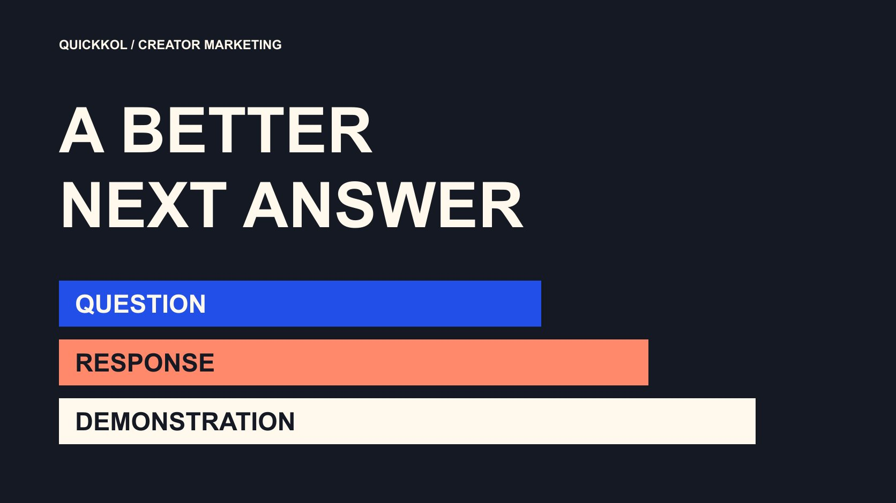
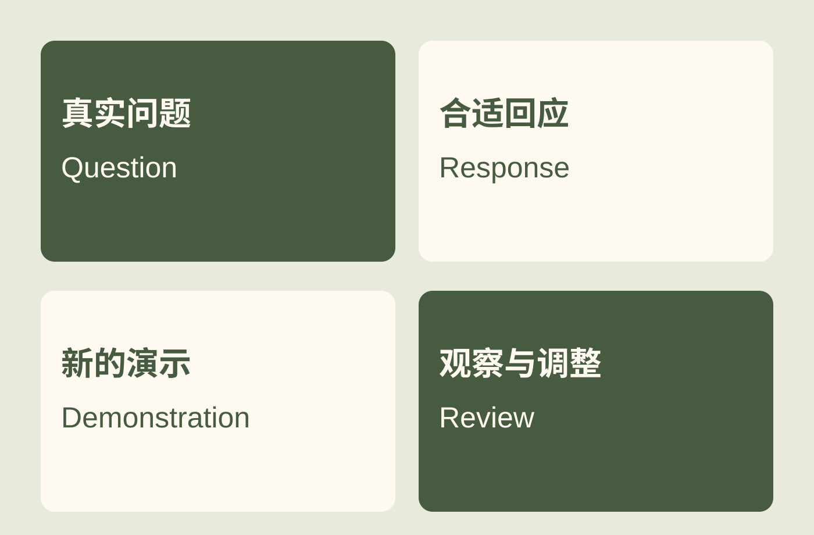

# TikTok 回应怎样改进下一次演示

状态：本地审阅稿；正式发布日期待确认。

把真实观众问题转成下一次有用的达人演示，区分内容回应、产品确认与客户服务，不用空泛互动诱导代替解释。

QuickKOL 编辑图形；不呈现真实账号指标或平台界面。

品牌希望增加 TikTok 上有意义的互动，可以让达人回答真实观众问题，并把适合公开解释的部分转成下一次演示。先判断问题需要内容、产品确认还是服务处理，再约定创作者工作与品牌支持。评论数量不是理解程度，也不能保证推荐。回应的价值在于让观众更容易完成判断，结果仍需在实际作品与观察条件中核对。

## 先选择值得回应的问题

不必回应每条内容，也不要先按点赞最多选择。找出与委托任务有关、可以提供有用解释的问题，例如一个必要步骤、使用条件或比较依据。

区分真正在问什么。观众可能需要演示，也可能想知道库存或个人订单。后两种不一定适合由达人制作视频回答，更不应为追求互动延迟实际服务。

[达人演示迭代方法](https://www.quickkol.com/zh/blog/tiktok-creator-strategy-demonstration-iterations/#answer)处理一段作品怎样逐步改进。本篇从发布后的具体问题出发，决定什么时候值得制作下一项内容，而不只是重复同一演示。

保留原问题的意思与来源，避免为了更好表演而改成观众没有提出的困惑。必要时概括共同问题，不公开与解释无关的个人信息。

## 推荐机制不提供回复公式

[TikTok 推荐机制说明](https://support.tiktok.com/en/using-tiktok/exploring-videos/how-tiktok-recommends-content?traffic_source=Direct)列出用户互动、内容与用户信息等因素，并说明观看等互动对多数用户具有重要作用。它不提供一个可保证结果的评论次数或回复频率。

因此，不能因为平台考虑互动，就把更多评论直接写成更多推荐。评论可能来自清楚问题、争议或重复，不同语境不能只按总量判断。

品牌可以努力提高解释价值与相关性，但不要要求创作者保证算法反应。也不要让团队为了达到计数目标，选择故意缺少关键信息的表达来诱发更多追问。

将平台机制作为背景，把工作任务留在可执行范围。需要检查的是回应是否准确、有用、与原问题有关，以及后续观察能够支持什么。

## 先把产品依据交给创作者

若问题涉及产品条件，品牌需要提供确认信息与限制，而不是只要求达人“回复得更积极”。实际体验由创作者说明，品牌事实由相应负责人确认。

不确定的问题可以先记录并交接。及时说明正在核对，与编造一个答案不同；但也不要让“待确认”无限停留而没有负责人。

对超出原委托的新内容，明确制作、审稿、发布与用途范围。一个评论出现不意味着创作者自动接受拍摄额外视频或长期客服。

把确认内容与原问题连接，方便下一位审稿人看懂为什么这样回应。这样可以减少反复传话，也让产品限制不在制作过程中被一层层删掉。

## 为新演示安排独立价值

新的回应内容应让没有看过原帖的人也能理解主要问题，同时保留与原作的关系。必要背景用清楚短句说明，不要求观众先在多个页面来回寻找。

如果问题需要动作，展示关键前提与过程；如果只需要一个明确事实，可以使用更合适的简短回应，不为增加视频数而制造无关演示。

假设观众不理解某项设置何时适用，下一次可以比较适合与不适合的条件，而不是重新朗读产品介绍。这是编辑情境，不是实测效果。

让创作者选择适合表达的方式，同时核对事实与用途。回应不需要与原片完全同样风格，但不能因为脱离原语境而扩大产品承诺。

先判断问题需要什么，再决定是否制作下一次内容。

## 商业回应仍有商业语境

[TikTok 商业内容说明](https://support.tiktok.com/en/business-and-creator/creator-and-business-accounts/promoting-a-brand-product-or-service?from=HN)要求推广品牌、产品或服务的内容使用相应披露设置，包括自有业务与第三方合作。回应形式不自动改变内容的商业性质。

按实际项目与账号核对设置和表达，不声称每个界面完全相同。若通过项目平台发布，也确认实际工作条件，而不只凭看到一个标签推断所有要求已经完成。

披露与产品依据分别处理。说明合作关系后，仍不能让创作者声称未发生的体验，或把待确认产品答案讲成肯定事实。

如果品牌后续希望把回应作为广告使用，另行确认用途和许可。一次帮助解释问题的自然回应，不自动包括所有未来商业改编。

## 把管理工具当作工作入口

[TikTok Studio 发布说明](https://newsroom.tiktok.com/helping-creators-bring-creativity-to-life-with-tiktok-studio?lang=en)在 2024 年介绍创作、管理与分析工具，以及对已发布与排期内容的管理。这是产品推出资料，不代表本文在每个账号内测试了所有功能。

用实际可用工具保留作品、问题与负责人。不要因为平台提供统计，就假设能知道每位观众如何理解；也不要求创作者共享与任务无关的全部后台。

可以记录选中了什么问题、依据由谁确认、回应何时完成，以及后续是否仍有同类疑问。字段应服务决定，而不是因为工具能显示就全部导出。

若工具或功能不可用，使用合适记录与交接仍可继续工作。核心是问题与回应关系清楚，不是一定要使用某个仪表盘。

## 复盘回应质量与观察结果

先看是否回答了原问题、是否保留条件、是否有人接手非内容事项。然后再看实际观看与互动，并保留窗口、对象和同期分发背景。

评论多不必然更好，评论少也不必然说明没有帮助。观众可能得到答案后不继续互动；需要研究理解时，应采用适当方法，而非猜测沉默。

可以将新问题作为下一轮输入，但不要让每次回应都无限生成新义务。按相关性、资源与实际价值决定是否继续。

[社媒 KPI 决策方法](https://www.quickkol.com/zh/blog/social-kpi-creator-decision-contract/#answer)帮助约定什么发现会引发什么行动。结论可以是继续某种解释、修正前提或交给产品团队，不必始终增加发布量。

## 让下一次互动有明确用途

交接时留下原问题、回应依据、实际作品、用途与未解事项。让接手人知道下一步该解释什么，而不是只看到“提高互动”的目标。

QuickKOL 可以帮助理解新的 Brief、研究适合讲解任务的达人并准备联系；产品事实、账号功能、合作条件与结果仍需核对。它不因推荐机制讨论而被描述为保证 TikTok 增长的系统。

创作者回应可以让品牌与观众之间的理解更清楚，但需要真实问题、准确信息和合理分工。它不是一种随意增加评论数的技巧。

在这些条件下，互动才成为持续内容工作的输入。品牌获得可执行学习，创作者保留清楚范围，观众得到与自己问题相关的解释。

## 问题应交给谁

| 问题 | 合适动作 | 主要责任 |
| --- | --- | --- |
| 看不懂步骤 | 补充准确演示 | 创作者与事实负责人 |
| 条件未确认 | 核对产品依据 | 品牌产品团队 |
| 个人服务问题 | 转入适当渠道 | 品牌服务团队 |
| 无关或重复内容 | 按相关性决定 | 内容负责人 |

编辑回应框架，不保证推荐或增长。

## 确认下一次回应

让互动服务真实理解。

- [ ] 保留实际问题意思。
- [ ] 区分内容、产品与服务。
- [ ] 提供已确认的回答依据。
- [ ] 约定新增内容与用途。
- [ ] 核对商业语境与账号条件。
- [ ] 用有限观察决定下一步。

## 研究日期与使用边界

资料核验于 2026 年 11 月 20 日。文中方法、表格和决策规则为编辑建议，标为假设的示例不是实际客户结果或行业基准。外部资料的适用地区与时期按各段说明。

## 从任务开始达人研究

用 QuickKOL 理解 Brief、发现相关达人并研究作品与联系路径；数据、合作条件和结果仍需核验。

[了解 QuickKOL](https://www.quickkol.com/#capabilities)

## 来源

- [TikTok 推荐机制说明](https://support.tiktok.com/en/using-tiktok/exploring-videos/how-tiktok-recommends-content?traffic_source=Direct)
- [TikTok 商业内容说明](https://support.tiktok.com/en/business-and-creator/creator-and-business-accounts/promoting-a-brand-product-or-service?from=HN)
- [TikTok Studio 发布说明](https://newsroom.tiktok.com/helping-creators-bring-creativity-to-life-with-tiktok-studio?lang=en)
