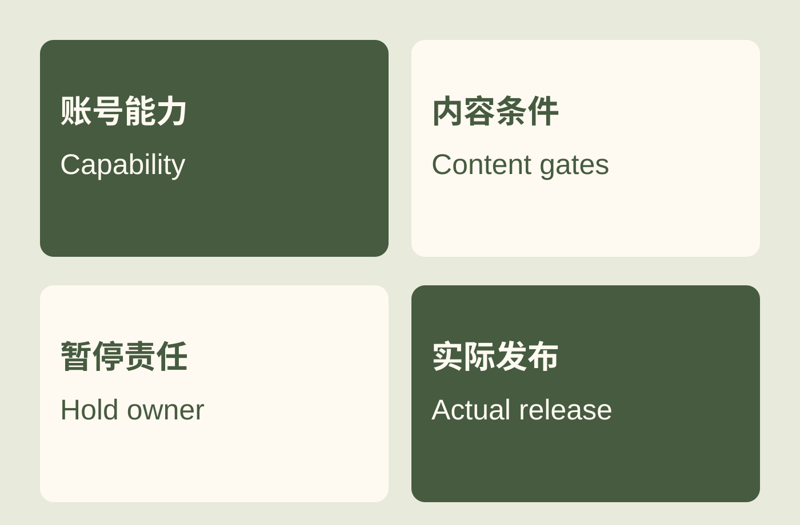

# Can You Schedule TikTok Posts? Check Release Gates

Status: local review draft; confirm the publication date before release.

Check actual TikTok scheduling capability, then confirm creator assets, disclosure, hold responsibility and release outcome.

TikTok has offered web scheduling and Studio content management, but suitability for this collaboration depends on the actual account, region, entry point and post type. Confirm a scheduling option exists, then check assets, commercial disclosure, usage and release responsibility. A time range in an older guide is not a universal limit for every current account. Entering a queue is also not publication: assign someone to hold the release if conditions change, and inspect the actual post and destination at the agreed time.

## Check the actual account capability first

[TikTok Studio’s launch explanation](https://newsroom.tiktok.com/helping-creators-bring-creativity-to-life-with-tiktok-studio?lang=en) describes creation, management and analysis, including published and scheduled content. It supplies feature background rather than proof that every account has the same menu today.

Ask an authorized person to confirm the current entry point, supported post type and available options. Do not promise automatic publication when scheduling is unavailable, and do not share personal passwords just to inspect it.

The [creator posting-schedule and capacity method](https://www.quickkol.com/blog/creator-posting-schedule-production-capacity/#answer) addresses production planning. This article follows content approaching a queue: when it can be released and which changes require a hold.

Record the capability actually observed and its date. Public research without a signed-in check should not become an account-test conclusion. If the option is unavailable, arrange a responsible publication process instead of inventing a completed setup.

This check should happen before the creator commits to a delivery plan that relies on unattended release. The question is specific: can this account prepare this kind of post through this route? A general statement that the platform has scheduling is useful background, but it cannot answer every operational dependency of the brand’s particular collaboration.

## Do not turn a historical window into a universal limit

[TikTok’s web-scheduler explanation](https://ads.tiktok.com/business/en-US/blog/introducing-video-scheduler-now-you-can-plan-tiktoks-in-advance) describes a particular scheduling window, time-zone behaviour and revision process. Retain that context instead of applying its numbers to every current Studio version and account.

For a project needing a long lead time, have the operator inspect the actual selectable dates and ability to retain or revise a queued item. An unchecked condition should remain a question rather than enter a promise to the creator.

Confirm local time, publication location and the time zone used in the agreement. Tomorrow morning is not enough when people in different regions may interpret it differently.

Interfaces and capabilities can change, so update the operational record with the arrangement. An older guide helps identify what to check; an old screenshot does not establish today’s account state.

The useful result is a clear release time with an accountable operator. If a feature cannot support that plan, change the plan explicitly. Avoid compensating for uncertainty by listing more historical specifications, because additional detail from the wrong context can make an inaccurate instruction look more authoritative without making it usable.

## Queue the version that was actually approved

Establish a clear final version containing the video, copy, cover, relevant links and commercial information. Similar filenames do not prove identical content; the operator needs to compare the actual version.

When a number or condition changes after review, confirm that the old queued item has been replaced or cancelled. Updating a shared folder alone can leave outdated work awaiting automatic release.

Content clearance needs a basis: important facts checked, media use consistent with the agreement and necessary claims within support. Passing a creative review does not automatically answer those questions.

Imagine two edits: one tests an opening and the other is approved for publication. Choose the identified release version instead of guessing from modification time. This is an editorial operational example, not a real client incident.

The process need not create an elaborate approval bureaucracy. A concise record of the final file and accompanying text can be sufficient when the responsible people can locate and compare them. What matters is preventing one person’s final from silently meaning a different asset to the person who enters the post into the queue.

## Check commercial settings in the publication route

[TikTok’s web-disclosure instructions](https://ads.tiktok.com/resources/help/article/how-to-turn-on-the-commercial-content-disclosure-setting-in-tiktok?lang=en-GB) describe commercial-content settings in the web upload route and selection of the relevant brand relationship. They do not establish identical feature combinations across every publication route.

Confirm the applicable settings in the actual entry point rather than inspect only whether the video contains a brand name. The content, commercial relationship and system setting need to agree. Successful scheduling does not itself confirm disclosure.

For work managed through TikTok One, inspect the corresponding project explanation and actual state instead of guessing how it will be handled. This article has not operated a user account or enabled a switch for a particular post.

If a necessary setting cannot be completed, hold the release and find an appropriate resolution. Do not remove the commercial relationship or obscure it with vague wording just to meet a time.

That check belongs before the item is treated as ready. It helps the brand and creator avoid discovering at the publication deadline that the approved copy assumes one relationship while the selected publishing route represents another. The resolution should reflect the real collaboration and available account controls.

## Check music, media and destination conditions

A sound being publicly audible does not establish permission for this commercial collaboration. Check rights and applicable platform conditions for the actual use rather than convert a creator’s everyday experience into brand advertising authorization.

Record media permission separately from publication capability. A system accepting a file establishes certain technical conditions; it does not consent for every rights holder or commercial party.

Inspect the destination, offer conditions and necessary information as well. A video can appear on time while the linked page remains outdated, leaving the collaboration task incomplete.

Do not make the creator responsible for factual confirmation the brand has not completed internally. Identify who supplies reliable conditions, who checks the destination and who handles changes before clearing publication.

This is a useful place for a proportionate final check. The team need not repeat every creative discussion, but it should verify dependencies that could make the finished content misleading or unusable at release. The post and its destination form one audience journey even though different people may own the two parts.

Confirm queue state and actual release separately.

## Assign responsibility for holding a release

After scheduling, prices can change, an event can be cancelled, a fact can require correction or a media issue can emerge. Define who can request a hold, who operates the queue and how the changed state is confirmed.

Avoid everyone assuming someone else will act. The responsible person needs the relevant schedule record and an identified backup when unavailable; this does not require everyone’s account access.

The [Facebook creator schedule-change method](https://www.quickkol.com/blog/facebook-creator-schedule-change-dependencies/#answer) likewise connects content, queue and destination. A multi-platform project requires separate checks rather than assume cancelling one service stops every queue.

A hold is a concrete state, not only a message saying wait. Confirm the affected post and next arrangement, then notify relevant participants so an older version does not remain accepted as valid delivery.

This makes the release plan resilient to ordinary changes without promising that every unexpected event can be prevented. The team knows how to stop an unsuitable publication, which evidence confirms the action and who can decide when a revised item is ready. Those responsibilities matter more than the mere existence of an automatic scheduler.

## Inspect the actual post after release

At the agreed time, inspect public state, actual version, disclosure, destination and playback. A successful scheduling message and actual publication are different evidence. A queue screenshot should not become a release report.

If nothing appears, inspect the state and notices before retrying. Repeated uploads can create several versions without explaining what happened to the original queued item.

For an incorrect version or condition, decide on correction, holding later promotion or contacting the responsible party according to the actual issue. Retain timing rather than rewrite a later correction as though no problem occurred.

Observe performance separately. Successful publication does not guarantee reach, interaction or orders. Fewer views than expected do not automatically show the scheduler failed. Report operational and content outcomes separately.

This distinction also makes troubleshooting more efficient. The operator can resolve a failed release while the creative reviewer examines audience response to a correctly published work. Combining the two into one success score obscures which person can act and encourages unsupported explanations when the visible results differ from the campaign’s expectations.

## Hand over an executable release arrangement

The handover includes actual publishing route, confirmed version, explicit time zone, content conditions, hold responsibility and post-release inspection. Each item refers to a real action rather than a catalogue of unrelated historical features.

If the plan changes to manual publication, confirm operator and time again instead of reporting an automatic queue as still active. File delivered, scheduled, published and inspected should remain distinct descriptions.

QuickKOL helps research potential partners and relevant work; scheduling and account settings require confirmation on the actual platform. This article offers a working method, not a claim that a tool has operated or taken over the brand’s account.

Good scheduling releases the creator’s correct version under suitable conditions, with someone able to act when those conditions change. Technical capability is one part; clear responsibility and actual state make the arrangement executable.

A short final record can achieve this when it connects the approved work to the release and its owner. It gives the next person enough context to continue the collaboration without guessing whether a file is merely ready, already queued or actually visible to its intended audience.

## Four states in scheduling

| State | Evidence | Next action |
| --- | --- | --- |
| Delivered | Identified file and copy | Check release conditions |
| Scheduled | Actual queue and time | Retain hold responsibility |
| Hold needed | Change and affected content | Confirm queue change |
| Published | Actual post and destination | Inspect version and later performance |

Editorial operational states, not universal platform interface labels.

## Check before scheduling release

Connect each item to a real owner.

- [ ] Confirm account support for this post.
- [ ] Check final assets and copy.
- [ ] Confirm disclosure and usage conditions.
- [ ] State time and time zone.
- [ ] Assign hold operator and backup.
- [ ] Inspect actual version and destination after release.

## Research date and limitations

Sources reviewed November 20, 2026. Methods, tables and decision rules are editorial recommendations. Hypothetical examples are not actual client results or industry benchmarks. Source geography and periods are specified where relevant.

## Start creator research with a clear task

Use QuickKOL to interpret a brief, discover relevant creators and research their work and contact routes. Verify data, commercial terms and outcomes at their source.

[Explore QuickKOL](https://www.quickkol.com/#capabilities)

## Sources

- [TikTok Studio’s launch explanation](https://newsroom.tiktok.com/helping-creators-bring-creativity-to-life-with-tiktok-studio?lang=en)
- [TikTok’s web-scheduler explanation](https://ads.tiktok.com/business/en-US/blog/introducing-video-scheduler-now-you-can-plan-tiktoks-in-advance)
- [TikTok’s web-disclosure instructions](https://ads.tiktok.com/resources/help/article/how-to-turn-on-the-commercial-content-disclosure-setting-in-tiktok?lang=en-GB)
