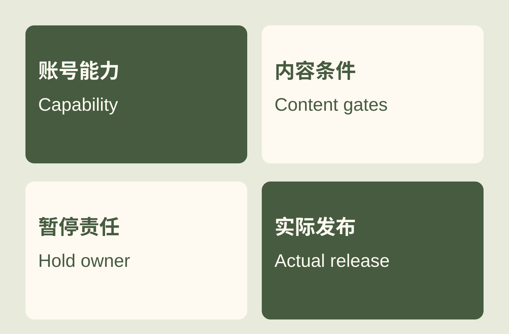

# TikTok 排期怎样设置发布关口

状态：本地审阅稿；正式发布日期待确认。

TikTok 内容能否排期，先看实际账号能力，再为合作素材、披露、暂停与发布结果设置确认。

TikTok 提供过网页排期及 Studio 内容管理功能，但能否用于本次合作，要核对实际账号、地区、入口与帖子类型。先确认排期选项真实存在，再完成素材、披露、用途与发布责任检查。历史说明中的时间范围不是所有现行账号的统一限制。排入队列也不等于已发布：为需要暂停的变化指定负责人，并在约定时间检查实际帖子与目的地。

## 先核对账号中的实际能力

[TikTok Studio 发布说明](https://newsroom.tiktok.com/helping-creators-bring-creativity-to-life-with-tiktok-studio?lang=en)介绍创作、管理和分析能力，也涉及已发布与排期内容。它是功能背景，不能证明每一个账号在今天都有相同菜单。

请有权限的人确认当前入口、可用帖子类型与实际选项。不要在排期不可用时仍向创作者承诺自动发布，也不需要为了检查而共享个人密码。

[达人发布排期与产能方法](https://www.quickkol.com/zh/blog/creator-posting-schedule-production-capacity/#answer)先解决制作安排。本篇继续处理已经准备排入队列的合作内容，确认何时可放行，何种变化需要暂停。

记录实际看到的能力和日期。未登录核验的公开研究不能写成账号测试结论；当入口不可用时，可以重新安排有责任人的发布流程，而不是虚构已经设置完成。

## 不要将历史窗口写成现行统一限制

[TikTok 网页排期说明](https://ads.tiktok.com/business/en-US/blog/introducing-video-scheduler-now-you-can-plan-tiktoks-in-advance)曾给出特定时间范围、时区与修改方式。使用这类资料时保留背景，不把其中的数字当作所有 Studio 版本和账号的现行规则。

如果本次项目需要较长提前量，由操作人检查实际可选时间，并确认队列保留与修改能力。无法核对的条件写成待确认，而不是直接放入给达人的承诺。

确认本地时间、发布地与项目约定使用的时区。不要只在沟通里写“明天上午”，却让不同地区的人各自理解。

界面与能力可能变化，实际检查记录应随安排更新。排期说明的价值是提出需要核对的问题，不是让旧截图代替今天的账号状态。

## 让排队版本对应最后确认内容

建立一个清楚的最终版本，包含视频、文案、封面、有关链接和适用商业信息。文件名相近并不能证明内容一致，操作人需要对照实际版本。

如果审稿后又修正数字或条件，确认旧队列是否已被替换或取消。不要只更新共享文件夹，却留下旧稿等待自动发布。

内容放行应有明确依据：重要事实已核对，素材使用符合约定，必要主张没有超出支持范围。通过创意审稿不自动回答这些问题。

假设创作者交付两个剪辑，一个用于测试开头，一个才是确认版。应选择明确的发布版本，而不是用修改时间猜测。这是编辑操作示例，不是某个实际客户的发布事故。

## 在实际发布路径检查商业设置

[TikTok 网页商业披露步骤](https://ads.tiktok.com/resources/help/article/how-to-turn-on-the-commercial-content-disclosure-setting-in-tiktok?lang=en-GB)列出网页上传中的商业内容设置，并说明相关品牌关系选择。它不证明所有发布路径都支持完全相同的功能组合。

在本次实际入口确认适用设置，不只检查视频文件里是否出现品牌名。内容表达、合作背景和系统设置需要相互一致，不能靠排期成功推定披露已经完成。

如果项目经由 TikTok One 管理，核对对应项目说明与实际状态，不重复猜测平台会怎样处理。本篇没有操作用户账号，也不声称已为某一帖子打开开关。

遇到无法完成的必要设置时，先暂停并找适当处理方式。不要为按时发布而删掉合作关系，或用含糊文案掩盖实际商业安排。

## 检查音乐、素材与目的地条件

作品里可以公开听到的声音，不等于自动允许用于本次商业合作。依据实际用途核对所需许可和适用平台条件，不将创作者日常使用经验直接变成品牌广告授权。

素材许可与发布能力分开记录。系统接受文件只说明达到某些技术条件，不能替所有权利人与合作方作同意。

同样检查链接目的地、活动条件和必要信息是否准备好。视频可以按时发出，但若观众到达的页面仍是旧状态，合作任务并未完整实现。

不要让创作者承担品牌内部尚未完成的事实确认。明确由谁提供可靠条件、谁最后核对链接、谁处理目的地变化，再决定内容是否可以放行。

队列状态与真实发布要分别确认。

## 给暂停发布安排一个责任人

排期后可能出现价格变化、活动取消、事实更正或素材问题。写清谁可以提出暂停、谁实际操作以及怎样确认队列已经改变。

不要让每个人都以为别人会处理。负责人应能看到本次排期记录，并知道在自己无法响应时由谁接替；这不是索取所有人的账号权限。

[Facebook 合作排期变更方法](https://www.quickkol.com/zh/blog/facebook-creator-schedule-change-dependencies/#answer)也强调同步内容、队列与目的地。跨平台项目需要分别检查，不因取消了一个平台就默认其他队列一起停止。

暂停是一种具体状态，不是聊天里的一句“先等等”。确认实际受影响的帖子和后续安排，并通知与本次任务有关的人，避免旧版继续被当作有效交付。

## 发布后检查真实帖子

到约定时间检查公开状态、实际版本、披露、链接和播放情况。排期成功提示与真实发布是不同证据，不能把队列截图直接用作上线报告。

若未出现，先查看实际状态与通知，再处理重试。不要连续重复上传，造成多个版本同时存在，却仍不知道原队列发生了什么。

如果版本或条件有误，按实际问题决定修正、暂停后续推广或与负责方沟通。保留发生时间，不将后来改正的结果写成从未出现问题。

作品表现另行观察。顺利发布不保证触达、互动或订单；未获得期待的观看量，也不自动证明排期工具没有工作。分别报告操作结果与内容结果。

## 交接一个可执行的发布安排

最终记录包括实际发布入口、确认版本、明确时区、内容条件、暂停责任与发布后检查。每项都指向现实操作，不需要堆砌与本次无关的历史功能清单。

若改用手动发布，重新确认操作人与时间，不把它写成自动队列仍在工作。交付文件、已排期、已发布和已检查应分别表述。

QuickKOL 可帮助研究合作对象与相关作品，排期和账号设置仍需在实际平台确认。本文提供工作方法，不声称工具已经替品牌操作或接管账号。

好的排期让创作者的正确版本在合适条件下发布，并且有人能在条件变化时行动。技术能力只是其中一部分，清楚的责任与真实状态使整个合作安排可以执行。

## 排期中的四种状态

| 状态 | 对应证据 | 下一步 |
| --- | --- | --- |
| 交付完成 | 明确文件与文案 | 核对发布条件 |
| 已排期 | 实际队列与时间 | 保留暂停责任 |
| 需要暂停 | 变更与受影响内容 | 确认队列改变 |
| 已发布 | 实际帖子与目的地 | 检查版本与后续表现 |

编辑操作状态，不是所有平台的统一界面用语。

## 排期前放行检查

让每一项对应现实负责人。

- [ ] 确认实际账号支持本次帖子。
- [ ] 核对最终素材与文案。
- [ ] 确认适用披露与使用条件。
- [ ] 明确时间与时区。
- [ ] 指定暂停操作人与接替人。
- [ ] 发布后检查实际版本和目的地。

## 研究日期与使用边界

资料核验于 2026 年 11 月 20 日。文中方法、表格和决策规则为编辑建议，标为假设的示例不是实际客户结果或行业基准。外部资料的适用地区与时期按各段说明。

## 从任务开始达人研究

用 QuickKOL 理解 Brief、发现相关达人并研究作品与联系路径；数据、合作条件和结果仍需核验。

[了解 QuickKOL](https://www.quickkol.com/#capabilities)

## 来源

- [TikTok Studio 发布说明](https://newsroom.tiktok.com/helping-creators-bring-creativity-to-life-with-tiktok-studio?lang=en)
- [TikTok 网页排期说明](https://ads.tiktok.com/business/en-US/blog/introducing-video-scheduler-now-you-can-plan-tiktoks-in-advance)
- [TikTok 网页商业披露步骤](https://ads.tiktok.com/resources/help/article/how-to-turn-on-the-commercial-content-disclosure-setting-in-tiktok?lang=en-GB)
