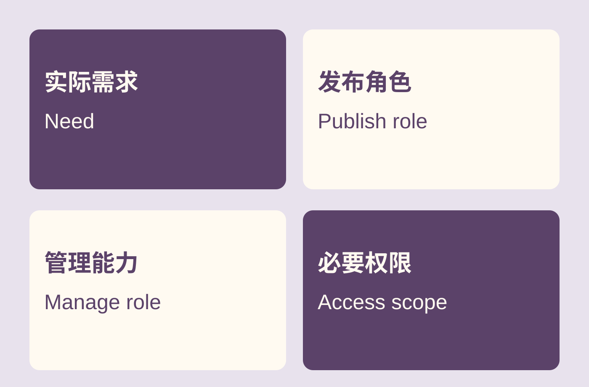

# Get a YouTube Channel for a Defined Creator Job

Status: local review draft; confirm the publication date before release.

When a creator project needs YouTube access, distinguish publishing, collaboration, management and ownership before requesting a channel or permissions.

To create a YouTube channel, follow the official flow on a computer or mobile website: sign in, use the account settings to create a channel, and confirm profile details including name and handle. Before doing that for a creator project, ask whether the job actually needs a new channel or a particular publishing, viewing or collaboration capability on an existing one. Creating, managing and owning a channel are distinct from permission to use creator work. Match the request to the task and have the appropriate account owner confirm it.

## State the job before requesting a channel

Give me a YouTube channel can describe several needs: a new public entity, publication on an existing channel, production participation or access to particular information. These do not require identical permissions or working arrangements.

[YouTube’s channel-creation guide](https://support.google.com/youtube/answer/1646861?hl=en-ca) distinguishes a Google Account used for watching and subscribing from the channel needed for public activities such as uploading. A staff member’s existing Google login does not establish that the brand’s publishing identity is ready.

Write the output, recipient and period of use. One creator video may belong on an existing channel or need a brand series destination. A different project name alone does not justify another account.

The [channel-continuity method](https://www.quickkol.com/blog/make-youtube-channel-creator-account-continuity/#answer) concerns arrangements after creation. This article works earlier, helping the team make a clear internal request so an account owner knows what to supply instead of receiving an undefined request for login access.

The request should describe an action someone can perform and a result someone can review. That gives the team a basis for deciding whether a new channel is necessary, whether an existing channel can serve the task or whether the creator can deliver material without any access to the brand’s account.

## Separate public identity from working capability

Public name, handle, entity description and work roles should match the actual brand or creator relationship. Someone able to open the backend is not automatically the public author or representative for this assignment.

If a brand sponsors work on an existing creator channel, it does not necessarily need control of that channel. A defined delivery and review arrangement can support the partnership while account control remains with the creator’s established setup.

If a brand channel hosts creator work, confirm attribution, publisher and future maintenance. A creator appearing on screen should not make viewers or colleagues think channel ownership transferred.

Likewise, a new channel supplies a public publishing object without automatically supplying an audience, trust or commercial eligibility. Describe the task rather than treating creation as a campaign result.

This distinction improves the request because it separates what the public sees from what an operator must do. The team can agree an accurate identity treatment and a proportionate working capability without assuming the same person must own, present, publish, moderate and maintain every part of the project indefinitely.

## Request capability through actual actions

List actual actions: upload a sample, edit a description, publish, inspect a report, answer comments or manage permissions. Define object and period for each instead of writing administrator.

[YouTube’s channel-permission guide](https://support.google.com/youtube/answer/9481328?hl=en) describes delegation without sharing a Google Account password and distinguishes role capabilities. Use the current guide and actual account rather than guessing that a role name applies identically to every device and feature.

Someone reviewing wording may not need backend access. Someone producing files may need only a delivery route. Choose an appropriate way to complete the job instead of habitually requesting the broadest access.

The account owner still needs to understand who receives access and what it enables. This article concerns how to make the request; it does not replace actual authorization or require transfer of an account for a short assignment.

Describe a capability in terms of the work it supports. That makes the request easier to assess and later close. It also helps identify cases where an operational limitation requires a different workflow, rather than leading the team to assume that increasingly broad access will solve a problem unrelated to permissions.

Define the job before requesting the capability needed to perform it.

## Verify the actual object after creation

If a new channel is required, have the appropriate owner create it through the official flow and confirm name, handle and channel URL. Public details should identify the actual entity rather than carrying a temporary test name into a partnership release.

Distinguish personal-channel arrangements from business or other naming options through the current guide and actual account conditions. An illustrative tutorial route should not become a promise of identical menus for every user, and the team should not claim it performed actions in an account it has not used.

After creation, verify a small reversible operation: the correct channel, suitable role and draft location, for example. Public test publication is not necessary merely to prove setup.

Record the result and capabilities not yet checked. Uploading does not establish every publishing, reporting or partnership feature. If a limitation appears, revise the task or have the owner investigate rather than hold the creator to an impossible condition.

A concrete setup record is useful because it separates a successful administrative action from readiness for the full commission. The next operator can see which parts are available and which still need confirmation before production depends on them.

## Rehearse the collaboration through one task

A rehearsal should resemble the real work while avoiding unnecessary public actions. Check how a sample is delivered, who reviews it, how changes return to production and how the final file connects to approval.

Imagine an internal brand editor routing a creator’s file for review while an account operator handles publication. They do not need one shared login, and everyone does not need publishing access. This is an editorial workflow example, not a permission plan for a particular organization.

If channel information is shared, define recipient scope. [YouTube’s Media Kit guide](https://support.google.com/youtube/answer/11322980?hl=en) reminds creators to consider the recipient of shared data. A downloadable report is not automatically intended for every project participant.

Write rehearsal findings back into the request: a missing file, role or confirmation. The exercise should reduce uncertainty rather than become an aimless tour of the backend.

This gives the brand something reviewable before the deadline depends on the arrangement. The team can identify a practical mismatch and correct the workflow without claiming that the entire channel configuration has been audited or that every feature will behave the same way during the eventual public release.

## Separate channel operation from media permission

The ability to publish a file does not establish permission to use it. Creator work, external footage, music, brand marks and identity treatment need suitable conditions of their own. An account role cannot answer for them.

Separate file readiness, content approval, usage confirmation and scheduling in the delivery record. An operator seeing final should know the scope it refers to rather than assume permanent cross-channel use.

Define who requests changes. The brand needs to check facts and task fit; the creator needs to understand whether new expression changes their actual contribution. Uploading to a brand channel does not erase those relationships.

If a changed task requires added usage or production, explain it and confirm the arrangement first. Backend access is one condition for executing work, not authorization to expand every commercial boundary.

This distinction keeps the channel request proportional. It can solve an operational need while leaving the substantive partnership agreement intact. It also helps the account owner decide when a file is ready to act on without being expected to infer licensing conditions from a folder name or from the fact that a technically valid upload succeeded.

## Assign unresolved readiness questions

A channel request may wait because identity, role, capability or delivery material is unconfirmed. Record reasons separately so the person able to resolve each can act, rather than labelling every issue creator incomplete.

Define conditions for publication: correct channel, executable role, approved file and appropriate usage, for example. These are editorial working gates, not a claim that the platform will automatically prevent every mistake.

The [channel-launch check method](https://www.quickkol.com/blog/create-youtube-channel-collaboration-launch-check/#answer) can support subsequent release preparation. It complements this internal request: establish the needed capability, then check the particular publication work.

Keep actual dependencies with delivery dates. If access is delayed, do not report the content as already published. File completion and pending platform action can be described separately.

This produces a more accurate status for the brand and a fairer assessment of the creator. A finished asset should not disappear into a generic blocked label, while a technically available channel should not make the project appear ready when the content or permission remains unresolved. The owner can then make a concrete decision about timing or an alternative route.

## Hand over a clear channel request

The final request should include public entity, actual work, object, required capability, period, owner and verification state. Use it to request a concrete next action instead of sending only a message asking for an account.

At task completion, handle access and maintenance under the actual arrangement. A short collaboration should not silently become permanent management. Channel and work ownership remain under the confirmed conditions.

QuickKOL can help interpret a channel-related brief, research creators suited to the task and prepare contact. Appropriate owners still confirm account configuration, access, usage and publication. Discovering a candidate does not mean channel creation has occurred.

Getting a channel is only the beginning. The brand needs it to serve a clear creator-partnership job, which requires an executable request rather than broader login access.

Preserve the request with the resulting channel or workflow record. Future teams can then understand why it exists and whether another task requires a change, without assuming that an old role assignment or a previously successful upload answers every question about a new commission.

## Different needs within a channel request

| Need | Confirm | Not automatically required |
| --- | --- | --- |
| Review material | Material and recipient | Publishing access |
| Produce files | Delivery and review | Account login |
| Publish work | Correct channel and role | Full account control |
| Create a public entity | Name, handle and responsibility | Guaranteed audience |

Editorial request table, not a replacement for account-level confirmation.

## Confirm the channel requirement

Give the account owner an executable request.

- [ ] Define public entity and actual task.
- [ ] Separate creation, publication and management.
- [ ] Request capability by action.
- [ ] Rehearse the collaboration appropriately.
- [ ] Check asset usage separately.
- [ ] Retain readiness gaps and owners.

## Research date and limitations

Sources reviewed November 20, 2026. Methods, tables and decision rules are editorial recommendations. Hypothetical examples are not actual client results or industry benchmarks. Source geography and periods are specified where relevant.

## Start creator research with a clear task

Use QuickKOL to interpret a brief, discover relevant creators and research their work and contact routes. Verify data, commercial terms and outcomes at their source.

[Explore QuickKOL](https://www.quickkol.com/#capabilities)

## Sources

- [YouTube’s channel-creation guide](https://support.google.com/youtube/answer/1646861?hl=en-ca)
- [YouTube’s channel-permission guide](https://support.google.com/youtube/answer/9481328?hl=en)
- [YouTube’s Media Kit guide](https://support.google.com/youtube/answer/11322980?hl=en)
