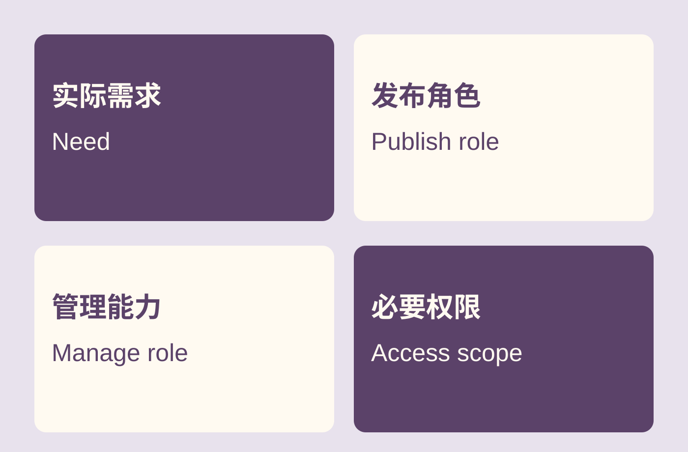

# 达人项目怎样提出频道需求

状态：本地审阅稿；正式发布日期待确认。

达人项目需要 YouTube 频道时，先区分发布、合作、管理与拥有，再提出能由账号负责人执行的需求，避免为一个任务索取整个账号。

要创建 YouTube 频道，可以按官方说明，在电脑或移动网站登录后，通过设置中的账号与创建频道流程确认名称、头像和 Handle。品牌达人项目在执行前还应先问：真正需要新频道，还是现有频道的发布、查看或协作能力？创建、管理、拥有频道与获得达人素材许可不同。让需求对应实际工作，再由适当账号负责人确认。

## 先说明需要频道做什么

“给我一个 YouTube 频道”可能是四种需求：建立新的公开主体、在既有频道发布、参与制作，或查看特定资料。它们不需要同样权限和工作安排。

[YouTube 频道创建说明](https://support.google.com/youtube/answer/1646861?hl=en-ca)区分可用于观看和订阅的 Google 账号，与公开上传等活动需要的频道。不要仅因工作人员已有 Google 登录，就认为品牌公开发布身份已经就绪。

先写输出、接收人和使用时期。一次达人视频可能适合在原有频道发布，也可能需要品牌自己的系列入口；不能只因项目名称不同就新增账号。

[频道持续维护方法](https://www.quickkol.com/zh/blog/make-youtube-channel-creator-account-continuity/#answer)处理创建后的延续安排。本篇更早，帮助内部团队提出一份明确需求，让账号负责人知道要提供什么，而不是收到一个范围不明的登录请求。

## 把公开身份与工作能力分开

公开频道名称、Handle、主体说明和作品角色，需要与实际品牌或创作者关系一致。工作人员能打开后台，不代表对方就是频道公开作者或本次合作代表。

如果是现有创作者频道，品牌希望赞助一篇作品，不必因此获得整个频道。可以通过明确的交付与审阅安排合作，账号控制仍按对方实际机制管理。

如果是品牌频道承载创作者作品，确认如何呈现实际贡献、由谁发布，以及未来谁维护说明。不要让创作者出镜被误读成频道所有权发生转移。

同样，一个新频道可以提供公开发布对象，却不自动建立受众、信任或商业资格。需求应说明要完成的任务，而不是把创建动作当成合作效果已经取得。

## 按实际动作提出权限需求

列出需要执行的动作：上传样片、修改说明、发布、查看报告、回应评论或管理权限。逐项说明对象与时期，避免只写“管理员”。

[YouTube 频道权限说明](https://support.google.com/youtube/answer/9481328?hl=en)提供不共享 Google 账号密码的分工机制，并区分角色能力。按当前官方说明和实际账号选择，不凭角色名称猜测所有设备和功能都适用。

对仅需审稿的人，可能不必进入后台；对只制作文件的人，交付路径也不必包含账号权限。选择能完成任务的适当方式，而不是习惯性索取最大权限。

账号负责人仍需理解授权对象和作用。本文描述怎样提出请求，不代替实际权限审批，也不要求团队为了一个短期任务转移整个账号。

先确定工作，再申请完成工作所需的能力。

## 创建流程之后核对实际对象

若确认需要新频道，由适当负责人按官方流程创建，并核对名称、Handle 与频道链接。公开资料应说明实际主体，不用临时测试名直接进入合作发布。

区分个人频道与使用商业或其他名称的安排，以官方当前说明和账号实际条件为准。不要把教程中的示例路径当成所有用户完全一致的菜单，也不虚构已经在用户账号执行。

创建后做一次小范围、可恢复的操作确认。例如核对正确频道、适当角色和草稿位置，不必为证明配置而发布公开测试内容。

记录创建结果与还没有验证的能力。能够上传不代表能完成所有发布、报告或合作功能；如果发现限制，先调整任务或由负责人继续核对，而不是让创作者承担无法完成的交付。

## 用一次任务演练确认协作

演练应与真实工作相似，但避免不必要公开动作。可以确认样片如何交付、谁查看、修改怎样回到制作人，以及最终文件如何与批准状态对应。

假设品牌内部编辑需要将达人文件送审，账号操作人负责最终发布。两者不必共享同一登录，也不必让所有人都拥有发布权限。这是编辑流程示例，不是特定组织的权限方案。

如果要共享频道资料，说明接收范围。[YouTube 媒体包说明](https://support.google.com/youtube/answer/11322980?hl=en)提醒创作者考虑资料接收者；不能因为某份报告可下载，就推断它可以发给每个项目参与人。

把演练发现的问题写回需求：缺少哪个文件、哪个角色或什么确认。它应帮助缩小不确定性，而不是变成一次没有结论的后台游览。

## 频道管理与素材许可分开

能发布文件不代表已经取得文件用途。创作者作品、外部画面、音乐、品牌标志和人物展示需要各自合适的条件，账号角色无法替它们作答。

在交付表中区分文件准备、内容批准、用途确认与排期。某位操作者看到“最终版”，仍应知道它对应什么范围，而不是默认可以长期跨渠道使用。

也明确谁可以提出修改。品牌需要核对事实和任务，创作者需要理解新增表达是否改变自己的实际贡献。不能因为素材上传到品牌频道就抹去这些关系。

如果任务变化导致额外用途或制作，先说明并确认。后台权限是执行工作的一项条件，不是扩大所有商业范围的授权。

## 把未就绪事项留给负责人

频道需求可能因为身份、角色、功能或交付材料未确认而暂缓。分别记录原因，让下一步由能解决的人处理，不把所有问题都写成创作者未完成。

明确什么条件满足后才可以发布。例如正确频道、可执行角色、已批准文件和实际用途条件。这里是编辑工作关口，不声称平台会替团队自动阻止所有错误。

[频道推出检查方法](https://www.quickkol.com/zh/blog/create-youtube-channel-collaboration-launch-check/#answer)可以作为后续发布准备。它与本篇的内部请求互补：先知道要什么能力，再核对具体上线工作。

对交付日期保留实际条件。若权限迟迟未到，不应在报告中写成内容已经发布；可以如实说明文件完成与平台动作仍待处理。

## 交付清楚的频道请求

最终请求应包含公开主体、实际工作、对象、所需能力、时期、负责人和验证状态。用这份记录提出具体下一步，而不是只发送一条索要账号的消息。

任务结束后按实际安排处理权限与维护，不将短期协作默默变为永久管理。频道和作品的归属继续按已确认条件保留。

QuickKOL 可以帮助理解频道相关 Brief、研究适合任务的达人并准备联系；账号配置、权限、用途和发布仍由相应负责人确认。工具发现不等于创建已经执行。

得到一个频道只是开始。让它服务清楚的达人合作工作，才是品牌需要管理的结果；这要求可执行需求，而不是更宽泛的登录权限。

## 频道请求中的不同需求

| 需求 | 确认 | 不自动需要 |
| --- | --- | --- |
| 观看资料 | 资料与接收范围 | 发布权限 |
| 制作文件 | 交付与审稿路线 | 账号登录 |
| 发布作品 | 正确频道与角色 | 整个账号控制 |
| 新建主体 | 名称、Handle 与责任 | 保证受众 |

编辑需求表，不替代账号内权限确认。

## 确认频道需求

给账号负责人一份可执行请求。

- [ ] 说明公开主体与实际任务。
- [ ] 区分创建、发布与管理。
- [ ] 按动作提出必要能力。
- [ ] 完成适当的协作演练。
- [ ] 单独核对素材用途。
- [ ] 保留未就绪条件与负责人。

## 研究日期与使用边界

资料核验于 2026 年 11 月 20 日。文中方法、表格和决策规则为编辑建议，标为假设的示例不是实际客户结果或行业基准。外部资料的适用地区与时期按各段说明。

## 从任务开始达人研究

用 QuickKOL 理解 Brief、发现相关达人并研究作品与联系路径；数据、合作条件和结果仍需核验。

[了解 QuickKOL](https://www.quickkol.com/#capabilities)

## 来源

- [YouTube 频道创建说明](https://support.google.com/youtube/answer/1646861?hl=en-ca)
- [YouTube 频道权限说明](https://support.google.com/youtube/answer/9481328?hl=en)
- [YouTube 媒体包说明](https://support.google.com/youtube/answer/11322980?hl=en)
