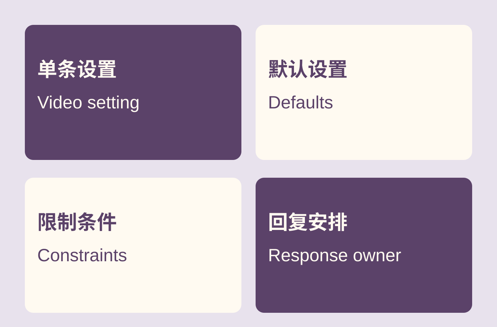

# Turn On YouTube Comments for a Creator Release

Status: local review draft; confirm the publication date before release.

Before enabling comments on a creator video, check video settings, constraints and response responsibilities.

On a computer, open YouTube Studio, select Content, open the video thumbnail, choose Show more, set comments under Comments and ratings, and save. First check that the video and account allow changes: made-for-kids videos, private videos and supervised experiences have relevant restrictions. Do not misclassify the audience to enable comments. Defaults affect new content rather than automatically changing existing videos. For a creator partnership, also assign moderation, product-question responses and follow-up so enabling the setting corresponds to work someone can actually perform.

## Use the individual video’s settings

[YouTube’s comment-setting guide](https://support.google.com/youtube/answer/9482556?hl=en) gives the computer route: Studio, Content, video thumbnail, Show more, then Comments and ratings and Save. When selecting an option that allows comments, review the required moderation choices too.

Before making a change, agree whether the request concerns this one release or a future default. The creator should understand the intended scope, and the operator should avoid changing unrelated videos merely because a broader control is easier to find. An authorized person should operate it and confirm the particular partnership video. Similar titles and multiple edits can lead to the wrong selection; a quick impression of the thumbnail is insufficient.

After saving, inspect the actual state before recording completion. This article follows public official steps and has not signed into the user’s channel or changed a setting.

The [creator engagement-response routing method](https://www.quickkol.com/blog/creator-engagement-response-routing/#answer) helps assign real questions. Prepare the technical setting and response work together instead of looking for a product owner only after comments arrive.

This gives the release team a practical sequence: identify the approved video, apply an available setting and verify the resulting state. A saved configuration is useful evidence of the operation, while the later public experience still needs its own check. Keeping those steps separate avoids reporting that the collaboration is ready merely because someone opened the correct settings panel.

## Respect audience and visibility constraints first

Some videos and accounts cannot use the ordinary comment-setting process. Made-for-kids content, private videos and supervised experiences should be handled according to their applicable constraints, without bypassing them to satisfy a brand engagement target.

Audience classification must reflect the content. Do not change an unsuitable classification simply to expose a comment section, or ask the creator to guarantee that comments can be enabled on every video.

For limited feedback before public release, assess a suitable review route. An unlisted link is not a strict confidentiality guarantee and should not justify casual distribution of sensitive partnership material.

Record the current constraint and workable alternative, then revise the affected response plan. If comments cannot be enabled, adjust the feedback method instead of filling the delivery table with a false success state.

This preserves the purpose of the setting rather than treating it as a technical obstacle to overcome. The collaboration can still have a clear review and audience-learning plan, but the plan must fit the actual video and account conditions instead of relying on a promise that the available controls cannot support.

## Distinguish defaults from existing work

Changing a default does not automatically update older partnership videos. For existing work, return to the relevant video. Establish scope before a bulk action so unrelated content is not affected.

Give the operator the target video and required state rather than a broad instruction to open the whole channel. The creator may have other content with different management needs; this partnership should not expand its scope without agreement.

Defaults can help later production remain consistent, but exceptions still need inspection. A template saying comments allowed does not prove every upload adopted that state.

Distinguish a changed default, an individual-video change and an inspected actual result in the final record. A reviewer can then see what is complete and what remains, rather than one settings done label covering different operations.

This is also helpful for a returning collaboration. The team should not assume that a previous project’s setup applies to the next video. It can reuse the agreed working approach while checking the new content’s real state, preserving efficiency without allowing a historical setting to substitute for current confirmation.

Confirm both the setting and capacity to handle questions.

## Choose moderation that fits response capacity

[YouTube’s comment-moderation explanation](https://support.google.com/youtube/answer/9483359?hl=en) distinguishes on, pause and off, with different review options. Held comments are not ordinarily public; the moderation queue is not a discussion everyone has already seen.

Choose an approach suited to the creator’s and team’s actual capacity rather than maximizing comment quantity alone. Define both moderation and public-response responsibility.

Automatic filtering can be mistaken. Review actual content rather than treat the system’s classification as established personal intent. Reasonable criticism, product questions and actual violations require different responses.

The brand can supply checked information and an appropriate escalation route without requiring every disagreement to disappear. Moderation should support safe, useful discussion rather than manufacture an appearance of universal praise.

This makes the chosen setting part of a realistic operating plan. If the team expects a queue to be reviewed, someone needs time and suitable judgment to do that work. If capacity changes, reassess the arrangement transparently rather than leave questions unhandled while reporting the mere presence of an enabled comment section as successful community engagement.

## Separate content, product and service questions

Viewers may ask about a demonstrated step, product conditions or a particular order. The creator can explain their own process without necessarily deciding brand policy or accessing customer records.

Agree which questions the creator answers and which go to product or service owners. Use an appropriate route for personal information instead of having people publish sensitive details in public comments.

Supply concise checked facts while allowing the creator their own expression. Do not require unsupported statements or treat I need to verify that as failed engagement.

Repeated genuine questions may inform a later demonstration. First decide whether the issue needs new explanation, factual correction or service handling instead of giving every comment the same sales reply.

That distinction connects comment management to the actual creator task. An unclear step in a tutorial belongs with the explanation; an order-specific problem belongs elsewhere. The audience can receive a more useful response, and the creator avoids being made responsible for information or decisions outside the experience and authority the partnership actually gives them.

Distinguish explanation, product and service questions before assigning responses.

## Use suitable permissions instead of shared passwords

[YouTube’s channel-permission guide](https://support.google.com/youtube/answer/9481328?hl=en) supports delegated access by role without providing the Google Account login. Check actual role and feature support instead of treating team member as unlimited access.

If the brand only needs to supply product answers, define a collaboration route first; it may not need control of the channel. The creator’s other content and partnerships should not become visible to unnecessary people merely because this task exists.

The operator and commercial decision-maker may also differ. Managing some content does not automatically establish authority to sign, expand usage or guarantee outcomes for the creator.

Review access and responsibility at the end of the partnership as agreed. No collaborator has been invited for the user here. This is a task-allocation method, not a report of changed account permissions.

The appropriate arrangement gives people enough capability for their actual work and a clear route for questions beyond it. It avoids using broad account access as a substitute for deciding who should answer a product question, review a difficult comment or approve a change in the collaboration’s commercial scope.

## Review settings and interaction separately after release

After release, inspect whether the target video has the intended comment state and whether moderation and response work have owners. Where needed, check the saved record; one backend screenshot does not establish the entire public outcome.

Few comments do not automatically show the switch failed. Many comments do not establish agreement or purchase intent. Inspect technical state first, then examine actual questions and content performance.

The [creator KPI decision-agreement method](https://www.quickkol.com/blog/social-kpi-creator-decision-contract/#answer) connects a measure to an action. Observe which questions need a clearer explanation without promising that comments will improve recommendation or produce orders.

For an apparent anomaly, preserve actual notices and state before using an appropriate resolution route. One fluctuation should not accuse the creator or justify removing conditions important to interpretation.

This produces a more useful report for the next commission. The team can distinguish a setting issue, a response-capacity issue and a content question. Each may need a different owner and remedy, rather than one engagement total encouraging the team to repeat an action whose actual effect it has never established.

## Connect enabled comments to real partnership responsibility

Hand over target video, actual setting, applicable constraints, moderation plan and response owners, marking what remains unchecked. Update the record if the arrangement later pauses or changes instead of allowing an older plan to circulate as current.

QuickKOL helps research creators able to explain relevant questions. Real channel operation, product facts, moderation and responses still require their responsible people; a research tool has not taken over the comment section.

Comments can reveal confusion without being a complete market study. Respect the creator’s expression and reasonable discussion rather than make the space accept only sales language.

The setting is a starting point. Accurate explanation, suitable handling of different questions and necessary correction make open comments sustainable partnership work rather than a switch with no follow-through.

The final record should make that follow-through visible. Another person ought to see who can act, which answers need checking and when the arrangement will be reviewed, without assuming that enabling a feature has already created the capacity or evidence for every audience response the campaign might receive.

## Comment settings and partnership responsibilities

| Question | Check | Avoid assuming |
| --- | --- | --- |
| Individual video | Target and saved state | Defaults changed older videos |
| Constraints | Actual audience and visibility | Engagement justifies bypassing limits |
| Moderation | Queue, rules and ownership | Held comments are public |
| Response | Content, product and service owners | Everything belongs to the creator |

Platform steps reviewed November 20, 2026; no user channel was operated.

## Hand over a creator-video comment plan

Check the setting and prepare follow-through.

- [ ] Identify the exact video and account.
- [ ] Check audience and visibility constraints.
- [ ] Save and inspect the video setting.
- [ ] Choose moderation the team can perform.
- [ ] Route content, product and service questions.
- [ ] Review actual state and responses after release.

## Research date and limitations

Sources reviewed November 20, 2026. Methods, tables and decision rules are editorial recommendations. Hypothetical examples are not actual client results or industry benchmarks. Source geography and periods are specified where relevant.

## Start creator research with a clear task

Use QuickKOL to interpret a brief, discover relevant creators and research their work and contact routes. Verify data, commercial terms and outcomes at their source.

[Explore QuickKOL](https://www.quickkol.com/#capabilities)

## Sources

- [YouTube’s comment-setting guide](https://support.google.com/youtube/answer/9482556?hl=en)
- [YouTube’s comment-moderation explanation](https://support.google.com/youtube/answer/9483359?hl=en)
- [YouTube’s channel-permission guide](https://support.google.com/youtube/answer/9481328?hl=en)
