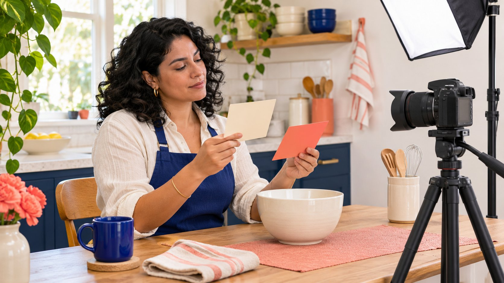
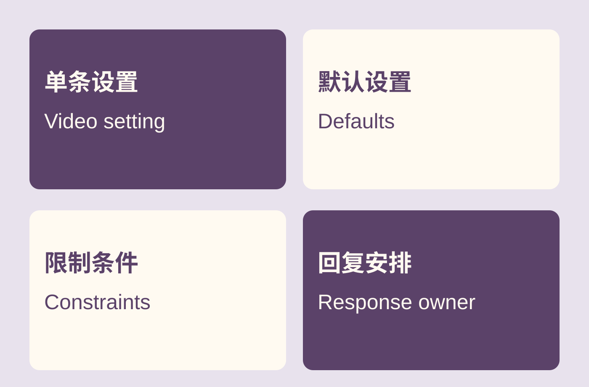

# YouTube 合作视频怎样开启评论

状态：本地审阅稿；正式发布日期待确认。

开启合作视频评论前，核对单条设置、适用限制与回复责任，让品牌和创作者共同承接真实问题。

电脑端可在 YouTube Studio 进入 Content，点开视频缩略图，选择 Show more，在 Comments and ratings 中选择允许评论的设置并保存。先确认视频和账号允许修改：面向儿童、私享视频或受监督账号存在相应限制，不应为开启评论而错误更改受众分类。默认设置只影响新内容。达人合作还要安排谁审核、回答产品问题及处理后续，让打开开关对应真实可执行的回复工作。

## 按单条视频设置完成操作

[YouTube 评论设置说明](https://support.google.com/youtube/answer/9482556?hl=en)给出电脑端路径：进入 Studio 的 Content，点视频缩略图，选择 Show more，在 Comments and ratings 调整并保存。选择允许评论的选项时，同时检查需要的审核条件。

更改前先确认只针对本次视频，还是另有默认设置安排。让创作者理解范围，不因较宽的控制入口更容易找到，就顺带改变无关作品。由有权限的人操作，并核对正在修改哪条合作视频。相似标题或多个剪辑版本可能导致误选，不能只凭缩略图大概判断。

保存后检查实际状态，再记录完成。本文按官方公开步骤整理，没有登录用户频道执行修改，不应说成某个账号已经开启评论。

[达人互动回复分工方法](https://www.quickkol.com/zh/blog/creator-engagement-response-routing/#answer)帮助团队安排真实问题的承接。技术设置与回复工作要一起准备，而不是等评论出现后才临时寻找产品负责人。

## 先尊重受众与可见性限制

某些视频或账号不能按通常方式更改评论设置。面向儿童的内容、私享视频与受监督使用情形，应按实际规则处理，不为完成品牌互动目标而绕过限制。

内容的受众分类要依据真实情况。不能把不适合的分类改掉，只为了出现评论区，也不能要求创作者向品牌保证所有视频都可开启。

如果团队想在公开发布前收集有限反馈，可以评估适合的审稿方式。非公开链接也不是严格保密保证，不应用来随意分享敏感合作材料。

记录当前限制与可行方案，把受到影响的互动安排重新确认。不能开启时，可以调整研究和反馈计划，不需要用一个虚假的成功状态填完交付表。

## 分清默认设置与现有作品

调整默认设置不代表旧合作视频自动改变。需要处理某条现有内容时，回到该视频确认；批量操作也要先明确范围，避免影响其他作品。

发布前给操作人列出目标视频与实际需要的状态，不笼统要求“把频道全部打开”。创作者可能有其他内容与不同管理需求，本次合作不应擅自扩大。

默认值适合帮助后续制作保持一致，但仍需检查例外条件。不能因为模板中写着允许评论，就推定每次上传都已经生效。

最终记录区分改了默认、改了单条和已查看真实结果。这样负责人能知道哪里完成、哪里还需检查，而不是将不同操作都压成一个“设置好了”。

开启功能与有人承接问题需要分别确认。

## 按回复能力选择审核方式

[YouTube 评论审核说明](https://support.google.com/youtube/answer/9483359?hl=en)区分开启、暂停与关闭，并提供不同审核方式。待审核内容通常不公开，不能把审核队列当作公众已经看到的讨论。

选择方式时考虑创作者和团队实际能处理多少工作，不以“尽量增加评论”作为唯一目标。审核条件与公开回复责任需要明确。

自动过滤可能出错，负责人应根据实际内容复核，不把系统判断当成已经证实个人意图。合理批评、产品问题和实际违规需要不同处理。

品牌可以提供核对信息和适当升级路径，不应要求清除所有不同意见。审核服务于安全与有用讨论，而不是制造只有赞美的虚假效果。

## 把内容、产品与服务问题分开

观众可能询问演示步骤、产品条件或具体订单。创作者可以解释自己的过程，但未必有权决定品牌政策或查看客户记录。

约定哪些问题由创作者回应，哪些交给产品或服务负责人。涉及个人资料时使用适当渠道，不让用户在公开评论里发布敏感信息。

为已核对事实提供简明资料，同时让创作者保留自己的表达。不要强迫其照读无法确认的说法，也不将“不知道，需要核对”当作不合格互动。

反复出现的真实问题可以转为后续演示。先判断是否需要新解释、事实修正或服务处理，不让每条评论都自动触发同一份销售回复。

先区分解释、产品与服务问题，再安排适合的回复人。

## 用适当权限安排协作

[YouTube 频道权限说明](https://support.google.com/youtube/answer/9481328?hl=en)允许按角色委派相关访问，无需提供 Google 账号登录。实际功能与角色支持需要核对，不把“团队成员”当作无限权限名称。

品牌如果只需要提供产品答复，可以先明确协作方式，不一定要接管频道。创作者自己的内容与其他合作也不应因本次任务而暴露给不必要的人员。

操作人与商业接受人仍可能不同。有能力管理部分内容，不自动意味着有权签约、增加用途或代创作者承诺结果。

合作结束后按约定复查访问与责任。这里没有为用户邀请任何协作者；文章提供的是任务分工方法，不是账号权限已变更的说明。

## 发布后分别检查设置与互动

上线后查看目标视频是否呈现预期评论状态，并确认实际审核与回复工作有人承接。必要时核对保存记录，不用一张后台截图代替全部公开结果。

评论数量少不自动证明开关无效，数量多也不代表观点一致或购买意图强。先检查技术状态，再研究具体问题与内容表现。

[达人 KPI 决策约定方法](https://www.quickkol.com/zh/blog/social-kpi-creator-decision-contract/#answer)强调让指标对应行动。可以观察哪些问题需要补充解释，而不承诺开启评论必然提高推荐或带来订单。

遇到明显异常先保留真实通知与状态，按适当路径处理。不根据一次波动指控创作者，也不为了好看而删除影响解释的重要条件。

## 让开启评论对应真实合作责任

交接目标视频、实际设置、适用限制、审核安排与回复负责方，并标明尚待核对部分。后续如果暂停或改动，更新记录而不是让旧安排继续流转。

QuickKOL 可帮助研究能够解释相关问题的创作者。真实频道操作、产品事实、审核与回复仍需要各自负责人，不暗示研究工具已经接管评论区。

评论可以帮助理解观众困惑，但不是完整市场调查。尊重创作者原有表达与合理讨论，避免把合作区变成只允许销售话术的空间。

设置只是起点。有人能够提供准确解释、处理不同问题并跟进必要修正，才使开放评论成为可持续的达人合作工作，而不是一次没有后续的开关操作。

## 评论设置与合作分工

| 问题 | 核对 | 避免误解 |
| --- | --- | --- |
| 单条视频 | 目标与保存状态 | 改默认就改了旧视频 |
| 适用限制 | 真实受众与可见性 | 为互动可以绕过限制 |
| 审核 | 队列、规则与责任 | 待审核已公开 |
| 回复 | 内容、产品与服务分工 | 全部由创作者负责 |

平台步骤核验于 2026 年 11 月 20 日，未操作用户频道。

## 交接合作视频评论安排

核对设置并准备后续工作。

- [ ] 定位明确的视频和账号。
- [ ] 确认受众与可见性限制。
- [ ] 保存并检查单条设置。
- [ ] 选择有能力执行的审核方式。
- [ ] 分配内容、产品和服务问题。
- [ ] 发布后复查真实状态和回复。

## 研究日期与使用边界

资料核验于 2026 年 11 月 20 日。文中方法、表格和决策规则为编辑建议，标为假设的示例不是实际客户结果或行业基准。外部资料的适用地区与时期按各段说明。

## 从任务开始达人研究

用 QuickKOL 理解 Brief、发现相关达人并研究作品与联系路径；数据、合作条件和结果仍需核验。

[了解 QuickKOL](https://www.quickkol.com/#capabilities)

## 来源

- [YouTube 评论设置说明](https://support.google.com/youtube/answer/9482556?hl=en)
- [YouTube 评论审核说明](https://support.google.com/youtube/answer/9483359?hl=en)
- [YouTube 频道权限说明](https://support.google.com/youtube/answer/9481328?hl=en)
