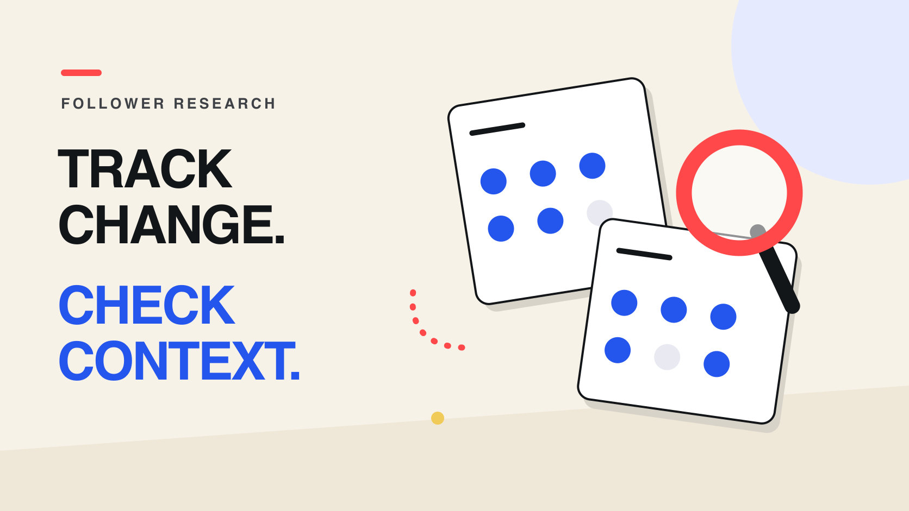

# Instagram 粉丝追踪：品牌如何记录增长并判断数据边界

区分粉丝总量、净变化、新增与取消关注，建立可复核的观察记录，并明确哪些结论需要额外证据。

QuickKOL 原创编辑图形；图形仅表示观察概念，不是账号数据或产品界面。

## 直接回答

Instagram follower tracker 是记录账号粉丝总量或变化的工作方式或工具。品牌应先区分自己有权访问的账号数据、合作创作者主动分享的资料，以及第三方对公开信息的观察。两个可比时间点能够计算净变化；仅凭总量变化，不能知道每位取消关注者的身份，也不能证明真实受众比例、买粉行为或活动销售效果。

## 先确定你要追踪哪个问题

同一个“追踪粉丝”请求，可能包含三种不同任务：了解品牌自有账号的变化、观察候选达人的增长趋势，或评估某次合作期间发生了什么。先写下要做的决定，再选择数据。品牌如果只是想确认候选人是否持续活跃，并不一定需要逐日追踪；若要分析合作窗口，则需要活动前的基线和对应时间记录。

把粉丝总量、账号正在关注的人数、粉丝名单和取消关注名单分开。它们不是同一个指标，也不因工具名称包含 tracker 就都能获得。查询前明确账号、字段、周期和所需精度。一个页面显示今天的粉丝数，不代表它已经保存过去半年的每日历史。

对于品牌筛选，先参考[Instagram 粉丝筛选指南](https://www.quickkol.com/zh/blog/free-instagram-influencer-search-follower-filter/)完成发现任务，再决定是否建立持续观察记录。不要把筛选条件误写成对增长质量的判断。只有当变化会影响邀约、试点或追加研究的决定时，追踪才有明确用途。

如果问题是“具体谁取消关注”，先确认是否真的需要逐人身份，以及来源能否提供可靠、获授权的名单。总量净减 20 可能同时包含新增和流失，既不意味着只发生 20 次取消，也不能指出参与者。对品牌候选研究，通常先判断变化是否值得补充背景就已足够；需要什么证据，应由任务决定，而不能由工具宣传的最长字段列表决定。

## 区分授权数据、创作者资料与公开观察

为每个字段保留来源类型。品牌有权访问的自有账号资料，与合作方提供的 Insights 截图、第三方历史曲线和人工查看的主页数字，代表不同的证据。记录获取日期、统计窗口、账号身份，以及数字是实际观察、四舍五入还是供应商估计；不要因为报表样式一致就混在同一条曲线上。

[Meta 官方 Instagram API 集合](https://www.postman.com/meta/instagram/collection/6yqw8pt/instagram-api)描述面向专业账号、令牌和权限的工作方式；它不是对任意账号所有数据开放的承诺。接入时按实际登录方式、权限与版本验证所需字段，不能把某条 API 路线的条件套到所有工具上。

创作者主动分享的截图应包含足以辨认账号与窗口的信息，但不需要暴露无关私信或个人资料。第三方提供的地域或真实性估计，应保留方法与更新时间。若对方无法解释字段来源，就把它降为研究线索，而不是以更漂亮的可视化替代原始证据。

## 建立能连续比较的快照记录

为账号建立固定记录：账号链接、可用的稳定标识、当前用户名、观察时间与时区、粉丝值、精度、来源、数据状态和备注。用户名可能改变，所以不能仅靠显示名称拼接历史。遇到改名时保留身份核验依据；若无法确认是同一账号，就先分开记录，避免给两个不同账号拼出虚假的增长曲线。

按任务选固定观察节奏，例如每周同一天、同一时区的近似时刻。频率是编辑建议，需按项目变化速度和人工成本调整，并非平台规则。活动前记录基线，发布时记下内容链接，再按约定窗口观察；把赠奖、广告或媒体曝光等背景事件另列备注，保留来源。

数据状态至少区分已观察、缺失、受限、估计和精度不足。空白不能自动变成零。漏掉一天就保留缺口，不能补一个直线插值后仍称为实际观测；更换供应商或口径时标注断点。附带模板用于记录这些字段，不会连接 Instagram，也不会自动采集任何账号。

为记录附上一页数据字典，解释哪些字段由人工输入，哪些来自文件，零值何时有效，以及哪些行可以比较。若项目跨团队，约定统一时区并保留来源原始时间，避免上午截图和前一晚报表被误当成同一时点。设定保存与访问范围，期末交接必要证据，移除不再需要的账号权限；不要为了长期观察而无限保存无关资料。

使用 CSV 时，每行只放一个账号的一次观察。原始显示值照录；只有已核验的精确整数才填入精确值列。观察时间采用带时区的 ISO 格式，状态与精度分别填写；例如没有读到数据时标为缺失，不能同时填精确值零。文件本身不包含计算公式或示例账号，团队应先保留两条可比记录，再按下节公式计算，并将计算结果与原始观察分别保存。

## 正确计算净变化与增长率

在同一账号、同一来源且精度足够的前提下，净变化 ΔF = 期末粉丝 F1 − 期初粉丝 F0；期内增长率 = ΔF ÷ F0 × 100%。必须同时报告起止时间。F0 为零时，百分比不可用，但仍可报告绝对变化；缺失、负数或无法确认的输入，不应进入精确计算。

以下均为假设：10 月 1 日观察 12,500，10 月 15 日观察 12,875，经过 14 天，净增 375，期内增长率为 3%。375 ÷ 14 约为每天 26.79，是整个区间的平均净变化，不是每天都实际增长这么多。若主页只显示 12.5K 和 12.9K，就不能据此声称精确净增 400；应保存原始显示值并标注舍入限制。

只有在独立数据明确记录相同窗口的新增与取消关注时，才能比较流入与流出。假设新增 600、取消 225，简单差值为 375；这组数是另外的输入，不能由两个总量快照倒推出。若它与总量变化不符，先核对定义、时区、覆盖和账号处理，不要把差额自动归因于某一种行为。

## 异常变化触发核查，不直接触发指控

明显增长或下降应先触发数据复核：是否换了来源、账号改名、数字舍入、观察间隔改变或同步失败？然后检查可验证背景：近期内容、合作发布、媒体提及或创作者说明。可以把这些事件与变化放在同一时间轴，但时间相近本身不能证明因果，也不能证明购买粉丝。

[Meta 2024 年账号保护说明](https://about.fb.com/news/2024/06/protecting-athletes-and-fans-on-our-apps-during-major-sporting-events-this-summer/)于 6 月 11 日提到，创作者可以批量移除垃圾粉丝。它提供一种总量下降的可能背景，不能证明某个具体账号使用过该功能，更不能把所有下降都解释为清理。

把记录写成“某区间减少，原因待核验；下一步请求同窗口资料”，而不是“发现欺诈”。若要进一步研究受众类别，可阅读[假粉检查的类别解读指南](https://www.quickkol.com/zh/blog/fake-follower-check-audience-categories/)。总量曲线不能替代抽样方法、身份核验或供应商估计误差说明；未知应保留为未知。

## 用任务测试工具，而不是接受所有承诺

让供应商或试用版本完成一个真实小任务：能否准确定位账号，解释当前字段，说明历史起点、更新节奏、缺失值、导出方式和访问条件？如果需要合作方授权，应明确谁授予权限、品牌能看到什么以及何时停止访问。官方接口名称出现在营销页上，不等于所需账号和字段已经通过验证。

[Meta 关于克隆站与凭证风险的说明](https://about.fb.com/news/2022/07/how-meta-safeguards-people-against-clone-sites/)于 2022 年 7 月 5 日发布，提醒用户不要向未经授权的网站提供 Instagram 登录凭证。评估工具时使用正式授权流程；不要为了获得一条曲线索取创作者密码，也不要把登录表单外观当成官方关系的证明。

对“免费、实时、完整历史、识别所有取消关注者”等承诺逐项验证。记录哪些功能实际可用，哪些只是文档描述，以及额度和导出是否符合本次任务。先比较同一任务的证据质量与人工成本，再看订阅价格。本文不提供未经实测的工具排名，也不把第三方名称作为效果背书。

试用验收还应覆盖失败情形：账号暂时不可见、授权到期、导出缺列或某天无记录时，界面是否明确提示？若系统仍输出平滑曲线，要求解释填补方法并导出原始状态。与同事一起检查一个导出文件，确认离开产品界面后仍能辨认账号、窗口和来源。只有演示时看得懂、交接后无法复核的数据，不适合成为正式报告的唯一依据。

## 把观察转成有限、可执行的品牌决定

假设品牌在同一 14 天窗口内观察两位候选：A 从 12,500 增至 12,875，B 从 80,000 增至 80,800。A 的期内增长率为 3%，B 为 1%；B 的绝对净增长 800 更高。两个比较都正确，却都没有告诉我们谁的受众更相关、谁能解释产品，或谁愿意接受实际合作条件。

先核对任务匹配，再决定是否补充研究。若候选人的相关作品较好但受众地域未知，可以请求合适窗口的受众证据。若活动期间粉丝增加，却没有内容链接或承接事件，则保留“同期增长”的描述，不能改写为合作带来了全部新增用户。

QuickKOL 可以帮助发现相关创作者、理解内容与准备联系。本文的记录方法不代表 QuickKOL 已提供实时粉丝历史、逐人取消关注名单或完整受众审计。把粉丝趋势作为候选记录中的一项证据，与作品、受众条件和商业可行性共同评估，才会得到可解释的下一步。

报告可使用这样的句式：“在［起止时间及来源］观察到［绝对净变化与期内增长率］；［精度与缺口］限制了解释；下一步核对［具体证据］后再决定［行动］。”如果只有四舍五入值，就删除精确百分比。把结论和下一步同时交付，能避免阅读者把一句“增长很快”扩大成受众真实、目标市场契合或值得追加预算的完整判断。

## 常见问题：可以追溯未记录的历史吗？

没有可靠历史来源时，今天的总量不能重建昨天的新增或取消关注。工具可能已有自己的观察记录，也可能允许访问某些历史指标，但必须核验账号覆盖、起点与方法。历史为空时，从今天建立基线，比补一条看似连续却无法追溯的曲线更有用。

同样，没有跨账号通用的“健康增长率”。观察窗口、账号基数、内容事件和数据精度都会影响比较。不要把本文的 3% 算例写进采购标准，也不要因低于示例就否定候选。若团队需要阈值，应说明它是内部工作规则，并测试是否适合自己的任务。

下一步可复制配套记录模板：先确认账号身份，再填两个真实可比的观察点、来源和精度，最后写一句数据能支持的结论与一个待确认问题。这样交给同事时，对方既能复算，也知道何时应该停下，不会把研究线索误当成已经验证的合作结论。

## 三种数据路线如何使用

| 路线 | 应保留 | 适合的判断 |
| --- | --- | --- |
| 自有或获授权账号 | 权限、字段、窗口与导出来源 | 在实际可用范围内分析账号 |
| 创作者分享资料 | 账号身份、截图日期与窗口 | 核对该窗口的披露信息 |
| 公开或供应商观察 | 观察时间、精度、方法与缺口 | 描述趋势并确定下一项研究 |

三种路线不是完整性或准确性的排名；可用字段需单独核验。

## 执行前核对

- 确认同一账号、字段、来源和观察窗口。
- 保留原始显示值、精度、时区与未知状态。
- 起点非零才计算增长百分比。
- 把异常原因写为待核验问题。
- 将粉丝变化与受众质量、商业结果分开。

[下载双语粉丝观察记录模板（CSV）](../public/downloads/instagram-follower-observation-log.csv)

## 研究日期、证据与限制

资料核验于 2026 年 10 月 29 日。Meta 的部分帮助页返回访问限制；本文据已读取的官方集合与公开说明，不主张具体账号门槛、保留天数或当前可用字段。未进行追踪产品端到端实测，没有可适用于所有账号的增长基准。数字均为假设算例；方法为编辑建议。

## 从明确需求开始研究达人

用 QuickKOL 理解需求、发现相关创作者、研究作品并准备个性化联系；受众证据、商业条件和结果仍需核验。

[了解 QuickKOL](https://www.quickkol.com/#capabilities)

## 资料来源

- [Meta 官方 Instagram API 集合](https://www.postman.com/meta/instagram/collection/6yqw8pt/instagram-api)
- [Meta 2024 年账号保护说明](https://about.fb.com/news/2024/06/protecting-athletes-and-fans-on-our-apps-during-major-sporting-events-this-summer/)
- [Meta 关于克隆站与凭证风险的说明](https://about.fb.com/news/2022/07/how-meta-safeguards-people-against-clone-sites/)
