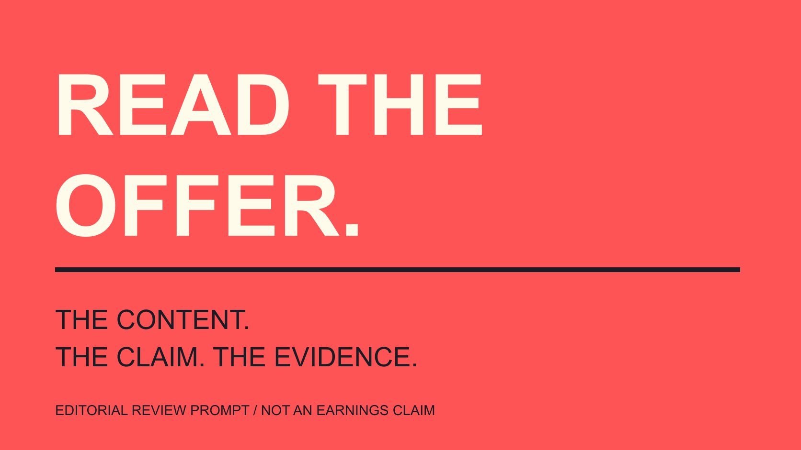

# ClickBank: Review the Roles and the Offer

Status: local review draft; confirm the publication date before release.

Understand ClickBank through seller, product and affiliate roles, reviewing the actual offer, destination, approval and claim support before planning content collaboration.

QuickKOL editorial graphic; not actual account metrics or a platform interface.

ClickBank’s Marketplace connects sellers presenting products with affiliates looking for offers to promote. A brand or content team should begin with the particular offer: what is sold, whom it serves, what the customer actually receives, which destination applies and whether seller approval is required. Listing statistics, commission terms and promotional copy do not replace product experience or evidence for claims. This guide uses ClickBank’s public help documentation to explain review. It logs into no marketplace, generates no affiliate link, buys no product and supplies no income forecast or guaranteed-return product list. The practical objective is an explainable content decision about a specific offer.

## Separate the seller, affiliate and product

The [ClickBank Marketplace guide](https://support.clickbank.com/en/articles/10535269-what-is-the-clickbank-marketplace) describes sellers presenting products and affiliates finding suitable offers and using associated links. Platform, seller, affiliate and customer play different roles in that process.

A brand may supply the product or research a content collaboration, while a creator may explain, demonstrate or provide other promotional content. Establish the actual role before deciding who supplies information and handles questions.

An affiliate account does not establish experience with a particular product or availability for a brand agreement. A marketplace listing likewise does not mean this article independently verified quality or every claim.

The [brief-writing guide](/blog/write-a-useful-campaign-brief/#answer) converts roles into work. Identify what the audience needs to understand, what the collaborator delivers and which facts come from the product owner rather than only send a directory link.

This article makes no blanket judgment about every category or operator. Start with the particular offer and actual evidence, retaining questions where information is missing. Role clarity also prevents a customer-support responsibility from being casually assigned to a content creator who agreed only to produce an explanation.

## Read marketplace information within its actual scope

Official guidance describes filtering by language, category and offer type and accessing the marketplace through a logged-in account. This article reads public help material, not a real user’s marketplace session.

A marketplace display can identify an object for further research, while visible fields still need their current definitions. Do not turn popularity, statistics or commission wording into a ranking suitable for every brand.

List relevant conditions first, such as product language, customer context, delivery format and intended geography. A higher number cannot make content suitable when these do not fit.

If a metric definition is needed, use the corresponding current official explanation. A professional-looking field is not a basis for precise comparison or earnings arithmetic before its meaning is checked.

Retain observation time and source, distinguishing material obtained from information still wanted. A formal table does not make incomplete evidence complete. The marketplace can help structure the next question without supplying every answer needed for a recommendation, and the research record should preserve that difference.

## Review the offer through what a customer receives

Begin with actual contents, delivery, applicable conditions and support route. A course, guide or other product should make clear what the customer receives rather than only list desired outcomes.

Check version, language, required tools and prior knowledge. If a tutorial depends on particular software, for example, the customer needs that condition in advance. Suitable for anybody does not replace a real explanation.

Where experience is needed, obtain a sample or demonstration under an appropriate arrangement and record which parts were actually reviewed. Reading directory copy should not be described as complete product use.

A creator can have expressive freedom while facts and scope remain consistent. The product owner supplies information, the editor checks accuracy and the collaborator identifies what they can genuinely demonstrate.

Leave unresolved questions open, such as whether a version contains the required material. A delivery deadline is not a reason to make a missing answer affirmative by default. The resulting content can be narrower and still useful when it accurately describes the part the evidence supports.

If an offer involves continuing access, additional services or later purchasing conditions, have the product owner explain the actual arrangement. Showing only the first step may not communicate the full delivery. Distinguish required material from optional additions and retain the formal conditions the reader needs to consult. One demonstration is not a complete explanation of every charge, service or access period. The review should identify those outstanding questions before a collaborator repeats a simplified promise that the product information does not support.

## Review listing wording and landing page together

The [ClickBank listing guide](https://support.clickbank.com/en/articles/10535196-how-do-i-add-or-update-my-clickbank-affiliate-marketplace-listing) describes seller-provided title, description, affiliate tools and destination information. Compare those representations with the actual product and page a customer reaches.

A listing may summarize while the landing page supplies detail. Language, price conditions, version and content promises should align so the collaborator is not promoting across an unexplained discrepancy.

If several landing pages exist, specify which the current assignment uses. Different pages may serve different explanations or audiences; one generic purchase link should not leave the next colleague guessing.

Promotional tools can provide a production starting point without proving every asset and phrase is suitable for a new channel. The [usage-scope guide](/blog/creator-rates-usage-rights/#answer) confirms material, version, purpose and responsibility.

Retain the actual state of changes. A listing draft, published description and current customer-facing page need their respective checks rather than have a prepared edit described as live. A project can accept a corrected script while still recording that its corresponding destination requires an owner’s update.

## Arrange affiliate approval and content confirmation separately

The [ClickBank affiliate-approval guide](https://support.clickbank.com/en/articles/10535184-affiliates-require-approval) explains that sellers can require approval before an affiliate promotes and can provide a contact route. Confirm the condition for the particular offer and current setting.

Approval in this affiliate context differs from advertising-account access or permission to distribute creator content on another platform. Shared terminology does not make scope and capability identical.

Where approval is required, complete appropriate communication and have the owner confirm the actual state. Applying, receiving willingness to discuss and being approved are separate stages; do not supply an affirmative result on the other party’s behalf.

After the relationship is established, content facts, material use, delivery and the audience-facing relationship explanation still need attention. Completing one element does not resolve all the others.

This article contacts no seller, submits no application and changes no account. It explains which states a plan should retain, while appropriate parties perform the actual work. The distinction gives production a clear dependency without turning a platform feature description into an agreement the team has not obtained.

## Keep tracking links and financial outcomes distinct

Marketplace guidance describes tracking links and commission arrangements. Generating a link does not independently establish a purchase, qualifying transaction or net return from this content.

The [metric-definition guide](/blog/engagement-rate-formula-metric-contract/#answer) separates clicks, orders, relevant transactions and actual outcomes. Retain definition, window and source for a reporting value rather than rename every field earnings.

The [campaign-measurement guide](/blog/creator-campaign-measurement/#answer) connects objectives and evidence. Production cost, distribution, refunds and other relevant conditions need actual records instead of profit inferred from one public commission description.

With missing information, report observed actions and evidence not yet obtained. Do not assign every sale to one collaboration or infer causation solely from sequence.

This is not an earnings calculator. It supplies no real operator sample, universal return rate or guaranteed-income process; commercial judgment requires actual project information. A clear description of what happened can remain useful while some financial questions are unresolved, and uncertainty should not be concealed behind an attractive percentage.

## Review claim support alongside the content

The [ClickBank product guidelines](https://support.clickbank.com/en/articles/10535118-product-guidelines) explain category-specific requirements extending to marketing material and discuss exaggerated earnings and substantiation within the internet-marketing category. Review the actual category and current requirements rather than treat one policy as legal assurance for every project.

For content teams, ask what supports each outcome claim, whom it applies to and whether limitations remain visible. A demonstration fragment or individual result does not establish the same outcome for every customer.

Platform presence, seller confirmation or a higher commission is not independent verification of a product claim. Evidence should reach actual facts rather than circulate among several promotional pages.

Remove an unsupported claim or replace it with an accurate content description. An added disclaimer should not preserve a substantively misleading promise, and invented trials, testimonials or research have no place in the explanation.

Where professional review is needed, use appropriate people for the actual geography and assignment. This article supplies an editorial method and certifies no particular offer. The aim is an accurate explanation a reader can understand, with support proportionate to what is asserted.

## A hypothetical: a beginner photography course

Suppose a brand researches a content collaboration around a photography course. Confirm syllabus, language, equipment requirements and delivery before identifying which parts the creator can actually inspect and demonstrate.

The task might explain one composition exercise, show its conditions and point readers to full course information. Viewing one lesson is not completing the entire course, nor a basis for promising photography income afterward.

Check listing, destination, approval conditions and material scope together. The owner retains specific unresolved items to address under the arrangement before actual promotion, rather than let a ready link stand in for the whole collaboration explanation.

This is hypothetical, not a real course recommendation or outcome case. ClickBank provides a marketplace context connecting products and promoters while the brand still makes its own content judgment.

QuickKOL can help interpret a brief and research relevant creators’ work. The particular offer, experience, commercial conditions and outcomes still require appropriate sources and confirmation between the parties.

## Five objects in an offer review

| Object | Confirm | Retain the limit |

| --- | --- | --- |

| Product | What the customer receives | Unreviewed is not personally used |

| Listing and destination | Version, contents and conditions agree | Promotion is not independent verification |

| Affiliate arrangement | Approval requirement and actual state | Application is not approval |

| Tracking and outcomes | Definition, window and source | A link is not net return |

| Claim | Support and applicable limits | One result is not universally applicable |

Editorial review framework; the photography course is hypothetical, not a product list, income forecast or compliance certification.

## ClickBank content-collaboration preparation

Review information and assignment without generating tracking links or operating an actual account.

- [ ] Seller, product and affiliate roles explicit.

- [ ] Customer delivery and conditions clear.

- [ ] Listing and destination aligned.

- [ ] Approval and content confirmation recorded separately.

- [ ] Claims have support and retain limits.

- [ ] Outcomes interpreted with corresponding evidence.

## Research date and limitations

Sources reviewed November 4, 2026. Methods, tables and decision rules are editorial recommendations. Hypothetical examples are not actual client results or industry benchmarks. Source geography and periods are specified where relevant. This draft is in independent local review; confirm its publication date before release.

## Sources

- [ClickBank Marketplace guide](https://support.clickbank.com/en/articles/10535269-what-is-the-clickbank-marketplace)

- [ClickBank listing guide](https://support.clickbank.com/en/articles/10535196-how-do-i-add-or-update-my-clickbank-affiliate-marketplace-listing)

- [ClickBank affiliate-approval guide](https://support.clickbank.com/en/articles/10535184-affiliates-require-approval)

- [ClickBank product guidelines](https://support.clickbank.com/en/articles/10535118-product-guidelines)
