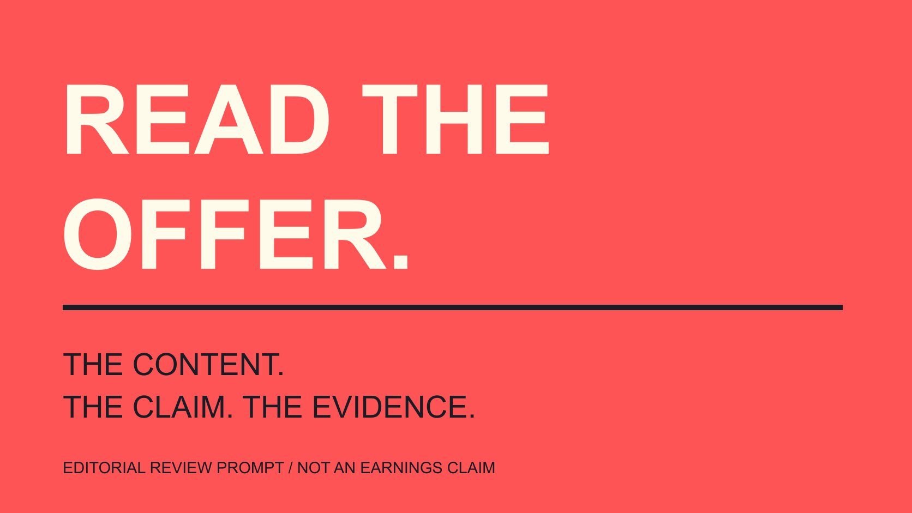

# ClickBank是什么：品牌先读角色与商品

状态：本地审阅稿；正式发布日期待确认。

按卖家、产品与推广者三种角色理解ClickBank，先核对实际Offer、目标页面、推广批准和声明依据，再讨论内容合作。

QuickKOL 编辑图形；不呈现真实账号指标或平台界面。

ClickBank的Marketplace连接展示产品的卖家与寻找推广对象的联盟推广者。品牌或内容团队使用它时，先确认具体Offer：卖什么、面向谁、消费者实际得到什么、使用哪个目标页，以及推广是否需要卖家批准。目录中的统计、佣金或宣传文案都不能代替产品体验与声明依据。本篇依据ClickBank公开帮助资料说明核对方法，不登录市场、不生成联盟链接、不购买产品，也不提供收入预测或保证回报的选品名单。

## 先把卖家、推广者和产品分清

[ClickBank市场说明](https://support.clickbank.com/en/articles/10535269-what-is-the-clickbank-marketplace)介绍卖家展示产品，联盟推广者寻找合适推广对象并使用相应链接。平台、卖家、推广者与消费者在过程中的角色不同。

品牌可能是提供产品的一方，也可能在研究某种内容合作；创作者则可能提供解释、演示或其他推广内容。先确认实际角色，再讨论谁应提供资料和处理问题。

一个人有联盟账号，不代表已经试用某个产品，也不说明接受特定品牌合作。同样，产品出现在市场里，不是本篇已经独立验证质量或全部宣传的证明。

[Brief写作指南](/zh/blog/write-a-useful-campaign-brief/#answer)帮助把角色转为任务。说明受众需要理解什么、合作方交付什么，以及哪些事实由产品负责人提供，比只发一个目录链接更清楚。

本篇不把所有类别和经营者归为同一种判断。研究以具体Offer与实际资料开始，缺少信息时保留需要继续确认的问题。

## 读取市场资料时，保留其实际范围

官方说明介绍按语言、类别、Offer类型等筛选，并指出市场通过登录后的账号入口使用。文章读取的是公开帮助资料，没有进入真实用户市场后台。

市场页面可以帮助找到继续研究的对象，但可见字段应按当前说明理解。不要把热度、统计或佣金描述直接改写成适合所有品牌的排名。

先列与任务有关的条件，例如产品语言、消费者背景、交付形式和目标地区。条件不合适时，较高数字也不能让内容自动适合受众。

如果需要某个指标定义，回到对应当前官方说明。未核对含义时，不因为字段看起来专业就据此做精确比较或收益计算。

记录观察时点与来源，区分已经取得的资料和希望进一步了解的内容。正式表格的外观不会让原本不完整的信息自动完整。

## 用消费者会得到什么核对Offer

先说明产品的实际内容、交付方式、适用条件与支持路径。课程、指南或其他产品，需要让读者理解购买后到底得到什么，而不是只列能实现的愿望。

核对版本、语言、所需工具与使用基础。假设产品教程依赖特定软件，消费者需要提前知道对应条件；不要用“任何人都适合”替代实际说明。

如果需要体验资料，按合适安排取得样本或演示，并记录实际看过哪部分。只看目录文案，不应写成已经完整使用产品。

创作者可能需要自己的表达空间，但事实与范围仍应一致。产品负责人提供资料，内容负责人检查解释是否准确，合作方说明自己真正能够演示的部分。

未确认的问题保持开放，例如某个版本是否包含所需内容。不要为了按时完成选题，把缺少的答案改成默认肯定。

若Offer涉及持续访问、额外服务或后续购买条件，应让产品负责人说明实际安排。内容里只展示第一步，可能还不足以让读者理解完整交付。把必需内容与可选补充分别说清，保留需要查看的正式条件；不把一个示范片段包装成所有费用、服务与使用期限的完整答案。

## 条目文案与落地页需要一起看

[ClickBank条目说明](https://support.clickbank.com/en/articles/10535196-how-do-i-add-or-update-my-clickbank-affiliate-marketplace-listing)介绍卖家填写标题、描述、推广工具与目标页资料。这些是卖家提供的说明，应与实际产品和消费者到达的页面核对。

条目可能概括产品，落地页则承担更多细节。两边的语言、价格条件、版本和内容承诺应保持一致，不能让合作方在不清楚差异时继续推广。

如果有多个目标页，先明确当前任务使用哪个。不同页面可能用于不同解释或受众，不要只保留一个笼统“购买链接”让后续同事猜测。

宣传工具可以提供制作起点，却不是所有素材和表达都已经适用于新渠道的证明。[使用范围指南](/zh/blog/creator-rates-usage-rights/#answer)帮助确认素材、版本、用途与相应责任。

对变更保留真实状态。条目草稿、已经发布的描述与消费者目前看到的内容，应按实际核对，不把准备好的修改说成已经公开。

## 推广批准与内容确认分别安排

[ClickBank推广批准说明](https://support.clickbank.com/en/articles/10535184-affiliates-require-approval)介绍卖家可以要求推广者先获批准，并提供相应联系路径。是否需要批准，应按具体Offer与当前设置确认。

这里的联盟推广批准，与其他平台广告账户或创作者内容投放权限，属于不同情境。一个称呼相同，不代表实际能力和用途相同。

需要批准时，先完成适当沟通，再由负责人确认实际状态。发出申请、对方愿意讨论和已经获准，是不同阶段，不替对方填写肯定结果。

推广关系确定以后，内容事实、素材用途、交付与对读者的关系说明仍需安排。不能把其中一项完成，当作其余全部已经解决。

本篇没有联系卖家、提交申请或修改账号。它解释计划中应留什么状态，实际操作继续由适当双方按任务完成。

## 跟踪链接与收入结果保留各自口径

市场说明介绍相应跟踪链接与佣金安排。生成一个链接，不独立证明有人购买、交易已经符合条件，或本次内容带来了净收益。

[指标定义指南](/zh/blog/engagement-rate-formula-metric-contract/#answer)帮助区分点击、订单、对应交易与实际结果。要使用某个报表值，就保留其定义、窗口与来源，不给所有字段统一改名“收益”。

[项目测量指南](/zh/blog/creator-campaign-measurement/#answer)进一步把目标与证据对应。内容制作成本、投放、退款或其他相关条件，需要按实际资料考虑，而不是从一项公开佣金描述推算利润。

数据缺失时，报告已有行为与尚未取得的资料。不要把所有销售归给一个合作，也不从时间先后直接得出因果结论。

这不是收入计算器。本篇不提供真实经营者样本、通用回报率或保证赚钱的流程，具体商务判断应依据实际项目资料。

## 声明依据应跟着内容一起审阅

[ClickBank产品指南](https://support.clickbank.com/en/articles/10535118-product-guidelines)说明相关类别要求也适用于营销资料，并在互联网营销类别讨论夸大收益与声明依据。应按具体类别和当前要求审阅，不把一段政策当成所有项目的法律保证。

对内容团队，实用问题是每项效果说法有什么依据、适用于谁，以及是否保留限制。体验片段和个别结果不自动代表所有消费者都能获得同样结果。

避免把平台存在、卖家确认或更高佣金，当成产品声明已经得到独立验证。各项依据需要指向实际事实，而不是在几个宣传页面之间循环引用。

没有支持的说法可以删去或改成准确的内容说明。不要靠增加免责声明保留一个实质仍然误导的承诺，也不编造试用、用户证言或研究结果。

需要专业审阅的项目，交给适当人员按实际地区和任务处理。本篇提供编辑核对方法，没有为任何具体Offer作出合规认证。

## 假设案例：初学者摄影课程

假设品牌研究一门摄影课程的内容合作。先核对课程大纲、语言、器材要求与交付方式，再确认创作者实际能够查看与演示的部分。

内容任务可以是解释其中一个构图练习、展示练习条件，并让读者找到完整课程资料。不能把看过一节课写成已完成全部课程，更不承诺学完必然靠摄影获得某种收入。

同时核对条目、目标页、批准要求与素材范围。负责人保留具体未确认项，实际推广前按安排解决，而不是把一个现成链接当作全部合作说明。

这个例子为假设，不是真实课程推荐或效果案例。ClickBank可以提供产品与推广者联系的市场语境，品牌仍需完成自己的内容判断。

QuickKOL可以帮助理解Brief和研究相关创作者作品。具体Offer、经验、合作条件与结果，继续回到适当来源与双方确认。

## Offer审阅的五个对象

| 对象 | 确认 | 保留边界 |

| --- | --- | --- |

| 产品 | 消费者实际得到什么 | 未体验不写已使用 |

| 条目与目标页 | 版本、内容与条件一致 | 宣传不是独立验证 |

| 推广关系 | 是否需要批准与实际状态 | 申请不是已经获准 |

| 跟踪与结果 | 对应定义、窗口与来源 | 链接不等于净收益 |

| 声明 | 事实依据与适用限制 | 个别结果不自动普遍适用 |

编辑审阅框架；摄影课程为假设，不是产品名单、收入预测或合规认证。

## ClickBank内容合作准备清单

核对资料与任务，不生成跟踪链接或操作真实账号。

- [ ] 卖家、产品与推广者角色清楚。

- [ ] 消费者交付与适用条件明确。

- [ ] 条目与目标页已对应。

- [ ] 批准与内容确认分别记录。

- [ ] 声明有支持，限制有保留。

- [ ] 结果按相应资料解释。

## 研究日期与使用边界

资料核验于 2026 年 11 月 4 日。文中方法、表格和决策规则为编辑建议，标为假设的示例不是实际客户结果或行业基准。外部资料的适用地区与时期按各段说明；本稿处于独立本地审阅阶段，正式发布日期待确认。

## 来源

- [ClickBank市场说明](https://support.clickbank.com/en/articles/10535269-what-is-the-clickbank-marketplace)

- [ClickBank条目说明](https://support.clickbank.com/en/articles/10535196-how-do-i-add-or-update-my-clickbank-affiliate-marketplace-listing)

- [ClickBank推广批准说明](https://support.clickbank.com/en/articles/10535184-affiliates-require-approval)

- [ClickBank产品指南](https://support.clickbank.com/en/articles/10535118-product-guidelines)
