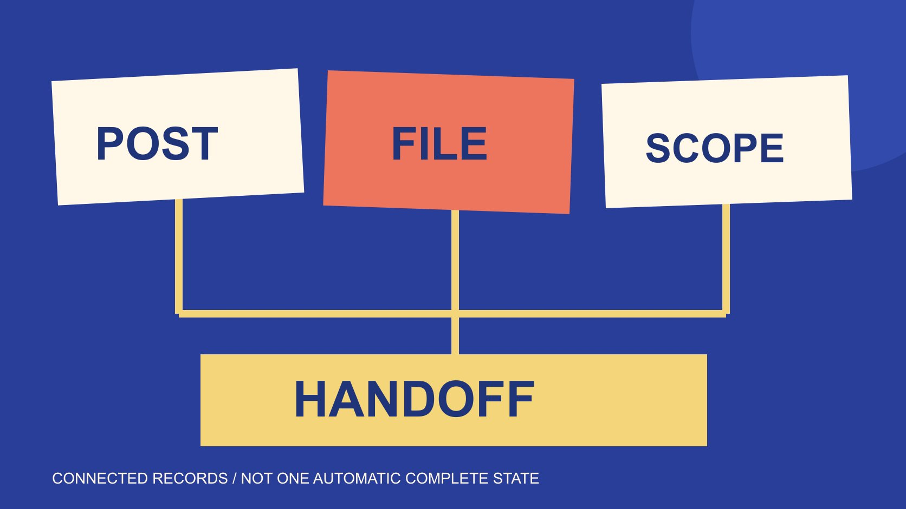

# Download an IG Reel: Complete the Campaign Handoff

Status: local review draft; confirm the publication date before release.

At campaign closeout, connect Reel publication records, production originals, versions, use scope and unfinished work in a maintainable handoff.

QuickKOL editorial graphic; not actual account metrics or a platform interface.

At campaign closeout, clarify whether a download IG Reel request means preserving a publication record, obtaining future production material or completing an archive. One downloaded file cannot simultaneously prove publication, approval, receipt of originals and confirmation of every use scope. Connect the original post, publication record, suitable production originals, versions, actual use conditions and unfinished items. Instagram download copies have commercial-use restrictions; later brand production should separately obtain appropriate originals and a use basis. This article offers an editorial handoff framework and blank CSV. It extracts no work, declares no real campaign complete and does not treat file existence as publication or verified performance.

## Define the closeout objects first

Closeout can involve publication records, production files, review records, use arrangements and outcome evidence. These objects are related but have different sources and completion conditions. A folder called complete cannot establish every state.

The [account-archive guide](/blog/download-instagram-reels-account-owner-archive/#answer) handles an account’s own information.

The [single-reference guide](/blog/download-instagram-reel-single-post-reference/#answer) handles revisiting and reference. Campaign closeout connects relevant objects and responsibilities so the next owner can continue with suitable material. The purpose is continuity rather than merely accumulation.

List the campaign’s content, corresponding platforms and required records, then assign responsibility by record type. Where production still owes material, retain unfinished items within the actual scope instead of declaring all work ended. The handoff can be accurate before every dependency is resolved.

This framework concerns editorial coordination. It does not replace actual contracts, organizational retention rules or a specific publication state, and it collects no real campaign files. Appropriate owners confirm those operational conditions against the project rather than infer them from a generic checklist.

## Connect the publication record with the media file

An original link, account, publication period and content identifier help the recipient identify the actual object. Verify against real sources rather than infer publication from a planning calendar or treat local preview as a production release.

If the post later becomes unavailable, retain observation date and the limited evidence obtained at that time without immediately inferring a deletion cause. A file remaining in storage does not establish continued public display. Publication state and file state must be readable independently.

A media file needs a corresponding content object, version and source. Avoid naming several different published variants final, which leaves a future editor unable to identify the intended asset.

The recipient should be able to follow the record to the post or understand its unavailable state, then identify the associated file. Sending a provenance-free video rarely answers those questions. A compact mapping is sufficient when it preserves the exact relationship rather than make the next owner reconstruct it from memory.

## Obtain appropriate originals for future production

The [Instagram download-conditions guide](https://help.instagram.com/520831036611383/?cms_platform=android-app) restricts commercial use of downloaded Reels. Future editing, advertising or another commercial task should separately obtain suitable production originals and a corresponding basis, not infer usability from a platform download copy.

The [production-original scope guide](/blog/creator-raw-footage-rights/#answer) distinguishes published edits, text-free versions, raw shots and project files. The actual task and arrangement determine what is needed. One download operation should not be expected to supply every deliverable.

Where material is missing, record the required version, technical conditions and next owner. Do not substitute a similar file from a different source while retaining a label saying verified original. Similar appearance and established provenance are different properties.

An author’s or producer’s agreement should also correspond to the file and scope, rather than be described as automatically cancelling restrictions on the platform copy. Appropriate owners check actual use questions against project conditions. This preserves the distinction between receipt, technical suitability and the arrangement for commercial use.

## Preserve the exact version associated with review

The [Frame.io version-comparison guide](https://help.frame.io/en/articles/9952618-comparison-viewer) describes comparing versions and associated comments. That capability can help inspect differences, but the comparison tool itself does not establish brand approval of a fact or work.

Record which version, which actual confirmation and which matters were reviewed. Technical acceptance, fact review and commercial scope may have different owners. An ambiguous check mark should not cover all of them. The next editor needs to understand what a confirmation actually concerns.

If subtitles, sound or visuals change later, retain the revision reason and the relationship between versions. Do not place a new file under an old approval record as though the same material had been reviewed at that time.

This article uses no real account or review project. The framework helps a recipient locate actual records and recognize pending conditions, instead of inferring completed approval from software capability. A useful state can remain awaiting confirmation when no source establishes more.

## Check technical properties for the next assignment

The [Adobe export-settings guide](https://helpx.adobe.com/premiere/desktop/render-and-export/export-files/overview-of-export-settings.html) explains conditions including format, frame dimensions and frame rate, with related handling of captions and metadata. It informs technical fields here without prescribing one universal parameter set for every later Reel use.

Define the next task before inspecting the actual file. Playability does not establish suitability for further editing or a particular publication placement. Check required visuals, sound and subtitles against the actual destination rather than the broad label video.

Record inspected results and untested properties. A supplier’s high-definition claim should not become a measured technical fact in the handoff. This article has no actual file or test result. Requested, reported and inspected properties should remain distinguishable.

If conditions do not fit, tell the corresponding production owner what is missing and which version is needed. Other records can still be completed. An unresolved technical item should not be hidden merely to make every row appear finished. The purpose is to identify usable material and the work still required.

## Keep use arrangements understandable after the activity

The [usage-scope guide](/blog/creator-rates-usage-rights/#answer) helps record actual channels, geography, period, editing and advertising conditions. An activity ending does not automatically extend use or include every future assignment in the original arrangement.

Connect the relevant record to a particular file and version, with unresolved matters explicit. A location inside a brand folder does not establish that music, appearances or other components suit a new purpose. File possession and a corresponding use basis remain different questions.

When a period or scope changes, an appropriate owner checks the actual arrangement before deciding how to continue. An ordinary handoff list records conditions; it does not amend a contract, renew a period or grant permission automatically.

Retain necessary information without placing account passwords or unrelated private details in a shared table. The recipient needs a route to suitable evidence rather than every sensitive project document. This also makes the ordinary working list easier to maintain because its purpose is a scoped connection, not an unrestricted archive.

## Accept outcome evidence separately from asset delivery

The [campaign-measurement guide](/blog/creator-campaign-measurement/#answer) connects objectives with corresponding evidence. Receiving an edit does not establish viewing or sales, and obtaining a platform copy does not establish a business impact for the whole activity.

Outcome records need source, definition, window and distribution conditions. Unobtained data remains unobtained. An interaction screenshot cannot supply a precise income or unique-customer count that it does not actually contain.

Asset delivery and outcome reporting can have different states. One complete and another awaiting evidence is an understandable project record. They do not need to collapse into an ambiguous success or failure. Each answers a separate completion question.

The next owner should know what is outstanding, who provides it and which judgment depends on it. Internal work can then continue against real dependencies even after the activity has publicly ended. That is more useful than a polished closeout label concealing an unfinished report or a missing asset.

## Check a three-piece campaign handoff

Suppose an activity has three pieces. A has suitable originals and a use record, B only an original post link and C an unresolved subtitle version. Do not label all three available for the next advertising round.

The CSV can record state, required file, scope, omission and next owner separately. B needs a material decision and C a version check. Even A remains limited to its actual scope rather than automatically expand to a new purpose.

If the owner receives a platform download copy, identify that provenance first, then decide whether the present need is only reference. Future commercial production still separately obtains appropriate originals and a corresponding basis.

This example contains no real brand, activity or outcome. It shows that a completed handoff explains differences rather than assign every piece the same finished label. A recipient can continue because the unresolved work is specific, not because uncertainty has disappeared. That is the practical purpose of the accompanying blank record.

## Give remaining work an explicit owner

Before using the CSV, add fields genuinely needed for the project while retaining blanks and unknown states rather than invent facts. A specific next action and owner are usually more useful than an unexplained pending label.

Use one content object per row. If an object has different files or purposes, duplicate a row with an explicit version relationship. Do not merge unreceived, awaiting review and inapplicable into one unexplained blank. State the reason and record a review on the date it actually happened. Later changes should follow the same approach so the recipient can distinguish the original handoff from subsequent completion rather than infer a history from the current state alone.

QuickKOL can help interpret briefs and research relevant partnerships. Actual publication, files, use conditions and outcomes still require verification at their source. Campaign closeout should tell the next colleague what can continue and what needs completion first.

## States to confirm separately at closeout

| State | Basis | Still cannot infer |

| --- | --- | --- |

| Published | Actual publication record | Suitable originals delivered |

| File received | Actual file and provenance | Reviewed or commercially usable |

| Version confirmed | Actual record for that version | Every future revision confirmed |

| Scope confirmed | Specific file and actual conditions | Unlimited use forever |

| Outcomes obtained | Corresponding source, definition and window | Every change caused by the activity |

Editorial handoff framework; the three-piece example is hypothetical, not an executed activity or permission determination.

## Reel campaign-closeout handoff

A blank 16-field CSV connecting publication, files, scope and outstanding work; it downloads or verifies no real material.

- [ ] Campaign and content identifiers recognizable.

- [ ] Original post and actual publication state sourced.

- [ ] File, provenance and version correspond.

- [ ] Technical and review states accurately recorded.

- [ ] Use scope and outcome reporting separated.

- [ ] Omission, next action and owner explicit.

[Download Chinese campaign-handoff CSV](/downloads/reel-campaign-closeout.zh.csv)

[Download English campaign-handoff CSV](/downloads/reel-campaign-closeout.en.csv)

## Research date and limitations

Sources reviewed November 4, 2026. Methods, tables and decision rules are editorial recommendations. Hypothetical examples are not actual client results or industry benchmarks. Source geography and periods are specified where relevant. This draft is in independent local review; confirm its publication date before release.

## Sources

- [Instagram download-conditions guide](https://help.instagram.com/520831036611383/?cms_platform=android-app)

- [Frame.io version-comparison guide](https://help.frame.io/en/articles/9952618-comparison-viewer)

- [Adobe export-settings guide](https://helpx.adobe.com/premiere/desktop/render-and-export/export-files/overview-of-export-settings.html)
