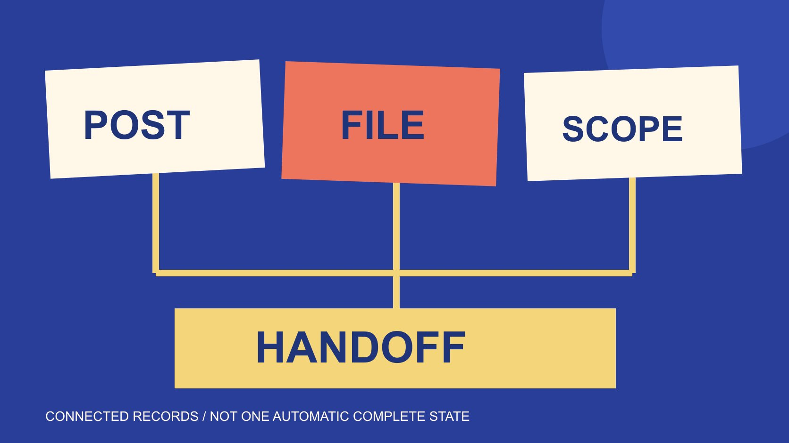

# IG Reel下载：活动结束交接

状态：本地审阅稿；正式发布日期待确认。

活动结束后，将Reel发布记录、制作原件、版本、使用范围与未完成项目连起来，交付可继续维护的内容清单。

QuickKOL 编辑图形；不呈现真实账号指标或平台界面。

活动结束时处理download IG Reel需求，先问要保留发布证据、取得后续素材，还是完成项目归档。一个下载文件不能同时证明已发布、已批准、原件已收到与所有使用范围已确认。交接应连接原帖、发布记录、适当制作原件、版本、实际使用条件和未完成项目。Instagram下载副本有商业用途限制，品牌后续制作应另取得适当原件和依据。本篇提供编辑交接框架与空白CSV，不抓取作品、不认定活动完成，也不把文件存在当成正式上线或效果已验证。

## 先定义活动结束时的交付对象

项目结束可能涉及发布记录、制作文件、审核记录、使用安排与结果资料。它们彼此相关，但每项有不同来源和完成条件，不能只建一个“已完成”文件夹。

[账号归档指南](/zh/blog/download-instagram-reels-account-owner-archive/#answer)帮助处理自有账号资料。

[单条参考指南](/zh/blog/download-instagram-reel-single-post-reference/#answer)处理回看与参考。活动结束交接则把相关对象与责任连接，方便下一位负责人继续使用适当资料。

先列本次活动有哪些内容、对应平台与需要保留什么，再确认谁负责各类记录。若部分材料尚待制作方补充，项目可以按范围保留未完成项，而不是宣称所有工作已结束。

本文框架适用于编辑交接，不替代真实合同、组织保存规则或具体发布状态。它没有收集任何实际活动文件。

## 把发布记录与媒体文件关联

原帖链接、账号、发布时期与内容编号，可以帮助接手者识别实际对象。记录由实际来源核对，不从计划日历推定已经发布，也不把本地预览当成正式上线。

如果原帖后来不可访问，保留观察日期与当时取得的有限资料，不直接推断删除原因。文件仍在也不能证明内容仍公开展示。

媒体文件需要说明对应哪条内容、哪个版本和哪个来源。避免把多个不同发布版本都命名为最终版，导致后续误用。

交接者应能沿记录找到原帖或理解无法访问状态，并知道哪一文件与其对应。只传一段没有出处的视频，通常无法回答这些问题。

## 为后续制作取得适当原件

[Instagram下载条件说明](https://help.instagram.com/520831036611383/?cms_platform=android-app)限制下载Reels的商业用途。未来要剪辑、投放或用于其他商业任务时，应另取得适当制作原件与相应依据，不从一个平台下载副本推定可用。

[制作原件范围指南](/zh/blog/creator-raw-footage-rights/#answer)区分发布成片、无文字版本、原始镜头和工程文件。需要哪些由实际任务与约定决定，不能要求一个下载动作自动补齐所有交付。

文件缺失时，记录所需版本、技术条件与下一位负责人。不要用一个内容相似但来源不同的文件替代，却继续标记为已经确认的原件。

作者或制作方的同意也应与具体文件和范围对应，不写成自动取消平台副本限制。实际使用问题由适当负责人按项目条件核对。

## 保留审核对应的具体版本

[Frame.io版本比较说明](https://help.frame.io/en/articles/9952618-comparison-viewer)介绍比较版本与相应评论的能力。它可以帮助查看差别，但比较工具本身不证明品牌已批准某个事实或作品。

交接应记录哪一版本、谁以何种实际记录确认了哪些事项。技术验收、事实审核与商业范围可能由不同人员处理，不用一个含糊勾选覆盖全部。

如果后来修改字幕、声音或画面，保留修订原因与新旧版本关系。不要把新文件放进旧批准记录中，假装当时已审核同一内容。

本篇没有使用真实账号或审阅项目。框架建议让接手者能找到实际记录，并识别仍待确认的内容，而不是从软件功能推定审批已经发生。

## 技术检查围绕接下来的任务

[Adobe导出设置说明](https://helpx.adobe.com/premiere/desktop/render-and-export/export-files/overview-of-export-settings.html)介绍格式、画面尺寸、帧率等导出条件，以及字幕和元数据的相关处理。这里以其说明理解技术字段，不规定所有Reel后续使用都采用一个统一参数。

先明确接下来的任务需要什么，再检查实际文件。能播放不等于适合继续剪辑或某个发布位置；需要的画面、声音和字幕条件按实际目标核对。

记录实际检查结果和未测项目，不把供应方宣称高清写成已经测量的技术事实。本文没有真实文件或实测结果。

若技术条件不合适，向对应制作负责人说明缺口与需要版本。可以继续完成其他交接记录，不必为了让状态全部完成而隐藏问题。

## 让使用安排在活动之后仍可理解

[使用范围指南](/zh/blog/creator-rates-usage-rights/#answer)帮助记录渠道、地区、期限、编辑和广告等实际条件。活动结束不自动延长使用，也不意味着未来所有任务都包含在原来约定中。

把相应记录连接到具体文件与版本，并标明仍待核实事项。不能因为文件在品牌文件夹中，就默认音乐、人物或其他组件全部适用于新的用途。

期限或范围改变时，由适当负责人核对实际安排，再决定下一步。普通交接清单记录条件，不自动修改合同、续期或授予权限。

保留必要资料即可，不在共享表中放账号密码或无关私人信息。接手者需要找到合适依据，而不是接收整个项目所有敏感材料。

## 结果资料与素材交付分别验收

[项目测量指南](/zh/blog/creator-campaign-measurement/#answer)将目标与相应证据连接。收到成片不证明观看或销售，取得平台副本也不证明整个活动产生了某种业务影响。

结果记录保留来源、定义、窗口与分发条件。没有取得的数据保持未取得，不能从作品互动截图补出精确收入或独立顾客。

素材交付和结果报告可以具有不同状态。一个已完成、另一个待资料，是可理解的项目记录，不需要合并成模糊的成功或失败。

后续负责人应知道还等什么、由谁提供以及会影响哪项判断。这样即使活动对外已经结束，内部工作也能按真实依赖继续。

## 用三条内容的活动检查交接

假设活动有三条内容，A已取得适当原件与范围记录，B只有原帖链接，C的字幕版本仍待核对。不要将三个对象都列为可用于下一轮广告。

CSV可以分别记录状态、所需文件、范围、缺项和下一位负责人。B需要另确认素材，C需要确认版本；A也只能按实际范围使用，不自动扩展用途。

如果负责人收到的是一个平台下载副本，先标清来源，再决定当前任务是否只需参考。未来商业制作仍另取得适当原件与依据。

这个例子没有真实品牌、活动或结果。它展示完成交接的含义是把差别说清，而不是让每条内容都拥有同样的完成标签。

## 把剩余工作交给明确负责人

使用下方CSV前，可以按项目增加必要字段，但保留空白与未知状态，不编造事实。记录一项下一步和负责人，通常比一个含糊待处理标签更有用。

每行以一个内容对象为单位，同一对象有不同文件或用途时，可复制一行并清楚标记对应版本。不要把未取得、待核对和不适用混为一个空格；用明确状态解释原因，并把复核结果留在实际发生的日期。交接后变化也应按同样方式更新。

QuickKOL可以帮助理解Brief和研究相关合作。实际发布、文件、使用条件与结果继续按来源核对；活动结束交接应让下一位同事知道什么可以继续，什么需要先补齐。

## 活动结束时分开确认的状态

| 状态 | 依据 | 仍不能推定 |

| --- | --- | --- |

| 已发布 | 实际发布记录 | 适当原件已交付 |

| 文件已取得 | 实际文件与来源 | 已审核或可商用 |

| 版本已确认 | 对应版本的实际记录 | 所有未来改版已确认 |

| 范围已确认 | 具体文件与实际条件 | 无限期全部使用 |

| 结果已取得 | 相应来源、定义与窗口 | 所有变化均由活动导致 |

编辑交接框架；三条内容为假设，不是已执行活动或许可结论。

## Reel活动结束交接表

16字段空白CSV，连接发布、文件、范围与待办；不下载或验证真实素材。

- [ ] 活动与内容编号可识别。

- [ ] 原帖与实际发布状态有依据。

- [ ] 文件、来源与版本相互对应。

- [ ] 技术与审核状态按实际记录。

- [ ] 使用范围与结果报告分开。

- [ ] 缺项、下一步与负责人明确。

[下载中文活动交接CSV](/downloads/reel-campaign-closeout.zh.csv)

[下载英文活动交接CSV](/downloads/reel-campaign-closeout.en.csv)

## 研究日期与使用边界

资料核验于 2026 年 11 月 4 日。文中方法、表格和决策规则为编辑建议，标为假设的示例不是实际客户结果或行业基准。外部资料的适用地区与时期按各段说明；本稿处于独立本地审阅阶段，正式发布日期待确认。

## 来源

- [Instagram下载条件说明](https://help.instagram.com/520831036611383/?cms_platform=android-app)

- [Frame.io版本比较说明](https://help.frame.io/en/articles/9952618-comparison-viewer)

- [Adobe导出设置说明](https://helpx.adobe.com/premiere/desktop/render-and-export/export-files/overview-of-export-settings.html)
