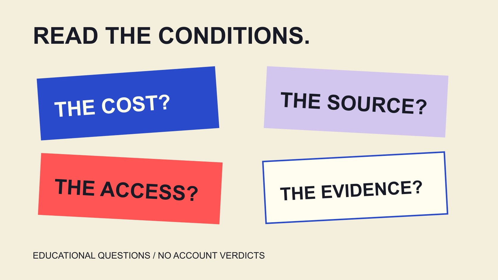

# Free Instagram Followers Offers: Read the Conditions

Status: local review draft; confirm the publication date before release.

Read free Instagram follower offers by separating price, conditions, access, source and outcomes, retaining verification questions without converting suspicious signals into established accusations.

QuickKOL editorial graphic; not actual account metrics or a platform interface.

When searching for free Instagram followers Instagram, treat free as a pricing claim rather than proof of source, genuine interest or results. An offer still needs to explain participation conditions, requested access, where the number comes from and what evidence supports it. Meta’s spam policy opposes buying, selling or exchanging engagement, among other conduct. This educational article supplies no claiming service, follow-exchange process or artificial-growth procedure. It helps brands and readers interpret promises, protect account information and retain uncertainty. It investigates no particular operator and labels no individual false from a follower change. The aim is an informed decision about a claim, not a perfect detector.

## A free claim answers only part of the pricing question

Free on a page does not independently explain time, information, later charges or other participation conditions. Treat those as questions to inspect rather than assume they are absent.

Do not reverse that into a claim that every free entry point is deceptive. A judgment needs particular evidence. Education can identify gaps without inventing an operator’s motive in the absence of investigation.

Retain necessary records of the visible promise, date and relevant conditions. Testing whether the promise works does not require joining artificial engagement or submitting account credentials.

Translate the wording into clear questions: what is free, what is required, how is the number produced and how would outcomes be measured? One adjective cannot answer all of them.

If the original objective is for interested readers to understand content, keep that objective visible. An offer about a number should not silently replace the audience need and later use the resulting total to justify that change. A well-framed question can show that the offer does not answer the assignment even before a particular service is evaluated.

## Separate information requests from account access

A public username, private information, password, verification code and operating permission are different objects. A simple form grouping them together does not make the requests equivalent.

Read the actual scope: identifying what is requested is not enough without understanding why it relates to the task and what inspectable explanation supports it. An unclear condition is a reason to stop relying on that route.

Do not exchange passwords, recovery information or verification codes for an unfamiliar follower promise. This guide also asks for none of those in chat and requires no actual account login to inspect a page.

No password still answers only one question. It does not independently verify source, count quality or every access condition; retain the unanswered parts.

These are claim-reading methods, not findings that a particular tool stole information. A suspicious request needs appropriate verification, while an established incident needs its actual basis and scope described. An editor should be able to explain the difference without either endorsing the service from one reassuring phrase or making an unsupported accusation from one concern.

## Check branding and reviews with appropriate context

The [FTC phishing guide](https://consumer.ftc.gov/articles/how-recognize-avoid-phishing-scams), in a U.S. consumer-education context, explains that messages can imitate familiar companies. For verification, use a website or contact route known to be genuine rather than rely only on the message’s information.

Apply that checking principle to a free offer: confirm the actual source and contact route before further action. This is not a finding that a particular real message or page is phishing.

The [Meta app-security report](https://about.fb.com/news/2022/10/protecting-people-from-malicious-account-compromise-apps/) uses a 2022 investigation of apps targeting Facebook login information to show why store appearance and reviews are not complete verification. It is historical research with a date and platform scope, not 2026 statistics about Instagram follower services.

The same report acknowledges legitimate applications. A similar interface, login option or third-party status therefore does not establish identical behavior across services.

Record source verification separately from performance. Knowing who supplies a service still does not validate its follower and outcome promises. Those questions need evidence of their own rather than inherit certainty from the page’s branding or a familiar distribution channel.

## Read interaction policy without making count-based accusations

The [Meta spam policy](https://transparency.meta.com/policies/community-standards/spam/), in the U.S. English version actually read for this draft, prohibits attempted or successful buying, selling and exchanging engagement such as likes and follows. It also describes deceptive links and engagement gating.

Retain its scope and exceptions. Content collaboration, clearly identified branded content and the described cross-promotion not triggered by payment to a third party should not become a claim that all promotion is prohibited.

This guide provides no exchange procedure, bulk operation or service entry point. It explains why free alone does not resolve source and platform-condition questions.

At the same time, an externally observed follower jump, low interaction or similar comments does not independently establish that a person violated policy. Separate a signal, possible explanation and supported fact.

The platform has its actual handling and appeal mechanisms; an educational article makes no determination on its behalf. It also promises no perfect identification from a few public figures. A policy can guide interpretation of described conduct without turning an unexplained change into proof of that conduct.

## Source, interest and business outcomes need separate support

A follower count does not independently reveal who followed for which reason, whether they continue reading or whether a business outcome occurred. Interpret people, accounts and actions under actual data definitions.

The [metric-definition guide](/blog/engagement-rate-formula-metric-contract/#answer) establishes object and window. If only a total is available, report the total instead of inventing unknown audience characteristics, motives, countries or purchasing.

The [content-measurement guide](/blog/creator-campaign-measurement/#answer) connects objectives with evidence. Helping a reader understand a guide, continually providing content and confirming a purchase are different questions; one field cannot substitute for every outcome.

The [engagement-literacy guide](/blog/free-tiktok-likes-engagement-literacy/#answer) further separates action, interest and results. It discusses a TikTok context, while actual platform rules still require their respective current sources rather than mechanical transfer.

If a promise lacks corresponding support, label it unverified. A later change in one value does not make every stronger claim true simultaneously. This distinction keeps the report useful to someone deciding how to improve content rather than only deciding whether a displayed number became larger.

## A hypothetical: read an unclear claiming promise

Suppose a page only promises free followers, then presents additional steps without explaining source or requested access. This is an educational scenario, not a real operator investigated for this article.

Record the visible claim and missing conditions, identify the questions needing answers and stop relying on that route. Reading the claim does not require joining exchanges, installing unexplained software or submitting information.

A report should state what was observed and what remains unknown rather than declare fraud proved or accuse an individual of purchasing followers. A page’s information gap and particular responsibility require different evidence.

If the brand’s original goal is for relevant readers to find a tutorial, next examine content, entry points and distribution. Improving those tasks guarantees no fixed follower increase and does not require adopting an unexplained promise as a shortcut.

The example shows how to retain a question while continuing evidence-based work. Not adopting a service can be a reasonable result; the investigation need not select a winner merely to produce a recommendation list.

## If information was shared, return to appropriate official help

If a reader is concerned they shared account information with an unclear source, the account user should use appropriate official help to inspect current protection and recovery routes. Do not keep circulating credentials in public comments or ordinary handoff files.

The FTC guidance points to relevant post-phishing information, and Meta’s historical report links account-protection advice. Choose actual steps for the affected service and current state rather than copy an old Facebook menu into a universal Instagram instruction.

Record necessary symptoms and timing for an appropriate account owner. Concern does not independently prove compromise; unconfirmed parts remain unconfirmed.

This article changes no password, revokes no access, deletes no material and submits no report for a user. It explains appropriate help and requests no passwords or verification codes in chat.

Content and evidence work can continue without exposing more private information for reassurance. Protective action and a conclusion about an operator’s responsibility are separate questions too. A clear account-support route can be worthwhile while the cause of an observed problem remains unresolved.

## Write educational guidance as an inspectable explanation

If a team turns this reading experience into an internal educational note, organize it around the claim, question and appropriate next step rather than an unsupported list of people. Identify policy statements, editorial recommendations and unverified points separately.

For screenshots, retain what the explanation needs along with the date and necessary context. Do not include unrelated personal details, contact information or private messages, and do not crop in a way that changes meaning.

For an unusual count, describe the observation’s scope and which evidence may still be needed. An authenticity percentage without a defensible method would make readers think a professional detection process had occurred.

If reliable correction becomes available, retain its source and revision state. That keeps the material useful instead of turning one limited observation into a permanent label. This guide supplies a learning framework, not a verdict about an individual, page or service. The next action should be understandable from the evidence actually provided.

## Bring the conclusion back to claims and evidence

Free does not establish source, followers do not represent every interest or outcome, and unusual does not mean a violation proved. Retaining those distinctions helps brands and readers choose a clearer next step.

Continue with metric definitions, sources and limitations. This guide recommends no artificial-growth service and provides no personal authenticity score. It supports understanding a claim and accurately expressing what remains unknown.

## Five questions for a free offer

| Question | Inspect | Retain uncertainty |

| --- | --- | --- |

| What is free? | Price and participation conditions | Unexplained later conditions |

| Which access is requested? | Information, credentials and operating permission | Unclear scope |

| Where does the number come from? | Appropriate source explanation and support | Do not infer motive from a total |

| Which outcome? | Metric definition and actual evidence | Unmeasured is not achieved |

| What is known? | Observation, explanation and supported fact | A signal is not an accusation |

Educational reading framework; the hypothetical claiming page is not an operator investigation or perfect-detection tool.

## Free-offer reading checklist

For understanding conditions, not claiming, exchanging or testing an account.

- [ ] Read price and source separately.

- [ ] Requested information and access scope explicit.

- [ ] Separate source verification from performance.

- [ ] Interpret policy against actual conduct.

- [ ] Separate suspicious signals from established facts.

- [ ] Retain gaps and an appropriate next step.

## Research date and limitations

Sources reviewed November 4, 2026. Methods, tables and decision rules are editorial recommendations. Hypothetical examples are not actual client results or industry benchmarks. Source geography and periods are specified where relevant. This draft is in independent local review; confirm its publication date before release.

## Sources

- [FTC phishing guide](https://consumer.ftc.gov/articles/how-recognize-avoid-phishing-scams)

- [Meta app-security report](https://about.fb.com/news/2022/10/protecting-people-from-malicious-account-compromise-apps/)

- [Meta spam policy](https://transparency.meta.com/policies/community-standards/spam/)
