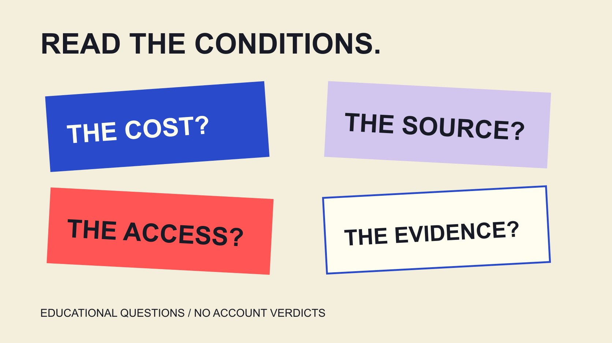

# 免费Instagram粉丝说法：如何读领取条件

状态：本地审阅稿；正式发布日期待确认。

阅读免费Instagram粉丝承诺时，把收费、条件、访问、来源与结果分开，保留需要核验的问题，不将可疑信号写成已证实指控。

QuickKOL 编辑图形；不呈现真实账号指标或平台界面。

搜索“free Instagram followers Instagram”时，先把“免费”理解为一个收费声明，而不是来源、真实兴趣或结果的证明。页面还需要回答参与条件、所需访问、数字从哪里来，以及有什么适当证据。Meta垃圾互动政策反对买卖或交换互动等行为；本篇不提供领取入口、互关流程或刷粉操作。它是一篇教育文章，帮助品牌与读者理解承诺、保护账号资料并保留未知，不调查具体经营者，也不凭粉丝变化给个人贴虚假标签。

## 免费说法只回答了部分收费问题

页面上写免费，没有独立说明是否存在时间、资料、后续付费或其他参与条件。阅读时把这些作为待核对问题，而不是先假定全部不存在。

也不应反过来认定每个免费入口都在欺骗。判断需要具体资料，教育内容可以说明缺口，却不能在没有调查时替某个经营者补上动机。

先保存可见承诺、日期与相关条件的必要记录。不需要为了证明页面是否有效，实际参与人为互动安排或提交账号凭据。

把承诺改写成清楚问题：免费指什么、需要什么、数字如何形成、结果怎样衡量。一个词语无法同时回答这几项。

如果目标原本是让有兴趣的读者理解内容，就继续保留这个目标。不要让一个数字承诺悄悄取代受众需要，随后再用总数为改变目标辩护。

## 阅读条件时，区分资料与账号访问

公开用户名、私人信息、密码、验证码与操作权限不是同一种对象。不能因为页面把它们都放在一个简单表单里，就视为相同程度的请求。

阅读所要求的实际范围：只说明需要什么还不够，也要看它为什么与任务有关，以及对方提供了什么可核对说明。条件不清楚时，可以停止依赖该路线。

不把密码、恢复资料或验证码交给陌生承诺来换取粉丝。本篇也不要求读者在聊天里发送这些内容，或为检查页面实际登录某个账号。

“不需要密码”仍然只回答一个问题，不能独立证明服务来源、数字质量或全部访问条件。应保留它仍未回答的部分。

这些是读声明的方法，不是关于某个具体工具已经窃取资料的结论。可疑请求需要适当核验，已确认事件则说明实际依据与范围。

## 品牌外观与评价都需要适当核对

[FTC网络钓鱼说明](https://consumer.ftc.gov/articles/how-recognize-avoid-phishing-scams)在美国消费者教育语境中提醒，消息可能模仿熟悉企业；需要核实时，使用自己知道真实的网站或联系方式，而不是只依靠消息里的入口。

对免费承诺的阅读，可以借用这个核对原则：先确认实际来源与联系路径，再考虑进一步动作。这里没有认定某条真实消息或页面就是钓鱼。

[Meta应用安全研究说明](https://about.fb.com/news/2022/10/protecting-people-from-malicious-account-compromise-apps/)以2022年针对Facebook登录资料的应用为例，说明应用商店中的外观与评价并非完整验证。它是有明确日期和平台范围的历史研究，不是2026年Instagram粉丝服务统计。

同一研究也承认存在合法应用。因此，不应从相似界面、一个登录选项或第三方身份，直接推出所有服务都有相同行为。

把来源核对与性能核对分别记录。知道谁在提供服务，仍不等于已经证明它关于粉丝和结果的承诺。

## 按平台政策理解互动，不凭数字定罪

[Meta垃圾互动政策](https://transparency.meta.com/policies/community-standards/spam/)在本次实际读取的美国英语版本中，禁止企图或成功买卖、交换点赞、关注等互动，也说明误导链接与互动门槛相关行为。

阅读时保留政策范围与例外。真实内容合作、清楚标明的品牌内容，以及政策所述不涉及向第三方付款的交叉推广，不能被概括成所有推广都被禁止。

本篇不会提供交换步骤、批量操作或服务入口。它解释为什么一个免费标签不能独立解决互动来源与平台条件的问题。

同时，外部观察到粉丝突增、互动较低或评论相似，不足以单独证明某个个人违反政策。把信号、可能解释和已证实事实分开。

平台处理与申诉有其实际机制，教育文章不替平台认定。我们也不承诺根据几项公开数字就能百分百识别所有不真实行为。

## 来源、兴趣与业务结果分别需要依据

一个粉丝计数没有独立说明谁为何关注、是否持续阅读，或是否产生某种业务结果。人数、账号与动作的关系应按实际数据定义理解。

[指标定义指南](/zh/blog/engagement-rate-formula-metric-contract/#answer)帮助确认对象与窗口。若只取得总数，就如实报告总数，不补写未知的人群、动机、国家或购买行为。

[内容测量指南](/zh/blog/creator-campaign-measurement/#answer)把目标与证据对应。帮助读者理解指南、持续提供内容与确认购买，是不同问题；其中一个字段不能代替全部结果。

[互动数据学习指南](/zh/blog/free-tiktok-likes-engagement-literacy/#answer)进一步区分动作、兴趣和结果。它以TikTok情境说明相关概念，实际平台规则仍分别采用各自当前资料，不能机械套用。

如果某项承诺没有对应依据，写未验证。一个数值后来改变，也不会独立让所有更强说法同时成立。

## 假设案例：读一份含糊的领取承诺

假设一页只写免费获得粉丝，随后提出额外步骤，却没有解释来源和所需访问。这是教学设定，不是本篇调查过的真实经营者。

可以记录可见承诺与缺失条件，提出需要回答的问题，然后停止依赖该路线。无需实际参与交换、安装不明软件或提交资料来完成这项阅读任务。

报告应写观察到什么、哪些内容还不知道，而不是直接宣称已证明经营者欺诈或某个个人购买了粉丝。页面缺口与具体责任需要不同证据。

如果品牌原本希望更多相关读者找到教学，接下来可以审视内容、入口和分发安排。改善这些任务并不保证固定粉丝增长，也不需要把未知承诺当作捷径。

这个例子示范如何保留问题，同时继续有依据的工作。合理结果可以是未采用，不必为了形成推荐名单强行选出一个服务。

## 已经共享资料时，回到适当官方帮助

如果读者担心已经把账号资料交给不明来源，应由账号使用者通过适当官方帮助核对当前保护和恢复路径。不要在公开评论或普通交接文件中继续传播凭据。

FTC说明提供网络钓鱼后的相关处理资料，Meta历史研究也指向相应账号保护建议。实际步骤按受影响服务与当前状态选择，不把Facebook历史菜单照搬成所有Instagram账号的现行操作。

记录必要现象与时点，交给适当账号负责人。担忧并不独立证明已经被入侵，尚未确认的部分保持尚未确认。

本篇不替任何用户改密码、解除访问、删除资料或提交报告。它解释应该寻求怎样的适当帮助，也不会在聊天中索要密码或验证码。

内容与资料判断可以继续，但不以进一步暴露私人信息换取确定感。保护行动与对某个经营者责任的判断，也应分别处理。

## 把教育提醒写成可核对说明

如果团队准备把这类阅读经验写成内部提醒，可以围绕声明、问题和适当下一步组织，而不是制作缺少依据的个人名单。明确哪些内容来自政策，哪些是编辑建议，哪些仍未验证。

展示截图时只保留解释所需的部分，同时保留日期与必要语境。不要把无关个人资料、联系方式或私密消息带入教学材料，也不让裁剪改变原本意思。

对异常计数，可以准确描述观察范围，并说明可能还需要资料。不要配上一个没有方法依据的“真实性百分比”，让读者以为已经完成专业检测。

如果后来有可靠更正，保留来源和修订状态。这让教育材料继续有用，也避免把一次有限观察变成永久标签。本篇提供的是学习框架，不是对具体个人、页面或服务的判决。

## 让结论回到承诺与证据

免费不证明来源，粉丝不等于全部兴趣或结果，异常也不等于已证实违规。把这些区别保留，品牌和读者才能更清楚地决定下一步。

继续学习时，优先明确指标、资料来源与限制。本篇不推荐人工增长服务，也不提供个人真假评分；它支持对承诺的理解，以及对未知的准确表达。

## 免费承诺的五个问题

| 问题 | 核对 | 保留未知 |

| --- | --- | --- |

| 免费指什么？ | 收费与参与条件 | 未说明的后续条件 |

| 需要哪些访问？ | 资料、凭据与操作权限 | 不清楚的范围 |

| 数字从何而来？ | 适当来源说明与依据 | 不能从总数反推动机 |

| 效果是什么？ | 指标定义与实际证据 | 未测量不写已实现 |

| 知道什么？ | 观察、解释与证实事实 | 信号不直接变指控 |

教育阅读框架；假设领取页面不是实际经营者调查或百分百识别工具。

## 免费承诺阅读清单

用于理解条件，不执行领取、交换或账号测试。

- [ ] 收费与来源分别看。

- [ ] 所需资料与访问范围明确。

- [ ] 来源与性能核验没有混为一谈。

- [ ] 平台政策按实际行为理解。

- [ ] 可疑信号与证实事实分开。

- [ ] 缺口与适当下一步保留。

## 研究日期与使用边界

资料核验于 2026 年 11 月 4 日。文中方法、表格和决策规则为编辑建议，标为假设的示例不是实际客户结果或行业基准。外部资料的适用地区与时期按各段说明；本稿处于独立本地审阅阶段，正式发布日期待确认。

## 来源

- [FTC网络钓鱼说明](https://consumer.ftc.gov/articles/how-recognize-avoid-phishing-scams)

- [Meta应用安全研究说明](https://about.fb.com/news/2022/10/protecting-people-from-malicious-account-compromise-apps/)

- [Meta垃圾互动政策](https://transparency.meta.com/policies/community-standards/spam/)
