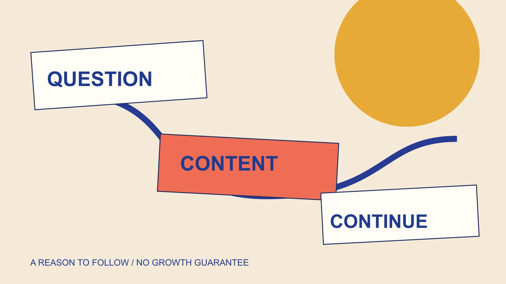

# Free Instagram Followers: Plan Organic Audience Development

Status: local review draft; confirm the publication date before release.

Turn a search for free Instagram followers into education on organic audience development: a clear reason to follow, useful content, maintenance and honest measurement.

QuickKOL editorial graphic; not actual account metrics or a platform interface.

If free Instagram followers means audience development without buying or exchanging followers, a reasonable starting point is a clear explanation of what the account helps people understand, supported by useful, accurate and maintainable content. Organic distribution does not eliminate staff, production or time costs, and no formula guarantees a quantity or speed of growth. This educational guide recommends no follower giveaway service, follow exchange or artificial-growth operation. It helps a brand plan a reason to follow, relevant content and ongoing maintenance. Changes in follower totals establish limited observations, not automatic understanding, trust, purchases or anyone’s misconduct. Interaction of unverifiable origin should remain unknown.

## Write a reason for someone to keep following

A brand account can explain what it consistently helps people understand instead of merely announce a desire for more followers. The reason should match content it can actually maintain, such as clear product-operation explanations rather than a promise of daily exclusive information it cannot sustain.

The [content-brief guide](/blog/write-a-useful-campaign-brief/#answer) helps identify who needs which explanation. A profile can then connect identity, value and next step. The [Instagram bio guide](https://help.instagram.com/728994388226960/) specifies a 150-character limit and public visibility. Limited space calls for necessary information rather than a collection of vague labels.

A clear biography cannot guarantee growth or replace subsequent content. It helps a first-time visitor recognize relevance, while the decision to follow remains the reader’s. Treat the profile as an explanation, not a conversion mechanism with a promised result.

Do not assume every reader has the same need. State intended audience and scope so someone outside it can also make an accurate decision. Maximizing the head count is not the only useful standard for an account whose content serves a particular professional or practical task.

## Distinguish organic development from exchanging engagement

The [Meta spam policy](https://transparency.meta.com/policies/community-standards/spam/) addresses buying, selling and exchanging engagement and related manipulation, while distinguishing allowed situations. Organic audience development should concern content and genuine relevance rather than treat the word free as a justification for any operation.

This article gives no follow-exchange, artificial-like, follower-claim or restriction-evasion steps. It also does not rename all partnerships, paid distribution or brand mentions artificial interaction. Each needs its actual facts and conditions.

If a service promises quantity, speed or permanent results, record the gap between claim and evidence instead of trying it and presenting that experience as certification. A promotional guarantee does not become a platform-backed outcome merely because it is worded confidently.

The educational task is to understand boundaries. This article tests no supplier, analyzes no individual and establishes no account violation. Unknown provenance stays unknown, preventing method learning from becoming an accusation. That distinction should remain intact when the explanation is reused in a report or internal training.

## Build a content list from actual questions

The [GOV.UK content-design guide](https://guidance.publishing.service.gov.uk/writing-to-gov-uk-standards/plan-manage-content/understand-content-design/) supports organizing information around user needs. Adapting that principle, build a list from actual questions and verifiable information instead of treating popular words as the current audience’s needs.

Questions can come from appropriately obtained support records, gaps in public explanations or conditions the team repeatedly explains. Remove unnecessary private information while retaining the context and evidence version needed for the task. A personal account of a problem does not need to be copied wholesale into the production brief.

For each question, identify the answer’s object, required material and applicable conditions. Mark unsupported items awaiting evidence rather than let a publishing deadline force a creator to invent a claim.

This is not an algorithm strategy guaranteeing organic exposure. It connects production effort with an audience task. Whether content is seen and whether it is understood still need separate observations. A useful explanation can be worth producing without an invented prediction about how many followers it will generate.

## Fulfill the positioning with self-contained content

The [Reels education-content guide](/blog/reels-brand-education-content-assignment/#answer) helps turn a question into a self-contained piece. Identify the object, show the necessary process, then explain conditions and an appropriate continuation. Viewers should not need every historical post to understand it.

The same question can have different depths, such as a short identification explanation and a complete procedure page. Do not hide a necessary condition in a future post merely to make someone keep following. A series should extend learning rather than withhold the present answer.

Original visuals and wording still need a factual basis. Label AI illustration, a hypothetical setting and actual product performance separately. Realistic-looking material does not replace a verified result, and an original asset is not automatically evidence for every claim attached to it.

Review subtitles, sound and readable wording during production. Confirm platform features against the actual account and current conditions instead of saying an editing structure necessarily produces recommendations or follows. The assignment should be judged first on whether its explanation can be understood.

## Plan responses and content maintenance

An account needs someone to answer suitable questions, correct outdated information and maintain destinations if it is to keep providing value. Organic distribution does not remove that work or make internal staff time costless.

Assign who maintains facts, answers routine questions and routes matters requiring a technical specialist. Ordinary comment discussion should not carry passwords, private identity records or other unnecessary sensitive information. A suitable support route can handle issues outside the content team’s scope.

When content changes, record the reason and version. A model or activity condition changing may affect old posts and pages, not merely require another new piece. Maintenance belongs in the plan alongside production.

The [social media operating plan](/blog/social-media-marketing-operating-plan/#answer) helps assign responsibility and capacity. Where resources are insufficient, narrow scope and reduce promises instead of retaining a growth objective nobody can maintain. This makes the proposed work reviewable even though audience outcomes remain uncertain. A small dependable explanation service is a concrete assignment rather than an abstract posting ambition.

## Describe accurately what the next step provides

The [W3C link-purpose technique](https://www.w3.org/WAI/WCAG21/Techniques/general/G91) emphasizes wording that expresses a destination. Apply that descriptive principle to invitations across profile, content and page without claiming a full accessibility certification.

If the explanation offers a model list, check that it reaches the actual list, uses the expected language and remains current. Do not describe an unproduced free resource as already downloadable. A useful invitation concerns what the reader can actually receive now.

Where another choice is necessary, explain why. Readers can judge whether to continue when they understand how the next step relates to their original question, rather than be sent through an ambiguous button to unrelated information.

A link opening and a page fulfilling its invitation are separate checks. Assign a destination owner so a persistent biography does not point at an ended activity. When the page changes, review the entry wording as well; preserving a URL does not necessarily preserve the same reader experience.

## Observe audience development without making totals every outcome

The [like-comparison education guide](/blog/free-instagram-likes-comparison-distortion/#answer) explains denominators, windows and distribution conditions. Changes in follower totals likewise need a source and period. They do not automatically establish that one piece caused growth, and they cannot be converted directly into understanding or income.

Distinguish account totals, change over a period and information actually available for a particular piece. Unobtained reports remain unobtained. Do not reconstruct apparently precise unique audiences from a screenshot that does not supply them.

If the question concerns whether an explanation helped, actual questions and suitable feedback can contribute. Still state sample, observation scope and unknowns. One favorable comment does not represent everyone, just as silence does not independently establish that no one benefited.

Avoid one growth-rate threshold for every account. Objectives, periods and assignments differ. An appropriate comparison explains conditions before discussing revision, rather than turn an attractive increase into a universal benchmark or an unfavorable result into a personal accusation.

## Apply the plan to a maintenance-tool explanation account

Suppose a brand has actual maintenance-tool instructions and wants to answer recurring questions about identifying parts, storage and applicable conditions. Establish the account’s purpose and evidence owner without guaranteeing a follower number.

A first round can finish one part-identification piece and its corresponding page, then use actual questions to decide whether another explanation is needed. A fictional adult presenter illustrates the assignment, while product conditions require real information. An illustration is not a user-results claim.

If many questions concern the model, inspect whether the explanation omitted that condition. If evidence is missing, obtain facts rather than expand a following promise to conceal the gap. The next useful task may be a clearer label rather than more content.

This is a planning example with no actual account, publication or growth result. It shows how organic audience development can begin with consistently fulfilling an explicit assignment instead of claiming a quantity. The output can be reviewed for clarity before any future audience outcome is known.

## Choose content work that can be maintained

Retain the reason to follow, actual questions, material, owners and review conditions in the plan. Expression and scope can change over time, but free should not mean costless, and useful education should not become a route to buying or exchanging interaction.

Keep delivery states separate as well: explanation written, material produced, account publication completed and outcome evidence obtained are different states. An owner can confirm each against actual progress, preventing a date in a planning calendar from making the next team assume execution has happened. This record needs no growth forecast to be useful.

Actual outcomes require actual evidence. Continuing to explain questions and improve content is actionable work; a specific quantity, speed or commercial result cannot be guaranteed in advance.

## Organic audience work and its limits

| Work | Concrete output | Cannot guarantee |

| --- | --- | --- |

| Positioning | Clear reason to follow | Every visitor follows |

| Content | Supported self-contained explanation | Guaranteed distribution |

| Maintenance | Owners, versions and current destinations | No time cost |

| Measurement | Sourced, scoped interpretation | Followers equal business outcomes |

Educational and editorial framework; no engagement service, growth guarantee or individual identification.

## Organic-audience content-plan checklist

For learning and production planning, without operating an account or obtaining followers.

- [ ] Positioning matches actual content.

- [ ] Questions have evidence and material.

- [ ] Pieces do not withhold necessary conditions.

- [ ] Maintenance has staff and time.

- [ ] Destination fulfills its invitation.

- [ ] Outcomes, unknowns and limits accurately recorded.

## Research date and limitations

Sources reviewed November 4, 2026. Methods, tables and decision rules are editorial recommendations. Hypothetical examples are not actual client results or industry benchmarks. Source geography and periods are specified where relevant. This draft is in independent local review; confirm its publication date before release.

## Sources

- [Instagram bio guide](https://help.instagram.com/728994388226960/)

- [Meta spam policy](https://transparency.meta.com/policies/community-standards/spam/)

- [GOV.UK content-design guide](https://guidance.publishing.service.gov.uk/writing-to-gov-uk-standards/plan-manage-content/understand-content-design/)

- [W3C link-purpose technique](https://www.w3.org/WAI/WCAG21/Techniques/general/G91)
