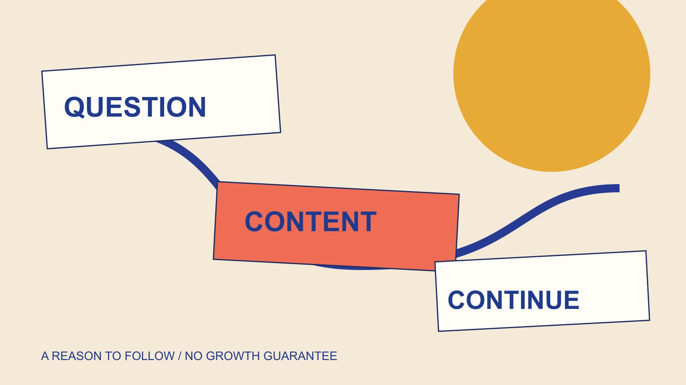

# 免费Instagram粉丝：规划自然受众建设

状态：本地审阅稿；正式发布日期待确认。

把免费Instagram粉丝的搜索转成自然受众建设教育：提供明确关注理由，投入内容与维护工作，并诚实解释结果。

QuickKOL 编辑图形；不呈现真实账号指标或平台界面。

如果free Instagram followers指不购买或交换粉丝的自然受众建设，合理起点是让读者知道账号持续帮助解决什么问题，并用真实、有用、可维护的内容兑现。自然分发不等于没有人员、制作和时间成本，也没有保证数量或速度的公式。本篇不推荐赠粉服务、互关或刷量操作，而是帮助品牌规划关注理由、内容与后续维护。粉丝总数变化只能说明有限现象，不自动证明理解、信任、购买或任何人的违规；来源无法核实的互动仍应保留为未知。

## 先写一个值得持续关注的理由

品牌账号可以说明自己持续解释什么，而不是只宣布希望拥有更多粉丝。关注理由应与实际能提供的内容相符，例如维护清楚的产品操作说明，而非承诺无法持续的每日独家信息。

[内容Brief指南](/zh/blog/write-a-useful-campaign-brief/#answer)帮助确定要向谁解释什么。简介再把身份、价值与下一步连接。[Instagram个性签名说明](https://help.instagram.com/728994388226960/)指出简介有150字符限制，且可公开查看；有限空间更需要选择必要信息，不堆放模糊标签。

一个清楚简介不能保证增长，也不能替代后续内容。它帮助第一次看到账号的人理解是否相关，真实关注决定仍由读者自己作出。

不要假设所有读者都具有相同需求。账号可明确适用对象和范围，使不相关的人也能准确判断，而不把最大化人数当成唯一质量标准。

## 区分自然建设与互动交换

[Meta垃圾互动政策](https://transparency.meta.com/policies/community-standards/spam/)涉及买卖、交换互动及相应操纵行为，同时区分一些允许情形。自然受众建设应关注内容与真实相关性，不把免费两个字当成任何做法都合适的理由。

本篇不提供互关、刷赞、领取粉丝或规避限制的步骤。也不把所有合作推广、付费分发或品牌提及都称为虚假互动，各自需要看具体事实和条件。

如果一个服务主张保证数量、速度或永久结果，记录主张与证据之间的差距，不自行尝试后再把体验写成认证。

教育重点是理解边界。文章没有测试供应商、分析具体个人或认定某个账号违规；未知来源保留未知，避免让方法学习变成人物指控。

## 从真实问题形成内容清单

[GOV.UK内容设计说明](https://guidance.publishing.service.gov.uk/writing-to-gov-uk-standards/plan-manage-content/understand-content-design/)支持从用户需求组织信息。这里借用这一原则，建议从已有真实问题和可核验资料形成内容清单，而不把热门词直接等同于当前受众需要。

问题可以来自适当取得的支持记录、公开说明中的缺口或团队反复解释的条件。记录时去除不必要私人信息，保留任务需要的语境与资料版本。

为每个问题写答案对象、所需素材与适用条件。还没有事实支持的项目，先列为待资料，不让发布压力迫使创作者补出未经确认的说法。

这不是一套保证自然曝光的算法策略。它使品牌投入的制作工作与受众任务对应，后续是否被看到、是否被理解仍需分别观察。

## 用独立可理解的内容兑现定位

[Reels教育内容指南](/zh/blog/reels-brand-education-content-assignment/#answer)帮助将一个问题变成能够独立理解的作品。开头识别对象，中间展示必要过程，结尾说明条件与适当下一步，不依赖观众看过所有历史帖子。

同一问题可以按不同深度安排，例如简短识别说明与完整操作页面。不要把关键条件藏在下一篇，只为让人持续关注。

原创画面和文字仍需事实基础。AI示意、假设场景与真实产品效果分别标注，不用看似真实的画面替代已经验证的使用结果。

制作时复核字幕、声音和可读文字。平台功能按实际账号与当前条件确认，不宣称某个剪辑结构必然得到推荐或关注。

## 安排回应与内容维护

账号持续提供价值，需要有人回答适合回答的问题、修订过期资料与维护目的地。自然分发不免除这些工作，也不意味着内部人员时间没有成本。

确定谁维护事实、谁回应普通问题、谁接收需要技术人员处理的问题。不要让普通评论讨论承载密码、私人身份资料或其他不必要的敏感信息。

内容更新时记录原因与版本。型号或活动条件变化，可能同时影响旧帖子和页面，而不是只需要下一条新内容。

[社交媒体执行计划](/zh/blog/social-media-marketing-operating-plan/#answer)可帮助安排责任和能力。如果实际资源不足，缩小内容范围、减少承诺，比保留一个无人能够维护的增长目标更可执行。

## 让下一步准确说明读者会得到什么

[W3C链接目的说明](https://www.w3.org/WAI/WCAG21/Techniques/general/G91)强调链接文字能表达去向。这里用这个原则检查简介、内容与目标页面之间的邀请，不声称已经完成全面无障碍认证。

若说明提供型号清单，就核对是否到达实际清单、语言是否相符、资料是否当前。不要把没有制作的免费资料写成已经可以下载。

如果当前入口需要进一步选择，说明为什么。读者知道下一个步骤与原问题相关，才能自行判断是否继续，而不是被含糊按钮推往无关页面。

链接能打开与内容兑现邀请是不同检查。为页面安排维护者，避免一个持续展示的简介指向已经结束的活动。

## 观察受众发展，不把总数当成全部结果

[点赞比较教育指南](/zh/blog/free-instagram-likes-comparison-distortion/#answer)解释分母、窗口与分发条件。粉丝总数变化也需要来源和时间，不能自动证明某条内容导致增长，更不能换算成理解与收入。

区分账号总数、期间变化与具体作品对应的可用资料。没有取得的报告保持未取得，不根据截图补出看似精确的独立受众。

如果问题是说明是否帮助读者，可以结合实际提问和适当反馈。样本、观察范围和未知条件仍应说明，不能用一条正面评论代表所有人。

不以一个统一增长率判断所有账号。目标、时期与任务不同，适当比较应先解释条件，再讨论下一步修订。

## 用一个维护工具说明账号作为例子

假设一个品牌有真实工具说明资料，计划持续回答如何辨认配件、如何收纳以及哪里查适用条件。先明确账号定位与资料负责人，不设保证粉丝数量。

第一轮可完成一个配件识别作品和对应页面，再根据实际问题决定是否需要补充。演示使用虚构成年讲述者，真实产品条件按资料核对，不把示意图当成用户效果。

如果出现许多关于型号的问题，先检查说明是否遗漏；如果资料不足，就补事实，不通过扩大关注承诺来掩盖缺口。

这是内容规划假设，没有实际账号、发布或增长结果。它说明自然受众建设可以从持续兑现一个明确任务开始，而不是从领取数量开始。

## 选择可维护的内容工作

把关注理由、实际问题、素材、负责人和复核条件留在计划中。可以逐步调整表达与范围，但不要将免费等同于零成本，也不把合理教育变成购买或交换互动的入口。

交付状态也要分开：内容写好、素材制作完成、账号已发布与结果已取得，不是同一个状态。负责者可以按实际进度逐项确认，避免仅凭计划表中的日期，就让后续团队以为已经执行。

真实结果需要真实资料。持续解释问题与改进内容是可执行工作，特定数量、速度或商业效果仍不能预先保证。

## 自然受众建设的工作与边界

| 工作 | 具体交付 | 不能保证 |

| --- | --- | --- |

| 定位 | 明确关注理由 | 每位访客关注 |

| 内容 | 有依据的独立说明 | 必然获得分发 |

| 维护 | 责任、版本与有效目标页 | 不需要时间成本 |

| 测量 | 有来源和范围的解释 | 粉丝等于业务结果 |

教育与编辑规划框架，不提供互动服务、保证增长或识别个人。

## 自然受众内容计划清单

用于学习与制作规划，不操作账号或获取粉丝。

- [ ] 定位与实际内容一致。

- [ ] 问题有资料和素材支持。

- [ ] 作品不隐藏必要条件。

- [ ] 维护工作有人员与时间。

- [ ] 目标页兑现相应邀请。

- [ ] 结果、未知与限制如实记录。

## 研究日期与使用边界

资料核验于 2026 年 11 月 4 日。文中方法、表格和决策规则为编辑建议，标为假设的示例不是实际客户结果或行业基准。外部资料的适用地区与时期按各段说明；本稿处于独立本地审阅阶段，正式发布日期待确认。

## 来源

- [Instagram个性签名说明](https://help.instagram.com/728994388226960/)

- [Meta垃圾互动政策](https://transparency.meta.com/policies/community-standards/spam/)

- [GOV.UK内容设计说明](https://guidance.publishing.service.gov.uk/writing-to-gov-uk-standards/plan-manage-content/understand-content-design/)

- [W3C链接目的说明](https://www.w3.org/WAI/WCAG21/Techniques/general/G91)
