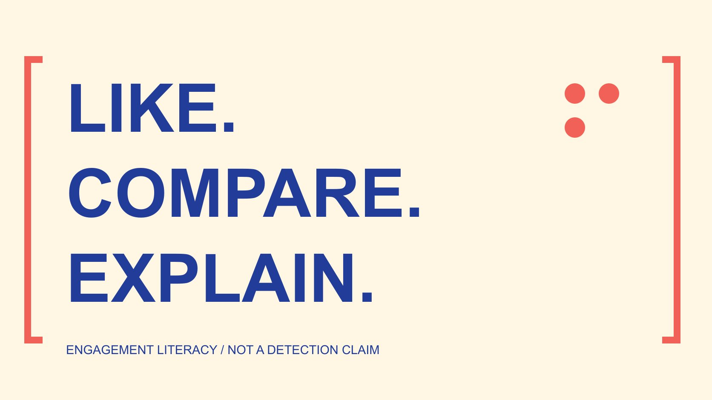

# Free Instagram Likes: Understand Distorted Comparisons

Status: local review draft; confirm the publication date before release.

Learn how extra, incentivized or unexplained likes affect comparisons. Keep metric and distribution conditions, and distinguish uncertain signals from established facts.

QuickKOL editorial graphic; not actual account metrics or a platform interface.

Comparing Instagram likes requires knowing what is being compared. Extra, incentivized or unexplained interaction can alter a total or rate without independently establishing that content is more useful, the audience more authentic or business performance better. Free does not mean an action occurred naturally. This educational guide recommends no free-like service or exchange method. It explains denominators, observation periods, distribution conditions and evidence limits. A growth spike, low engagement or a comment pattern can raise a question for further verification, but cannot establish an individual’s misconduct. Keep an unverified source unknown instead of forcing a positive or negative verdict. A useful comparison remains explicit about what its evidence supports.

## Start with a comparison question rather than a larger total

Write the question first: was content seen, did a relevant action occur, or did it help a reader complete a task? A like answers only a limited part of that inquiry and cannot replace every outcome.

The [engagement-rate definition guide](/blog/engagement-rate-formula-metric-contract/#answer) explains why a metric name needs a numerator, denominator and scope. Two reports called engagement rate may combine different actions and populations, so comparing only the number before the percentage sign is insufficient.

If the sole objective is a larger total, extra interaction can appear attractive. A changed total and an answered question are different achievements, especially when the way interaction occurred remains unclear. The comparison should explain what the added number represents before treating it as progress.

This article concerns interpretability. It investigates no account and establishes no purchase of interaction by an observed person. Unknown conditions belong in the record as gaps, rather than material for a convenient story. That restraint protects the usefulness of both favorable and unfavorable observations.

## Understand the authentic-interaction policy boundary

The [Meta spam policy](https://transparency.meta.com/policies/community-standards/spam/) addresses buying, selling and exchanging engagement and related manipulation. It also distinguishes allowed situations, so not every promotion, partnership or mutual mention should be called artificial interaction.

The [free-follower claim-literacy guide](/blog/free-instagram-followers-offer-claim-literacy/#answer) further separates price, conditions and evidence. A promotional page saying free does not establish that the interaction occurred naturally, participants were interested or the account supplies nothing else.

Policy information helps explain a boundary without replacing verification of specific facts. This article infers no platform penalty for an individual and supplies no method for circumventing a policy. It also makes no claim that a particular provider or participant has been independently tested.

When uncertain, retain the actual observed claim and its source. A page advertises interaction and a person has been established to use that service are very different statements requiring different evidence. Keeping them separate prevents a general educational explanation from becoming an unsupported accusation.

## The same like count can describe different situations

Two posts with the same likes may differ in viewing scope, publication time, content task and distribution. Without those conditions, totals alone cannot establish which one resonates more effectively.

A step-by-step explanation and an activity notice may need different outcomes. One concerns understanding a process; the other might concern finding the correct time and location. A like directly establishes neither judgment. The useful question is which evidence corresponds to the intended task.

Where interaction sources are mixed, state known conditions and the unknown portion. Paid distribution should not be renamed artificial interaction, and extra actions should not all be assigned to one assumed mechanism. Distinct conditions can alter a comparison for different reasons.

Retain original numbers while limiting the conclusion. A recorded window contains more likes for A is closer to the evidence than everyone prefers A. The narrower statement can still be useful because another reviewer can see its scope and decide what additional information would answer the larger question.

## A denominator change alters what a rate means

Suppose post A has 100 likes and 1,000 views under a stated definition, while B has 120 likes and 2,000 views under that same definition. For teaching arithmetic only, those ratios are 10% and 6%. B has more likes but a lower rate under this definition.

The example contains no real account, industry benchmark or effectiveness finding. The calculation is interpretable only with compatible view definitions, periods and counting rules. A count of likes is also not automatically a count of distinct people.

Changing the denominator to followers creates a different metric. Do not place those two results in one column as though they are interchangeable. Repeated viewing, unobtained information and estimates also need explanation in the corresponding record.

One threshold cannot establish a conclusion across every industry, format and period. Decide what phenomenon needs explaining before deciding whether the denominator suits it. A correct calculation can still answer the wrong question when the metric was chosen only because its data was convenient.

## Keep observation windows and distribution conditions comparable

The [pre-pilot comparison guide](/blog/benchmarking-creator-pilot-comparison-design/#answer) recommends setting objects and conditions before observation. Watching one post for an hour and another for a week leaves accumulation time as a possible explanation. The difference alone does not establish content quality.

Record organic or paid distribution, publication time, content volume and activity context. Where these differ, describe the difference without presenting one design change as its established cause.

Visible interaction increasing is not proof of causation. Titles, audiences, timing and distribution may change together, and distinguishing their influence requires an appropriate method. A convenient before-and-after chart does not resolve those differences by appearance alone.

When data is limited, a descriptive conclusion remains valuable. It can identify the next period, source or content condition to check rather than force an apparently certain winner. Preserve those limitations beside the number so they survive when a chart or sentence is copied into another document. The explanation should travel with the comparison.

## Do not rename action totals business outcomes

The [AMEC integrated evaluation framework](https://amecorg.com/amecframework/) distinguishes outputs, audience responses, outcomes and impact. This article adapts that structure: content volume, a like action, reader understanding and a business result need corresponding evidence rather than one shared success label.

If the task is understanding an operation, relevant material might include actual questions, comprehension feedback or subsequent behavior. These still have sampling and observation conditions. One reply does not represent every viewer.

Without sales or other business evidence, do not convert likes into revenue said to have occurred. An estimation model needs explicit assumptions; precise decimal places cannot turn unobtained results into actual ones. The reporting choice should make that distinction easy to see.

The framework itself supplies no data and verifies no account. The recommendation is to keep question, metric and interpretation connected, rather than replace a total with a more technical-sounding name. This makes a modest finding easier to use because the reader can identify what it explains and what it leaves open.

## An anomaly can raise a question for further checking

A sudden increase, repetitive comments or a mismatch between likes and other visible actions may deserve further understanding. None is a perfect detection tool, and one signal cannot establish an individual’s misconduct.

First check source updates, compatible windows, different distribution and possible display changes. If corresponding information cannot be obtained, record the cause as unknown. A list of possible explanations is not proof that any one of them occurred.

Avoid building private profiles of observed users or inferring sensitive identity from language or location. This comparison needs data conditions, not unsupported judgments about personal motives. Reporting should remain proportionate to the actual observation.

When more reliable information becomes available, revise the interpretation and retain its basis. Correcting an earlier hypothesis is a normal part of research. New information should not be ignored merely to protect a previous conclusion, whether that conclusion favored or criticized the observed content. The record should make a revision understandable without turning uncertainty into a permanent personal label.

## Check whether an activity-notice comparison answers the question

Suppose a library publishes two activity notices. A receives more likes, while B receives more questions about the registration route. An editor initially wants A to become the standard template, but does not yet know the observation period or distribution scope for either post.

Start with the activity objective: readers should understand eligibility and find the correct registration route. The [GOV.UK content-design guide](https://guidance.publishing.service.gov.uk/writing-to-gov-uk-standards/plan-manage-content/understand-content-design/) supports organizing content around user tasks. This adapts that principle without presenting it as an Instagram algorithm explanation.

The team can separately record like totals, route questions and any actual registration evidence available. More questions on B might indicate unclear instructions or simply more interested readers. Without other evidence, neither interpretation should become a fact.

If A includes extra likes of unexplained origin, retain its original total and the unknown condition. Do not subtract an estimated number of supposedly artificial actions and announce a corrected true rate. An unverifiable adjustment introduces another source of misleading precision.

A useful decision can be to clarify the registration explanation and observe the corresponding question within an explicit window. This hypothetical example contains no real library, account or test result and establishes no superior template. It connects a content decision to a reader task while leaving the uncertain comparison appropriately limited.

## Deliver a limited conclusion that can be reviewed

Record the question, metric definition, original source, observation window, distribution and unknowns before writing the conclusion those materials support. The table and checklist organize information without automatically verifying interaction provenance.

The useful lesson from free-like claims is to distinguish obtaining more actions from understanding an actual result. Improve explanations, choose a suitable comparison and continue checking evidence without adding a growth promise or personal accusation to give a limited observation more weight. A clear statement of uncertainty is part of an informative result when the underlying source cannot answer the larger question.

## Conditions to preserve in a comparison

| Condition | Record | Does not independently establish |

| --- | --- | --- |

| Metric | Numerator, denominator, counting rule | Understanding or purchase |

| Time | Start, end, observation time | Causation |

| Distribution | Known organic, paid and other conditions | Interaction authenticity |

| Anomaly | Observation and causes to check | Individual misconduct |

Educational framework; hypothetical arithmetic is not an industry benchmark or a finding about an actual account.

## Like-comparison interpretation checklist

For learning evidence limits, not identifying individuals or recommending engagement services.

- [ ] Question explicit and metric relevant.

- [ ] Denominators and windows compatible or differences stated.

- [ ] Known distribution conditions retained.

- [ ] Unknown provenance not invented as a cause.

- [ ] Action, understanding and business outcome separated.

- [ ] No individual accusation based on an anomaly.

## Research date and limitations

Sources reviewed November 4, 2026. Methods, tables and decision rules are editorial recommendations. Hypothetical examples are not actual client results or industry benchmarks. Source geography and periods are specified where relevant. This draft is in independent local review; confirm its publication date before release.

## Sources

- [Meta spam policy](https://transparency.meta.com/policies/community-standards/spam/)

- [AMEC integrated evaluation framework](https://amecorg.com/amecframework/)

- [GOV.UK content-design guide](https://guidance.publishing.service.gov.uk/writing-to-gov-uk-standards/plan-manage-content/understand-content-design/)
