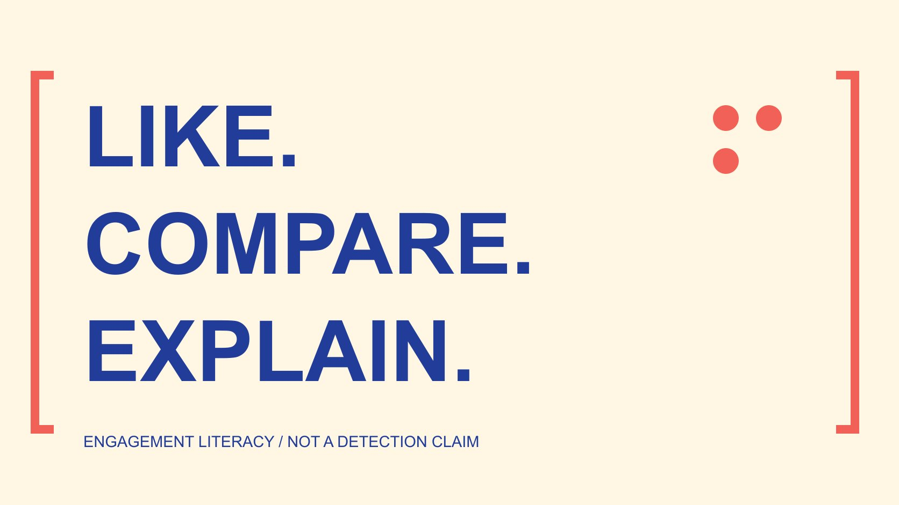

# 免费Instagram点赞：理解比较怎样失真

状态：本地审阅稿；正式发布日期待确认。

理解额外、受激励或来源不清的点赞怎样影响比较；保留指标、分发与观察条件，用证据说明结果，避免单凭异常指控个人。

QuickKOL 编辑图形；不呈现真实账号指标或平台界面。

比较Instagram点赞时，必须知道在比较什么。额外、受激励或来源不清的互动，可能改变总数和比率，却不能单独证明内容更有用、受众更真实或业务效果更好。“免费”也不等于互动自然发生。本篇不推荐免费点赞服务或交换方法，而是解释分母、观察时间、分发条件与证据边界。单一增长、低互动或评论模式只能提出进一步核对的问题，不能用来给个人贴造假标签。无法核实的来源，应保留为未知，而不是强行作出正面或负面结论。

## 从比较问题开始，而不是追求更大总数

先写需要解释的问题：内容是否被看到、是否引发相应动作，或是否帮助读者完成任务。点赞只能回答其中有限的一部分，不能替代所有结果。

[互动率口径指南](/zh/blog/engagement-rate-formula-metric-contract/#answer)说明指标名称需要对应分子、分母和范围。同样叫互动率，两份报告可能把不同动作与不同人群放在一起，不能只比较百分号后面的数字。

如果只是希望总数更大，额外互动看起来可能很吸引人。但总数改变与问题得到回答是不同的事，尤其当互动如何产生仍不清楚时。

本篇讨论如何保留比较的可解释性，不调查某个账号，也不认定任何被观察对象购买了互动。未知条件应成为记录中的缺口，而不是补成故事。

## 先了解真实互动的政策边界

[Meta垃圾互动政策](https://transparency.meta.com/policies/community-standards/spam/)涉及买卖、交换互动以及相关操纵行为。它也区分某些允许情形，因此不要把所有推广、合作或互相提及都称为虚假互动。

[免费粉丝主张教育指南](/zh/blog/free-instagram-followers-offer-claim-literacy/#answer)进一步区分价格、条件与证据。一个推广页面写免费，不能据此认定互动自然发生、参与者感兴趣，或账号不需要提供其他东西。

政策说明可以帮助理解边界，但不能替代对具体事实的核实。本稿不推断某个账号受到或应当受到平台处罚，也不提供规避政策的方法。

不确定时，记录实际观察到的主张与来源。区分“页面声称赠送互动”和“已经证实某人使用了该服务”，两者需要完全不同的证据。

## 相同点赞数也可能描述不同情形

两个帖子点赞数相同，可能有不同观看范围、发布时间、内容任务与分发方式。若缺少这些条件，不能只凭总数说某一条更能打动受众。

一条解释步骤的内容与一条活动通知，所需结果未必相同。前者可能需要判断是否看懂，后者可能需要判断是否找到时间地点；点赞并不能直接完成这些判断。

如果互动来源混杂，先说明已知条件和未知部分。不把付费分发误称为虚假互动，也不假设所有额外动作都来自同一机制。

比较可以保留原始数值，同时限制结论。比如记录“在所取窗口中A点赞总数较多”，比“所有人更喜欢A”更接近有限资料实际支持的内容。

## 分母变化会改变比率的意义

假设内容A有100次点赞和1000次某定义下的观看，内容B有120次点赞和2000次同定义观看。只为教学计算，分别是10%与6%；B的点赞总数更多，但按此口径比率更低。

这个例子没有真实账号、行业基准或效果结论。只有在观看定义、窗口与计数方式一致时，算式才有对应意义，且点赞次数不自动等于独立点赞者人数。

若改用粉丝数作分母，就变成另一个指标，不能把两个结果放在同一列继续比较。重复观看、未取得数据与估算，也需要在相应位置说明。

不能用一个统一阈值给所有行业、格式和时期下结论。先确定希望解释的现象，再判断这个分母是否适合问题。

## 保持窗口与分发条件可以比较

[项目前比较设计指南](/zh/blog/benchmarking-creator-pilot-comparison-design/#answer)建议在观察之前确定比较对象与条件。一个帖子观察一小时，另一个观察一周，差异可能只是累积时间不同，不能独立证明内容优劣。

记录自然或付费分发、发布时间、内容数量与活动背景。若这些条件不同，可以描述差异，但应避免将一项设计变化说成已证实原因。

不要因为可见互动增加就宣布因果已经成立。可能同时改变的标题、受众、时段与分发，需要相应方法才能区分影响。

资料不足时，保留描述性结论也有价值。它可以指向下一步要核对的窗口、来源或内容条件，而不是强行产出一个看似确定的胜者。

## 不要把行为总数写成业务成效

[AMEC综合评估框架](https://amecorg.com/amecframework/)区分输出、受众反应、结果与影响。本文借此组织判断：内容数量、点赞动作、读者理解与业务结果，应使用相应证据，而不是都归为成功。

如果任务是让读者理解某个操作，可以考虑实际问题、理解反馈或后续行为资料。它们仍有采样与观察条件，不是只要出现一个回复就能代表全部观众。

没有销售或其他业务资料，就不把点赞换算成已经发生的收入。估算模型也要明确假设，不能以精确小数掩盖未取得的真实结果。

框架本身不提供数据，也没有验证某个账号。本篇的建议是使问题、指标和解释保持对应，而不是用另一个听起来更专业的名词替换总数。

## 异常只能提出进一步核对的问题

突然增长、重复评论、点赞与其他可见动作不一致，都可能值得进一步理解。它们仍不是百分百识别造假的工具，也不能单凭一项信号指控个人。

先核对来源是否更新、窗口是否一致、内容是否有不同分发、平台是否调整显示。若无法取得对应资料，就把原因记为未知。

避免给观察到的用户建立私人画像，或从语言、地点猜测敏感身份。当前比较需要的是数据条件，不是对个人动机的未经支持推断。

如果后来获得更可靠资料，修订解释并保留依据。纠正一个旧假设是正常研究过程，不应为了维护早先结论而忽略新信息。

## 用活动通知检查比较能否回答问题

假设一个图书馆发布两条活动通知，A点赞更多，B收到更多关于入口的询问。编辑最初想选A作为标准模板，但还不知道每条的观察时间与分发范围。

先核对活动目标：读者应理解报名条件，并找到正确入口。[GOV.UK内容设计说明](https://guidance.publishing.service.gov.uk/writing-to-gov-uk-standards/plan-manage-content/understand-content-design/)支持从用户任务组织内容；这里借用这一原则，不把它当作Instagram算法说明。

团队可以分别记录点赞总数、入口问题与实际可用的报名资料。B的问题较多，可能提示入口说明不清，也可能只是更多人有兴趣；没有其他证据时，两种解释都不应被当成事实。

如果A包含来源不清的额外点赞，保留其原始总数与未知条件，不自行删除估算的所谓假互动后宣布得到真实比率。不能验证的修正会制造新的误导。

最后结论可以是：先修订入口说明，再用明确窗口观察对应问题。这个假设没有真实图书馆、账号或测试结果，也没有证明某种模板更有效。

## 交付一个可以复核的有限结论

记录问题、指标定义、原始来源、观察窗口、分发条件与未知部分，再写这些资料实际支持的结论。表格与清单帮助组织资料，不会自动验证互动来源。

免费点赞主张最值得学习的，是不要把取得更多动作和理解真实结果混为一谈。可以改进内容解释、选择合适比较和继续核对证据；不需要用增长保证或个人指控为一个有限观察增加分量。

## 比较中应保留的条件

| 条件 | 记录内容 | 不能独立证明 |

| --- | --- | --- |

| 指标 | 分子、分母、计数方式 | 理解或购买 |

| 时间 | 开始、结束、采集时间 | 因果关系 |

| 分发 | 已知自然、付费与其他条件 | 互动真假 |

| 异常 | 实际观察与待核对原因 | 个人违规 |

教育框架，假设算式不是行业基准或对真实账号的判断。

## 点赞比较解释清单

用于学习数据边界，不识别个人、不推荐互动服务。

- [ ] 问题明确，指标与问题对应。

- [ ] 分母与窗口一致或差异已说明。

- [ ] 已知分发条件保留。

- [ ] 未知来源没有被编造成原因。

- [ ] 行为、理解与业务结果分开。

- [ ] 没有单凭异常指控个人。

## 研究日期与使用边界

资料核验于 2026 年 11 月 4 日。文中方法、表格和决策规则为编辑建议，标为假设的示例不是实际客户结果或行业基准。外部资料的适用地区与时期按各段说明；本稿处于独立本地审阅阶段，正式发布日期待确认。

## 来源

- [Meta垃圾互动政策](https://transparency.meta.com/policies/community-standards/spam/)

- [AMEC综合评估框架](https://amecorg.com/amecframework/)

- [GOV.UK内容设计说明](https://guidance.publishing.service.gov.uk/writing-to-gov-uk-standards/plan-manage-content/understand-content-design/)
