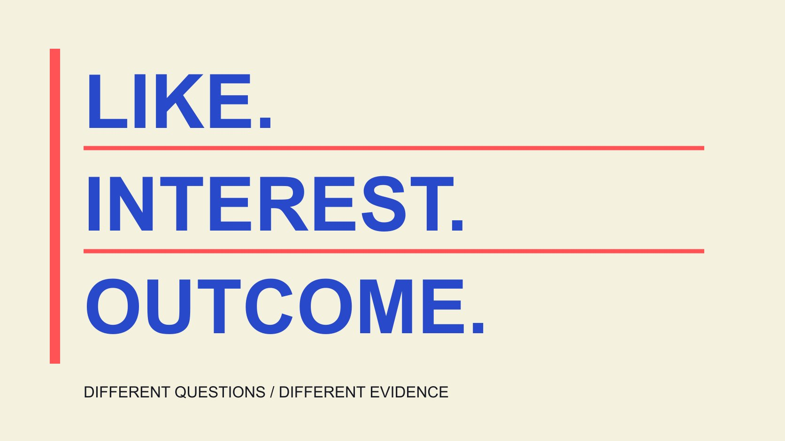

# Free TikTok Likes: Understand Engagement Evidence

Status: local review draft; confirm the publication date before release.

A free-likes promise is not evidence of genuine preference. Distinguish likes, views, audience and outcomes, identify missing evidence and report content response accurately.

QuickKOL editorial graphic; not actual account metrics or a platform interface.

When searching for free TikTok likes, distinguish voluntary responses to content from a service promising to increase a number for you. Free describes a pricing claim, not evidence that participants are genuinely interested, access conditions are appropriate or the number produces business outcomes. TikTok’s authentic-interaction explanation opposes services and instructions for artificially inflating engagement. This is an educational guide to metrics and content judgment. It provides no artificial-likes service, exchange procedure or guaranteed-growth method, and makes no accusation about an individual from a like count or one suspicious signal. Its purpose is to help readers ask what was measured, under which conditions and with what limits.

## One like action is not a complete statement of preference

The [TikTok likes guide](https://www.tiktok.com/support/faq_detail?id=7636670088171035157&category=web_account) explains liking, undoing a like and the scope of profile totals. A platform action is an observable signal, but it does not independently reveal why it occurred, how the content was understood or what the viewer plans next.

A like could reflect usefulness, appreciation of presentation, support for someone known or another reason. Without appropriate evidence, do not assign participants a motive or expand the action into purchase intent, loyalty or a partnership request.

Establish whether the object is one post, a period or a profile total. Mixing figures from different objects removes meaning from an apparently simple conclusion.

The [metric-definition guide](/blog/engagement-rate-formula-metric-contract/#answer) explains numerator, denominator and window. Begin with the record actually available instead of attaching a psychological explanation absent from the data.

This distinction does not dismiss voluntary likes. It respects an actual expression while avoiding a complete profile of a person from one lightweight action. A report can accurately say that likes were observed without claiming to know every participant’s identity, reasons or future behavior.

## Which questions a free offer leaves unanswered

A page saying no charge still leaves questions about where the count comes from, whether participants act voluntarily, which access is requested, whether other conditions apply and why the number would change.

Do not submit a password, verification code or unclear access approval merely to try an offer. Free may still involve time, information or later conditions; without examining a particular service, those possibilities are not established facts about it.

The educational task is to identify unanswered questions rather than participate in artificial engagement to test a promise. Record a visible claim, date and missing conditions without recommending or linking the service.

No password, real users and permanent are claims needing evidence, not facts created by their appearance on a page. Nor does seeing such wording establish that a particular operator committed fraud.

If the actual need is for relevant readers to understand content, return to content, distribution and measurement. A promise about a free number cannot replace the original objective. Clarifying that objective also helps explain why a numerical offer may fail to answer the question even if a displayed total changes.

## Keep platform policy separate from judgments about individuals

The [TikTok authentic-interaction explanation](https://newsroom.tiktok.com/how-tiktok-counters-deceptive-behaviour?lang=en-150) identifies services, marketing and instructions for artificially increasing engagement among prohibited behavior. This article therefore provides no service list, exchange process or bulk-operation method.

Policy explains how the platform describes conduct. It does not give an outside observer the ability to identify the cause of every unusual number. An account’s changing figures still require appropriate evidence to establish what happened.

Large totals, sudden growth, similar comments or one ratio do not individually prove a violation. Raise a verification question where warranted, while distinguishing an observation, possible explanation and supported conclusion.

The platform has its own handling and appeal processes. This guide makes no determination about a person and does not package education as perfect detection.

Apply the same standard to the brand’s own reporting. Interactions arranged under particular conditions should not be described as entirely unprompted demand. Keep those conditions visible instead of retaining only attractive totals. Honest reporting concerns the description of the evidence, including when the team does not yet have enough evidence to classify what it sees.

## Likes are not a single switch controlling recommendations

The [TikTok recommendation guide](https://www.tiktok.com/support/faq_detail?id=7655285288050104852&category=web_account) describes multiple factors, including user interactions, content information and user information, with importance varying by recommendation context and over time. Likes can matter does not imply that adding a stated number guarantees a stated amount of exposure.

Public explanation is not a complete formula outsiders can reproducibly control. Nor does one video’s viewing change establish likes as the sole cause.

Suppose an opening, publishing time and distribution arrangement change before viewing increases. Even if likes rise too, those concurrent changes do not establish one as the only cause.

More useful content work asks whether the question is clear, the demonstration accurate and the relevant explanation easy to find. That may improve communication, but this guide does not promise recommendations or fixed growth from it.

Keep a general platform explanation separate from project-specific evidence in a report. A description of a recommender system cannot replace missing measurement. The distinction is especially useful when someone offers an apparently precise growth forecast based only on one visible engagement count.

## Separate voluntary response, incentive conditions and outcomes

Voluntary responses to content, participation under activity conditions and manufactured interaction should not be described as identical sources in a report. Classification still needs facts rather than guesses from the resulting count.

Suppose a brand runs a public activity during a period. Retain its conditions and window when deciding which evidence answers the activity question. This is not an instruction to reward engagement or a determination that a particular arrangement meets every applicable rule.

Content receiving likes, readers understanding an explanation and people purchasing or continuing to use something are different outcomes. The latter questions require their own evidence instead of borrowing the first signal.

The [content-measurement guide](/blog/creator-campaign-measurement/#answer) connects objectives and sources. An educational task can examine whether it answers a concrete question; a commercial assignment needs relevant records. Not every piece must be evaluated with one universal metric.

If evidence only supports observed likes, retain that conclusion. Describing its scope is more useful than renaming the count high-quality demand. A larger label does not add information that was never collected, and it can make later decisions harder to revisit honestly.

## When a total changes, check definition and window first

Official likes guidance explains that profile totals concern existing posts, updates can be delayed and deleting or removing content can change the display. A cumulative profile total and one post’s period value therefore describe different objects.

Check source, observation date, window and included posts before interpreting an increase or decline. Missing does not mean zero, and screenshots from different times do not automatically establish false information.

The [monthly-engagement interpretation guide](/blog/social-media-engagement-rate-monthly-explanation/#answer) explains content mix, distribution and timing conditions. With different publishing volumes, comparing total likes may mainly reflect a changing sample rather than each piece becoming more appealing.

Where needed, say the reason for a difference remains unconfirmed and identify the missing evidence. Do not invent intermediate values for a chart or use an unverifiable account percentage as a true-or-false verdict.

Retain the original record and interpretation version. If later information changes the conclusion, explain the change without pretending the answer was known from the start. This makes a report more useful to colleagues who must understand both the current conclusion and the evidence available when an earlier decision was made.

A hypothetical calculation illustrates the denominator: 100 likes divided by 1,000 views is 10%, while 500 divided by 10,000 is 5%. The second has more likes but a lower ratio. Neither establishes unique people, genuine preference or purchasing. These are arithmetic examples, not industry benchmarks.

Even when both calculations use likes divided by views, verify the window and viewing definition. If only the like count is available, report that count rather than invent a denominator. An explicitly unknown field communicates more than a precise-looking percentage whose source cannot be explained. Do not turn either illustrative ratio into a threshold declaring an account authentic or false.

## Replace a numerical promise with an actual content question

Suppose a tutorial receives feedback that its second step is difficult to see. The next version can reshoot that action, check captions and supply the relevant guide. This is an explanation repair grounded in specific feedback, without first purchasing additional likes.

Record what changed, why, when it was published and what response was observed. Without a suitable experimental design, do not attribute every later change to one edit.

The team can also examine whether actual distribution reached relevant readers, the question received an answer and follow-up material was available. Do not claim those checks occurred without data, or suggest that unpaid content requires no labor.

The goal is an explainable learning process: ask a question, adjust content on a supported basis and record outcomes and limits. That better supports the next editorial decision than pursuing an unexplained count. It can still leave an outcome unresolved, which is preferable to a numerical guarantee unsupported by the project’s evidence.

## Preserve the meaning of genuine interaction in reporting

Free is not proof of source, a like is not a complete audience profile and neither replaces evidence of business outcomes. Keeping those distinctions helps a brand understand what its content actually answered.

Continue with metric definitions, source and evidence scope. This guide supplies no artificial-engagement service or personal authenticity score. An unusual signal is a possible question for verification; an actual conclusion requires appropriate support.

A useful report also identifies what the reader can do next: clarify a definition, confirm the observation window or repair an unclear explanation. It need not end with a verdict about a person. Returning the question to the evidence preserves actual uncertainty while allowing the team to continue with an action it can explain.

## Four concepts that should stay distinct

| Concept | Can describe | Does not establish |

| --- | --- | --- |

| Free claim | A stated absence of a particular charge | Reliable source, conditions and outcomes |

| Like | An action count under a definition | Motive, purchase or lasting trust |

| Unusual change | An observation needing context | A person committed a violation |

| Content revision | A change addressing a specific question | Growth was caused solely by that edit |

Educational distinctions, not a detection score, service recommendation or growth promise.

## Engagement-literacy checklist

For interpreting data and claims, not purchasing interaction or labeling individuals.

- [ ] Specify action, object and window.

- [ ] Keep pricing claims separate from source.

- [ ] Separate unusual observations from established facts.

- [ ] Measure interaction, understanding and purchasing separately.

- [ ] Retain unknowns and interpretation limits.

- [ ] Improve content against a concrete question.

## Research date and limitations

Sources reviewed November 4, 2026. Methods, tables and decision rules are editorial recommendations. Hypothetical examples are not actual client results or industry benchmarks. Source geography and periods are specified where relevant. This draft is in independent local review; confirm its publication date before release.

## Sources

- [TikTok likes guide](https://www.tiktok.com/support/faq_detail?id=7636670088171035157&category=web_account)

- [TikTok authentic-interaction explanation](https://newsroom.tiktok.com/how-tiktok-counters-deceptive-behaviour?lang=en-150)

- [TikTok recommendation guide](https://www.tiktok.com/support/faq_detail?id=7655285288050104852&category=web_account)
