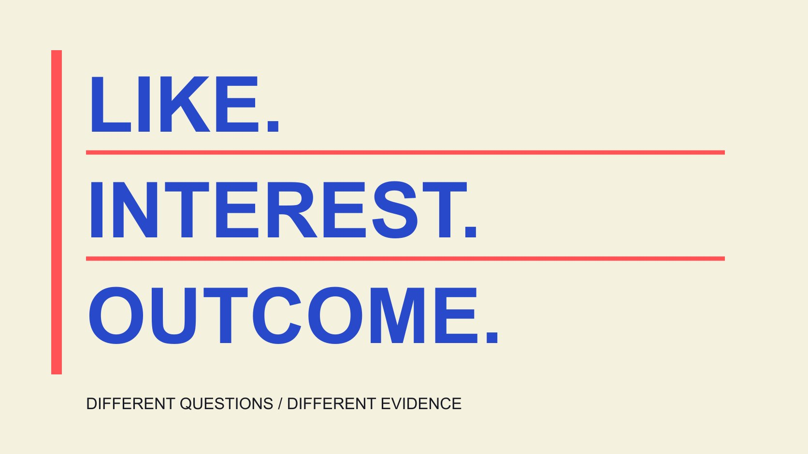

# 免费TikTok点赞：先理解互动证据

状态：本地审阅稿；正式发布日期待确认。

免费点赞承诺不等于真实偏好。学习区分点赞、观看、受众与结果，识别资料缺口，用准确报告保护内容判断。

QuickKOL 编辑图形；不呈现真实账号指标或平台界面。

搜索“free TikTok likes”时，先区分自愿的内容互动与承诺代为增加数字的服务。“免费”只描述某项收费声明，不能证明参与者真实感兴趣、访问条件合理或数字能够带来业务结果。TikTok真实互动说明反对人为放大互动的相关服务与操作指导。本篇是指标与内容判断的教育文章，不提供刷赞入口、交换步骤或保证增长的方法。它解释如何核对口径、理解异常与保留未知，也不凭点赞数量或一项可疑信号指控任何个人。

## 一个点赞动作，不等于完整偏好

[TikTok点赞说明](https://www.tiktok.com/support/faq_detail?id=7636670088171035157&category=web_account)介绍点赞与取消点赞，并说明主页总获赞数的口径。一个平台动作是可记录信号，但不会独立说明为什么发生、读者如何理解内容或接下来准备做什么。

同样的点赞可能来自觉得有用、欣赏表达、支持熟人或其他原因。没有适当资料时，不替参与者填写动机，更不把它扩展为购买、忠诚或合作意向。

先明确分析对象是单条作品、某段时期还是主页总数。把不同对象的数字混用，会让看似简单的结论失去实际含义。

[指标定义指南](/zh/blog/engagement-rate-formula-metric-contract/#answer)帮助说明分子、分母和时间窗口。要判断内容反应，就从实际记录出发，而不是给每个点赞附上数据中不存在的心理解释。

这种区分并没有否定自愿点赞的价值。它让团队尊重真实表达，同时避免把一种轻量动作当作关于一个人的完整研究。

## 免费承诺还留下哪些问题

某个页面写“不收费”，仍没有回答数字从哪里来、参与者是否自愿、需要开放哪些访问、是否有其他条件，以及数字为什么会改变。

不应为了试一试而提交账号密码、验证码或接受不清楚的访问请求。所谓免费也可能意味着花时间、交出资料或承担后续条件；具体服务未核实前，不把这些可能性写成已证实事实。

教育上的做法是识别尚未回答的问题，而不是为了验证承诺实际参与刷量。可以记录页面可见说法、日期与缺失条件，不推荐或链接相关服务。

“无密码”“真实用户”“永久”等字样是需要证据的声明，不因出现在页面上就视为事实。我们也不因为看见这些词就认定某个具体经营者已经欺诈。

如果需求其实是让内容被合适读者理解，应回到内容、分发与测量任务，不让一个免费的数字承诺替代原本目标。

## 平台规则与个人判断各有范围

[TikTok真实互动说明](https://newsroom.tiktok.com/how-tiktok-counters-deceptive-behaviour?lang=en-150)将人为增加互动的服务、营销和操作指导列入其反对的行为。本篇因此不提供服务名单、互赞流程或批量操作办法。

规则说明告诉读者平台如何描述相关行为，不让外部观察者获得识别每次异常原因的能力。某个账号数字变化，仍需要适当资料才能判断发生了什么。

不要把大量点赞、突然增长、相似评论或某个比率单独当成已证实违规。可以提出需要核验的问题，但应区分观察、可能解释与有来源支持的结论。

平台有自己的处理与申诉机制。本篇不替平台认定某个人，也不把教育内容包装成百分百识别工具。

同一标准适用于品牌自己。内部报告不应把人为安排的互动写成未经推动的自发需求；实际条件应该保留，而不是只选择好看的总数。

## 点赞不是推荐的唯一开关

[TikTok推荐机制说明](https://www.tiktok.com/support/faq_detail?id=7655285288050104852&category=web_account)介绍用户互动、内容信息和用户信息等多种因素，且权重会因推荐场景与时间变化。不能从“点赞有影响”推导出“增加若干点赞必定获得若干曝光”。

平台公开解释不等于给出外部人员可重复操控的完整公式。也不要把一条视频的观看变化直接解释成由点赞单独造成。

例如，假设内容修改了开头、发布时间和分发安排，随后观看上升。即使点赞也增加，这些共同变化仍不足以证明其中一项是唯一原因。

更有用的内容工作是确认问题是否清楚、演示是否准确、观众能否找到相关说明。它可能改进表达，但本篇不会因此承诺获得推荐或固定增长。

在报告里，把平台机制的一般说明与实际项目证据分开。不要拿一段机制介绍替代本来缺失的测量资料。

## 把自然反应、激励条件与结果分开

自愿响应内容、因某项活动条件参与，以及人为制造互动，不能在报告里被写成完全相同的来源。但具体归类需要事实，不能只凭结果数字猜测。

假设品牌在一段时期内开展了公开活动，就应保留相应条件与窗口，判断哪些资料适合回答活动问题。这里不提供以互动换奖励的操作建议，也不判断某个具体安排是否符合全部规则。

内容被点赞、读者实际理解了某个说明，以及购买或持续使用，是不同结果。后两项需要各自合适的证据，不用前一项代替。

[内容测量指南](/zh/blog/creator-campaign-measurement/#answer)进一步把目标与资料对应。教学任务可以检查是否解决具体问题，商业任务则需相应记录；并非每个内容项目都必须使用同一个指标。

如果资料只支持观察点赞，就停在这个结论。准确说明范围，通常比给数字加一个“高质量需求”的名字更有帮助。

## 总数变化时，先核对口径与窗口

官方点赞说明指出主页总数涉及现有作品，更新可能延迟，删除或移除作品也可能改变显示。因此，主页累计数与某条内容的当期数字并非同一对象。

先核对来源、观察日期、窗口与作品范围，再解释增加或减少。缺失不是零，截图时点不同也不自动意味着有人提供假资料。

[月度互动解释指南](/zh/blog/social-media-engagement-rate-monthly-explanation/#answer)帮助说明内容组合、分发与时间条件。若作品数量不同，简单比较总赞数可能主要反映样本变化，而不是每条内容更受欢迎。

必要时写“目前无法确认差异原因”，并说明需要哪项资料。不要为了完成图表补造中间数字，或把一个无法核验的账号百分比当作真假结论。

保存原始记录与解释版本。后来补到资料时，可以说明结论如何改变，不需要假装最初已经知道答案。

一个假设算例：100赞除以1000次观看是10%，500赞除以10000次观看是5%。后者赞数更多，比率却更低；两者都没有独立说明独立人数、实际偏好或购买。这里只演示分母如何改变表达，不是行业基准。

即使都按赞除观看计算，还要核对窗口与观看定义。只有赞数、没有适当观看数时，就报告已有计数，不补一个猜测分母。清楚标注的未知，比一个来源不明的精确百分比更利于理解。

## 用一个实际内容问题代替数字承诺

假设一条使用教学收到“第二步看不清”的反馈。下一版可以补拍该动作、核对字幕并提供对应指南。这是有具体依据的解释修订，不需要先购买更多点赞。

记录修改了什么、为什么修改、何时发布以及看到什么反应。若没有合适实验设计，不把后续全部变化归给一项修改。

还可以检查实际分发是否到达相关读者、问题是否被回答、后续资料是否可用。没有数据时不声称已经完成这些判断，也不承诺自然内容完全没有成本。

目标是形成可以解释的学习过程：提出问题，调整有依据的内容，记录结果与限制。它比追求一个不清楚来源的数字，更能支持下一次编辑决定。

## 让报告保留真实互动的含义

免费不是来源证明，点赞不是完整受众画像，更不是业务结果的替代品。把这些区别保留下来，品牌才更容易理解内容实际回答了什么。

需要继续学习时，先看指标、来源和证据范围。本篇不提供刷量服务或个人真假评分；异常信号只是可能需要核验的问题，结论应由适当资料支持。

一个可用的报告也应说明读者接下来可以做什么：补齐定义、确认观察窗口，或修改没有解释清楚的内容。它无需以“某个人是真是假”结束。让问题回到资料本身，既保留真实的不确定性，也让团队能够继续采取有依据的行动。

## 四个容易混淆的概念

| 概念 | 可以说明 | 不能直接证明 |

| --- | --- | --- |

| 免费声明 | 页面声称不收某项费用 | 来源、条件与结果都可靠 |

| 点赞 | 对应口径下的动作计数 | 动机、购买或长期信任 |

| 异常变化 | 有待理解的观察 | 个人已经违规 |

| 内容修订 | 针对具体问题作出改动 | 增长由该改动单独造成 |

教育区分表，不是检测评分、服务推荐或增长承诺。

## 互动数据学习清单

用于解释数据与声明，不用于购买互动或给个人定性。

- [ ] 说明动作、对象和窗口。

- [ ] 免费条件与来源没有混为一谈。

- [ ] 异常观察与已证实事实分开。

- [ ] 互动与理解、购买分别衡量。

- [ ] 未知字段与解释限制保留。

- [ ] 改进内容依据具体问题。

## 研究日期与使用边界

资料核验于 2026 年 11 月 4 日。文中方法、表格和决策规则为编辑建议，标为假设的示例不是实际客户结果或行业基准。外部资料的适用地区与时期按各段说明；本稿处于独立本地审阅阶段，正式发布日期待确认。

## 来源

- [TikTok点赞说明](https://www.tiktok.com/support/faq_detail?id=7636670088171035157&category=web_account)

- [TikTok真实互动说明](https://newsroom.tiktok.com/how-tiktok-counters-deceptive-behaviour?lang=en-150)

- [TikTok推荐机制说明](https://www.tiktok.com/support/faq_detail?id=7655285288050104852&category=web_account)
