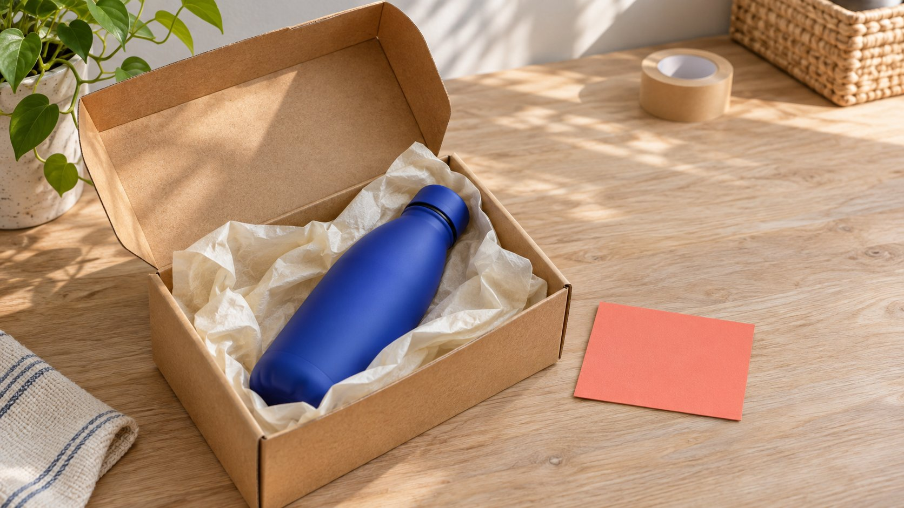

# GRIN: Scope a Product-Based Creator Program

Status: local review draft; confirm the publication date before release.

Evaluate a GRIN product-based creator program by defining collaboration, product and content states before reviewing Gia’s work, store connections, usage scope and current fees.

AI-generated editorial illustration, not an actual creator, client, product or event.

GRIN is a creator-marketing platform whose current site positions Gia as an AI agent assisting program work, with routes including GRIN with Gia and GRIN Classic. For a product-based collaboration, define what is sent, which content is agreed, how usage scope is confirmed and which outcomes have evidence before evaluating the particular product route. Sent, received, content completed and outcomes confirmed are different states. This guide uses current public information to develop review questions. It logs into no account, connects no store, contacts no creator and makes no payment, and it does not present vendor descriptions as independent hands-on results. The useful starting point is the work the team actually needs to perform.

## Define the actual product-based assignment

Sending a product can support experience, production or another agreement, but the shipment itself does not define the recipient’s obligation. Specify product, content, period and responsibilities first.

Suppose a brand wants to demonstrate cleaning a travel bottle. The task can identify model, actual information, demonstration needs and limitations. That differs from sending a sample and waiting for voluntary feedback.

The [brief-writing guide](/blog/write-a-useful-campaign-brief/#answer) starts with the audience question. Evaluate a platform around work that needs connecting rather than select a feature list and require the team to invent every corresponding activity.

Use explainable states: product awaiting confirmation, collaboration under discussion, delivery agreed or content awaiting acceptance. One partnered flag should not conceal the actual progress.

The bottle scenario is hypothetical, with no real client, creator or outcome. It explains evaluation of the arrangement rather than a verified product or platform campaign. Defining the work also helps the team distinguish its own responsibilities from features it expects a provider to supply, which is necessary before discussing automation or scale.

## Confirm the current product route

The [GRIN official-route guide](https://grin.co/) currently distinguishes GRIN with Gia and GRIN Classic. Confirm which entry, existing account state and corresponding current information the team is evaluating.

The [GRIN program-feature guide](https://grin.co/platform) describes connecting creators, programs, deal records, content and measurement, with Gia working across that system. This references vendor descriptions rather than independent verification of every capability or outcome.

Older tutorials, separate pages and current products can differ. Do not combine historical payment, integration or plan information into a new route and create a package the provider has not actually offered.

Write questions as work: how does the present route handle this task, which role operates it, what state is visible and how does an exception continue? A shared product name does not establish an unchanged process.

This article neither compares every market product nor offers a universal ranking. It helps a brand ask specific, inspectable questions about its own product-based program. A clearly identified route also makes later review possible when someone needs to understand which documentation informed the evaluation.

## Clarify seeding, paid, affiliate and UGC arrangements

Current product information describes several program modes. A brand still needs to identify whether the actual arrangement includes product, payment, publication, material or an affiliate component rather than rely only on a category label.

A product can be part of paid work or an experiential sample. Without a content agreement, receiving it is not agreement to publish. Obligations return to what the parties confirm.

The [collaboration workflow guide](/blog/collaborate-with-influencers-brand-workflow/#answer) assigns factual review, content acceptance and follow-up. A platform record can communicate state without supplying decisions not yet made between the parties.

If use or delivery expands later, reconfirm the corresponding elements. Being inside the same original program does not automatically include new content, channels and periods.

Keep changes in an appropriate record so the next colleague understands current conditions rather than reconstruct the effective version from scattered conversation fragments. The useful evaluation question is whether the system makes that arrangement understandable, including when an offer is still pending, rather than merely whether it can display a campaign name.

## Review products and store connection against the actual environment

Product state should identify model, version available for content, current availability and delivery arrangements. Inventory information, shipment creation, actual receipt and content acceptance should remain distinct.

The current platform guide distinguishes Shopify from custom or headless API connections and explicitly describes developer work for the latter. Connectable does not mean every environment requires no technical effort.

Appropriate business and technical owners should confirm required data, environment and testing arrangements. This article performs no integration and requests no access to store or customer information.

An appropriately authorized test scenario can show state transitions more usefully than an animation alone. Mark unperformed checks as unperformed and do not describe a marketing example as a real customer test.

When product choice changes, inspect whether content still applies. If a lid or capacity differs, for example, the cleaning demonstration may need revision rather than only an order-name change. This keeps logistical convenience connected to the actual explanation a creator is expected to make.

## Connect Gia-prepared work with execution responsibility

The site describes Gia assisting discovery, outreach preparation and program work, with the team choosing how closely to review. A picture showing a plan does not establish that every action always waits for individual human approval.

Before adoption, inspect current settings, roles and process. Clarify which work is a draft, what may execute and which change needs an owner’s decision.

For product-based work, supply actual product facts and contact context so any automated draft has a reliable basis. Unsupported experience, familiarity or outcomes do not become factual because a system generated them.

Assign follow-up. When someone replies, a product changes or delivery needs adjustment, the team should know who continues rather than only record that automation started.

This guide sends no GRIN message and enables no automated work. It discusses boundaries to understand at adoption rather than claim an actual account is configured. Evaluation should make the relationship between preparation, review and execution visible enough for a responsible operator to explain what happened.

## Confirm content storage and usage scope separately

The current product page describes tracking and organizing content with approved usage information attached. Finding a file in a library does not independently establish brand use across every channel, period and advertisement.

The [GRIN creator terms](https://grin.co/terms-of-use-influencers/) connect relevant brand rights with the particular arrangement accepted. An appropriate owner should read current terms and the parties’ agreement; this guide supplies no contract interpretation or compliance certification.

The [usage-scope guide](/blog/creator-rates-usage-rights/#answer) specifies material, version, purpose, channel and period. Third-party music, people and other elements are not automatically covered because a file was downloaded.

Acceptance can separately record file received, facts checked, content approved and use still awaiting clarification. The next person then knows what can continue instead of expanding one available label into completion of every issue.

Retain expiration and change conditions during maintenance. Searchability does not make an earlier arrangement permanent, and a new use requires appropriate support. This is a record-design question as well as a contractual one because the team needs to find the actual applicable evidence alongside the material.

## Use current definitions for cost, counts and outcomes

The [GRIN current-plan guide](https://grin.co/pricing) lists a free plan while also listing wallet-deposit management fees and differing usage limits. A free plan therefore does not make every program arrangement’s total cost zero.

Review plan conditions, products, creator agreements and other applicable charges separately. A monthly label does not establish the whole budget, and an unchecked price table can quickly become outdated.

Gifting counts, actual delivery, content completion and business outcomes need different definitions as well. A product action triggering a count should not be reported as completed content or a return achieved.

The [campaign-measurement guide](/blog/creator-campaign-measurement/#answer) connects objectives and evidence. For viewing, orders, commissions or another outcome, preserve source, window and state rather than replace unknown fields with promotion.

This article conducts no trial, funds no wallet and verifies no real program report. Give outstanding cost and count questions an explicit place in the plan, then have an owner confirm them against official information at decision time. Budget and outcome review should remain explainable even when the interface makes several stages appear in one connected timeline.

## A hypothetical: the delivered version differs from the demonstration

Suppose the bottle program agrees a cleaning demonstration using a particular lid. After shipment, the creator receives another lid type. The package can be recorded as received while product matching and production readiness remain unresolved.

The brand owner confirms replacement or a revised assignment, and the content team checks whether the demonstration changes. A completed-looking program is not a reason to have the creator describe a different version as the originally confirmed object.

During platform evaluation, ask how this difference is recorded, who sees it and how a revised arrangement is retained. If no test occurs, keep these as scenarios to inspect rather than claim every exception resolves automatically.

Once the appropriate product and content arrangement are ready, record material, facts, use and publication separately. This hypothetical contains no real shipment or client outcome. It demonstrates how clear states support the next action, not a software guarantee of every delivery. The same sequence gives reviewers a concrete case for asking which information remains visible when responsibility moves between teams.

## Hand off a product-based program that can be reviewed

The evaluation should identify current product route, actual assignment, connections needed, execution and review owners, and unresolved conditions. Limited evidence can lead to more information or a smaller pilot.

QuickKOL can help interpret a brief, discover relevant creators and research work and contact routes. Actual product delivery, content, use and outcomes still return to the parties’ arrangement, evidence and appropriate owners.

## Four program states to keep distinct

| State | Evidence | Next confirmation |

| --- | --- | --- |

| Product arranged | Model and collaboration record | Availability and actual shipment |

| Product received | Appropriate receipt record | Content task and delivery |

| Content completed | Actual version and acceptance | Usage scope and publication state |

| Outcome reported | Source, definition and window | Limits, concurrent activity and unknowns |

Editorial evaluation framework; the bottle program is hypothetical, and capabilities are vendor descriptions rather than independent tests.

## GRIN program-fit review

For framing specific evaluation questions without connecting accounts, stores or payment tools.

- [ ] Current route matches the actual task.

- [ ] Product, content and agreement explicit.

- [ ] Connection conditions and technical work checked.

- [ ] Preparation, review and execution owners clear.

- [ ] Content linked to the particular use evidence.

- [ ] Cost, counts and outcomes explained separately.

## Research date and limitations

Sources reviewed November 4, 2026. Methods, tables and decision rules are editorial recommendations. Hypothetical examples are not actual client results or industry benchmarks. Source geography and periods are specified where relevant. This draft is in independent local review; confirm its publication date before release.

## Sources

- [GRIN official-route guide](https://grin.co/)

- [GRIN program-feature guide](https://grin.co/platform)

- [GRIN creator terms](https://grin.co/terms-of-use-influencers/)

- [GRIN current-plan guide](https://grin.co/pricing)
