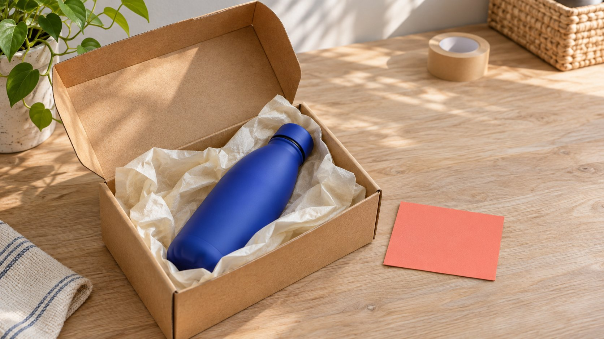

# GRIN：核对产品寄送型合作

状态：本地审阅稿；正式发布日期待确认。

评估GRIN产品型创作者项目时，先明确合作模式、产品与内容状态，再核对Gia工作、商店接入、使用范围和当前费用。

AI 生成的编辑示意图，不是真实达人、客户、产品或活动。

GRIN是一项创作者营销平台，当前官网把Gia作为协助开展项目的AI代理，并提供GRIN with Gia与GRIN Classic等入口。品牌评估产品寄送型合作时，应先明确寄什么、约定什么内容、如何确认使用范围，以及哪种结果有资料支持，再核对具体产品路线。产品寄出、对方收到、内容完成与效果确认是不同状态。本篇依据当前公开资料提出核对方法，不登录、接入商店、联系创作者或操作付款，也不把厂商功能说明当作独立实测结果。

## 先定义产品型合作的实际任务

寄送产品可以支持体验、内容制作或其他约定，但寄送动作本身没有说明对方承担什么。先把产品、内容、时期与双方责任写清楚。

假设品牌希望演示旅行水瓶的清洁步骤，任务可以包含对应型号、实际资料、演示要求与需要说明的限制。它不同于单纯寄出样品后等待自发反馈。

[Brief写作指南](/zh/blog/write-a-useful-campaign-brief/#answer)帮助从受众问题开始。平台选择应该围绕哪些工作需要被连接，而不是先选一个功能清单，再要求团队制造全部对应任务。

用可解释状态记录：产品待确认、合作待讨论、交付已约定或内容待验收。不要只设一个“已合作”，让同事无法判断具体进度。

本篇的水瓶场景为假设，没有真实客户、创作者或结果。它用于说明如何评估工作安排，不代表已经验证某个产品或平台项目。

## 确认当前产品路线，而不是沿用旧资料

[GRIN官方路线说明](https://grin.co/)在当前官网区分GRIN with Gia与GRIN Classic。评估前确认团队讨论的是哪个入口、现有账号状态及相应当前资料。

[GRIN项目功能说明](https://grin.co/platform)介绍把创作者、项目、合作记录、内容和测量联系起来，并将Gia放在相应工作之上。这里引用厂商描述，不声称已经验证所有能力与结果。

旧版教程、不同页面与当前产品可能有差别。不要把历史支付、接入或套餐说明直接拼接到新路线，形成一个服务方没有实际提供的组合。

把评估问题写成任务：当前方案如何处理这一项、哪个角色操作、什么状态可见、异常如何继续。一个名称相同，不足以证明工作方式仍相同。

本篇没有比较所有市场产品，也不做通用排名。重点是让品牌能就自己的寄送型项目提出具体、可核对的问题。

## 把寄样、付费、联盟与UGC约定说清

当前产品说明介绍多种项目模式。对品牌来说，需要明确实际约定包含产品、费用、发布、素材还是相应联盟安排，而不是只看项目被归到哪个标签。

一份产品可以出现在付费合作里，也可能只是体验寄样；没有约定内容时，不把收到产品写成对方已同意发布。实际义务回到双方确认。

[合作执行指南](/zh/blog/collaborate-with-influencers-brand-workflow/#answer)帮助安排谁核对事实、谁审阅内容、谁继续跟进。平台记录可以帮助传递状态，但不能替双方填写尚未作出的决定。

如果项目后续扩大用途或增加交付，重新确认对应事项。不能因为最初在同一项目里，就默认新增内容、渠道与时间都已经包含。

把约定变化保留在合适记录里。接收项目的下一位同事应理解当前条件，而不必从多个聊天片段猜测哪一版有效。

## 产品与商店接入按真实环境核对

产品状态至少需要让团队知道对应型号、可供内容使用的版本、当前可用性与寄送安排。库存资料、创建寄送、实际送达和内容验收不应合并。

当前平台说明区分Shopify与自定义或headless商店的API路线，并明确后者涉及开发工作。不要从“可接入”推断所有环境都不需要技术投入。

评估时让适当业务与技术负责人确认所需数据、实际环境与测试安排。本篇没有进行接入，也不要求为读文章开放商店或客户资料访问。

用一个适当获准的测试场景核对状态如何流转，会比只看动画示例更有帮助。未执行的检查标为未执行，营销页面中的例子不写成真实客户测试。

产品选择改变时，检查内容是否仍适用。假设换成另一个杯盖或容量，原先清洁演示可能需要修订，而不只是改订单上的名称。

## 把Gia准备的工作与实际执行责任对应

官网说明Gia可以协助寻找、准备外联与开展项目，并让团队选择参与审阅的程度。不能只从“展示计划”的画面推断所有动作都必然逐条等待人工批准。

采用前核对当前设置、角色与具体流程。哪些内容只是草稿，哪些可能执行，哪些变化需要负责人决定，应在评估中说清楚。

对寄送型任务，准备一份产品事实与联系语境，让任何自动草稿都围绕真实内容。没有资料支持的体验、熟悉关系或合作结果，不应因为由系统生成就被当作事实。

给跟进留适当负责人。收到了回复、产品发生改变或交付需要调整时，团队应知道谁继续处理，而不是只记录自动化已经启动。

本篇没有通过GRIN发送消息或启用任何自动工作。它讨论采用时需要理解的边界，不宣称某个实际账号已经完成设置。

## 内容入库与使用范围分别确认

当前产品页介绍内容追踪、整理和把已确认使用范围与内容关联。素材能在库中找到，并不独立说明品牌可以在所有渠道、时期与广告中使用。

[GRIN创作者条款](https://grin.co/terms-of-use-influencers/)将相应品牌权利与实际接受的具体安排联系起来。采用时应由适当负责人阅读当前条款及双方约定，本篇不提供合同解释或合规认证。

[使用范围指南](/zh/blog/creator-rates-usage-rights/#answer)帮助把素材、版本、用途、渠道与时期说清楚。第三方音乐、人物或其他元素，也不能因为文件已经下载就默认全部覆盖。

验收记录可以分开说明文件收到、事实已核对、内容已确认、用途仍待问。这样后续同事知道什么能继续处理，不会把一个“可用”标签扩大成所有事项都完成。

维护时保留到期与变更条件。素材仍可搜索，不代表先前约定永久有效；新的用途需要回到适当依据。

## 费用、计数与结果使用当前定义

[GRIN当前套餐说明](https://grin.co/pricing)列出免费方案，同时列出钱包存入管理费与不同使用限额。因此，免费方案不等于每种项目安排的全部成本为零。

评估时分别确认方案条件、产品成本、创作者约定与其他适用费用。不要从一个月费标签推算全部预算，也不在未核对时列出会迅速过期的价格表。

寄送计数、实际送达、内容完成和业务结果也需要不同定义。一个动作在产品里触发计数，不应被报告成已经完成内容或取得回报。

[项目测量指南](/zh/blog/creator-campaign-measurement/#answer)帮助把目标与证据对应。涉及观看、订单、佣金或其他结果时，保留来源、窗口与状态；未知字段不由平台宣传替代。

本篇没有试用、充值或核验真实项目报表。计划可把待问费用和计数放在明确位置，再由负责人用决定当时的官方资料确认。

## 假设案例：寄到的型号与演示不同

假设水瓶项目已经约定清洁演示与具体杯盖版本。产品寄出后，创作者发现收到另一种杯盖。此时可以确认包裹已收到，同时把产品对应和内容开拍保留为待处理。

品牌负责人确认替换或调整任务，内容人员核对演示是否需要变化。不能为了让项目显示完成，要求创作者把不一致的版本描述成原先已经确认的对象。

评估平台时，可以问这一差异怎样记录、谁能看到、后续约定如何保留。实际没做测试，就把这些写成待查情境，不假装已确认每种异常都自动解决。

等到适当产品与内容安排完成，再分别记录素材、事实、使用与发布。这个假设没有真实物流或客户结果，说明的是状态清楚如何支持下一步工作，而不是某个软件能够保证全部交付。

## 交付一个能够核对的产品型项目

评估结论应说明当前产品路线、实际任务、需要的连接、谁执行与审阅，以及哪些条件还未确认。资料不足时，可以先补充或缩小试点。

QuickKOL可以帮助理解Brief、发现相关创作者并研究作品与联系路径。具体寄送、交付、使用和结果，继续回到双方安排、实际资料与适当负责人。

## 不要合并的四个项目状态

| 状态 | 依据 | 继续确认 |

| --- | --- | --- |

| 产品安排 | 具体型号与合作记录 | 可用性与实际寄送 |

| 产品收到 | 适当收货记录 | 内容任务与交付安排 |

| 内容完成 | 实际版本与验收 | 使用范围与发布状态 |

| 结果报告 | 对应来源、定义与窗口 | 限制、其他活动与未知 |

编辑评估框架；水瓶项目为假设，产品功能为厂商公开说明，并非独立实测。

## GRIN项目适配检查表

用于提出具体评估问题，不连接账号、商店或付款工具。

- [ ] 当前路线与实际任务对应。

- [ ] 产品、内容与合作约定清楚。

- [ ] 连接条件与技术投入已核对。

- [ ] 准备、审阅与执行责任明确。

- [ ] 内容与具体使用依据相连。

- [ ] 费用、计数与结果分别解释。

## 研究日期与使用边界

资料核验于 2026 年 11 月 4 日。文中方法、表格和决策规则为编辑建议，标为假设的示例不是实际客户结果或行业基准。外部资料的适用地区与时期按各段说明；本稿处于独立本地审阅阶段，正式发布日期待确认。

## 来源

- [GRIN官方路线说明](https://grin.co/)

- [GRIN项目功能说明](https://grin.co/platform)

- [GRIN创作者条款](https://grin.co/terms-of-use-influencers/)

- [GRIN当前套餐说明](https://grin.co/pricing)
