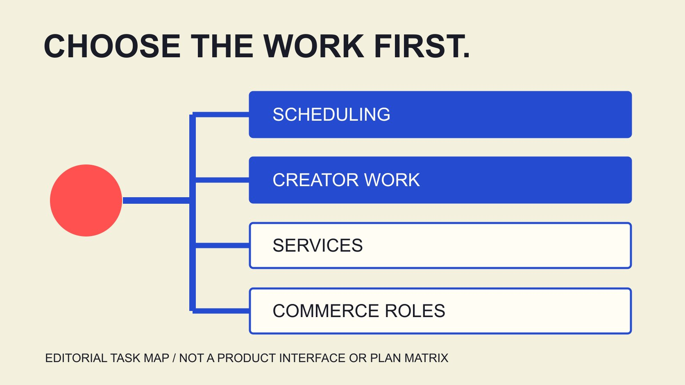

# Later: Choose the Product Route for Your Task

Status: local review draft; confirm the publication date before release.

Later’s public routes span social scheduling, creator software, services and creator opportunities. Match the team’s task before checking features, roles and project conditions.

QuickKOL editorial graphic; not actual account metrics or a platform interface.

Later’s current website presents routes for social media workflow, influencer marketing software, enterprise services and creator opportunities. A brand should first identify whether it needs scheduled publishing, research and partnership management, outsourced execution or another task such as affiliate linking. Then inspect the relevant product description. A scheduling feature does not establish inclusion of a complete influencer service, and a service description does not mean the team already has software access. This guide reviews Later’s public pages available on November 4, 2026 and develops task-selection and demonstration questions. It is public-document research, not a logged-in product test, universal brand ranking or performance guarantee. The decision begins with the work the team must actually complete.

## Translate the brand name into a specific task

The [Later official product routes](https://later.com/) distinguish enterprise campaigns, influencer software, creator earning opportunities and social media management. One website name does not mean every route serves the same user or produces the same work result.

Write the assignment in one sentence, such as a small team needs to schedule owned-account content and preserve review, or a brand needs someone to execute creator partnerships. These generate different purchasing and handoff questions.

The [platform-workflow guide](/blog/influencer-marketing-platform-workflow/#answer) turns name comparison into work comparison. Establish operator, required inputs and expected output before choosing a product page.

Retain unresolved boundaries rather than assume one package includes every capability shown across the site. When a team can explain which kind of help it needs, a demonstration or inquiry is more likely to produce an applicable answer. That clarity also lets stakeholders distinguish an attractive feature from a feature that would resolve the actual bottleneck in their current workflow.

## Social scheduling: inspect content and publication work

The [Later scheduler guide](https://later.com/social-media-scheduler/) describes a visual calendar, cross-platform scheduling, media folders and adapting content for profiles. These are supplier descriptions, not evidence of successful publication through an account in this review.

Check actual channel, content type, account access and steps requiring an operator. Cross-platform capability should not become unconditional automation of every action for every format and region.

At review, this page advertises a fourteen-day trial. That is public information for the product route read, not a promise shared by enterprise services, every account or all plans. Confirm applicable conditions through the corresponding route.

If the bottleneck is content review and publishing schedules, a demonstration should use an actual proposed post and relevant roles rather than only show an attractive calendar. Ask what configuration is required and which actions remain with the team. The aim is to understand how a piece of work reaches publication, including any handoff that a high-level feature list leaves unspecified.

## Influencer software: inspect research, partnership and reporting objects

The [Later creator-platform guide](https://later.com/influencer-marketing-platform/) presents discovery, incentive advice and reporting as capability areas, with an alternative service-team route. Public descriptions help formulate questions without independently establishing prediction accuracy or project returns.

For a brand operating its own partnerships, ask where information comes from, which fields are available, who updates states and how unknowns are handled. Using a platform does not make every external fact verified automatically.

The [metric-definition record](/blog/engagement-rate-formula-metric-contract/#answer) preserves object, source and window during reporting. Views, interactions, sales and estimates are different measurement levels; their appearance on one product page does not make them interchangeable.

For a prediction or performance comparison, seek applicable conditions and supporting evidence. We obtained no supplier client dataset and conducted no independent test, so the marketing description is not rewritten as a result established by QuickKOL. A useful review identifies which part of the proposed workflow deserves further verification instead of treating the existence of an intelligence feature as completion of the team’s own research.

## Services: establish who performs the work

The [agency-coordination guide](/blog/influencer-marketing-agencies-operating-rhythm/#answer) develops brand decisions, production review, escalation and handoff. If a brand needs an execution team, focus on responsibility, deliverables and actual resources rather than only a software feature list.

State what the brand supplies, what the service provider supplies, who contacts creators, who handles content issues, and who confirms budget and final acceptance. Actual responsibilities need an arrangement; a service introduction is not a private contract.

A service route may involve software without being equivalent to a software subscription. An introduction or consultation does not establish account access, all data, every production file or unlimited future use.

Prepare questions with the [statement-of-work checklist](/blog/creator-contract-scope-checklist/#answer) and obtain appropriate confirmation. The team can then compare the work it will actually receive instead of expecting one phrase such as full service to carry every unstated obligation. This distinction matters particularly when several internal teams assume that the same provider will own tasks nobody has explicitly assigned.

For example, a team may want the provider to handle creator feedback while an internal product owner still confirms technical statements. Retain that decision in the responsibility record so the brand can account for its own time. External execution should not be interpreted as disappearance of the internal decisions the work still requires.

## Do not confuse a creator route with brand procurement

The current site also presents creator routes for affiliate links and campaign opportunities. These explain ecosystem roles without establishing that a brand entering one route has acquired software for managing every partnership.

If a colleague lands on a creator page from search, identify whom it serves and the intended action before returning to the brand’s assignment. Similar marketing language across routes does not change the underlying user or object.

Such pages do not establish that an individual creator applied, received an invitation, is available or accepts a brand’s terms. Required relationships and states still need their corresponding records.

We have applied for no opportunity, joined no program and submitted no contact form. The output of navigation research is knowing which information to inspect and what to ask next, rather than creating a relationship or obligation without the relevant assignment. It should make the subsequent conversation better informed while keeping an observed route separate from an action actually completed by a user.

## Read approval features through roles and exceptions

The [Later collaboration-review guide](https://later.com/social-media-approval-workflow/) describes review, comments, roles and a shared calendar, but its FAQ separately qualifies publishing permissions for Members and Reviewers. The approval headline alone should not become a promise that every unapproved post is technically blocked.

Prepare a specific demonstration question: which role creates the post, in what state, with whose feedback and under which publication conditions? Ask how the current plan and permissions actually handle that case.

Distinguish content comments, factual confirmation and commercial acceptance. Even an approved state should have an identifiable object and show whether another owner still needs to decide something.

Without entering an account, we cannot claim a complete approval chain was tested. Retaining public qualifications helps a brand inspect behavior rather than allocate responsibility solely from a feature name. A successful evaluation should let the team explain both the intended process and the actual control that supports it, including any exception that would require an operating rule outside the tool.

## Use a small work sample to define a demonstration

Suppose a brand needs to review one product-explanation item each week while researching its next collaborator. This is an editorial scenario, not an actual client, workload benchmark or promised scope of a plan.

Separate content draft, fact review, account publication, partner research and reporting fields. For each, ask which route handles it, who owns it, what input is needed and how the result returns to the team.

If a stage depends on another product or service route, preserve that dependency instead of concealing it behind a common brand name. Where work remains manual for the brand, retain the actual steps and resources.

A demonstration should answer the assignment rather than require one tool to rank first at everything. One successful example does not establish year-round reliability; one unsuitable task does not discredit every supplier capability. The useful result is a clear account of fit and remaining questions, including whether the proposed combination reduces the bottleneck enough to justify further evaluation.

## Evaluate capability, conditions and cost against one question

Before purchase or renewal, check relevant plan, people, profiles, feature conditions and actual commercial information. A trial or offer on another route should not be applied automatically to the service being discussed.

This guide publishes no unverified universal price and turns no individual quote into a fixed worldwide rate. Currency, tax, duration and included scope require the appropriate route and actual information.

Separate tool fees from production, review and collaboration work retained by the brand. A lower subscription does not automatically establish a lower total operating cost, and a higher fee does not independently establish better outcomes.

Preserve assumptions, unknowns and decision conditions. Inadequate information can lead to a demonstration request or further inquiry rather than a fabricated experience or return comparison supplied to make a recommendation sound certain. A team should know what would change its decision and which missing answer is important enough to obtain before making a commitment.

## Hand off a task-fit conclusion

The handoff should state the task, relevant route, public evidence, checked conditions and unanswered questions. Later suits us leaves the next colleague guessing which work it suits.

Product pages begin the research; actual demonstrations, access, commercial arrangements and outcomes need separate records. When information changes, revise the relevant conclusion against new facts without manufacturing an all-platform ranking.

QuickKOL can help interpret brand tasks and research creators’ work. Tool comparison should still follow actual work and available evidence. Choose the question before choosing the product or service route expected to answer it.

## Choose a Later route by task

| Task | Research route | Verify next |

| --- | --- | --- |

| Owned-content scheduling | Social management and scheduling | Channels, formats, accounts and roles |

| Brand-operated creator program | Influencer software | Data, workflow, access and reporting |

| Outsourced execution | Enterprise services | Responsibilities, delivery and commercial conditions |

| Creator links or opportunities | Creator routes | User role and program conditions |

Based on public pages read November 4, 2026; a task-fit framework, not a logged-in test or a list of plan inclusions.

## Product-demonstration questions

Write a specific assignment before requesting an explanation that answers it.

- [ ] Whom does this route serve?

- [ ] Who operates it, and what are the inputs and outputs?

- [ ] How do actual plan and permissions affect the workflow?

- [ ] Can approval objects and exceptions be explained?

- [ ] How are external data and estimates labeled?

- [ ] Which work remains with the brand?

## Research date and limitations

Sources reviewed November 4, 2026. Methods, tables and decision rules are editorial recommendations. Hypothetical examples are not actual client results or industry benchmarks. Source geography and periods are specified where relevant. This draft is in independent local review; confirm its publication date before release.

## Sources

- [Later official product routes](https://later.com/)

- [Later scheduler guide](https://later.com/social-media-scheduler/)

- [Later creator-platform guide](https://later.com/influencer-marketing-platform/)

- [Later collaboration-review guide](https://later.com/social-media-approval-workflow/)
