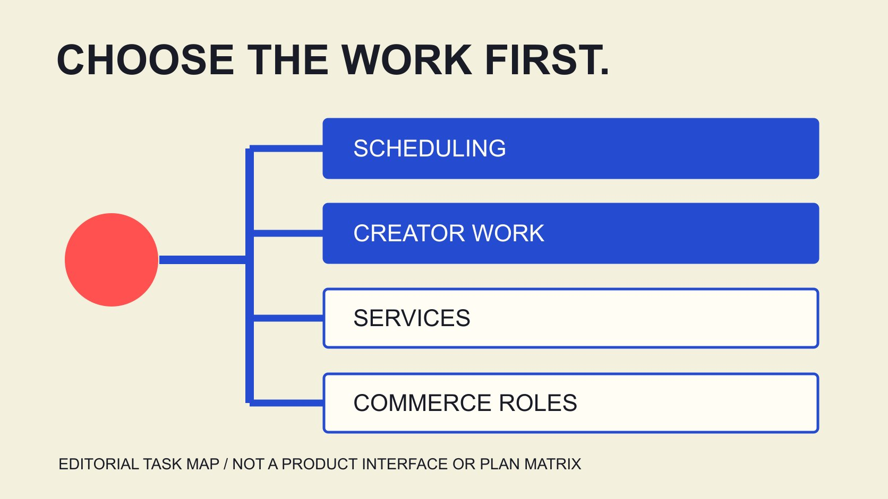

# Later是什么：按工作任务选择入口

状态：本地审阅稿；正式发布日期待确认。

Later的公开入口涉及社交排程、达人平台、服务与创作者机会。先匹配团队任务，再核对功能、角色与实际项目条件，避免拿一个页面替全部产品作判断。

QuickKOL 编辑图形；不呈现真实账号指标或平台界面。

Later的当前官网同时提供社交媒体工作流、达人营销平台、企业服务与创作者机会等入口。品牌选择时先明确自己要完成的是排程发布、研究与管理合作、委托执行，还是处理联盟链接等另一种任务，再进入对应产品说明。一个排程功能不证明已包含完整达人服务，一项服务介绍也不等于团队已经取得软件权限。本文核对2026年11月4日可读的Later公开页面，给出任务选择与演示问题；它是公开资料研究，不是已登录实测、适合所有品牌的排名或效果保证。

## 先把一个品牌名称拆成具体任务

[Later官方产品入口](https://later.com/)分别展示企业活动、达人软件、创作者赚钱机会与社交媒体管理。网站名称相同，不代表所有入口服务同一用户或提供同一工作结果。

写一句本次任务，例如“小团队需要安排品牌自有账号内容并保留审阅”，或“品牌需要有人负责达人合作执行”。这两句会产生不同采购与交接问题。

[平台工作流指南](/zh/blog/influencer-marketing-platform-workflow/#answer)帮助把名称比较变成工作比较。先确定谁操作、需要什么输入、要交出什么，再选择产品页继续读。

记录尚未解决的边界，不因网站有多种能力就默认一个套餐包含全部。团队能清楚说出自己需要哪一种帮助，演示或询问才更容易得到适用的答案。

## 社交排程：核对内容和发布工作

[Later排程产品说明](https://later.com/social-media-scheduler/)描述可视日历、跨平台排程、媒体文件夹与针对账号调整内容等功能。它是厂商对产品的公开说明，不是本次账号已成功发布的记录。

核对实际渠道、内容类型、账号权限与需要人工完成的步骤。不要把跨平台能力理解成每个平台、每种格式、每个地区的全部动作都能无条件自动执行。

该页面在本次核验时展示14天试用文案。它属于所读产品入口的公开信息，不能直接扩成企业服务、所有账户或全部计划共享的承诺；实际适用条件需要在相应入口确认。

如果团队主要痛点是内容审阅与发布排期，演示应围绕具体帖子和工作角色，而不是仅观看漂亮日历。让提供方解释完成任务需要哪些配置与仍由团队负责的动作。

## 达人平台：核对研究、合作与报告的对象

[Later达人平台说明](https://later.com/influencer-marketing-platform/)把发现创作者、激励建议和报告作为公开能力方向，并介绍另一个可由服务团队执行的入口。公开描述可以帮助设计问题，不独立证明预测准确率或项目收益。

如果任务是品牌自己管理合作，先问资料来自哪里、哪些字段可取得、谁更新状态以及如何处理未知。使用一个平台，不会让所有外部事实自动成为已核验。

[指标定义记录](/zh/blog/engagement-rate-formula-metric-contract/#answer)帮助在报告环节保留对象、来源与窗口。观看、互动、销售与估算不是同一层指标，不能因为它们出现在一个产品页面就相互替代。

对任何预测或表现比较，都要求理解实际适用条件与证据。本文没有取得供应商客户数据或运行独立测试，因此不会将其营销表达改写成QuickKOL证实的结果。

## 服务路线：确认谁负责实际工作

[机构协作指南](/zh/blog/influencer-marketing-agencies-operating-rhythm/#answer)讨论品牌决定、制作审阅、异常升级与交接。如果品牌寻找执行团队，问题应围绕责任、交付和实际资源，而不只看软件功能列表。

先写品牌提供什么、服务方提供什么，谁联系创作者、谁处理内容问题、谁确认预算与最后接受。具体责任需要实际安排，不能从一张服务介绍页猜出合同。

服务路线可以涉及软件使用，但两者不自动相等。获得一次介绍或咨询，不说明品牌已获账号、全部数据、所有制作文件或任意未来使用。

用[工作说明清单](/zh/blog/creator-contract-scope-checklist/#answer)准备问题，再由适当双方确认。这样，团队比较的是具体要接收的工作，而不是只用“全案”一词承担没有写出来的全部期待。

例如，团队可能希望服务方处理创作者反馈，却仍需要内部产品负责人批准技术说法。把这个决定保留在责任表里，才能计算品牌还需提供的时间，也避免把外部执行理解成内部责任已经消失。

## 创作者入口与品牌采购不要混为一谈

当前官网还为创作者展示联盟链接与活动机会入口。它们可以帮助理解生态中的角色，但不说明点击某个入口的品牌已经取得可管理所有合作的软件套餐。

如果同事从搜索结果进入创作者页面，先核对页面服务谁、预期动作是什么，再返回本次品牌任务。不同入口出现相似营销词语，也不改变其实际对象。

此类资料不证明某位创作者已经报名、获邀、可合作或愿意接受品牌条件。项目需要的关系与状态仍要按相应记录确认。

本篇没有申请机会、加入计划或提交联系表。公开导航研究的产出，是知道下一步应读哪份资料、问谁什么问题，而不是在没有相应任务时替用户创建新的关系或义务。

## 审批功能需要读到角色与例外

[Later协作审阅说明](https://later.com/social-media-approval-workflow/)介绍审阅、评论、角色与共享日历，但FAQ还对Member与Reviewer的发布权限另作说明。因此不能只从“审批”标题推导所有帖子都会在未通过时被硬性阻止。

为演示准备一个具体问题：由哪种角色创建、何种状态、经过谁的反馈、在什么条件下发布？再请提供方解释当前计划与权限实际怎样处理它。

把内容意见、产品事实确认和商务接受分别理解。即使系统内显示已批准，也应知道批准对象是什么，以及是否有另一个负责人仍需作决定。

不要在未进入账号时声称已证明完整审批链。本篇保留公开资料中的限定，是为了让品牌下一步能核对实际行为，而不是仅靠一个功能名称安排团队责任。

## 用一个小工作样本提出演示要求

假设品牌每周需要审阅一条产品解释内容，同时研究下一位合作者。这是编辑情景，不是实际客户、工作量基准或某计划已经承诺的范围。

把任务拆成内容草稿、事实复核、账号发布、合作对象研究与报告字段。分别问哪个入口处理、谁负责、需要什么输入、结果如何带回团队。

如果一个环节来自另一产品或服务路线，就保留这个依赖，不用“同一个品牌”掩盖差异。若某个工作仍由品牌人工完成，记录实际步骤与资源。

演示应回答你的问题，而不是要求一个工具在所有方面都第一。不能从一次成功示例推导全年稳定表现；也不因某个任务不适合就贬低供应商全部能力。

## 把功能、条件与成本放回同一个问题

采购或续费前，核对相关计划、人数、账号、功能条件与实际商务说明。不要把其他产品入口上的试用或折扣，直接套到本次询问的服务上。

本篇不发布未经核对的统一价格，也不把单个报价变成所有市场的固定费率。具体币种、税项、期限和包含范围应由适当入口与实际资料确认。

把工具费用与品牌仍需承担的制作、审阅和协作工作分开。一个较低订阅价不自动意味着更低总成本，较高费用也不独立证明业务结果更好。

最后保留关键假设、未知项和决定条件。资料不够时，可以说需要演示或进一步询问，而不是为了给出确定推荐，编造不存在的体验或回报比较。

## 交付一个任务匹配结论

最终结论写清本次任务、对应入口、公开依据、已核对条件与未回答问题。不要只写“Later适合我们”，让下一位同事猜究竟适合哪一段工作。

产品页是研究起点，实际演示、权限、商务安排与项目结果分别保留。资料更新时，按新的具体事实修订相关结论，而不需要重新制造一份全平台排名。

QuickKOL可以帮助理解品牌任务与研究创作者作品；工具比较仍应围绕实际工作与可取得证据进行。先选对问题，再选择适合回答它的产品或服务路线。

## 按工作任务选择Later入口

| 任务 | 研究入口 | 进一步核对 |

| --- | --- | --- |

| 自有内容排程 | 社交媒体管理与排程 | 渠道、格式、账号与角色 |

| 品牌自己管理达人合作 | 达人营销平台 | 数据、流程、权限与报告 |

| 委托项目执行 | 企业服务 | 职责、交付与实际商务条件 |

| 创作者链接或机会 | 创作者入口 | 用户角色与项目条件 |

依据2026年11月4日公开页面整理；是假设任务匹配框架，不是登录实测或套餐包含清单。

## 工具演示问题单

先写具体任务，再要求能回答它的说明。

- [ ] 这个入口主要服务谁？

- [ ] 谁操作、输入与输出是什么？

- [ ] 实际计划与权限如何影响流程？

- [ ] 审批对象与例外能解释吗？

- [ ] 外部数据与估计如何标注？

- [ ] 品牌仍负责哪些工作？

## 研究日期与使用边界

资料核验于 2026 年 11 月 4 日。文中方法、表格和决策规则为编辑建议，标为假设的示例不是实际客户结果或行业基准。外部资料的适用地区与时期按各段说明；本稿处于独立本地审阅阶段，正式发布日期待确认。

## 来源

- [Later官方产品入口](https://later.com/)

- [Later排程产品说明](https://later.com/social-media-scheduler/)

- [Later达人平台说明](https://later.com/influencer-marketing-platform/)

- [Later协作审阅说明](https://later.com/social-media-approval-workflow/)
