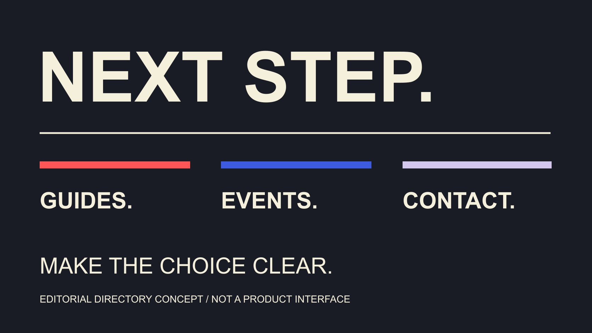

# Linktree: Organize Brand Links and Visitor Paths

Status: local review draft; confirm the publication date before release.

Organize Linktree as a clear brand destination directory: task-based ordering, meaningful titles, update conditions and accurately defined clicks.

QuickKOL editorial graphic; not actual account metrics or a platform interface.

People searching for link tree often mean Linktree, a tool for presenting multiple destinations through one shareable entry point. The brand’s real decision is what visitors came to do and which route deserves priority. Organize necessary links, meaningful titles and current conditions before choosing presentation features. A directory can connect guides, activities, products or partnership information, but more entries are not automatically more useful. This guide uses Linktree’s public help documentation to explain destination hierarchy and maintenance. It creates or edits no account and promises no purchase or follower increase from replacing a profile link. The aim is an understandable next step that the actual destination fulfills.

## List visitor tasks before organizing links

Visitors may need a usage guide, activity information, product detail or a partnership contact route. Write the main tasks first, then decide which links actually help rather than place every organizational URL on the page.

An account introduction should explain identity, value and a next step. This article continues into the multiple destinations behind that invitation so the introduction and actual directory support each other.

The [brief-writing guide](/blog/write-a-useful-campaign-brief/#answer) helps identify the main audience and question. Educational and event accounts may need different ordering, and one brand may have different tasks at different stages.

Give each link a purpose and owner during organization. If nobody knows why an older route exists, ask the responsible person before continuing to send visitors to potentially expired material.

A short directory should explain how its choices differ. If two entries look identical but serve different regions or versions, state those conditions rather than rely on guessing. This is a content decision before it is a design decision, and it gives the editor a reason for every destination retained.

## Give the main task an understandable position

The [Linktree link-organization guide](https://linktr.ee/help/articles/8614124-organize-links-keep-visitors-engaged) recommends putting important entries first, grouping related links and removing irrelevant material. Treat that as vendor guidance rather than a proven rule for every brand.

Important need not mean most clicked historically. A newly opened activity can have a clear time condition, while a frequently needed guide remains useful over time. Explain ordering against the current task.

Different tasks need distinguishable names: read the model guide and see activity arrangements communicate more than two identical learn more buttons. When there are too many entries, reconsider necessity first.

Do not keep an expired route at the top solely because it once received many clicks or makes the page appear busy. Historical response and current applicability are separate considerations.

Retain the ordering rationale. A later colleague interpreting changed data can then understand the earlier priority rather than mistake one campaign’s prominence for a permanent brand hierarchy. Review the route as a visitor would encounter it, including whether the first choice makes sense alongside the content that brought them there.

## Make link titles describe the actual destination

The [W3C link-purpose technique](https://www.w3.org/WAI/WCAG21/Techniques/general/G91) explains how wording helps readers understand a destination and its use. It is an accessibility technique example; the principle is adapted here without claiming full accessibility certification for a Linktree.

A title can identify an action and object, such as view the cleaning guide or see weekend-session arrangements. The actual page should answer that expectation rather than turn a reading invitation into a destination primarily requesting a sales appointment.

Keep necessary conditions visible. Geography, language, activity stage or model differences should help visitors choose before they arrive somewhere inapplicable.

Review title and destination together after drafting. A URL opening does not establish content alignment; an old guide may remain accessible while no longer supporting the current invitation.

Decoration, thumbnails and motion can support recognition, while essential meaning remains in the words. A colleague uninvolved in drafting can restate each route’s purpose to reveal obvious ambiguity. This modest editorial check is useful without being presented as representative user research or proof of a conversion improvement.

## Understand highlighting and redirecting as different choices

The [Linktree prioritization guide](https://linktr.ee/help/articles/5434173-how-to-prioritize-a-link) describes auto-expansion, animation and redirecting as different options with plan-dependent availability. Redirecting changes whether visitors first see the directory, which differs from making one option more noticeable.

Before using it, ask whether the current task genuinely suits a direct route to one destination. A single activity and a continuing directory serving several needs can require different choices; a feature is not the default for every situation.

For a time-limited route, the owner should confirm ending conditions, actual rules and the restored page. This article only reads public guidance and enables no account feature.

Some content needs to preserve meaningful choices, such as regional information. Highlighting one route should not hide conditions a visitor still needs to complete the task.

Animation cannot repair a mismatched destination either. Finish content and route review before deciding whether emphasis helps, rather than equating noticeable with suitable or effective. A team can reasonably choose ordinary ordering when it communicates the task clearly, without purchasing or activating additional presentation functions.

## Plan what happens after a campaign route ends

For each time-limited route, record start, end, owner and subsequent handling. After an activity, choose a recap, next-session route or removal against actual business arrangements.

Consider other entry points connected to the destination too. Editing one Linktree title does not automatically change published social copy, a QR code or collaboration material.

The [collaboration workflow guide](/blog/collaborate-with-influencers-brand-workflow/#answer) identifies who proposes, confirms facts and applies the update. A prepared version needs its actual state retained rather than have a pending checklist described as completed work.

Suppose an event is postponed. Confirm its new date and participation details, then align destination page, directory title and related public explanation. Otherwise visitors may encounter conflicting invitations in different places.

Daily changes are not inherently necessary. Maintenance triggered by actual changes is more explainable than constant movement for apparent freshness, and it gives analysis a record of structural changes. A link remaining unchanged can be appropriate when its purpose and underlying information are still current.

## Walk through the route from the actual invitation

Start a review from the actual planned invitation, such as an Instagram bio, an event-poster QR code or a tutorial explanation. Read the invitation before opening the directory and ask whether the promised next step is recognizable. A link existing in an editor does not answer that question.

Check the main language and geography conditions separately. If a bio invites reading a Chinese guide while the first entry uses only an obscure English abbreviation, revise wording or ordering even when the destination exists. Readers need to understand which option fits their task.

At the destination, confirm that content, model or activity stage agrees with the invitation. For a booking route, inspect whether arrangements are explained. An ordinary review need not submit information or complete a purchase to identify an obvious mismatch.

Record the reviewed links and timing so later click interpretation retains that context. Describe a problem by its page, observation and needed action rather than only calling the experience poor. Specific notes give an owner something they can actually resolve.

If a timed redirect is used, assign an appropriate owner to check both the active period and restored page. The team can first specify scenarios and retain pending states for checks not performed. This article walks through no user account; these are editorial recommendations to apply against the actual arrangement.

## Read clicks using Linktree’s actual definitions

The [Linktree Insights guide](https://linktr.ee/help/articles/5434178-understanding-your-analytics) distinguishes total views, unique views, total clicks and unique clicks, and defines Click Rate as total clicks divided by total views. These should not be renamed interchangeably or called a purchase rate.

The same guide says the owner’s test clicks enter counts, while historical windows and some functions depend on plan. Record test and change times and compare using the definitions actually available.

The [metric-definition guide](/blog/engagement-rate-formula-metric-contract/#answer) clarifies numerator, denominator and window. A route receiving more clicks may involve placement, wording, distribution or visitors changing; totals alone cannot identify the cause.

For business outcomes, use the corresponding system and appropriate evidence rather than infer every order from clicks. A directory records a path without automatically answering every downstream behavior question.

This article logs into no Linktree analytics account, tests no reporting feature and exports no report. Definitions come from the official public help material read for the draft; an actual project still verifies its report. Keeping the label with the number makes a later handoff more useful than sharing a percentage without its construction.

## A hypothetical: guides, sessions and partnership routes

Suppose a brand account continually teaches product use, has one upcoming session and maintains a partnership contact route. Give the main educational invitation its relevant guide, then position the session route against its current timing.

Use three titles that explain purpose rather than repeat the brand name. The partnership route should indicate suitable inquiries so an ordinary customer does not mistake it for support.

After the activity, the owner updates its route under actual arrangements while continuing guides retain applicable conditions. When a new product version launches, check whether guide and explanation still correspond.

Evaluate each route against its task rather than combine all clicks into people intending to buy. This hypothetical demonstrates directory organization without establishing a universally better order.

Linktree’s useful role is a clear next step. QuickKOL can help interpret brand briefs and research relevant creators’ work; actual destinations, data and commercial conditions still require source confirmation. Each additional destination creates a maintenance responsibility. Keep it because it serves a current reader task, with an owner who can confirm changes.

## Give each entry a clear task

| Entry | Title explains | Maintenance condition |

| --- | --- | --- |

| Usage guide | Object, version and explanation | Product or guide version changes |

| Activity arrangements | Activity and next action | Dates, eligibility or state changes |

| Partnership route | Suitable type of inquiry | Owner or contact route changes |

| Data record | Metric and window | Structure, distribution or definition changes |

Editorial directory framework; the three-route case is hypothetical, not a hands-on Linktree test or growth promise.

## Brand destination-directory review

For organizing tasks and links without creating or editing a Linktree account.

- [ ] Main visitor tasks explicit.

- [ ] Each entry has a purpose and owner.

- [ ] Title matches the actual destination.

- [ ] Geography, version and activity conditions understandable.

- [ ] Time-limited entries have ending and update arrangements.

- [ ] Clicks and business outcomes interpreted separately.

## Research date and limitations

Sources reviewed November 4, 2026. Methods, tables and decision rules are editorial recommendations. Hypothetical examples are not actual client results or industry benchmarks. Source geography and periods are specified where relevant. This draft is in independent local review; confirm its publication date before release.

## Sources

- [Linktree link-organization guide](https://linktr.ee/help/articles/8614124-organize-links-keep-visitors-engaged)

- [W3C link-purpose technique](https://www.w3.org/WAI/WCAG21/Techniques/general/G91)

- [Linktree prioritization guide](https://linktr.ee/help/articles/5434173-how-to-prioritize-a-link)

- [Linktree Insights guide](https://linktr.ee/help/articles/5434178-understanding-your-analytics)
