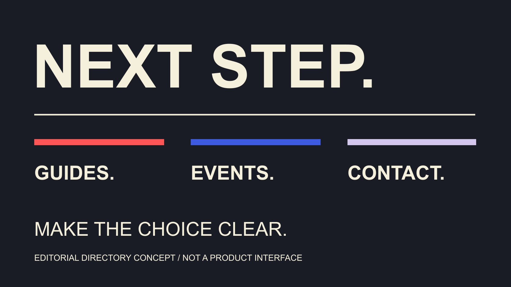

# Linktree：安排品牌链接路径

状态：本地审阅稿；正式发布日期待确认。

把Linktree组织成清楚的品牌目的地目录：排序按任务，标题说明用途，活动有更新条件，点击保留真实口径。

QuickKOL 编辑图形；不呈现真实账号指标或平台界面。

搜索“link tree”时，很多人是在寻找Linktree这类把多个目的地放进一个分享入口的工具。品牌真正需要决定的是访客来做什么，以及哪个入口应先出现。先整理必要链接、清楚标题和当前有效条件，再选择合适的组织功能。一个目录可以连接指南、活动、产品或合作信息，但入口越多不自动越有用。本篇依据Linktree公开帮助资料讲目的地层级与维护，不替用户创建或修改账号，也不承诺换一个主页链接就能增加购买或粉丝。

## 先列访客任务，再整理链接

访客可能要找使用指南、了解某场活动、查看产品资料或确认合作入口。先写主要任务，再判断哪些链接真正帮助完成它，而不是把组织所有URL都堆进页面。

账号简介应说明身份、价值与下一步。本篇处理下一步里的多个目的地，让简介邀请与实际目录相互支持。

[Brief写作指南](/zh/blog/write-a-useful-campaign-brief/#answer)帮助决定主要受众与问题。教学账号和活动账号可能需要不同入口顺序，同一个品牌在不同阶段也可能有不同任务。

整理时逐个说明链接用途和负责人。没有人知道它为什么存在的旧入口，可以先交给负责人确认，避免继续让访客碰到过期内容。

一个短目录应能解释每个选项如何不同。若两个入口看起来相同，却分别面向不同地区或版本，把条件写明，比依靠读者猜测更有效。

## 把主要任务放在可理解的位置

[Linktree链接组织说明](https://linktr.ee/help/articles/8614124-organize-links-keep-visitors-engaged)建议把重要入口放前面、组合相关链接并清理不再相关的内容。这里把它作为产品方建议来使用，不说已经证明适合每个品牌。

重要不一定等于历史点击最多。一个刚开始的活动可能有明确时效，一份常见问题说明可能长期有用；排序理由应与当前任务一致。

给不同任务必要区分：例如“阅读型号指南”和“查看活动安排”，比两个同样写“了解更多”的按钮更容易解释。若入口太多，先重新审视必要性。

不要为了让页面显得活跃，把一批已经过期但点击曾经很高的链接继续放在顶部。历史表现与当前适用性需要分别看。

保留本次排序理由。后续同事看到数据变化时，就能知道先前重点是什么，不会把一次活动优先误认为品牌永久层级。

## 链接标题说明真实目的地

[W3C链接目的说明](https://www.w3.org/WAI/WCAG21/Techniques/general/G91)强调让文字帮助读者理解目的地和用途。它是可访问性技术示例；本篇借用原则，不声称某个Linktree已经完成全部可访问性认证。

标题可以说明动作与对象，例如“查看清洁指南”或“了解周末体验安排”。实际页面也应回答对应问题，避免把阅读邀请送到主要要求销售预约的页面。

必要条件留在能看见的位置。地区、语言、活动阶段或型号不同，应让访客知道自己选择哪条路线，而不是到了页面才发现不适用。

写作完成后，把标题与目标页一起审阅。仅检查URL能打开不足以判断内容相符；一份旧版指南可能仍能访问，却不适合当前邀请。

装饰、缩略图和动效可以支持辨认，但关键含义应由文字承担。团队可以请一位未参与起草的同事复述各入口用途，先发现明显歧义。

## 理解优先显示与重定向的差别

[Linktree优先入口说明](https://linktr.ee/help/articles/5434173-how-to-prioritize-a-link)介绍自动展开、动效和重定向等不同方式，相关功能按套餐提供。重定向会改变访客是否先看到完整目录，与让某个选项更显眼不同。

采用前先问当前任务是否真的适合让访客直达一个目标。单一活动与长期多任务目录可能有不同需要，不能把一个功能当作所有情境的默认选择。

若设置有时效的入口，负责人需要核对结束条件、实际规则与恢复后的页面。文章只读取公开说明，没有在任何账号开启该功能。

某些内容需要让读者保留选择，例如地区不同的资料。不要为了把一个入口做得突出，隐藏访客完成任务仍需要的条件。

动效也不解决目的地不合适的问题。先完成内容与路径核对，再判断视觉强调是否有用；不把醒目等同于适合或有效。

## 活动入口需要结束后的安排

为每个限时入口记录开始、结束、负责人和后续处理。活动结束以后，是改为回顾、引导下一场，还是移除入口，应按实际业务安排决定。

连接目标页的其他入口也需要一起考虑。改掉Linktree一处文字，不会自动修改已经发布的社交说明、二维码或合作素材。

[合作执行指南](/zh/blog/collaborate-with-influencers-brand-workflow/#answer)帮助明确谁提出变更、谁核对事实和谁实际更新。准备好的新版本应保留真实状态，不把待修改清单当作已完成记录。

假设活动延期，先确认新日期与参与安排，再同步目标页面、目录标题和相关公开说明。否则访客可能在不同位置看到互相矛盾的邀请。

不一定需要每天改变页面。按实际变化维护，比为了显得新鲜不停调整更可解释，也让数据分析知道什么时候发生了结构变化。

## 从实际邀请走读一次读者路径

审阅可以从真实计划中的入口开始，例如Instagram简介、活动海报二维码或某条教学说明。先读邀请，再打开目录，检查读者是否能辨认它承诺的下一步，不只从编辑后台看链接存在。

分别核对主要语言与地区条件。假设简介邀请阅读中文指南，第一项却只写含糊英文缩写，即使目标页存在，仍需要调整标题或顺序，让读者知道该选什么。

进入目标后，确认内容、型号或活动阶段与邀请一致。若下一步是预约，检查页面是否解释相关安排；普通审阅不需要实际提交资料或完成购买才能发现明显路径错误。

记录本次走读涉及哪些链接和时点，后续解释点击数据时保留这项背景。测试过程发现的问题，写成具体页面、观察与待处理动作，比只给一个“体验不好”的评价更易修改。

如果使用限时重定向，还需安排适当负责人核对启用期间与恢复后的任务。可以先写需要检查的情境，实际未执行时保留待查状态。本篇没有走读任何用户账号；这里是一份采用时可执行的编辑建议。

## 按Linktree定义阅读点击数据

[Linktree数据口径说明](https://linktr.ee/help/articles/5434178-understanding-your-analytics)区分总访问、独立访问、总点击和独立点击，并以总点击除以总访问定义Click Rate。它们不应互相换名称，也不能直接叫作购买率。

同一说明还指出自己的测试点击会进入统计，历史窗口与部分功能取决于套餐。记录测试与变更时点，比较时采用实际可用口径。

[指标定义指南](/zh/blog/engagement-rate-formula-metric-contract/#answer)帮助确认分子、分母与观察窗口。一个入口点击更多，可能涉及位置、文案、分发或访问人群变化；仅凭总数无法确定原因。

需要实际业务结果时，回到相应系统和合适证据，不从点击数推断全部订单。目录方便记录路径，却没有自动提供所有后续行为的答案。

本篇没有登录Linktree后台，也没有测试分析功能或导出报告。上述定义来自本次读取的官方公开帮助资料，实际项目仍需核对所用报表。

## 假设案例：指南、体验与合作三个入口

假设一个品牌账号持续讲产品使用，同时有一场体验活动与一个合作联系入口。可以先让主要教学邀请找到对应指南，再根据活动时期安排体验入口。

三个标题分别说明用途，而不是全部写品牌名称。合作路径也应告诉人适合什么联系，不让普通顾客误以为那是售后入口。

活动结束后，负责人按实际安排更新，长期指南继续保留其适用条件。若新版本产品推出，确认指南链接与说明是否仍对应。

评价时分别看入口任务，不把所有点击合成“有意购买人数”。这个假设只演示目录组织，不证明某种顺序一定提高结果。

Linktree的作用是让下一步清楚。QuickKOL可以帮助理解品牌Brief和研究相关创作者作品，具体入口、数据与合作条件仍按实际资料确认。每增加一个目的地，也应有能够核对变更的维护负责人。

## 让每个入口有清楚任务

| 入口 | 标题说明 | 维护条件 |

| --- | --- | --- |

| 使用指南 | 对象、版本与所学内容 | 产品或资料版本改变 |

| 活动安排 | 活动与下一步 | 日期、资格或状态改变 |

| 合作联系 | 适合的联系类型 | 负责人与联系路径改变 |

| 数据记录 | 指标与窗口 | 结构、分发或定义改变 |

编辑目录框架；三个入口案例为假设，不是Linktree实测或增长承诺。

## 品牌目的地目录检查表

用于整理任务与链接，不自动建立或修改Linktree账号。

- [ ] 主要访客任务明确。

- [ ] 每个入口有用途与负责人。

- [ ] 标题与实际目标相符。

- [ ] 地区、版本与活动条件可理解。

- [ ] 限时入口有结束与更新安排。

- [ ] 点击与业务结果分别解释。

## 研究日期与使用边界

资料核验于 2026 年 11 月 4 日。文中方法、表格和决策规则为编辑建议，标为假设的示例不是实际客户结果或行业基准。外部资料的适用地区与时期按各段说明；本稿处于独立本地审阅阶段，正式发布日期待确认。

## 来源

- [Linktree链接组织说明](https://linktr.ee/help/articles/8614124-organize-links-keep-visitors-engaged)

- [W3C链接目的说明](https://www.w3.org/WAI/WCAG21/Techniques/general/G91)

- [Linktree优先入口说明](https://linktr.ee/help/articles/5434173-how-to-prioritize-a-link)

- [Linktree数据口径说明](https://linktr.ee/help/articles/5434178-understanding-your-analytics)
