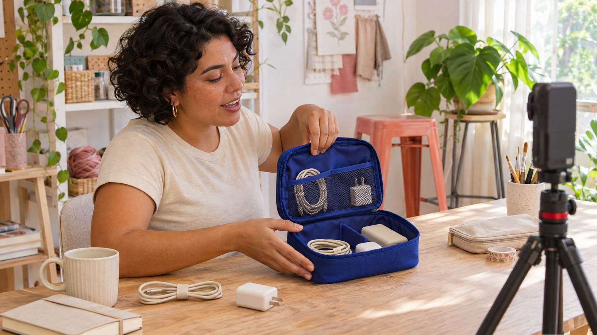

# Reels：用短内容解释品牌知识

状态：本地审阅稿；正式发布日期待确认。

把Reels用于清楚解释：一个具体问题、一段可理解的演示和一个相关下一步，组成可以独立观看的品牌教学内容。

AI 生成的编辑示意图，不是真实达人、客户、产品或活动。

Reels是Instagram的视频内容形式之一。品牌若用它做教学，可以把每条内容设计成一个完整的小解释：读者遇到什么问题、镜头展示什么步骤、有哪些适用限制、下一步在哪里。系列可以互相关联，但单条不应依赖读者已经看过前几集。本篇给出教学任务与假设示例，不把某种开头、时长或剪辑方式说成推荐保证。Meta试验Reels说明提供一种先面向非关注者发布的方式；它也不是私人审稿环境或自动证明因果关系的实验。

## 从一个能被解释的问题开始

“介绍新品”是内部任务，还不一定是观众的问题。把它改写成“哪个隔层适合放什么”“初次安装先检查哪里”或“这两种设置有什么区别”，才容易选择镜头与说明。

[GOV.UK内容设计说明](https://guidance.publishing.service.gov.uk/writing-to-gov-uk-standards/plan-manage-content/understand-content-design/)在政府内容语境下强调用户需要与适当信息量。这里借用这个写作原则，不将它解释为Instagram算法要求。

[Brief写作指南](/zh/blog/write-a-useful-campaign-brief/#answer)帮助确认受众、问题、证据与内容边界。先说清什么会在这一条中得到回答，再决定哪些背景需要详情页补充。

如果问题本身需要个别诊断、复杂资格或完整安全说明，不应为了短视频把必要条件删掉。可以说明本条提供哪部分基础知识，以及何时需要阅读更完整资料。

## 让第一次看到的人也理解上下文

系列的第二条仍可能是某位观众第一次看到品牌。不要只说“接上集”，应在开头交代对象与本次要解决的问题，再进入演示。

例如，假设品牌讲收纳袋使用方法，可以说“今天看长线材如何收进这一侧隔层”，而不是要求观众先记住整套产品命名。画面也应让被说明的部位能够辨认。

必要背景不等于长篇品牌历史。只保留理解当前步骤需要的信息，把组织介绍、其他产品与完整政策放到适当位置。

独立可理解是编辑目标，不是保证非关注者推荐的技巧。读者是否愿意继续观看，还涉及实际内容、兴趣与分发条件，不能仅由一段开场白预测。

## 用镜头证明步骤，而不是只有形容词

先写观众需要看到什么，再选择景别。说明开合方向时要看清手与部件，说明容量时要给出真实放置过程；漂亮环境镜头不能代替关键演示。

画面与旁白对应。若旁白解释第二个隔层，镜头仍停留在包装外观，观众就需要自行猜测。剪辑应优先解决这种信息错位。

假设示例中的收纳袋不应靠剪掉失败步骤制造所有物品都能装入的错觉。哪些尺寸或使用条件影响结果，应保留必要说明，也不要用未经证实的效果词代替演示。

制作前可用简短分镜列出问题、动作、画面证据和限制。拍摄后按实际素材修改解释，不能因为脚本写过某个结果，就认为画面已经证明它。

审阅时可先静音观看一次，检查关键动作是否仍能看懂，再单独听一遍说明，找出画面没有支持的结论。这不是完整可访问性验收，却能发现具体信息缺口。若演示依赖产品的特殊版本，应在拍摄对象与文字中对应说明，避免把一个型号的表现推广到全部产品。

## 字幕、声音和文字各承担清楚的任务

旁白解释动作，字幕帮助理解所说内容，画面文字可提示关键条件。不要让三者同时塞进不同信息，以致读者必须暂停才能拼出完整意思。

字幕需要人工复核专有名称、数字、否定词和语言。自动生成不等于准确，尤其是在一个错误字符会改变使用条件或表达结果时。

避免让关键说明只依赖装饰字体、短暂闪现或与背景近似的颜色。也应检查人物、产品与必要文字在实际预览中是否清楚。

配乐有其创作作用，但“平台提供音频”不自动回答品牌在其他渠道或广告中能否继续使用。[使用范围指南](/zh/blog/creator-rates-usage-rights/#answer)帮助把素材、版本与具体用途分别讨论。

## 把系列组织成不同问题，而不是重复广告

假设一组三条收纳教学：第一条说明选择隔层，第二条演示整理长线材，第三条解释清洁前查看哪些产品资料。每条有不同问题，也各自说明适用条件。

三条的顺序可以帮助长期关注者，但不要求任何人已经看过第一条。标题、开场与链接可以提示相关内容，当前答案仍留在当前视频里。

[Instagram合作规划指南](/zh/blog/instagram-influencer-marketing-campaign/#answer)进一步讨论账号、创作者与项目的分工。若邀请创作者参与，先确认其实际能演示的经验与任务，而不是只把品牌脚本交给不同人重复说。

教学与商业关系可以同时存在，但不能用教学口吻隐藏真实合作安排。相关说明按适用平台要求与地区规则处理，品牌事实也应由合适负责人确认。

同一个系列也应允许不同表达。有人擅长近距离手部演示，有人更适合解释选择理由，任务可以据此分配；但共同的事实不能因表达者不同而互相矛盾。统一必要资料与限制，比要求每位创作者逐字说同一段话更有助于保留真实解释能力。

## 使用试验Reels时，先理解它公开给谁

[Meta试验Reels说明](https://about.fb.com/news/2024/12/trial-reels-try-content-non-followers-first-see-what-perfoms-best/)介绍先向非关注者展示的方式，并提醒关注者仍可能通过其他入口看到，例如私信分享或相关内容页面。它不等于保密审稿。

文中也说明可以选择进一步分享及相应自动设置。采用前应由账号负责人检查当前可用功能与实际设置，尤其是内容是否已经适合公开。

[Meta创作更新说明](https://about.fb.com/news/2025/06/inspiring-creativity-that-brings-people-together/)后来介绍了试验功能的扩展。历史发布说明有助于理解产品方向，不能代替当前账号核对，也不能把平台报告的群体结果当作你下一条视频的预测。

如果需要审查未发布产品、客户资料或尚未确认的声明，使用合适内部审阅安排。不要因为名称中有“试验”，就把仍面向外部观众的内容当成私人草稿。

## 用内容问题解释结果，不只看一个总数

先看内容有没有产生需要回答的具体问题、是否有人指出演示看不清，或某个条件需要更明确。这些观察可以改进下一版解释，但不代表完整市场调查。

可见观看和互动数据按实际定义与窗口记录，不把播放直接等同独立人数，也不把点赞直接等同学会、购买或长期信任。

[月度互动解释指南](/zh/blog/social-media-engagement-rate-monthly-explanation/#answer)帮助处理内容组合与分发变化。若一条用了付费支持，另一条没有，或面对不同受众，不应仅凭总数说某种开场必然更有效。

试验发布也不是自动随机实验。报告可以说在特定条件下观察到哪些反应，再说明尚不能判断什么；没有效果证据时，仍可依据事实准确度和解释清楚程度修订。

保留分母未知或观察期不同的状态，不为了做图把它们填成零。收不到完整数据时，可以准确汇报发布、已见反馈与需补充资料，而不是用缺失字段计算一个看似精确的教学成功率。

## 让下一步延续刚刚的解释

结尾动作应与问题有关。讲某种使用步骤，可连接完整指南或提示去哪里查看型号资料，不必每次都把购买作为唯一动作。

把视频与目标页面一起复核。若指南版本不同、型号不符或页面要求另一种任务，先修正链接或解释，再把它作为下一步。

品牌教学Reels的可交付价值，是一段准确、独立可理解且能够继续回答问题的内容。QuickKOL可以帮助研究适合任务的创作者作品，具体事实、素材范围与合作结果仍要逐项确认，并保留可用的交接记录。

## 假设教学系列的分工

| 问题 | 画面任务 | 需要保留 |

| --- | --- | --- |

| 隔层怎么选？ | 展示位置与适用物品 | 对象与适用条件 |

| 长线材怎么整理？ | 显示真实放置过程 | 步骤顺序与尺寸条件 |

| 清洁前看什么？ | 指向对应产品资料 | 型号、版本与完整说明 |

假设编辑示例，不是实际产品说明、已验证效果或平台推荐公式。

## 教学Reels准备清单

按内容任务检查，不自动发布或修改账号设置。

- [ ] 这一条回答一个具体问题。

- [ ] 第一次看到也能理解对象。

- [ ] 关键步骤在画面里可见。

- [ ] 字幕与事实已经人工复核。

- [ ] 素材与发布范围得到确认。

- [ ] 结果按实际数据边界解释。

## 研究日期与使用边界

资料核验于 2026 年 11 月 4 日。文中方法、表格和决策规则为编辑建议，标为假设的示例不是实际客户结果或行业基准。外部资料的适用地区与时期按各段说明；本稿处于独立本地审阅阶段，正式发布日期待确认。

## 来源

- [GOV.UK内容设计说明](https://guidance.publishing.service.gov.uk/writing-to-gov-uk-standards/plan-manage-content/understand-content-design/)

- [Meta试验Reels说明](https://about.fb.com/news/2024/12/trial-reels-try-content-non-followers-first-see-what-perfoms-best/)

- [Meta创作更新说明](https://about.fb.com/news/2025/06/inspiring-creativity-that-brings-people-together/)
