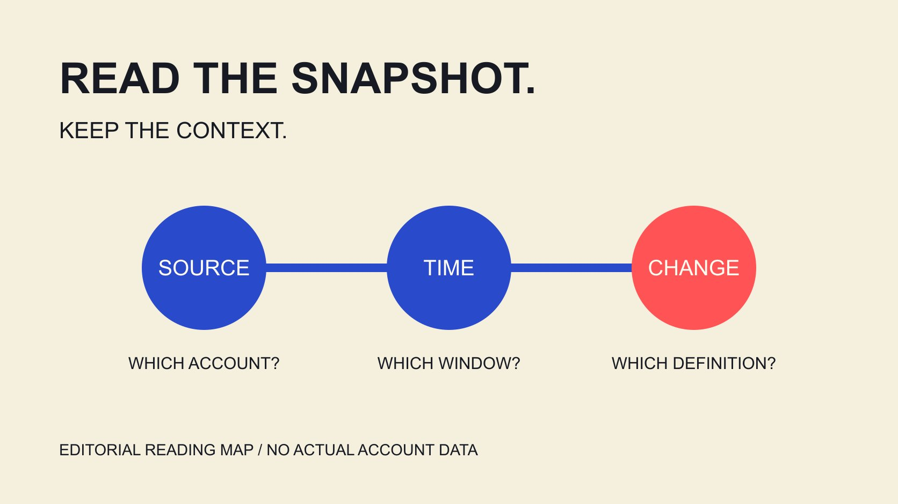

# Social Blade: Read Public Channel Statistics

Status: local review draft; confirm the publication date before release.

Read Social Blade public channel statistics by confirming identity and window, then interpreting changes, update differences and estimated earnings without treating snapshots as complete analytics.

QuickKOL editorial graphic; not actual account metrics or a platform interface.

Social Blade is a cross-platform statistics service that helps readers examine public account growth and history. Start by confirming the account, dates, metric definition and update state before interpreting a change. Public statistics are not the creator’s complete private analytics, and estimated earnings are not actual income, profit or a sponsorship quote. This guide explains how to read a statistics page against the provider’s public documentation, with a clearly hypothetical calculation. It evaluates no named individual and does not infer manipulation or a violation from an unusual day. A useful reading makes clear which number was observed, when it was collected and which question it can actually answer.

## Confirm which account the page represents

The [Social Blade product FAQ](https://socialblade.com/help/what-is-socialblade) describes cross-platform statistics, history and related products. A name appearing in search does not establish that an account with the same name on another platform represents the same person or that any commercial relationship is confirmed.

Cross-check the platform, link and visible identifiers against the original public account. When names are similar, changed or incomplete, retain an unresolved state instead of relying on a matching avatar alone.

The [creator-data reading guide](/blog/read-creator-engagement-data/#answer) explains how source and metric relate. The task here is to understand statistics, not collect private contact details, sensitive information or infer unpublished ownership.

Record the actual page address and observation time, together with the question: public growth, change during a period or an issue needing clarification. Different questions require different supporting material.

Resolve an uncertain identity before interpreting numbers. A complete statistics page belonging to someone else is more misleading than an explicitly missing field. Also retain the platform as part of the identity: two pages concerning one organization can still describe different accounts, audiences and content histories.

If the organization has regional or language accounts, retain each page’s particular task instead of combining them into one audience. A study of regional content can explain why that account was selected; a similarly named page elsewhere remains a different observation unless appropriate evidence supports a connection. Clear identity gives later window and numerical comparisons a meaningful object.

## Distinguish snapshot time from when activity occurred

The [Social Blade data-difference FAQ](https://socialblade.com/help/why-do-my-views-differ-from-socialblade) compares collection to noting a public total at a particular moment: the service receives a current number, not necessarily when every action happened. Differences from a platform display can therefore involve collection and storage.

That does not mean every mismatch has one fixed delay. Check the actual metric, window, time zone and update state rather than move a day’s figure to another date by assumption.

Suppose two records were saved on Monday and Wednesday. Their difference describes cumulative change between those observations; it cannot establish how much occurred separately on Tuesday and Wednesday.

Before interpreting a graph, ask whether its axis reflects platform activity dates or statistical observation dates. If documentation does not answer, retain uncertainty instead of inventing intermediate values for a smooth trend.

A source difference also does not automatically mean a platform or person supplied false information. Compare how each record was produced, then identify any remaining contradiction worth asking about. Keeping the original values and labels makes that comparison possible without retrospectively rewriting evidence to force agreement.

For example, comparing a public total saved Monday morning with a first-party screenshot from Monday evening may include activity after the earlier observation. Retain both times and explain that measurement was not simultaneous. The smaller value is not automatically under-reporting, nor the larger one exaggeration. This example illustrates a comparison condition without claiming it explains every actual discrepancy.

## Read update status without promising real-time completeness

The [Social Blade update-frequency FAQ](https://socialblade.com/help/how-often-does-socialblade-update-my-stats) says updates vary: popular profiles may update more often, while the service aims for at least daily collection but may update low-traffic pages less often, grouping several days together.

This is the provider’s public explanation, not a guarantee that every profile receives a complete daily update. Use the state actually observed rather than substitute a collection target for page evidence.

If several days lack distinct changes, do not automatically enter true growth was zero. First inspect whether an update gap, grouped record or unclear definition explains the display before deciding what can be calculated.

The [metric-definition guide](/blog/engagement-rate-formula-metric-contract/#answer) helps specify numerator, denominator and window. Without equivalent periods, a sparse record does not belong beside a complete daily record in a precise-looking ranking.

Nor does less frequent statistical collection establish that an account lacks value. Collection state and content quality are different questions requiring different evidence. If a decision depends on an unavailable period, ask for an appropriate source rather than describe an incomplete public history as a comprehensive account audit.

For a summary, leave unknown fields unresolved with a reason and identify windows with sufficiently comparable records. Do not interpolate missing days and let readers believe the service observed them. If internal planning genuinely needs an estimate, label it as such, explain the method and avoid mixing estimated entries with collected values in an indistinguishable column.

## Separate a cumulative change from its cause

A change in public totals can generate a question without identifying the post, activity or partner responsible. Record the observation first, then seek relevant and appropriate supporting material.

Suppose an account gains 500 subscribers in a week, a hypothetical quantity. If it publishes several pieces, receives other exposure or has statistical updates, the entire 500 cannot be assigned to one brand collaboration.

Do not accuse someone based only on a jump, decline or zero day. Possible explanations remain questions for verification; established facts need their source and scope.

The [monthly-engagement interpretation guide](/blog/social-media-engagement-rate-monthly-explanation/#answer) explains content mix and period conditions. Compare records with equivalent objects, definitions and windows rather than a viral post against another week’s total with a different publishing volume.

If the cause cannot be confirmed, write that a change was observed and remains unattributed. That is more useful than a complete story built from guessed motives. Public statistics may help decide what to examine next while remaining insufficient to conclude why a particular audience acted.

## Estimated earnings are not invoices, profit or a rate quote

The [Social Blade earnings-estimate FAQ](https://socialblade.com/help/how-are-estimated-earnings-calculated) describes multiplying views by an assumed RPM range and cautions that not every view may be monetized; none may be monetized. Users can also adjust the calculation settings.

Using the default illustrative range in the documentation read for this article, $0.25 to $4 per thousand, a hypothetical 100,000 views produces $25 to $400. This demonstrates multiplication, not an actual account’s income, an industry promise or an independently validated average.

Actual earnings can also depend on format, geography and monetization conditions. Such an estimate does not cover a creator’s entire business and cannot establish after-tax profit or require acceptance of a sponsorship rate.

For project costs, ask an appropriate contact about deliverables, use scope and a quote. A third-party range is not access to the person’s business accounts.

Preserve estimated labels and assumptions in screenshots or exports. A broad range is not a confidence interval proven to contain the actual figure, and visible lower and upper bounds do not create that statistical guarantee. Treat the number according to its construction, rather than the financial certainty its formatting might suggest.

When finance needs different information, change the request rather than stretch the public estimate. Planning a particular collaboration requires a defined service and quote; establishing what your project actually paid requires its payment records. Even an estimate coincidentally close to another figure does not validate the estimation method for every account. Match the evidence to the financial question being asked.

## First-party analytics answer another set of questions

The [YouTube impressions-and-views guide](https://support.google.com/youtube/answer/9314486?hl=en) distinguishes impressions, views, unique viewers and watch time, and notes different update frequencies for some cards and reports. Even figures inside one analytics system need their own definitions.

A public view total cannot reveal every thumbnail impression, traffic source or unique person. If these questions matter, an appropriate account owner can supply a shareable relevant report with its window and filters.

The [campaign-measurement guide](/blog/creator-campaign-measurement/#answer) connects actual project objectives with evidence needs. Not every question requires every private report, and a small assignment is not a reason to request unrelated business information.

When displaying public statistics alongside first-party material, explain their respective jobs. One can document public history while the other explains particular content or a project. Do not force their numbers to match by silently changing definitions.

This article logs into no creator analytics account and tests no paid Social Blade product. The distinctions come from public documentation and editorial analysis; actual reports still require source verification. Access to more fields can improve context, but only when the team understands what those fields measure.

## Write a statistical conclusion someone can revisit

Structure a conclusion around the account, observation window, recorded change and explanations not yet supported. Include an appropriate source and leave unconfirmed fields unresolved.

Record who will use the note and which decision it supports. That helps the next colleague request appropriate evidence without expanding the conclusion for apparent completeness or removing a limitation that still applies.

For example, public subscriber totals changed between these observations; collection timing and other activity still need checking is more accurate than claiming one piece drove all growth.

Readers should distinguish provider-displayed values, hypothetical calculations and editorial recommendations. QuickKOL can help interpret brand tasks and research relevant work; data and commercial conditions still require verification at their source.

## Questions public statistics can and cannot answer

| Record | Can describe | Does not establish |

| --- | --- | --- |

| Public-total snapshot | A value at an observation | When every action happened |

| Difference between snapshots | Cumulative change between observations | A post’s causal contribution |

| Estimated earnings | Calculation under stated assumptions | Actual income, profit or quote |

| First-party report | Metrics under its definitions, period and filters | Commercial outcomes beyond its scope |

The hypothetical 100,000-view calculation only illustrates the documented default range, not an actual person or industry benchmark.

## Statistics-reading checklist

For interpreting evidence, not labeling a person false or in violation.

- [ ] Platform, account and source confirmed.

- [ ] Observation window and update state recorded.

- [ ] Missing values distinguished from actual zero.

- [ ] Estimates retain labels and assumptions.

- [ ] Public and first-party values interpreted by definition.

- [ ] Causal and identity conclusions stay within evidence.

## Research date and limitations

Sources reviewed November 4, 2026. Methods, tables and decision rules are editorial recommendations. Hypothetical examples are not actual client results or industry benchmarks. Source geography and periods are specified where relevant. This draft is in independent local review; confirm its publication date before release.

## Sources

- [Social Blade product FAQ](https://socialblade.com/help/what-is-socialblade)

- [Social Blade data-difference FAQ](https://socialblade.com/help/why-do-my-views-differ-from-socialblade)

- [Social Blade update-frequency FAQ](https://socialblade.com/help/how-often-does-socialblade-update-my-stats)

- [Social Blade earnings-estimate FAQ](https://socialblade.com/help/how-are-estimated-earnings-calculated)

- [YouTube impressions-and-views guide](https://support.google.com/youtube/answer/9314486?hl=en)
