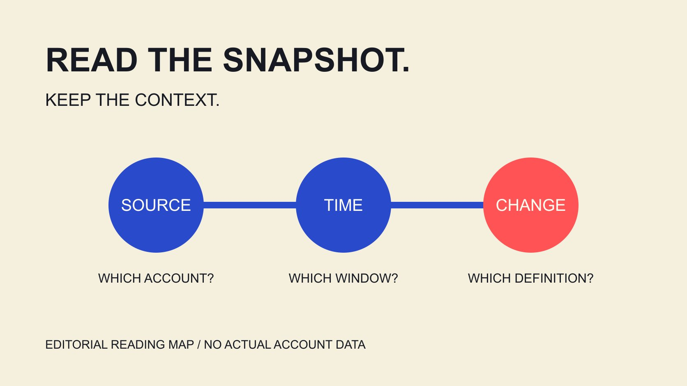

# Social Blade：怎样读公开频道统计

状态：本地审阅稿；正式发布日期待确认。

用Social Blade理解公开账号统计：先确认账号与窗口，再阅读变化、更新差异及收入估算，避免把公开快照当成后台完整结果。

QuickKOL 编辑图形；不呈现真实账号指标或平台界面。

Social Blade是一项跨社交平台统计服务，可帮助读者查看账号的公开增长与历史信息。阅读时，先确认账号对象、数据日期、指标定义和更新状态，再解释变化。它的公开统计不等于创作者后台全部数据，收入估算也不等于真实收入、利润或合作报价。本篇按公开说明解释如何读取一个统计页面，使用清楚标注的假设计算示例，不评价某个真实个人，也不因为单日数字异常就推断刷量或违规。

## 先确认你正在看哪个账号

[Social Blade产品问答](https://socialblade.com/help/what-is-socialblade)介绍跨平台统计、历史与相关产品。一个账号名称出现在搜索结果，不代表它与另一个平台同名账号属于同一对象，也不代表商业代表关系已经确认。

从原始公开账号核对平台、链接和可见标识。若名称相近、曾改名或页面不完整，保留待确认状态，不把相似头像作为唯一依据。

[达人数据阅读指南](/zh/blog/read-creator-engagement-data/#answer)进一步解释来源与指标的关系。本篇的任务是理解统计，而不是收集私人联系方式、敏感资料或推断未公开的账号所有权。

记录实际页面地址与观察时点，也说明你要回答什么：公开增长、某时期的变化，还是一个需进一步核对的问题。不同任务需要的资料并不相同。

无法确认对象时，先解决对象问题。把一个完整但属于别人的统计页带入报告，比一个明确标为缺失的字段更容易造成错误。

如果原始账号有多个语言或地区页面，保留其具体任务，不把它们合并成一个总受众。团队研究某个地区内容时，可以说明选择该页面的理由；另一地区的同名页面应作为不同观察对象，除非另有适当依据。账号身份清楚，后续窗口与数字比较才有意义。

## 理解快照时间与行为发生时间的区别

[Social Blade数据差异说明](https://socialblade.com/help/why-do-my-views-differ-from-socialblade)把采集比作在某个时点记下公开数字：服务获得当前总数，不一定知道每次行为何时发生。因此，与平台显示的数字不完全一致，可能涉及采集与存储方式。

这不能被概括为所有差异都有一个固定延迟。需要核对具体指标、窗口、时区与页面更新时间，而不是凭印象把一天的数据移到另一日。

假设两张记录分别在周一和周三保存，差值描述这两个观察时点之间的累计变化；不能把它直接拆成周二和周三各发生多少。

在解释图表前，先问横轴代表平台活动日期还是统计观察日期。如果资料没有说明，就保留不确定性，不为了画平滑趋势补造中间值。

来源差异也不自动说明某个平台或个人提供了错误数据。先比较资料如何形成，再判断是否仍有需要询问的具体矛盾。

例如，把周一早上保存的公开总数与周一晚上后台截图直接比较，差值可能包含后来发生的行为。正确做法是先保留两个时点，再说明它们并非同时测量；不把较小的数自动判断成漏报，也不把较大的数自动当作夸大。这个例子只说明比较条件，不认定实际差异原因。

## 阅读更新状态，不承诺实时完整

[Social Blade更新频率说明](https://socialblade.com/help/how-often-does-socialblade-update-my-stats)指出更新会变化：热门页面可能更频繁，服务以至少每日更新为目标，但低访问页面可能较少更新，数日信息可能合并出现。

这是一项服务方公开说明，不是每个账号每天一定完整更新的保证。报告应采用实际看到的状态，不能把目标频率替代页面证据。

连续几天没有单独变化记录时，不要直接填成“真实增长为零”。先判断是否有更新缺口、合并记录或尚不清楚的口径，再决定是否可以计算。

[指标定义指南](/zh/blog/engagement-rate-formula-metric-contract/#answer)帮助把分子、分母与窗口写清。缺少相同窗口的数据，就不适合与另一个每日完整记录直接排列成精确排名。

也不要反向推断某个账号因为资料更新不频繁就没有价值。页面的采集状态与内容质量是不同问题，仍需要各自的依据。

需要汇总时，可以把未知字段留空并标明原因，另列哪些窗口有完整可比较资料。不要用插值填补后再让读者以为服务实际观察过那些日期。如果为了内部规划做了估计，就明确标为估计，说明方法，并避免把它与实际采集记录混在同一列。

## 把累计变化与内容原因分开

公开总数的变化可以提出问题，但不会独立说明由哪条内容、哪次活动或哪位合作伙伴造成。先记录观察，再寻找相关且适当的补充资料。

假设某账号一周增加500个订阅，这只是一个假设数量。若同一周发布多条内容、接受其他曝光或更新统计，不能直接把500全部归给其中一次品牌合作。

也不要仅凭突增、下降或某天为零指控个人。可能的解释应保持为待核验问题，已经证实的事实则说明来源与范围。

[月度互动解释指南](/zh/blog/social-media-engagement-rate-monthly-explanation/#answer)帮助说明内容组合与时期条件。可比较的是相同对象、口径和窗口下的记录，而不是把一条爆款与另一周不同发布量的总数直接对照。

如果实际原因无法确认，就准确写“观察到变化，尚不能归因”。这个结论比为了给报告一个完整故事而猜测动机更有价值。

## 收入估算不是账单、利润或报价

[Social Blade收入估算说明](https://socialblade.com/help/how-are-estimated-earnings-calculated)介绍用观看数与假设RPM范围计算，并提醒可能并非所有观看都变现，甚至没有观看变现；用户也可以调整计算设置。

按本次官方说明的默认示例范围，每千次0.25至4美元，假设100000次观看对应25至400美元。这只是演示乘法，不是某个真实账号收入、行业承诺或本篇独立验证的平均水平。

实际收入可能还受内容形式、地区、变现条件等影响。此类估算也不包含一个创作者全部业务，不可拿来推算税后利润或要求对方接受某个合作价。

当团队需要确认项目成本，向适当联系人询问具体交付、使用范围与报价。不要把第三方收入区间当作已获知对方经营账目。

截图或导出时保留“估算”标签和所用假设。范围再宽也不是已经证明包含真实收入的置信区间，不能把视觉上的上下界当作统计保证。

财务需要不同资料时，应改变请求而不是继续放大公开估算。了解某次合作的预算，需要明确服务与报价；了解自己项目已经支付多少，需要核对相应付款记录。即使一个估算数碰巧接近另一张资料，也不能据此确认整套估算方法已经适用于所有账号。

## 后台资料回答的是另一组问题

[YouTube展示与观看说明](https://support.google.com/youtube/answer/9314486?hl=en)区分展示、观看、独立观众与观看时长，也说明部分卡片与报告更新频率不同。这表明即使在同一后台，不同数字仍需看各自定义。

公开总观看数不能推出所有缩略图展示、观众来源或独立人数。需要这些信息时，应由适当账号负责人提供可分享的相关报告，并保留窗口和筛选条件。

[项目测量指南](/zh/blog/creator-campaign-measurement/#answer)帮助把实际合作目标与所需证据对应。并非每个问题都需要全部后台资料，也不应为一项小任务索取无关商业信息。

把公开统计和后台资料并列时，明确各自用途。一个用于观察公开历史，另一个解释特定内容或项目；不必强行修改它们直到数字看起来完全相同。

本篇没有登录任何创作者后台，也没有测试Social Blade付费产品。这里的区分来自公开资料与编辑分析，实际报告仍按可用来源核验。

## 写一个可以复查的统计结论

结论可以采用四部分：对象、观察窗口、看到的变化、尚未支持的解释。附适当来源，不把未确认字段写成确定值。

记录分享对象与需要支持的决定，能帮助后续同事选择适当补充资料。不必为了显得完整而扩大报告结论，也不必删除真实存在的限制。

比如“在这两个观察时点之间，公开订阅总数出现变化；采集频率与其他活动尚待核对”，比直接宣称某一次内容推动全部增长更准确。

读者应知道哪些是服务方显示、哪些是假设计算、哪些是编辑建议。QuickKOL可以帮助理解品牌任务与研究相关作品，具体数据与合作条件仍按来源核验。

## 公开统计可以与不能回答的问题

| 记录 | 可以说明 | 不能直接推出 |

| --- | --- | --- |

| 公开总数快照 | 某次观察到的数值 | 每次行为发生时点 |

| 两次快照差值 | 观察区间累计变化 | 某条内容的因果贡献 |

| 收入估算 | 所用假设下的计算 | 真实收入、利润或报价 |

| 后台报告 | 对应定义、窗口与筛选下的指标 | 超出报告范围的商业结果 |

假设100000次观看的计算只演示官方默认范围乘法，不是实际个人或行业基准。

## 统计阅读检查表

用于理解资料，不给个人贴虚假或违规标签。

- [ ] 平台、账号与来源已确认。

- [ ] 观察窗口与更新时间已记录。

- [ ] 缺失与真实零值没有混淆。

- [ ] 估算保留标签和假设。

- [ ] 公开数与后台数按口径解释。

- [ ] 归因与身份结论没有超出证据。

## 研究日期与使用边界

资料核验于 2026 年 11 月 4 日。文中方法、表格和决策规则为编辑建议，标为假设的示例不是实际客户结果或行业基准。外部资料的适用地区与时期按各段说明；本稿处于独立本地审阅阶段，正式发布日期待确认。

## 来源

- [Social Blade产品问答](https://socialblade.com/help/what-is-socialblade)

- [Social Blade数据差异说明](https://socialblade.com/help/why-do-my-views-differ-from-socialblade)

- [Social Blade更新频率说明](https://socialblade.com/help/how-often-does-socialblade-update-my-stats)

- [Social Blade收入估算说明](https://socialblade.com/help/how-are-estimated-earnings-calculated)

- [YouTube展示与观看说明](https://support.google.com/youtube/answer/9314486?hl=en)
