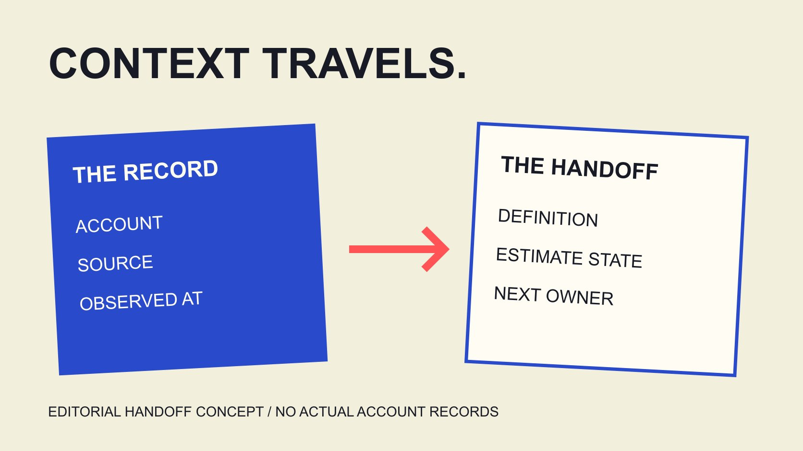

# Socialblade Data: Preserve Source and Snapshot in Reports

Status: local review draft; confirm the publication date before release.

When handing Socialblade public information to a colleague, retain account, source, observation time, metric and estimate state so the recipient can revisit the evidence and its limits.

QuickKOL editorial graphic; not actual account metrics or a platform interface.

A Socialblade handoff should contain more than a cropped number. The recipient needs the account, source, observation time, measurement window and metric definition, including which values are estimated or incomplete. Separate provider displays, editorial calculations and actual project material, retaining revisions. This guide builds on public-statistics reading and focuses on transferring evidence between colleagues, with a bilingual 16-field CSV. The worksheet connects to no Social Blade service, reads no private analytics, produces no account score and assigns no public change automatically to a collaboration. Its purpose is to make the evidence understandable when the original researcher is no longer present to explain it.

## State which judgment the recipient needs to make

The same material may support public historical context, planning or a follow-up question. State its purpose before handoff so the recipient does not treat background observation as the complete result of a project.

The [public-statistics reading guide](/blog/social-blade-public-channel-statistics/#answer) explains snapshots, updates and estimates. This article addresses transfer: when information leaves the original page, labels, dates and limits should travel with it.

Give the note a particular question, such as checking the public growth record available for this period, rather than calling it creator data. A clear question determines what information is necessary.

Describe the current state too: page found, identity checked, corresponding window obtained or evidence still missing. The recipient should not have to infer completion from the document’s appearance.

Organizing evidence does not expand what it can establish. If a source only supports background observation, deliver it that way rather than rename it verified commercial performance because it now appears in a formal table. Naming the decision also helps the next colleague avoid requesting unrelated information simply to make the package look more comprehensive.

## Make the account and source findable again

Retain platform, precise account identifier, original account URL and provider-page URL. A display name and avatar help understanding without replacing information pointing to the exact object.

Where names are similar, explain which account was selected and why. A regional, language or branch page retains its actual scope instead of becoming the combined audience of every page sharing a brand.

A screenshot can preserve observation, preferably with relevant heading, date and labels. A cropped growth number often cannot tell the recipient which object and window it describes.

When copying notes into a report, preserve source relationships too. If someone cites an article that cites the service, distinguish the original display from another author’s interpretation.

A missing source remains unresolved rather than be replaced with a similar account. The recipient can then choose further lookup, a request or non-use instead of analyzing the wrong object. This small amount of provenance can save a later reviewer from reconstructing the entire search, while still keeping the package limited to the information needed for its stated purpose.

## Record observation time separately from the measurement window

The [Social Blade data-difference FAQ](https://socialblade.com/help/why-do-my-views-differ-from-socialblade) distinguishes collecting current totals from knowing when activity happened. The [Social Blade update-frequency FAQ](https://socialblade.com/help/how-often-does-socialblade-update-my-stats) also notes variable collection, including records that can group several days.

A handoff should therefore include measurement window, observation time and time zone. One describes the intended reporting period; the other records when the researcher actually saw the information. A vague date does not replace both.

Suppose snapshots are saved Monday and Wednesday. Their difference concerns change between observations; without further evidence, it cannot be averaged into actual daily growth.

The [metric-definition guide](/blog/engagement-rate-formula-metric-contract/#answer) aligns object, unit and window. If one value is cumulative and another comes from a period report, explain the difference before deciding whether they belong in one comparison.

Leave dates without distinct observations unresolved with a reason. Do not interpolate and let the recipient believe those are daily values actually collected by the provider. If planning needs an estimate, keep it labeled and separated from observation so another colleague can tell which entries were seen and which were constructed.

## Deliver estimate labels with their construction

The [Social Blade earnings-estimate FAQ](https://socialblade.com/help/how-are-estimated-earnings-calculated) explains the estimate and monetization assumptions. Retain estimated during transfer rather than shorten the column to income and imply that it came from actual accounts.

Also separate provider-displayed values from your calculations. If deriving a change from two records, identify inputs, period and method instead of presenting the result as a daily observation independently supplied by the service.

An estimate does not establish actual income, profit or a sponsorship quote. If the project needs one of those, ask the corresponding question rather than stretch the estimate’s meaning.

Use explicit states, such as provider estimate, editorial calculation or unconfirmed. A blank state should not default to verified, and color alone should not replace words the recipient needs.

When an assumption changes, retain version and reason. A later version is not independently more accurate merely because it is newer. The recipient still needs an understandable basis. Preserving construction is especially useful when a report is reused without its original author, because the visible financial formatting can otherwise conceal how conditional the number was.

## Limit first-party follow-up to the actual question

The [YouTube Advanced-mode guide](https://support.google.com/youtube/answer/9717005?hl=en) describes reports across videos, groups, periods and filters. Appropriate first-party material can answer questions a public snapshot cannot, while retaining its own definitions.

Have a suitable account owner supply a shareable relevant report with dates and filters. Do not request unrelated personal or business information merely to make a package appear richer.

The [campaign-measurement guide](/blog/creator-campaign-measurement/#answer) connects collaboration objectives with evidence. A particular piece’s result, platform growth and organizational sales may require different sources rather than interchangeable figures.

Label supplemental material by source instead of merging it into one indistinguishable column with public statistics. For a mismatch, inspect object, period and definition before deciding which explanation is needed.

This article logs into no analytics account and downloads no actual report. It supplies a handoff design; appropriate people still obtain and verify information they may share. Access to first-party data does not erase its limits, and a report should remain interpretable even when only the relevant fields, rather than the entire account, are supplied.

## Use the 16-field CSV to retain necessary context

The downloadable worksheet has 16 fields: record identifier, platform, account, two source URLs, metric, definition, unit, window start and end, time zone, observation time, value, estimate state, limits and next owner.

Each row concerns an explicit object and metric. Different periods or sources can use separate rows rather than place several values in one cell, leaving the recipient unsure which applies.

Blank rows are for actual completion, without fictional accounts or preconfirmed sample values. Unknown fields remain unknown with a reason under limitations; a template having a space is not a reason to guess.

The [pilot-comparison design guide](/blog/benchmarking-creator-pilot-comparison-design/#answer) helps decide important conditions before collection. This worksheet helps transfer records already obtained. They can work together without automatically generating a conclusion.

The CSV connects to no service and replaces neither original pages, reports nor an appropriate explanatory note. It gives necessary context a consistent place while preserving the source’s scope. A reviewer should be able to follow a row back to its evidence instead of needing to trust the spreadsheet’s presentation as independent verification.

## Retain original value, reason and new state when revising

If later review finds a wrong account match, unequal window or omitted label, record the particular issue before revising. Retain the earlier version and explanation instead of silently overwriting evidence behind an earlier decision.

A correction can identify affected rows and conclusions needing another look. One changed field need not invalidate everything, nor establish that every interpretation remains intact.

Suppose an earlier sheet called an estimate actual income. Restore the correct label and inform appropriate colleagues using that explanation. This is an editorial recommendation; this article sends no message to anyone.

Retain actual completion state: revision prepared, delivered or still awaiting verification. A new version number is not a substitute for a handling record.

Traceable changes help the next person understand the information used for an earlier decision and what now needs adjustment. They do not require a dramatic account verdict or a claim that every later figure is certain. The aim is a usable record of evidence and decisions, including their corrections.

## A hypothetical: clarify a vague growth column

Suppose an agency places a public total in a weekly report under a column called growth, without a window or source. A brand colleague may assume it describes that week’s collaboration, although the evidence only supports a cumulative state observed at one time.

Return to the original object and add metric name, observation time and source. Without an earlier record, do not calculate an unsupported weekly change or reconstruct historical values from the current total.

The handoff explains which judgment remains incomplete and what appropriate supplement is needed. The brand can still use the record for public background, while evaluating the collaboration requires corresponding project evidence.

This hypothetical illustrates repairing labels and context, not an actual agency mistake or client case. The correction helps a recipient know how to continue rather than package one number into a stronger conclusion. A useful record can remain limited and still contribute to the work, provided its purpose is clear.

## Deliver evidence someone can continue working with

The recipient should be able to locate the object, understand the number, see its limits and identify the next owner. An accurate handoff can retain gaps while making further work possible when evidence arrives.

QuickKOL can help interpret brand briefs and research relevant work. Public statistics, first-party reports and collaboration outcomes retain their own sources and scope. Delivering those distinctions is more useful than a polished screenshot without context.

## Four distinctions to retain at handoff

| Record | Explain | Avoid |

| --- | --- | --- |

| Provider display | Object, source and time | Cropping context |

| Editorial calculation | Inputs, method and window | Presenting it as another raw observation |

| Estimate | Label, assumptions and limits | Renaming it actual income or outcome |

| First-party supplement | Report, filters and shareable scope | Merging it into the public definition |

Editorial handoff framework; no actual account sample, automatic scoring or data-accuracy guarantee.

## Public-source snapshot handoff

A blank 16-field CSV for necessary context; it performs no collection or analytics connection.

- [ ] Account and two source URLs explicit.

- [ ] Definition, unit and window understandable.

- [ ] Observation time separated from reporting period.

- [ ] Estimates and editorial calculations labeled.

- [ ] Unknowns, limits and revisions retained.

- [ ] Next owner knows the outstanding work.

[Download Chinese snapshot-handoff CSV](/downloads/source-snapshot-handoff.zh.csv)

[Download English snapshot-handoff CSV](/downloads/source-snapshot-handoff.en.csv)

## Research date and limitations

Sources reviewed November 4, 2026. Methods, tables and decision rules are editorial recommendations. Hypothetical examples are not actual client results or industry benchmarks. Source geography and periods are specified where relevant. This draft is in independent local review; confirm its publication date before release.

## Sources

- [Social Blade data-difference FAQ](https://socialblade.com/help/why-do-my-views-differ-from-socialblade)

- [Social Blade update-frequency FAQ](https://socialblade.com/help/how-often-does-socialblade-update-my-stats)

- [Social Blade earnings-estimate FAQ](https://socialblade.com/help/how-are-estimated-earnings-calculated)

- [YouTube Advanced-mode guide](https://support.google.com/youtube/answer/9717005?hl=en)
