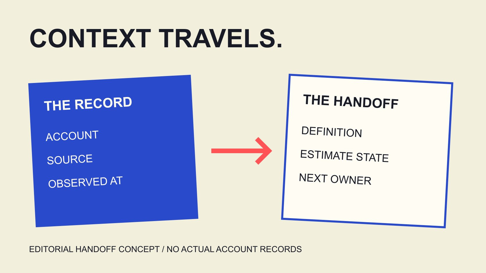

# Socialblade数据：让报表保留来源与时点

状态：本地审阅稿；正式发布日期待确认。

把Socialblade公开资料交给同事时，保留账号、来源、观察时点、指标与估算状态，让接收者能够复查并理解结论边界。

QuickKOL 编辑图形；不呈现真实账号指标或平台界面。

交接Socialblade资料时，交付的不应只是一个裁剪数字。至少让接收者知道哪个账号、哪个来源、何时观察、统计窗口与指标定义，以及哪些值是估算或仍有缺口。再区分服务显示、编辑计算和实际项目资料，保留修订记录。本篇承接公开统计阅读，重点是跨同事传递证据，附16字段双语CSV。模板不连接Social Blade、不读取私人后台、不生成账号评分，也不把公开变化自动归因给某个合作。

## 先说明接收者需要作什么判断

同一份资料可能用于公开历史背景、计划讨论或后续补充调查。交接前先写用途，避免接收者把背景观察当成某次项目的完整结果。

[公开统计阅读指南](/zh/blog/social-blade-public-channel-statistics/#answer)解释快照、更新与估算。本篇进一步处理传递：来源一旦离开原页面，标签、日期与限制也应跟着保留。

给交接说明一个具体问题，例如“核对这一时期可用的公开增长记录”，而不是笼统写“达人数据”。问题明确，才能判断哪项信息必要。

也说明当前结论处于什么状态：只是找到页面、已经核对对象、取得对应窗口，还是仍需资料。接收者不应靠猜测理解完成程度。

整理资料本身不会扩大证据能力。若来源只支持背景观察，就按此交付，不因为文件变成正式表格，就把它改称已验证商业表现。

## 让账号与来源可以被重新找到

保留平台、准确账号标识、原始账号链接与服务页面链接。显示名称和头像可以帮助理解，却不代替能够指向具体对象的资料。

如果多个账号名称相似，说明采用哪个及依据。地区、语言或分店页面应保持其实际范围，不把同品牌所有页面合并成一个受众。

截图可以帮助保留观察，但最好保留相关标题、日期与标签。仅一张被裁掉上下文的增长数字，往往无法让接收者判断对象和窗口。

复制笔记与报告时，也保留出处之间的关系。有人引用第三方文章、文章又引用服务页面时，明确哪个是原始显示，哪个是他人的解释。

找不到的来源保持未找回，不拿相近账号补位。这样接收者能决定继续查找、请求补充或暂不采用，而不是在错误对象上继续分析。

## 把观察时点与统计窗口分别记录

[Social Blade数据差异说明](https://socialblade.com/help/why-do-my-views-differ-from-socialblade)解释采集当前数字与知道行为发生时点的区别。[Social Blade更新频率说明](https://socialblade.com/help/how-often-does-socialblade-update-my-stats)也提醒，更新节奏会变化，部分记录可能合并数日。

交接因此应同时写统计窗口与观察时点，并说明时区。一个是资料打算描述的期间，另一个是你实际看到它的时候；两者不能只保留一个模糊日期。

假设周一与周三各保存一次快照，差值涉及两个观察之间的变化。没有进一步资料时，不能把差值平均分成每天实际发生的增长。

[指标定义指南](/zh/blog/engagement-rate-formula-metric-contract/#answer)帮助把对象、单位与窗口对应。若一项只有累计总数，另一项来自特定时期报告，先说明差异，再决定是否适合放在同一比较中。

没有独立记录的日期留空并说明原因。不用插值填补以后，再让接收者以为这些是服务逐日实际观察值。

## 估算标签与计算过程一起交付

[Social Blade收入估算说明](https://socialblade.com/help/how-are-estimated-earnings-calculated)明确其性质与变现假设。转交时保留“估算”，不要把列名缩短成“收入”，让接收者误以为来自真实账目。

同样区分服务显示与自己的计算。若从两次记录计算变化，写明输入、窗口与方法，不把派生数字说成服务另有提供的真实日记录。

估算不等于真实收入、利润或合作报价。若项目需要其中某项资料，应提出相应问题，而不是继续放大现有估算的含义。

表格里可以使用明确状态，例如“来源标为估算”“编辑计算”“未确认”。不要让空白状态默认变成已经验证，或用颜色替代接收者需要读懂的文字。

所用假设改变时，保留版本与原因。新版本比旧版本更晚，不独立证明它更接近真实；其依据仍需让接收者可以理解。

## 需要后台补充时，限定实际问题

[YouTube高级模式说明](https://support.google.com/youtube/answer/9717005?hl=en)介绍不同视频、分组、时期与筛选报告。适当后台资料可以回答公开快照无法说明的问题，但仍需保留其实际口径。

由合适账号负责人提供可分享的相关报告，说明日期与筛选。不要为了让资料包显得丰富，索取与当前任务无关的个人或商业信息。

[项目测量指南](/zh/blog/creator-campaign-measurement/#answer)帮助对应合作目标与证据。某次内容的结果、平台总增长和组织销售，可能需要不同资料，不能互相代替。

把补充资料标为相应来源，不与公开统计揉成一列后删除区别。若数字不一致，先检查对象、时期和定义，再判断需要何种解释。

本篇没有登录后台或下载真实账号报表。它提供交接设计，实际项目仍需适当人员取得并核验允许分享的资料。

## 用16字段CSV保留必要上下文

下载模板记录标识、平台、账号、两个来源链接、指标、定义、单位、窗口起止、时区、观察时点、值、估算状态、限制与下一位负责人，共16个字段。

每条记录对应一个明确对象与指标。不同窗口或不同来源可以分行，避免在一个单元格混写多个数字，使接收者难以判断哪项有效。

空白行用于实际填写，不提供虚构账号或已经确认的样本值。未知字段保持未知，并在限制栏写明原因，不因为模板有位置就猜测答案。

[试点比较设计指南](/zh/blog/benchmarking-creator-pilot-comparison-design/#answer)适合在收集前决定哪些条件重要。此处模板则帮助交付已经取得的记录，二者用途可以配合，但都不会自动生成结论。

CSV不连接服务，也不代替原始页面、报告或适当交接说明。它让必要上下文有固定位置，同时保留来源本来的边界。

## 修订时保留原值、原因与新状态

如果后来发现账号对应错误、窗口不一致或标签被遗漏，先记录具体问题，再发布修订。保留原版本与说明，不默默覆盖以后让接收者不知道决定依据曾经改变。

更正可以说明哪些行受到影响，以及哪些结论需要重看。一个字段改变，不一定使整份资料完全无用，也不能假定所有解释都继续成立。

假设旧表把估算列写成实际收入，修订应恢复正确标签并通知使用该说明的适当同事。这里是编辑建议，本篇没有向任何人发送消息。

交接中写实际完成状态：修订已准备、已交付或仍待核对。不要用一个新的版本号代替真实处理记录。

有了可追溯变化，后续同事能理解为什么某次决定采用当时资料，以及现在需要怎样调整，而不用反复猜测作者意图。

## 假设案例：补齐一列模糊的增长记录

假设机构把公开页面上的一个总数放进周报，列名只写“增长”，没有窗口与来源。品牌同事可能误以为它描述本周某次合作，实际资料却只支持当时观察到的累计状态。

修订时先回到原始对象，补齐指标名称、观察时点与来源。若缺少前次记录，就不计算无法支持的本周变化，也不从现在的总数推造过去数值。

交接说明指出哪项判断尚不能完成，以及需要什么适当补充。品牌仍可以使用这份资料理解公开背景，但需要评价合作时，应采用相应项目证据。

这个假设演示如何修复标签与上下文，不是真实机构错误或客户案例。修订的价值在于让接收者知道可以继续做什么，而不是把一个数字包装成更强结论。

## 交付一份可以继续工作的资料

接收者应能找到对象、理解数字、看到限制，并知道下一步由谁负责。准确的资料交接允许保留缺口，也让补充资料后可以继续工作。

QuickKOL可以帮助理解品牌Brief和研究相关作品。公开统计、后台报告与合作结果仍各有来源和范围；清楚交付这些区别，比一张没有上下文的漂亮截图更有用。

## 资料交接时保留四种区别

| 记录 | 说明 | 避免 |

| --- | --- | --- |

| 来源显示 | 对象、来源与时点 | 裁掉上下文 |

| 编辑计算 | 输入、方法与窗口 | 假装是额外原始观察 |

| 估算 | 标签、假设与限制 | 改名实际收入或结果 |

| 后台补充 | 报告、筛选与允许分享范围 | 与公开数混成同一口径 |

编辑交接框架；无真实账号样本、自动评分或数据准确性保证。

## 公开资料快照交接表

16字段空白CSV，保存必要上下文；不执行采集或连接后台。

- [ ] 账号与两个来源链接明确。

- [ ] 定义、单位与窗口可理解。

- [ ] 观察时点与统计期间分开。

- [ ] 估算与编辑计算有标签。

- [ ] 未知、限制与修订保留。

- [ ] 下一位负责人知道待办。

[下载中文快照交接CSV](/downloads/source-snapshot-handoff.zh.csv)

[下载英文快照交接CSV](/downloads/source-snapshot-handoff.en.csv)

## 研究日期与使用边界

资料核验于 2026 年 11 月 4 日。文中方法、表格和决策规则为编辑建议，标为假设的示例不是实际客户结果或行业基准。外部资料的适用地区与时期按各段说明；本稿处于独立本地审阅阶段，正式发布日期待确认。

## 来源

- [Social Blade数据差异说明](https://socialblade.com/help/why-do-my-views-differ-from-socialblade)

- [Social Blade更新频率说明](https://socialblade.com/help/how-often-does-socialblade-update-my-stats)

- [Social Blade收入估算说明](https://socialblade.com/help/how-are-estimated-earnings-calculated)

- [YouTube高级模式说明](https://support.google.com/youtube/answer/9717005?hl=en)
