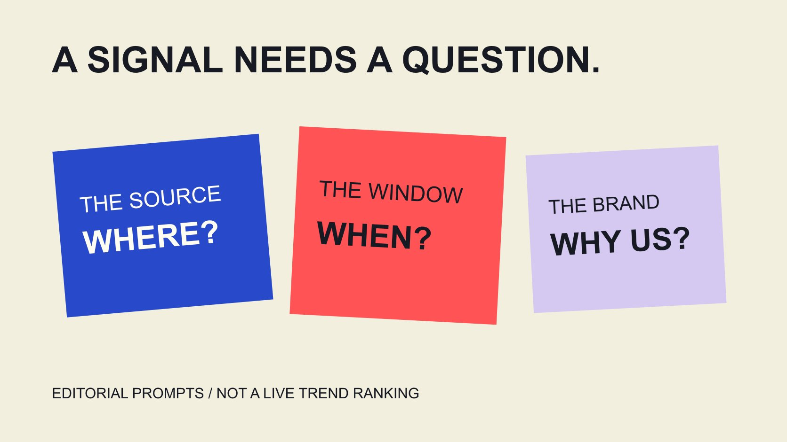

# Trending: Turn a Social Signal Into a Content Question

Status: local review draft; confirm the publication date before release.

Trending is a signal needing interpretation. Confirm platform, geography, window and data object before deciding whether a brand has a relevant, accurate contribution.

QuickKOL editorial graphic; not actual account metrics or a platform interface.

Trending usually describes interest or change observed by a source under particular conditions. It does not mean everyone is interested or that the topic suits a brand. Ask which platform, geography, time window and data object the label concerns, then identify a relevant question the brand can answer. Google search trends, TikTok hashtag trends and a personalized feed are different sources. This guide explains how to interpret a signal and develop an original assignment. It provides no live ranking and promises no growth from following a trend. Its hypothetical examples are neither actual trending events nor validated marketing cases. Relevance must be established rather than borrowed from a label.

## Translate the trending label back into a source

Retain the original entry point and observation conditions rather than only a screenshot with its title cropped away. A signal may come from search, a hashtag list, advertising examples, creator posts or a personal feed. These do not automatically describe the same population.

The [Google Trending-now guide](https://support.google.com/trends/answer/3076011?hl=en) explains recent search changes and related query clusters on that page. It helps interpret that particular entry point without establishing how another platform chooses popular content.

If a colleague says everyone is discussing it, ask where, when and what type of material they saw. The question does not require proof about the entire internet; it gives the assignment a clear starting point.

A signal may deserve reading without being a complete brief. The [brief-writing guide](/blog/write-a-useful-campaign-brief/#answer) turns observation into an audience question, needed explanation and actual output.

This article examines no account’s private interests and does not treat a personal recommendation feed as a representative sample of all users. Describe the actual source’s scope. A small, explicit observation can be useful without inflating it into a universal claim about what every potential customer wants.

## Separate interest, growth and absolute volume

The [Google Trends data FAQ](https://support.google.com/trends/answer/4365533?hl=en) explains that some search data describe interest normalized by time and geography on a zero-to-100 scale. A value of 100 is not 100 searches or support from 100% of people.

A rapid increase may begin from a small base, while a consistently large topic may lack the same growth label. Rising quickly does not answer the separate questions of scale or brand demand.

The [metric-definition guide](/blog/engagement-rate-formula-metric-contract/#answer) helps identify unit and denominator first. Do not place one source’s relative index beside another’s count or growth percentage and sort them as equivalent numbers.

If two regions display similar indices, that does not establish identical numbers of searches or purchasing opportunities. A question about absolute scale needs suitable evidence rather than precision reverse-engineered from an index.

Preserving these distinctions lets a report describe the observation instead of having a chart’s shape supply missing information. The team can still use a relative change to choose what to examine next, provided it does not quietly rename that change market size.

## Both zero and a one-off spike need context

The same Google FAQ notes that low-volume terms can appear as zero and that privacy-related statistical noise can affect brief spikes in low-volume queries. Do not describe such a spike as evidence of an individual search or established demand.

Interpret sparse or short-lived signals carefully. Examine the window, repeated observations and other appropriate sources instead of declaring a new market from one screenshot fragment.

Zero does not automatically mean nobody has any related interest. The source may be unable to provide a meaningful display under those conditions; wording should follow its actual explanation.

This article uses no trend to infer a person’s health, politics or other sensitive identity. Aggregate information and individual behavior are different levels of evidence. Being able to type a term does not turn the result into a personal dossier.

If support is insufficient, leave the topic under observation rather than ask production to build an unsupported story. Retaining uncertainty is preferable to making content first and later selecting screenshots to justify the premise. A planning record can name which missing context would make reconsideration worthwhile.

## Use each platform trend entry within its current scope

The [TikTok Trends guide](https://ads.tiktok.com/resources/help/article/how-to-use-trends?redirected=2), in the July 2026 version read for this draft, focuses on hashtags with industry and time conditions and further analytics. Do not assume every entry point in an older tutorial remains identical.

Hashtags, search queries, advertising examples and organic posts concern different objects. Related videos can provide context without establishing a shared need among every participant or granting a brand material-use rights.

Record actual filters and observation date. If an entry point is unavailable, describe that state; documentation mentioning a capability is not a logged-in hands-on test.

There is no need to force figures for one phrase across sources into a single total. Explain what each observes before asking whether a common audience question emerges. That may be more useful than inventing a combined popularity score.

Platform documentation can change. Recheck operation-specific details against the entry point at publication. A guide can teach interpretation without promising identical interfaces for every device and account. Separate the documented route from what the particular project actually observed and exported.

## Ask whether the brand has a relevant answer

After noticing a signal, write one question the brand can answer and explain why it has suitable information. Repeating a phrase in a title does not establish relevance to a reader’s need.

Consider language, geography, period and actual product conditions. A usage question discussed elsewhere may need different material, and a promise involving an unavailable service is not useful to the audience.

Ask whether the organization can explain the underlying facts accurately. Some topics require specialist information or concern an unresolved event. A deadline is not a reason to fill an essential gap with a guess.

If the only contribution is promotion without a relevant answer, the brand can decline participation. Missing a label is not a content failure, and every discussion need not become an organizational speaking opportunity.

Let the content owner make this judgment rather than have scheduling pressure decide alone. A timely decision not to participate can retain a specific rationale for a more suitable assignment later. This gives the team an active choice instead of treating every observed rise as an obligation to publish.

## A hypothetical: turn refill discussion into an explanation task

Suppose a refill-product brand notices public discussion about container compatibility. This is hypothetical, not a trending event verified for this article. The brand can first check its own models and public use information.

If there is a relevant question, an assignment might explain which containers fit, where to find model information and when the process does not apply. It answers a reader instead of merely repeating a popular tag.

A creator can demonstrate the confirmed process in their own style without omitting limitations for speed. When using someone else’s work as a reference, the [usage-scope guide](/blog/creator-rates-usage-rights/#answer) distinguishes learning an explanatory approach from actual reuse of material.

Hand off the audience question, facts the brand can provide, visual task, limitations and next step. Do not hand over copy this viral piece and leave the collaborator to guess which elements are appropriate to learn from.

Allow time for factual review and necessary corrections in the publishing plan. Without relevant information, a reasonable outcome may be improving the brand’s own explanation before pursuing attention. The hypothetical works because its contribution is concrete, not because a trend label guarantees demand.

Agree what happens if attention subsides before production finishes. The decision depends on whether the explanation still answers a real question. Relevant model information may remain publishable for its current purpose, while wording dependent on an immediate event needs revision. Do not manufacture everyone is discussing this right now after the signal changes, and do not discard useful knowledge solely because a label disappeared. Retain the original observation date and describe the content’s current use honestly. A timely reference and a lasting explanation may share a starting point while serving different publishing needs.

## Evaluate against the assignment rather than claim every increase

After publication, ask whether the original question was answered, a misunderstanding needs clarification and the destination remains applicable. Record views and interactions by their actual definitions; they do not independently establish comprehension or purchasing.

The [campaign-measurement guide](/blog/creator-campaign-measurement/#answer) connects assignments with evidence. If distribution, paid support, product or other channels changed at the same time, do not attribute every outcome to one trend-based topic.

Retain observation date, published version and result window. A topic passing its attention peak does not make a durable explanation worthless; evaluation still returns to the assignment.

If evidence does not support continuing, explain the adjustment or stopping reason. Learning does not require making every piece appear successful. It gives the next decision an understandable basis.

With limited evidence, a report can accurately describe publication and observed feedback while leaving outcomes unresolved. Do not use a trend success rate to cover results never measured. A content record should explain the original purpose well enough that another editor can revisit its value after the label has disappeared.

## Turn the signal into a clear original question

Trending can be a discovery entry point, while the brand still needs source, context, relevant facts and a content assignment. A fast-moving signal particularly needs an explanation of what was actually observed.

QuickKOL can help interpret a brief and research relevant creators’ work. Define the useful answer the brand can provide before discussing collaboration, and do not turn a label, estimate or short-lived response into an established commercial outcome.

## From a trend signal to an assignment

| Question | Record | Avoid |

| --- | --- | --- |

| Where observed? | Platform, source and object | Treating it as every audience |

| When and where? | Window, geography and state | Comparing without conditions |

| What is the number? | Index, count or growth | Mixing units |

| What can the brand answer? | Actual information and specific question | Only repeating a tag |

| How evaluate? | Assignment, results and unknowns | Attributing every change to the trend |

Editorial method; refill discussion is hypothetical, not a live ranking or industry benchmark.

## Trend-topic preparation

Turn observations into an explainable original brief; this checklist creates no live popularity ranking.

- [ ] Original source and observation date retained.

- [ ] Geography, window and unit explicit.

- [ ] Sparse data and spikes retain limits.

- [ ] Brand has a relevant, supported answer.

- [ ] Creative reference and material reuse separated.

- [ ] Results interpreted against task and evidence.

## Research date and limitations

Sources reviewed November 4, 2026. Methods, tables and decision rules are editorial recommendations. Hypothetical examples are not actual client results or industry benchmarks. Source geography and periods are specified where relevant. This draft is in independent local review; confirm its publication date before release.

## Sources

- [Google Trending-now guide](https://support.google.com/trends/answer/3076011?hl=en)

- [Google Trends data FAQ](https://support.google.com/trends/answer/4365533?hl=en)

- [TikTok Trends guide](https://ads.tiktok.com/resources/help/article/how-to-use-trends?redirected=2)
