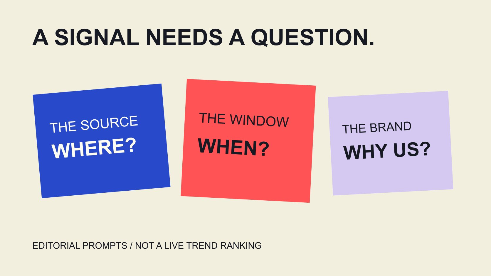

# Trending是什么意思：把信号变成内容问题

状态：本地审阅稿；正式发布日期待确认。

Trending只是一个需要解释的信号。先核对平台、地区、窗口与数据对象，再判断品牌是否能提供相关且准确的内容。

QuickKOL 编辑图形；不呈现真实账号指标或平台界面。

Trending通常表示某个来源在特定条件下观察到的热度或变化，不等于所有人都关注，也不等于适合你的品牌。使用前先问：哪个平台、哪个地区、什么时间窗口、统计了什么，以及品牌能回答什么相关问题。Google搜索趋势、TikTok话题趋势与个人推荐流不是同一种资料。本篇讲如何解释信号并形成原创内容任务，不提供实时榜单，也不承诺跟随趋势就能获得增长；文中的假设示例不是实际热门事件或已经验证的营销案例。

## 先把热门标签还原成来源

先保留原始入口与观察条件，不只保存一个被裁掉标题的截图。资料可能来自搜索、话题榜、广告示例、创作者帖子或个人首页，彼此不能自动代表同一群人。

[Google热门搜索说明](https://support.google.com/trends/answer/3076011?hl=en)介绍其Trending now页面所展示的近期搜索变化及相关查询集合。这能帮助理解该入口，不说明其他平台也在以同样方法选出热门内容。

如果同事说“大家都在讨论”，请具体说明是在哪里看见、什么时候观察、看到的是哪种内容。这个问题不是要求对方证明全部互联网，而是让任务有清楚起点。

一个内容信号可以值得进一步阅读，但还不是完整Brief。[Brief写作指南](/zh/blog/write-a-useful-campaign-brief/#answer)帮助把来源观察转为受众问题、所需解释与实际交付。

本篇没有检索某个账号的私人兴趣，也不把个人推荐流当作全体用户的代表样本。公开可见资料的范围仍应按实际来源描述。

## 热度、增幅与绝对规模并不是同一数值

[Google Trends数据问答](https://support.google.com/trends/answer/4365533?hl=en)说明部分搜索资料是按时间和地区标准化后的相对兴趣，采用0至100的尺度。一个100不是100次搜索，也不是100%的人支持某个观点。

突然上升可能发生在原本较小的基础上，长期较高但稳定的话题也可能没有同样的增长标签。只说“涨得快”不能回答实际规模或品牌需求。

[指标定义指南](/zh/blog/engagement-rate-formula-metric-contract/#answer)帮助先确认单位和分母。不要把一个入口的相对指数，与另一个入口的计数或增长百分比放在同一列，再当作可以直接排序的数字。

假设两个地区显示相近指数，也不能据此说它们有相同搜索人数或购买机会。需要绝对规模的问题，应寻找适合该问题的资料，而不是从指数反推不存在的精度。

保留这些区别，报告就能说明实际观察，而不让图表形状替代原本缺失的信息。

## 零值与一次尖峰都需要上下文

同一Google官方问答提醒，低搜索量可能显示为0，也解释隐私保护所用的统计噪声可能影响低量查询的短暂尖峰。不要把它直接写成某个个人搜索或具体需求已经出现。

因此，低量或短暂信号需要特别谨慎解释。先看窗口、重复观察与其他适当来源，不能从一张截图片段断定一个新市场已经形成。

零也不自动表示世界上没有相关兴趣。有时是资料无法在当前条件下给出有意义显示；表述应与来源实际说明一致。

本篇不通过搜索趋势推断某个人的健康、政治或其他敏感身份。聚合资料与个人行为是不同层次，不能因为能够输入一个词就把它变成个人档案。

如果证据不足，可以把选题记为待观察，不急着让内容团队围绕一个未经支持的故事制作。留下未知，比制作后再寻找能够证明它的截图更可靠。

## 平台趋势入口只能按其当前范围使用

[TikTok趋势入口说明](https://ads.tiktok.com/resources/help/article/how-to-use-trends?redirected=2)在本次读取的2026年7月版本中，重点介绍行业与时间条件下的话题标签，以及进一步查看相关分析。不要把历史教程中的所有入口当作当前仍完全相同。

话题标签、搜索查询、广告素材与自然内容具有不同对象。某个标签相关视频可提供语境，但不证明全部参与者有相同需求，也不代表品牌获得素材使用权。

记录实际筛选条件与观察日期。若某项入口不可用，说明实际状态，不把文档提到某项能力写成已经登录实测。

不需要把同一个词在多个来源的数字强行合并。先分别解释它们观察什么，再判断是否有共同的受众问题，可能比制作一个虚构“综合热度”更有帮助。

当前平台资料仍会变化，发布前涉及具体操作的部分要按当时入口复核。文章可以提供理解方法，而不承诺所有设备和账号有完全一样的界面。

## 品牌是否有相关答案，比能否追上更重要

看到热门信号后，先写一句品牌能够回答的问题，再说明为什么品牌有合适资料。只是在标题里放同一个词，不代表内容与读者需要有关。

考虑语言、地区、时期与实际产品条件。一个在另一地区讨论的使用问题，可能需要不同资料；不要用受众无法取得的服务做承诺。

也要看组织是否能准确解释所涉及的事实。有些话题需要专业信息或处于尚不清楚的事件中，不应为了及时发布，用猜测填补关键部分。

如果只能提出促销，却无法提供与话题有关的答案，可以暂不参与。错过一次标签不等于内容失败，也不需要把所有讨论都转成品牌发言机会。

把这个判断交给内容负责人，而不只由排程期限决定。可以及时做出“不参与”的决定，并保留具体理由，供后续出现更合适任务时参考。

## 假设案例：把补充装讨论变成说明任务

假设一家提供补充装的品牌观察到关于容器兼容性的公开讨论。这里只是假设，不是本次确认的热门事件。品牌可以先核对自己的型号与公开使用资料。

如果确有相关问题，内容任务可以是说明哪些容器适用、在哪里查看型号，以及哪些情况不能照搬。它回答读者问题，而不是只重复一个流行标签。

创作者可用自己的表达演示已确认过程，但不能因需要快速跟进就省略限制。若引用他人作品作参考，[使用范围指南](/zh/blog/creator-rates-usage-rights/#answer)帮助区分学习解释方式与实际复用素材。

把Brief交付为受众问题、品牌能提供的事实、画面任务、限制和下一步。不要交付“照着这个爆款做”，让合作方自行猜测哪些部分可借鉴。

发布安排也要留出事实复核与适当修改时间。没有相关资料时，合理结果可能是先完善自己的说明，而不是立即追赶流量。

也可以预先约定：若热度在制作完成前下降，是否仍发布？答案取决于内容是否继续解决真实问题。仍然适用的型号说明可以按当前用途交付；只依赖即时事件的措辞则需要调整。不要在信号已经变化后制造“此刻所有人都在讨论”的假象，也不必因为不再热门就删除有用知识。

## 用原任务评价内容，不追认全部增长

发布后先看原问题是否得到回答，是否出现需要补充的误解，以及目标页面是否仍适用。观看和互动按实际口径记录，不独立代表理解或购买。

[项目测量指南](/zh/blog/creator-campaign-measurement/#answer)帮助把任务与证据对应。若同时改变分发、付费支持、产品或其他渠道，不把全部结果归给一次趋势选题。

保留信号观察日期、发布版本与结果窗口。一个话题已经过了高峰，也不说明一段长期有用的说明失去全部价值；评价仍回到任务。

如果结果不支持继续，就说明调整或停止的理由。学习不是让每一条都显得成功，而是让下一次决定有清楚依据。

缺少资料时，报告可以准确写出发布与已见反馈，并留下未知。不用一个“趋势成功率”覆盖原本没有测量的结果。

## 把信号变成清楚的原创问题

Trending可以是发现入口，但品牌仍需完成来源、语境、相关事实与内容任务的工作。越是快速变化的信号，越需要说明当时到底观察了什么。

QuickKOL可以帮助理解Brief和研究相关创作者作品。先决定品牌能提供的有用答案，再讨论合作；不把热门标签、估计或短暂反应说成已经确认的商业结果。

## 从趋势信号到内容任务

| 问题 | 记录 | 避免 |

| --- | --- | --- |

| 哪里观察？ | 平台、来源与对象 | 等同全部受众 |

| 何时与何地？ | 窗口、地区与状态 | 省略条件比较 |

| 数字是什么？ | 指数、计数或增幅 | 单位混用 |

| 品牌回答什么？ | 真实资料与具体问题 | 只重复流行标签 |

| 如何评价？ | 任务、结果与未知 | 把所有变化归因趋势 |

编辑方法表；补充装讨论为假设，不是实时热门榜或行业基准。

## 趋势选题准备清单

将观察转为可解释的原创Brief，不生成实时热度排名。

- [ ] 原始来源与观察日期保留。

- [ ] 地区、窗口和数字单位明确。

- [ ] 低量与尖峰保留解释限制。

- [ ] 品牌有相关且能支持的答案。

- [ ] 创作参考与素材复用分别处理。

- [ ] 效果按实际任务与证据解释。

## 研究日期与使用边界

资料核验于 2026 年 11 月 4 日。文中方法、表格和决策规则为编辑建议，标为假设的示例不是实际客户结果或行业基准。外部资料的适用地区与时期按各段说明；本稿处于独立本地审阅阶段，正式发布日期待确认。

## 来源

- [Google热门搜索说明](https://support.google.com/trends/answer/3076011?hl=en)

- [Google Trends数据问答](https://support.google.com/trends/answer/4365533?hl=en)

- [TikTok趋势入口说明](https://ads.tiktok.com/resources/help/article/how-to-use-trends?redirected=2)
