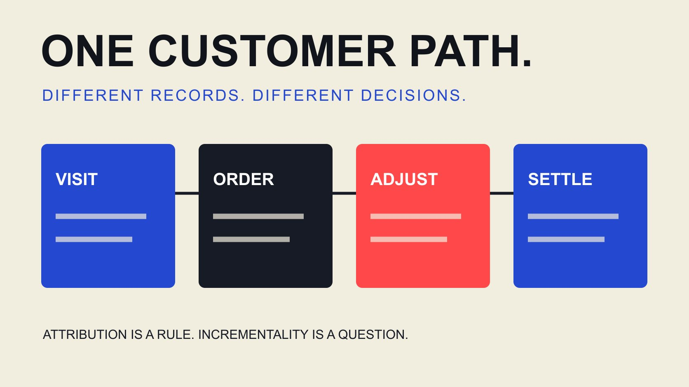

# Affiliate and Marketing: Map the Customer Journey

Status: local review draft; confirm the publication date before release.

Place affiliate partnerships inside the customer journey: who explains the product, how visits are recorded, which outcomes qualify and how returns connect to settlement.

QuickKOL editorial graphic; not actual account metrics or a platform interface.

Affiliate marketing compensates partners for agreed qualifying outcomes and can operate through content, social, search or other marketing activity. A link does not guarantee sales, and commission does not automatically replace payment for required production. Design content, visit records, qualifying outcomes, adjustments and payment separately. Connect the customer journey to settlement without treating an attributed record as proof of incremental growth.

## Define the partner’s job in the customer journey

Partners can introduce a product, explain use, compare conditions or provide an appropriate purchase route. These are different jobs. Do not treat every affiliate as someone supplying a discount immediately before checkout. Identify the missing explanation or path before deciding whether an affiliate arrangement fits.

The [CJ affiliate marketing overview](https://www.cj.com/about-affiliate-marketing) describes outcome-based commissions and includes content, social, coupon and other distribution models. This establishes breadth of possible channels, not guaranteed new customers from any one of them. Its historical marketing statistics should not become expectations for the current project.

A product requiring trial or instruction may need production compensation discussed separately from the sales incentive. Required deliverables are not fully specified by telling someone they can earn commission. The [affiliate outreach guide](/blog/whats-affiliate-outreach-partner-invitation/#answer) helps explain both the requested contribution and actual terms. A creator then has a basis for deciding whether they want to make the content, participate in the performance arrangement or discuss another scope. The brand also avoids confusing a partner’s willingness to share a link with acceptance of an unpriced production assignment.

## Map a path a customer can actually complete

Begin with seeing the content, then inspect the explanation page, relevant conditions, product selection and intended next action. An affiliate link might lead to a product page or an intermediate guide, depending on the assignment and program. Tracking convenience should not send every visitor to an irrelevant destination.

Confirm that the product is actually available to the intended market, language and prices make sense and necessary conditions remain visible after arrival. A software or service arrangement may define an outcome other than immediate purchase; use the actual program’s definition. Stronger persuasion by a partner cannot repair a customer path the brand has not prepared.

Assign owners at handoffs. An editor addresses content, the merchant confirms product conditions, technical staff examine tracking and settlement staff handle payment. Customers need not understand these internal divisions, but the team should know who investigates a problem. Otherwise the creator can become the default recipient of every question about missing sales even when the failure lies in stock, checkout or an incomplete offer rather than the partner’s work.

## Define what qualifies for commission

State the qualifying basis: transactions, confirmed net product value, eligible applications or another actual condition. Record currency, calculation base, exclusions, cancellations, returns, validation and payment timing separately. A headline percentage is not a complete description of what a partner may receive.

Do not universalize example terms. One merchant validating orders after confirmation does not establish the same window for another, and a network capability does not prove configuration of the current account. The invitation and terms sheet should agree, with an appropriate person confirming the version.

Mark missing decisive conditions pending instead of asking partners to invest in fixed production and wait for the answer. Early discussion can establish fit, but interest, application, approval and enabled tracking are separate states. An application is also not a grant of creative assets or a posting commitment. Defining these stages helps the brand ask for the next appropriate action without overstating what the person has already accepted. It gives operations a clearer point at which a partnership is actually ready to run, rather than counting everyone who expressed interest as active.

## Separate traffic tagging from commission attribution

The [conversion tracking guide](/blog/track-influencer-conversions-ga4/#answer) connects campaign links with records. Traffic tagging describes how a visit is classified; an affiliate system also applies actual partner, outcome and commission rules. A source appearing in an analytics report does not establish correct commission allocation or completed settlement.

The [Google traffic-source tagging guide](https://support.google.com/analytics/answer/11242870?hl=en) describes how manual parameters such as UTMs supply source, medium and campaign dimensions. Consistent naming helps interpretation, but does not create an automatically reconciled affiliate ledger or prove that an attributed sale was independently incremental.

Keep appropriate identifiers and definitions for comparing records while observing actual access and data requirements. Do not place private contacts or unnecessary sensitive fields in public URLs. Explain differences against the same object, window and state instead of forcing clicks, visits, orders and confirmed outcomes into one number. A useful comparison can identify missing events or mismatched naming without claiming that one system must be wrong whenever totals differ. The question is which record supports which operational decision, not which dashboard produces the largest count.

## Test records and exceptions before launch

Use an authorized test path to check destination, necessary records, outcome states and later adjustments. A page opening is not the entire test. The team also needs to locate relevant identifiers and know who handles returns, cancellations or missing records. Do not make the first real partner discover every system weakness.

Match testing to the program rather than requiring every small project to simulate all possibilities. Select cases that can change settlement or customer experience and save input, expectation, observation and open issues. Tests affecting actual payments, orders or accounts belong with appropriately authorized people using the real operating process.

Missing records remain unknown, not zero, and do not prove a partner contributed nothing. Investigate destination, naming, collection, window and access conditions. Assign an owner and a retest criterion to a technical gap instead of adding tracking risk beside a release date and expanding recruitment anyway. This produces a practical readiness decision: the tested path can proceed within its conditions, or a specific unresolved dependency has to be addressed before more partners are asked to use it.

## Connect order records and payment through validation

The [Awin commission validation guide](https://help.awin.com/docs/validating-commission-payments) distinguishes pending from validated records and describes order references, commissions and payment progress. It demonstrates distinctions within one system, not identical rules for every network or evidence that this project has completed validation.

Within the brand workflow, preserve tracked, confirmed, adjusted and paid separately. The validation owner should explain the basis and unresolved conditions. The payment owner needs a route to the approved records. Where returns or cancellations alter the qualifying base, follow actual rules and retain the explanation.

Give partner queries a path into investigation. A system label is not a complete answer by itself, and a discrepancy is not automatically fraud. Keep the relevant identifier, query date, handler and final reply so another colleague can understand what happened to the commission. This also separates an approved outcome from money already received. A payment delay, unresolved validation or missing tracking record calls for a different investigation, so grouping all three under unpaid makes it harder to give the partner an accurate answer.

## Use a hypothetical example to examine the commission base

Suppose a hypothetical program pays 10% of confirmed net product value, excluding tax and shipping. Ten orders each contain $50 of goods, totaling $500. Two are fully returned, removing $100 and leaving a $400 qualifying base. Commission is $40. Every term and amount is illustrative, not a named program’s conditions or an industry benchmark.

That $40 is not the creator’s entire income, brand profit or proof of payment. Fixed production, products, network charges or other costs need their own actual definitions. Do not deduct guessed returns or mix paid and pending amounts in one field.

The [affiliate conversion-cost guide](/blog/affiliate-creator-conversion-analysis/#answer) supports a deeper economic review. This example shows how a changed base alters commission, not whether the activity succeeded or caused all ten orders. Preserve its conditions so another reader can reproduce the arithmetic. If the real agreement uses a different base or qualifying event, rebuild the calculation from those terms rather than borrowing the percentage and assuming the same result. The useful lesson is to identify the basis before applying the rate.

## Do not treat commission credit as proof of incrementality

A rule assigning credit or compensation answers how an outcome is allocated. It does not automatically answer what would have happened without that partner. Customers may have encountered other content or already intended to buy. Different partner roles need suitable evaluation rather than treating the final recorded touch as the entirety of marketing value.

The [campaign incrementality guide](/blog/creator-campaign-incrementality/#answer) explores comparisons and limits. A small team can begin with an honest description of observed paths, qualifying outcomes and costs instead of inventing an incremental-sales number to complete a report. If a stronger conclusion is necessary, design an appropriate evaluation under actual conditions.

A brand may ask whether content answered an important question, whether the customer path worked and whether partners were settled accurately. Each matters without needing the same return label. Explain the evidence and unknowns behind another investment, especially when a commission report provides only one part of the picture. This preserves a useful distinction between a commercial accounting rule that must be followed and a business hypothesis that still needs evidence.

## Complete one operating path before expansion

Before launch, confirm the content job, destination, qualifying terms, tracking, validation, payment and query owners. Every stage need not require complex software, but it does need responsibility. Operate a clear scope and improve from observed issues rather than treating a higher commission as the answer to every gap.

Review which partners to retain, pages to improve, explanations to add or routes to stop. Sign-ups are not activity, and enabled tracking is not a qualifying outcome. Accurate states let the brand and partner discuss the same fact.

QuickKOL can support relevant creator research, understanding work and preparing contact. Program terms, orders and settlement remain dependent on the relevant systems and conditions. Understanding affiliate and marketing as a connection between customer tasks and a commercial mechanism helps a brand explain why it is partnering, how the arrangement operates and which evidence supports the next step.

## Affiliate journey and handoff ownership

| Stage | Record | Owner should answer |

| --- | --- | --- |

| Content and visit | Work, destination and source definition | Can the visitor reach the right next step? |

| Qualifying outcome | Actual terms and relevant identifiers | Why does this qualify? |

| Validation and adjustment | Confirmation, cancellation and return basis | Which changes affect commission? |

| Payment and queries | Paid, pending and handling records | Who investigates and answers discrepancies? |

Illustrative ownership. Verify fields and rules against the actual program and system.

## Affiliate launch checks

Check more than whether a link opens.

- [ ] Define the content job and partner role.

- [ ] Check the customer path for the intended market.

- [ ] Version qualifying terms, calculation base and payment rules.

- [ ] Explain traffic tagging and commission records separately.

- [ ] Test material exceptions and assign owners.

- [ ] Do not report attribution as causation.

## Research date and limitations

Sources reviewed October 30, 2026. Methods, tables and decision rules are editorial recommendations. Hypothetical examples are not actual client results or industry benchmarks. Source geography and periods are specified where relevant. This draft is in independent local review; confirm its publication date before release.

## Sources

- [CJ: About Affiliate Marketing](https://www.cj.com/about-affiliate-marketing)

- [Google Analytics: Traffic-Source Dimensions and Tagging](https://support.google.com/analytics/answer/11242870?hl=en)

- [Awin: Validating Commission Payments](https://help.awin.com/docs/validating-commission-payments)
