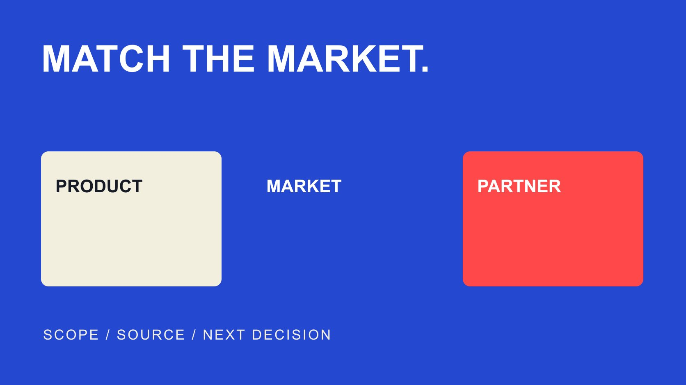

# Affiliate Networks for Consumer Products: Compare Fit

Status: local review draft; confirm the publication date before release.

Compare affiliate networks for consumer products through market, partner roles and order operations, then investigate CJ, Awin and Rakuten routes and conditions.

QuickKOL editorial graphic; not actual account metrics or a platform interface.

Choose an affiliate network for consumer products by relevant partners in the target market, a workable product and order path, tracking and validation, settlement and service ownership. CJ, Awin and Rakuten Advertising provide documented research starting points. Network scale, directory counts and broad return claims do not establish the best fit for a particular brand. Network membership and acceptance into a merchant program are different, with actual conditions dependent on market, plan and account.

## Define the consumer-product job before network size

Specify the product, market, purchase route and partner’s job. Equipment needing explanation, everyday products suited to comparison and items requiring actual trial can need different partners and production inputs. Consumer products is not enough to establish one network mix or commission arrangement.

The [affiliate customer-journey guide](/blog/affiliate-and-marketing-customer-journey/#answer) connects content and transactions. Network selection asks what the brand already has, what it needs supplied and who owns products, orders and partner relationships internally. Confirm that a customer in the intended market can complete the actual next action before expanding distribution.

Translate leading into checkable questions: relevant explanatory partners in this market, necessary records and workable handling. This is a brand selection method, not a market-share ranking. Without comparable independent evidence, vendor scale claims should not become an overall league table for consumer brands. A smaller relevant set may be more useful for a defined launch than a large directory the team cannot activate. The choice should reflect a working partnership route, not simply the most impressive network-wide number on a sales page.

## CJ: Investigate partners by distribution role

The [CJ partnership overview](https://www.cj.com/what-is-affiliate-marketing) distinguishes advertisers and publisher partners and describes distribution through websites, social, search, email, apps and offline activity. This helps organize research by role without establishing that each route is available in the target market or that every partner will accept the brand.

Separate partner location, audience market and the merchant’s fulfillment territory. A network operating locally does not establish that the particular combination meets this assignment.

List the actual roles needed, such as explanation, comparison, relevant editorial coverage or another contribution, then ask how discovery, engagement and management work for those roles. Retain observation date, market and plan conditions rather than using a global description as local availability evidence.

If creators must produce original product material, clarify production arrangements separately from commission. Network discovery does not automatically complete the brief, trial, asset acceptance or use confirmation. The research output should identify the next person and question, not treat a directory result as an accepted partnership. This makes CJ a route to investigate against a defined consumer-product job, rather than a name assumed to deliver the same roster, production and outcomes for every merchant using the network.

## Awin: Distinguish network, merchant program and service

The [Awin official FAQ](https://www.awin.com/us/faqs) distinguishes an affiliate network from an individual advertiser program and describes self-managed and different service arrangements. Ask more than whether the brand is on Awin: identify scope, daily operating ownership, market and conditions.

If the team needs human support, inspect the actual service rather than relying on the existence of account managers somewhere in the network. Service described for one tier is not automatically included in another. Confirm prices, allowances and admission against the intended market and option; this article does not publish unverified comparable pricing or income expectations.

For self-management, assign partner applications, terms updates, validation and queries internally. Network technology does not mean every operating task completes itself. Purchased service should address an actual gap rather than leaving the team to discover after joining that nobody maintains product information or answers suitable partners. A clear ownership conversation can reveal whether the appropriate next step is a smaller managed scope, an internal coordinator or preparation before launch, without treating one service model as universally superior.

## Rakuten: Check particular programs and visibility

The [Rakuten program-discovery guide](https://pubhelp.rakutenadvertising.com/hc/en-us/articles/360049778112-Find-and-Apply-to-Advertiser-Programs) describes finding advertisers by name or category and notes that some programs and commission offers can be private. Absence from search does not establish that a brand has no arrangement. A network result also does not prove that a merchant has accepted a particular publisher.

For a consumer-products advertiser, ask how suitable partners find its program and how public, invitation or other actual conditions affect recruitment. Network membership does not automatically make desired partners discover, apply and promote. The [affiliate outreach guide](/blog/whats-affiliate-outreach-partner-invitation/#answer) supports a clear invitation and next action.

When researching an existing merchant program, use official routes and appropriate access to current conditions rather than copying rates or windows from old lists. For a new program, describe product, market, partner types and support so the supplier can answer the actual requirement. Well-known customer logos do not establish that the brand will obtain the same relationships or service. The useful comparison concerns visibility and activation for this program, not a general assumption that every listed retailer is accessible to every publisher.

## Check product information and the purchase path

Keep product names, versions, specifications, images, conditions and destination pages consistent. Assign updates for stock, price and market changes instead of leaving partners with obsolete material and blaming every problem on content. Confirm how product information is supplied under the actual network and program.

Variants, packaging, bundles and regional differences can matter. Connect the record to the correct item rather than extending one sample experience to all variants. If trial, filming and page descriptions use different versions, correct inputs before comparing promotional outcomes.

Run an authorized customer-path test covering click, destination, important conditions, checkout and required records. Tests affecting real transactions or accounts need appropriate authority and process. Successful network integration does not establish merchant-page, fulfillment and support readiness. The brand should know which part was tested and who can fix each problem. That provides a more useful launch decision than assuming that a tracking connection has validated the entire commercial experience a partner’s audience will encounter.

## Compare economics and complete costs

Equal commission percentages do not establish equal partnership value. Suppose two hypothetical programs pay 10% of confirmed net value, with qualifying order bases of $30 and $150. Commissions are $3 and $15. These are examples, not network rates, average orders or income forecasts.

Consider cancellations, returns, samples, production, network and service fees, plus internal work. The [affiliate conversion-cost guide](/blog/affiliate-creator-conversion-analysis/#answer) supports cost definitions without filling missing terms with invented averages. Explain the base, exclusions and validation so partners can understand the arrangement.

Compare the same market, scope and period. A network’s promotional return should not sit beside another brand’s net profit as if they measure the same thing. If comparable independent evidence is unavailable, preserve that gap. A clear cost model can support a decision without creating an apparently authoritative best-return ranking. It can also reveal that a proposed commission leaves insufficient room for the brand’s actual fulfillment and content costs, requiring a different scope rather than assuming more sales will automatically repair the economics.

Clarify treatment of repeat purchases, subscriptions and bundles instead of extending a first-order example to every later transaction. Product net value, order total and the contribution relevant to the brand are different. Replenishment may matter, but unobserved or undefined repeat purchasing should not become already earned profit in the comparison. Preserve the condition that would allow the team to measure it later. Date assumptions and identify the confirmed terms that should replace them.

## Make tracking, validation and partner queries workable

The [conversion tracking guide](/blog/track-influencer-conversions-ga4/#answer) distinguishes traffic-source records from business outcomes. Network, site analytics and order systems can describe different objects, windows and states. Unequal figures do not automatically establish error. Preserve appropriate identifiers, definitions and times for the relevant owner to check.

Validation should explain qualifying outcomes, return and cancellation effects, and entry into payment. Pending review differs from paid; one total commission field cannot replace both. Use the actual program’s rules rather than extending one network feature example to every merchant.

Give partner questions a recipient, investigator and return path. Missing records remain unknown instead of zero or an unsupported accusation against a partner. Begin with a bounded test, then expand after a path genuinely works. Recruitment growth should not outpace validation and support capacity. The brand is choosing an operating relationship as well as technology, so it should be able to identify who resolves a discrepancy and what evidence that person needs rather than treating the network’s presence as the answer to every payment question.

## Decide the appropriate scope rather than a universal winner

Write the comparison as a judgment about market, product, partners, technology and service. The next step can be further verification with one network, more preparation, a smaller scope or no program yet. Not every consumer brand should immediately join several networks.

The [platform proof-and-exit guide](/blog/best-influencer-marketing-platforms-proof-exit/#answer) supports reporting and necessary-record handoffs. State what public material, supplier demonstration and actual account tests each establish. Desk research should not become a claim of completed transaction validation when no account was tested.

QuickKOL can support relevant creator discovery, work research and contact preparation without replacing a network’s program, tracking and settlement. A reliable response to leading affiliate marketing networks consumer products offers verifiable options and selection conditions. Brand prominence, old statistics and promotional promises are not the complete procurement evidence. The decision should remain understandable to the colleague who has to run the program after selection, including what was chosen, what still needs checking and why the intended market and partner task make the proposed route worth investigating.

## Consumer-product affiliate network research entries

| Entry | First-party material supports | Brand must confirm |

| --- | --- | --- |

| CJ | Advertiser and distribution partner roles | Market and actual partner fit |

| Awin | Network versus program and service arrangements | Selected plan, internal ownership and terms |

| Rakuten Advertising | Program discovery and private visibility | Admission, recruitment and qualification |

Public research on October 30, 2026, not market-share, return or hands-on rankings. Program and market conditions can change.

## Affiliate network selection checks

Connect the brand, partner and order workflow.

- [ ] Define product, market and partner job.

- [ ] Separate network membership and merchant approval.

- [ ] Make product information and customer paths usable.

- [ ] Explain commission base and complete costs.

- [ ] Assign tracking, validation, payment and query owners.

- [ ] Date the comparison and preserve unverified conditions.

## Research date and limitations

Public sources reviewed October 30, 2026; named network accounts were not accessed or hands-on tested. This is not a market-share ranking, current price list or return guarantee. Vendor descriptions provide research starting points. No comparable independent consumer-product network-return dataset was established, so no universal return benchmark is supplied. Examples are hypothetical; confirm actual market, plan, agreement and fees. Confirm publication date before release.

## Sources

- [CJ: The Power of Affiliate](https://www.cj.com/what-is-affiliate-marketing)

- [Awin: US Frequently Asked Questions](https://www.awin.com/us/faqs)

- [Rakuten Advertising: Find and Apply to Advertiser Programs](https://pubhelp.rakutenadvertising.com/hc/en-us/articles/360049778112-Find-and-Apply-to-Advertiser-Programs)
