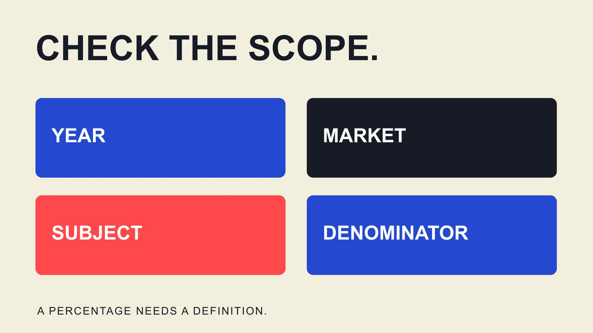

# 菲律宾美妆互动率 2025：先核对样本与分母

状态：本地审阅稿；正式发布日期待确认。

核对菲律宾美妆2025互动率资料，说明哪些报告不能直接回答问题，以及怎样建立可复核的本地比较样本。

QuickKOL 编辑图形；不呈现真实账号指标或平台界面。

本次公开资料核验未建立一个可负责任引用的“菲律宾美妆行业2025平均互动率”。这不等于断言无人拥有相关数据，而是找到的资料尚未同时匹配年份、菲律宾范围、美妆对象、平台与统计口径。不要把全球品牌报告、所有垂类达人中位数或2026推荐区间改名为该指标。品牌可以先建立明确范围的比较样本，并将结果称为该样本的描述，而不是全国行业标准。

## 先确定这个平均值究竟描述谁

美妆行业可能指品牌官方账户、零售商、个人美妆创作者，或涉及美妆产品的某类发布。菲律宾可能指创作者所在地、品牌经营市场、观看者地域或内容语言。这些条件不是同一件事，需要按实际合作问题选择。

若品牌研究菲律宾受众中的个人创作者，应同时说明如何识别创作者与受众范围。一个账户位于菲律宾，不代表所有互动都来自菲律宾；面向全球的美妆品牌也不能仅因在当地销售就进入本地达人样本。语言可以辅助理解内容，不能单独证明观看者地域。

[互动数据阅读指南](/zh/blog/read-creator-engagement-data/#answer)帮助定义动作与限制。此处再补充平台、内容形式、合作性质、粉丝规模、观察窗口和样本单位。先把问题写清，才知道报告中的某个百分比是否回答了它，而不是先找数字，再调整问题去适配。

## 为什么带2025标题的美妆报告仍可能不匹配

[Dash Social 2025 美妆报告](https://pages.dashsocial.com/hubfs/social-media-benchmark/2025/1H/beauty-industry.pdf)的方法页说明，H1 2025 报告分析的是2024年7月1日至12月31日的全球公司活动；Instagram 美妆样本为257个品牌。它还分别给出平台公式，例如 Instagram 采用赞与评论相对粉丝，而 TikTok 使用不同动作与分母。

这些信息有助于判断可比性，却不能被改写成菲律宾2025个人创作者平均。报告标题年份、实际观察年份、公司与个人、全球与单一市场都需要保留。不应因为数据来自可信发布者，就删掉使其有意义的样本条件。

本篇不使用报告中的百分比为本地达人设合格线。若需要广泛行业背景，可以清楚说明它是指定时期的全球品牌样本；若决定本地创作者合作，则还需要与那个任务更相近的证据。

## 菲律宾达人表也不自动等于美妆平均

[AnyMind 菲律宾样本说明](https://6727898.fs1.hubspotusercontent-na1.net/hubfs/6727898/State%20of%20Influence%20in%20APAC%202026%20Report_AnyMind%20Group.pdf)位于 State of Influence in APAC 2026 第68页，表注说明约4,000名菲律宾达人、1,000至1,000,000粉丝、跨所有达人垂类，表格展示中位数与四分位。这份地域相关的资料没有在该表中单列美妆。

因此，不能将某一档 Instagram 或 TikTok 中位数写成“菲律宾美妆行业平均”。相关表页也没有完整说明用于独立复算的观察窗口与公式；不能只根据整份报告的标题，补出未明确的面板条件。本次已阅读范围页并检查原始表格图像，不采用表下的效率推断作为因果证明。

更精确的引用方式是说明该报告提供所有垂类的分档样本背景，并向发布者索取与美妆、2025观察期和公式相匹配的补充数据。没有拿到补充分组，保留证据缺口。

## 平均、中位数和加权结果不能互换

[Rival IQ 2025 方法说明](https://www.rivaliq.com/blog/social-media-industry-benchmark-report/)将互动率与粉丝关联，并使用公司样本的中位表现汇总行业。这里引用其方法区分，不把该公司样本结果当作菲律宾美妆个人达人的算术平均。网页中的时间与选择条件也应按实际说明保留，不自行修补歧义。

用三条假设记录说明差异：每个账户一条内容，粉丝分别为1,000、10,000和100,000，指定窗口内赞与评论合计分别为50、100和500。相对各自粉丝的比率是5%、1%和0.5%；三个比率的算术平均为约2.17%，中位数为1%。

将合计动作650除以合计粉丝111,000，得到约0.59%。这是按这些分母形成的合并比率，不是上述简单平均，更不是去重受众互动率。全部数字都是教学假设，不是菲律宾、真实账户或行业基准。选择哪种汇总，取决于要回答的问题，并应写明每个账户是否同等权重。

## 建立可以说明范围的2025比较样本

先写纳入与排除条件：平台、个人创作者或品牌、相关美妆内容、地域证据、粉丝档、发布时期与内容形式。用适当的公开或获授权来源寻找候选，保留为什么符合条件；不要只挑团队已经喜欢或表现最高的账户。

历史观察尤其需要区分发布时间与抓取时间。2026年才查看一条2025内容，其累计互动已包含之后的增长；它不等于2025年末快照。若没有保存相应历史粉丝与观察窗口，就不能把今天的粉丝量当成当时分母，或声称得到了发布后同龄比较。

缺少历史资料时，可以改做明确标注抓取日期的2025发布内容回顾，或建立今后的同龄观察基线。这些可能仍有决策价值，但不是原先要求的历史快照。先缩小主张，再决定是否值得投入额外数据采集。

## 处理缺失、付费分发与样本不平衡

[Instagram 格式决策指南](/zh/blog/instagram-analytics-format-decision-matrix/#answer)说明不同形式与口径需要区分。对本样本，将 Reels、图文、Stories 或其他形式分开；赠品、广告扩量与自然发布按可核实状态记录。不知道是否投放，写未知，不把它自动分配到自然内容组。

不可见的赞或缺失粉丝不是零。说明缺失记录如何处理，并保留原始计数与样本量。某账户发一百条、另一个只发两条时，按全部发布平均会让高频账户权重更大；若按账户先汇总，再跨账户比较，应说明这个选择。

不能因为一个值很高就删除，也不能为得到漂亮平均数而排除低表现。先检查录入、窗口、格式与口径，确实异常时说明原因和处理。小样本可以用于具体候选研究，但不能仅凭表格完整就宣称代表整个国家行业。

## 怎样把可复核结果放进品牌方案

结果旁边保留定义、平台、对象、时期、地域条件、样本量与汇总方式。例如可以描述为“本次选取的某平台美妆创作者，在指定抓取窗口内的账户级中位表现”，再列条件与限制；不要把它缩写为“菲律宾美妆平均”。

[美妆主张审核指南](/zh/blog/top-beauty-influencers-claims-review/#answer)提醒品牌区分实际体验、教学与产品功效主张。互动表现也应和内容任务一起研究。较高比率不证明某人能够作出专业解释、产品主张成立，或合作一定带来销售；低比率也不能直接当作欺诈或不适合的证据。

若补充报告后来出现，先核对它是否真正修复原缺口，还是只是地区相近、年份不同或分母相似。保存版本与来源，让读者能从结论回到原始记录。可复核比单一漂亮数字更有引用价值。

## 向资料方索取能解决缺口的说明

一份有用的数据请求先说明品牌要作出的决定，再列需要的范围，而不是只问能否给一个百分比。对于本题，可以询问是否有菲律宾个人美妆创作者子样本、如何定义地域与垂类、覆盖哪个平台，以及能否区分发布形式和付费分发。若提供的是品牌账户，确认是否确实适合当前问题。

随后问真实观察窗口、抓取时间和历史粉丝的获得方式。要求解释动作计数、分母、先按发布还是账户计算、如何处理删帖或隐藏数值，以及最终摘要使用算术平均、中位数还是其他方法。并非每项都必须取得私人原始记录；适当的方法说明与不暴露个人资料的汇总，也可以帮助判断能否使用。

最后询问总样本与各子组有效样本量、选择来源和已知缺失。若只能提供一个大范围总数，不能把它当成每一分组都有足够资料。资料方可能无法补出历史快照，或不能以所需方式拆分；把回答保留，缩小结论，而不是要求其猜测。明确无法回答哪个部分，也是一项有用研究结果。

在收到数据前，不要在方案里留下看起来像真实结果的推荐区间。可以写“待确认相应样本与口径”，同时说明负责人与所需证据。收到后再检查其是否修复原来问题，而不是只因为回复来自专业供应商就自动采纳。

## 没有全国平均时，仍可以做出有边界的决定

品牌不必为等待一个完美行业数值而停止所有研究。可以先看与当前任务相近的作品、受众证据与可比观察，再做适当范围的试点。但应向决策人说明，当前支持的是候选与内容任务的判断，不是全国美妆市场估计。

QuickKOL 可以帮助理解 Brief、发现相关达人并研究作品。候选数据与历史口径仍需核验，不能从工具返回列表推导已完成代表性抽样。下一次观察按照同一规则保存，才能积累可用的比较。

本题最可靠的结论是明确证据边界，并给出可继续工作的路径。找到相近资料有价值，前提是不把它改名成尚未证明的答案。

## 哪些资料能回答这个问题？

| 资料 | 能提供 | 不能直接当作 |

| --- | --- | --- |

| Dash Social H1 2025 美妆报告 | 指定2024时期的全球品牌背景 | 菲律宾2025个人达人平均 |

| AnyMind 菲律宾分档表 | 所有垂类达人中位数与样本注释 | 美妆子样本算术平均 |

| Rival IQ 行业方法 | 公司样本、中位数与粉丝口径区别 | 本地美妆达人全国标准 |

| 明确限定的自建比较样本 | 该样本在指定条件下的描述 | 未经证明的全国代表性 |

资料核验于2026-10-30。未建立匹配的公开平均值，不等于断言不存在私人或后续研究。

## 互动率基准引用前检查

每个数字都要保留使它成立的条件。

- [ ] 地区指创作者、受众还是品牌市场？

- [ ] 是美妆、所有垂类、品牌还是个人？

- [ ] 报告年份与真实观察年份是否一致？

- [ ] 分子、分母、窗口与抓取日期是否明确？

- [ ] 平均、中位数与合并比率没有混用。

- [ ] 缺失、付费分发与样本选择限制已披露。

## 研究日期与使用边界

公开资料核验于2026年10月30日。本文未采集菲律宾美妆代表性数据集，也未建立该行业2025全国平均值。Dash Social 与 AnyMind 原PDF的相关范围与方法已核对；外部报告保留各自时期、样本与口径，教学算例完全是假设，不是实际市场结果。正式发布日期待确认。

## 来源

- [Dash Social：H1 2025 Beauty Industry Benchmark Report，第2、17页](https://pages.dashsocial.com/hubfs/social-media-benchmark/2025/1H/beauty-industry.pdf)

- [AnyMind：State of Influence in APAC 2026，第5、68页](https://6727898.fs1.hubspotusercontent-na1.net/hubfs/6727898/State%20of%20Influence%20in%20APAC%202026%20Report_AnyMind%20Group.pdf)

- [Rival IQ：2025 Social Media Industry Benchmark Report / Methodology](https://www.rivaliq.com/blog/social-media-industry-benchmark-report/)
