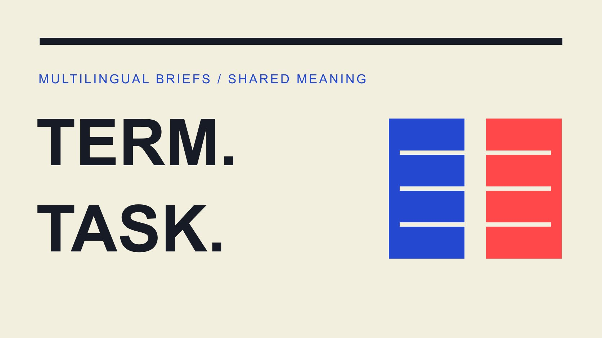

# Definition Influencer：跨语言 Brief 的术语对齐

状态：本地审阅稿；正式发布日期待确认。

把 influencer 的定义转成中英文 Brief 共用的术语与职责，避免翻译时新增发布、许可或专业资格承诺。

QuickKOL 编辑图形；不呈现真实账号指标或平台界面。

Influencer 可以译为“达人”或“影响者”，但多语言 Brief 不能只靠一个词传达合作范围。本文建议用同一条记录分别说明对象、相关受众、实际角色、商业关系与交付，再给出各语言表达。一个译名不自动包含发布义务、专家资格、独家关系或广告使用权。这是一套编辑交接方法，不是统一行业定义或法律术语认证。

## 先区分词义说明与任务指派

[AMA 达人营销说明](https://www.ama.org/topics/influencer-marketing/)从能够影响潜在买家的人与品牌传播活动解释这个领域。这适合提供营销背景，但没有让一个名词自动成为某个项目的全部职责。团队可以沿用熟悉的译名，同时明确本文或 Brief 讨论的具体范围。

[研究分类定义](/zh/blog/influencer-definition-research-classification/#answer)解决的是如何把对象归入研究口径；本篇则处理已进入合作讨论的对象在不同语言材料里是否仍承担同一任务。术语表不应把中文“达人”悄悄扩写成已经核实专业知识的专家，也不能把英文 creator 自动缩减为仅交文件的人。

在第一次出现术语时写一条项目定义，例如“本项目中的达人指受邀制作并在指定账户发布演示的独立创作者”。如果发布还未商定，就写拟议角色与待确认事项。定义应描述实际安排，不应为了显得简洁而提前确认尚未发生的合作。

## 为术语建立稳定标识，而不追求一个万能译词

为共用概念分配内部标识，例如角色 C01；在同一行保存英文、中文、项目定义、适用材料、负责人和版本。标识只服务团队整理，不是创作者的公开身份、行业认证或必须显示给受众的代码。

若两种语言存在常用别称，可作为检索词保存，但不要让别称指向不同职责。有人习惯说博主，有人习惯说 creator，都应该能找到同一行交付说明。若实际分工不同，则建立不同记录，而不是为了词表整齐硬说完全等同。

[项目输入与审批指南](/zh/blog/write-a-useful-campaign-brief/#answer)可以保留整体合作任务；术语记录只需要解释容易分歧的表达。避免将每个普通词都纳入繁重流程。先处理那些会改变报价、发布、使用、付款或事实理解的词，让译者可以提出具体问题，而不是自行猜测业务安排。

一条示例记录可以写为 C01：付费演示制作方，本轮提交两份文件，个人账户发布待确认。中文与英文都指向同一范围记录。若后续增加发布，先修改职责与商业安排，再更新译名附近的说明；不要让第二种语言成为新增要求的唯一出处。

## 把人物角色、商业关系和交付拆开

同一个人可能同时制作内容、发布、参与长期品牌活动并使用联盟链接。不要把这些都塞进“大使”或“达人”一个词。分别记录谁做什么、在何处、何时完成，以及什么关系需要清楚说明。

[合作范围清单](/zh/blog/creator-contract-scope-checklist/#answer)支持进一步确认交付与使用条件。术语表可以链接该范围，但不能替代它。例如“合作视频”仍需要说明数量、版本、发布者、账号与是否包含广告使用；“长期合作伙伴”也不能自动表示无限期、无限次修改或独家。

对尚未商定的内容使用拟议、待确认等明确状态。把英文 may 翻译成确定会做，把“可讨论授权”翻译成“已获授权”，都会改变团队理解。审核时逐项核对含义，而不是只检查语法是否流畅。

## 保留定义的地区、目的与来源

[ASA 社交广告说明](https://www.asa.org.uk/advice-online/recognising-ads-social-media.html)在英国广告识别语境中采用宽泛的 influencer 范围，并说明没有一个特定粉丝量或职业门槛。这是该指导的使用语境，不能直接当作品牌筛选中的专业资格或全球通用合同定义。

词表引用外部定义时，保存来源、核验日期与目的，例如“英国广告识别参考”或“营销背景说明”。不要把不同机构的定义拼成一条没有归属的所谓国际标准，也不要删掉使某项说明成立的条件。

如果项目对专家身份、当地执业资格或受众地域有额外要求，另列证据与确认人。术语翻译不能完成这些核验。一个人被叫作 influencer，不说明他适合回答医疗、金融或其他需要专业依据的问题；也不说明公开语言就是其全部受众的所在地。

## 广告披露不能只翻译一个固定标签

[FTC 披露指南](https://www.ftc.gov/business-guidance/resources/disclosures-101-social-media-influencers)在美国背景下要求披露容易看到和理解，并提到应使用与背书相同的语言。它不能推出所有市场都接受某一固定英文标签，也不能让自我介绍中的合作身份替代具体内容里需要的说明。

品牌应让适当负责人根据目标市场、内容形式与实际关系确认披露。词表保存已确认表达的适用条件与版本，而不是建议翻译人员自行选择最短标签。商业关系从付费变成赠品，也可能仍需要重新检查，而不是在删除 paid 后假设已经没有问题。

两种语言材料可以文字不同，但事实应相同：谁提供了什么、何种关系以及内容是什么性质。若篇幅、画幅或字幕排布影响可见性，交回内容与市场负责人处理，不把必要说明放进观众难以看到的位置，只为了让译文更短。

## 用反向复述找出实际分歧

让另一位同事不看原文，只用译稿回答：谁交什么、是否发布、在哪里用、多久、哪些仍未确认。再对照原来的范围记录。这里需要的是任务复述，不是机械把句子再翻译回来而已。

假设英文拟议让创作者交两段演示，中文写成“两次达人合作发布”。即使两种表达看起来都专业，也已经产生发布义务差异。保留问题记录，由业务负责人确认真实安排，再同时修正相关材料；不能靠对照哪个语言更正式来决定。

数字、日期、币种、次数、否定与条件句优先核对。事实复杂时，用一个例子测试：如果品牌想把视频投广告，这份文字是否明确说明需要另行确认？这是假设审核情景，不是法律结论或真实客户纠纷。

记录审核的具体结果，例如“英文两份素材，中文两次发布，待项目负责人决定”，并指向相应版本。不要只写翻译有误而没有说明差在哪。问题解决后，两位使用者应能从各自语言材料得出同样的任务清单，包括哪些内容没有被承诺。

## 更新概念时，同时更新受影响材料

术语由“内容制作”改为“制作并发布”，可能影响报价、Brief、邮件与时间安排。记录变更原因、适用版本与需要通知的人。不要让一个表格已经更新，另一种语言邮件却继续发旧范围。

将事实变化与措辞优化区分。更自然地表达同一个任务，不一定需要重新谈合作；新增交付、许可或期限则需要相应负责人处理。翻译人员可以标记差异，但不应被默认授权接受新商业条件。

保留必要的历史与当前使用版本，避免每次都复制出无法分辨的新文件。可用一份简洁变更记录说明哪些内容失效、哪些仍适用。对外沟通前，从当前范围取词，而不是凭记忆重用过去另一项目的“标准说法”。

## 把词表交给会实际使用它的人

最终术语表应让写作者、翻译、外联与项目负责人能找到定义、范围与提问路径。它不是装饰性附录；挑几条最可能影响决定的术语，检查另一位同事能否正确应用到真实任务。若团队在不同工具中使用词表，指定一处当前版本并给其他材料明确引用。自动补全或旧模板仍可能带回过时解释，检查实际发出的内容，而不是仅确认主文件正确。

QuickKOL 可以帮助理解 Brief、发现相关创作者并准备联系。清楚的输入有助于这些任务，但不能从生成流畅的文案推导商业范围已经核实。外联中用到的作品、身份和条件仍需回到相应来源。

多语言一致性不意味着每个词逐字相同，而意味着读者得到同样的事实、任务、限制与未知状态。把这四件事保存好，术语才真正帮助团队执行。无需把这套方法变成专业认证或复杂评分：能准确找到当前范围、说明分歧并交给有权限的人处理，就是有用的结果。

## 术语必须连接到独立的范围字段

| 术语 | 需要写清 | 不能自动推导 |

| --- | --- | --- |

| 达人 / Influencer | 相关受众与本次角色 | 专业资格或固定粉丝门槛 |

| 创作者 / Creator | 制作、发布或两者 | 默认在本人账户发布 |

| 品牌大使 / Ambassador | 代表职责与期限 | 无限授权或独家 |

| 联盟伙伴 / Affiliate | 实际计划与佣金条件 | 固定费用或保证收入 |

表格是项目词表的编辑示例，不是全球统一定义、合同条款或广告披露模板。

## 多语言 Brief 一致性核对

从实际任务复述核对，不只看文字是否流畅。

- [ ] 术语有稳定标识与当前项目定义。

- [ ] 角色、关系、交付和使用条件分别保存。

- [ ] 来源的目的、地区与日期没有被删掉。

- [ ] 数字、否定与未确认条件在两种语言一致。

- [ ] 披露表达由适当市场负责人确认。

- [ ] 变更同步到实际使用的材料与接收人。

## 研究日期与使用边界

资料核验于 2026 年 10 月 30 日。文中方法、表格和决策规则为编辑建议，标为假设的示例不是实际客户结果或行业基准。外部资料的适用地区与时期按各段说明；本稿处于独立本地审阅阶段，正式发布日期待确认。

## 来源

- [American Marketing Association：Influencer Marketing](https://www.ama.org/topics/influencer-marketing/)

- [ASA / CAP：Recognising ads（英国）](https://www.asa.org.uk/advice-online/recognising-ads-social-media.html)

- [FTC：Disclosures 101（美国，2019）](https://www.ftc.gov/business-guidance/resources/disclosures-101-social-media-influencers)
