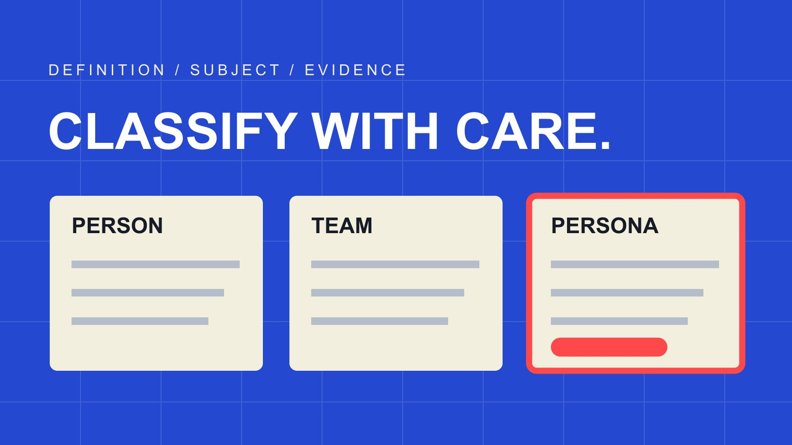

# Influencer Definition: Classify Research Records Consistently

Status: local review draft; confirm the publication date before release.

Turn an influencer definition into consistent research rules. Identify the subject, relevant influence, task fit and evidence state while preserving borderline cases.

QuickKOL editorial graphic; not actual account metrics or a platform interface.

An influencer definition should fit its purpose. Marketing concepts, advertising guidance and brand research lists can use different scopes; none should silently become the only definition for every setting. For a shortlist, document a project working definition, then record account subject, relevant work, intended influence and unresolved conditions. Follower thresholds, platform labels and tool categories should not replace the underlying evidence.

## State the purpose of the definition

The statement that someone is an influencer can explain a concept, identify advertising or qualify a research lead. These purposes ask different questions. State the purpose before deciding which fields are necessary. An introductory definition needs no follower qualification, while a shortlist for an event host also needs relevant capability and attendance conditions.

The [AMA influencer marketing overview](https://www.ama.org/topics/influencer-marketing/) describes marketing organized around people who influence potential buyers. That supplies marketing context, not a complete inclusion procedure. A brand still needs its relevant group, content question and contribution type.

A hypothetical working definition might include people or explicitly identified creative teams whose relevant public work can help the intended reader understand equipment use. This is a project rule, not an industry standard. Save its scope and version so later researchers know which assignment produced the label. Otherwise a record qualified for explanation can silently become qualified for hosting, production or a different market simply because the same word was reused. A useful definition limits what the classification claims as well as explaining why a lead belongs in the research set.

## Separate marketing concepts from advertising scope

Advertising guidance may use a broad scope to cover many online presentations, whereas a brand research list needs an actionable selection rule. The two can inform each other without being interchangeable. Record the source, geography and purpose alongside the brand’s own task conditions.

In its United Kingdom context, [ASA social advertising guidance](https://www.asa.org.uk/advice-online/recognising-ads-social-media.html) discusses human, animal and virtually produced personas and does not prescribe one qualifying follower count or occupation. That does not require a brand to include every kind of persona in an assignment, nor establish the classification for every country.

If a project needs someone personally to perform product use, it can mark a virtual persona unsuitable and identify the task-based reason. Do not turn that exclusion into a universal claim that virtual personas cannot be influencers. Reassess when project scope changes rather than copying the old label into a new assignment. This distinction makes a definition reusable without overstating it: another researcher can understand both the general reference and the narrower operational choice, including which conditions would require the record to be reconsidered.

## Identify the account subject before judging fit

Record subjects such as an individual, creative team, business, publication, community or virtual persona separately. Adapt categories to the task, allowing ambiguous cases rather than assuming every account fits neatly. The [account-role research guide](/blog/top-instagram-influencers-by-account-role/#answer) distinguishes individual and organizational roles without making the category a rating of influence or quality.

Retain the public account, stable identifier, display name and observation date. A founder appearing in a company video does not necessarily make that account personal. Work from a group program should not automatically be attributed to one participant. A specific commission needs confirmation of who appears, produces and publishes.

Mark unclear subjects pending while continuing independent work research where useful. Do not infer personal identity or eligibility from photographs, names, accents or follower age. Classification connects evidence to the appropriate subject; it is not a reason to collect unrelated private information. This order also prevents an apparently simple eligibility filter from hiding an attribution mistake, such as treating an organization’s audience and portfolio as the personal audience and work of its current spokesperson.

## Separate inclusion from ranking

Inclusion determines whether a lead merits further research. Ranking determines which suitable leads deserve attention first. Relevant work, language and necessary attendance can be project conditions; budget, availability or audience evidence may need later confirmation. A combined score should not hide an unmet prerequisite.

The [creator-shortlist workflow](/blog/creator-shortlist-workflow/#answer) preserves work and next questions. Check inclusion evidence before comparing capabilities. Unknown is not a zero score or an automatic pass. An account without a public geography report does not have zero local audience; it lacks evidence needed for this decision.

For a hypothetical live demonstration, someone may have highly relevant work with attendance unconfirmed. Content suitable, attendance pending is more informative than a simple pass or fail. It creates a specific outreach question and prevents procurement from treating a preliminary label as a fully confirmed participant. Keep essential conditions visible even when sorting a large list. A researcher should be able to explain why someone remains under consideration and which unresolved fact could change that decision, rather than defending a score produced from a mixture of observations and missing values.

## Record relationships and compensation separately

Compensation should not be the only classification rule for a person. Someone can publish independent work and also accept commercial assignments. The relationship behind one asset does not establish the relationship behind every post. Specify whether the observation concerns a person, account, work or particular partnership.

Where the commercial arrangement matters, retain the brand connection, public statement, direct confirmation or open question with its source and date. A public label is evidence to examine, not a reason to conclude from its absence that no relationship exists. Likewise, a brand appearing in content does not establish payment. Check consequential conclusions through an appropriate source.

The classification sheet need not estimate personal income. Early research may only require knowing whether fixed production, posting or another task can be discussed, with compensation considered after scope is clear. Keeping concepts and observations distinct avoids excluding unpaid people from every understanding of influence, while also avoiding the opposite mistake of turning a single paid assignment into ongoing authority to represent a brand. Relationship fields can change without requiring the researcher to rewrite the subject’s entire identity category. For example, someone reporting a past production assignment should not automatically be recorded as a current ambassador. Retain the statement and date, then ask about exclusivity if it matters to this task. One completed project does not establish the person’s present commercial relationships.

## Connect identities without merging their evidence

The [cross-platform identity guide](/blog/top-social-media-influencers-cross-platform-identity/#answer) helps verify public connections between a person’s accounts. Once linked, preserve platform-specific works and metric objects rather than adding followers into a unique audience total. Renaming, migration and joint programs may require additional notes.

For expertise research, attach work and actual contribution to the relevant subject. The [U.S. Copyright Office overview](https://www.copyright.gov/what-is-copyright/) explains original expression and associated rights. Content appearing on an account does not by itself establish that the contact can authorize every element. Subject classification, contribution attribution and use permission are different fields.

Imagine a joint program with two hosts and an external photographer. Listing one host as a candidate does not authorize that person to accept commercial uses for the program, cohost or photography. Ask about the specific permission required instead of demanding proof of every colleague’s identity. This keeps the identity map useful for discovery while preserving the limits of what it establishes. It also allows an otherwise relevant candidate to remain in research when a particular program asset cannot be commissioned or reused through that person.

## Calibrate researchers with borderline records

Have two researchers independently examine the same appropriately accessible public records using the same rule version, retaining classifications and reasons. Resolve disagreements through definitions, subjects and evidence rather than a simple vote. A small exercise can be useful if it includes genuinely ambiguous examples.

Suppose four of six hypothetical records receive matching classifications and two do not. This is an internal exercise, not an overall accuracy rate or statistical reliability test. Disagreement might involve confusing a founder with a company account or treating a production team as one person. Improving the rule and examples is more valuable than averaging scores.

Save the revised rule, reason and effective date. Identify affected earlier records without needlessly rebuilding the entire history. The [metric definition guide](/blog/creator-metric-definitions/#answer) supports stable fields, but cannot replace discussion of subject and task boundaries. The exercise should produce a clearer next research decision, not a claim that a small convenience sample has validated the whole system. When no evidence resolves a case, pending with a defined question is an acceptable result that keeps uncertainty available for later review. Keep the original disagreement as well as its resolution. A later colleague may encounter a similar case and need to understand which evidence changed the decision, rather than only inheriting a final label.

## Review definitions without moving them to fit results

Do not quietly change standards after research to expand the list or improve a report. When the business task genuinely changes, preserve a new version and identify records needing review. Reporting a final qualified count without changed inclusion conditions conceals how the list was produced.

Keep subject type, task, relevant evidence, state, rule version and next action. Tell recipients what a label establishes and what it does not. Within this research scope does not mean every audience claim is verified, a partnership is accepted or results are guaranteed.

QuickKOL can help interpret a brief, discover leads and research work and contact routes. Tool labels are leads to examine against actual definitions, sources and task conditions. A useful influencer definition states its purpose and limits. A useful research classification also lets the next colleague repeat the decision and locate its evidence. That makes the label stable enough for collaboration without pretending it is a permanent identity or universal professional credential. Revisit a record because relevant conditions change, not simply because its inclusion would make the current report look stronger.

## Minimum shortlist classification fields

| Field | Record | Avoid |

| --- | --- | --- |

| Subject | Person, team or other supported type | Attributing all company work to an individual |

| Task | Specific work being researched | Replacing fit with a broad title |

| Evidence | Source, date, work and contribution | Treating labels as verified facts |

| State | Included, pending or unsuitable with reasons | Treating unknown as zero or a pass |

Editorial research method, not the only global definition of an influencer.

## Definition and classification checks

Before procurement or outreach, establish what the label means.

- [ ] Record purpose, scope and rule version.

- [ ] Separate reference definitions from project inclusion rules.

- [ ] Separate subject, work contribution and use rights.

- [ ] Assign a next question and owner to unknowns.

- [ ] Do not merge metric objects across linked accounts.

- [ ] Explain rule changes and review affected records.

## Research date and limitations

Sources reviewed October 30, 2026. Methods, tables and decision rules are editorial recommendations. Hypothetical examples are not actual client results or industry benchmarks. Source geography and periods are specified where relevant. This draft is in independent local review; confirm its publication date before release.

## Sources

- [American Marketing Association: Influencer Marketing](https://www.ama.org/topics/influencer-marketing/)

- [ASA / CAP: Recognising Ads (United Kingdom)](https://www.asa.org.uk/advice-online/recognising-ads-social-media.html)

- [U.S. Copyright Office: What Is Copyright?](https://www.copyright.gov/what-is-copyright/)
