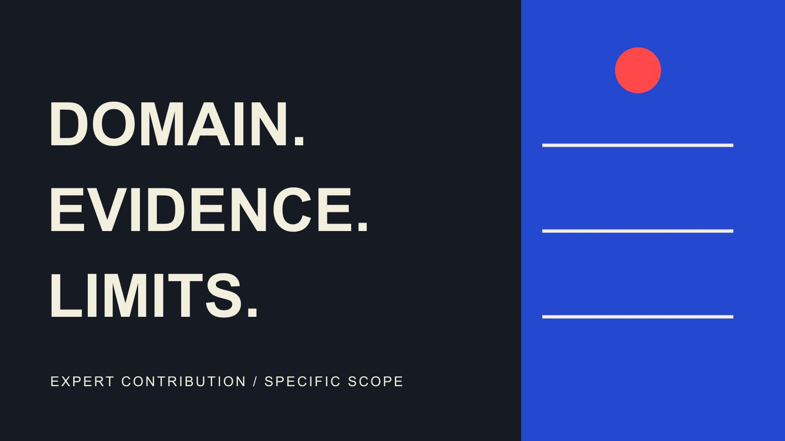

# Key Opinion Leader：如何核对专家贡献的适用范围

状态：本地审阅稿；正式发布日期待确认。

把 Key Opinion Leader 的专家身份拆成可核对的领域、经历、作品与主张范围，明确品牌想请其解释什么，以及哪些结论仍缺证据。

QuickKOL 编辑图形；不呈现真实账号指标或平台界面。

Key opinion leader 常译为关键意见领袖，品牌可以用它描述在相关领域对某类人群有影响的人，但这个称呼不自动证明专业资格或所有主张。核对一位候选者时，应把身份、领域、具体工作与本次结论分开，检查证据支持到哪里。过去经历和良好表达可以提供线索，不能代替产品事实、当前条件或必要的独立核验。

## 从一个需要解释的问题开始

不要先问谁是行业最有名的专家。先写清目标读者、要理解的问题，以及品牌希望得到哪种贡献。解释概念、演示实际操作、讨论研究和对产品作广泛结论，需要的工作与依据可能不同。

[KOL 证据分工指南](/zh/blog/kols-expertise-evidence-panel/#answer)讨论如何组合不同贡献。本篇把视角收窄到一位候选者：其背景与作品，能否支持本次需要的那段解释？影响力相关，不代表专业领域完全相同；一位熟悉制作过程的人，可能适合解释步骤，却不一定适合验证所有性能或市场主张。

把任务写成可讨论问题，例如“说明这套设备在已确认条件下怎样维护”。这是假设任务，不是具体产品建议。范围清楚后，研究员才能知道需要哪些经历、作品与输入，而不是从一份很长的头衔列表中猜测本次为什么选择这个人。

## 把身份、经历与当前角色分开

保存公开账号、稳定标识、本人介绍和适当的一方关联。一个名字相同的网页，不一定属于同一人；过去任职也不自动代表当前仍以该机构身份发言。对重要事实记录来源、观察日和核对状态。

[身份与品牌安全指南](/zh/blog/verify-creator-brand-safety/#answer)适合把主体与作品连接起来。若本次确实需要资格、机构关系或某项经历，由适当渠道核对必要事实；不因为头衔看起来正式就省略，也不为普通内容研究收集无关私人资料。

对“在某公司做过项目”这类说法，保存其具体范围。曾经参与、独立负责与代表机构审核不是同一种贡献。后续邀请可以问与任务相关的一个问题，而不是要求对方交出所有客户合同。资料不能公开时，保留限制并讨论其他合适证据，不把未共享自动解释为缺乏能力或故意隐瞒。

## 公开身份应同时保留专业边界

[Lab Muffin 官方介绍](https://labmuffin.com/about-michelle/)将 Michelle Wong 描述为化学博士与科学传播者，并明确说明自己不是医疗专业人士。这个一方例子说明，公开专业介绍可能同时包含能力与边界；不能只摘下头衔，删掉限制，再把它扩写成其他职业资格。

本文不据此作独立资格认证、合作背书或当前档期判断。[美妆主张研究指南](/zh/blog/top-beauty-influencers-claims-review/#answer)可以进一步讨论体验、技巧与产品结论。本篇的研究方法是保存来源实际说了什么，以及它没有说什么，而不是利用一个具名人物证明所有专家合作有效。

同样的原则适用于技术、教育和其他领域。工程经验、教学能力与采购决策支持可能互相关联，但不是同一种证据。候选者主动指出不适合回答的问题，可能帮助缩小工作范围；品牌不应要求其为了提案看起来完整，接受超出自己可支持范围的结论。

## 读懂记录是谁添加的

研究型候选者可能提供 ORCID 等公开记录；它可以帮助关联身份与学术工作，但不是所有商业 KOL 都需要拥有。也不能看到一个标识，就认为其中每个字段均经过独立审核。

[ORCID 来源说明](https://info.orcid.org/ufaqs/what-does-source-mean-in-an-orcid-record/)把 source 解释为添加某条记录的主体，并区分来源与断言的形成过程。这提醒研究员看条目具体由谁添加、描述什么，而不是仅凭资料所在平台判断全部内容已经核实。自己填报、机构添加和原始工作分别保留，不混成一个“已认证”状态。

对于非研究岗位，采用实际合适来源，例如相关作品、机构公开介绍或必要的直接确认。没有 ORCID 不代表没有专业贡献；有 ORCID 也不能代替本次任务适配。证据选择由问题决定，避免为了统一表格，让所有不同领域候选者提供同一种不适用文件。

## 让专业背景连接到具体主张

把拟定脚本中的重要结论单独列出，写清对象、条件、依据与负责核对的人。专家能够解释证据，不意味着其出现就替品牌完成全部证明。个人体验、某次实验、公开研究与对未来的推断，需要不同表述。

假设一位材料工程讲解者解释实验室样品的测试过程。这个情景不证明所有量产产品在每种环境都得到相同结果。品牌需要提供实际样品、条件与结果的关系，候选者也应有机会说明数据支持到哪里，而不是只被要求把结论讲得更有信心。

若无法支持一个强主张，可以缩小为准确的方法解释、标出未知或暂不采用。增加名人身份不会修复证据缺口，复制更多参考链接也不能让不相关资料产生支持。审阅应能指出哪一句话依赖什么，而不是在整份脚本顶部放一个“专家参与”标签。

## 商业关系不改变证据要求

邀请时说清任务、报酬、产品支持、内容与发布安排。不要把付费专家说明包装成没有商业关系的独立评价，也不把对方接受一项工作解释成长期代言全部产品。实际关系应保留到最终呈现中。

[FTC 背书问答](https://www.ftc.gov/business-guidance/resources/ftcs-endorsement-guides-what-people-are-asking)在美国背景下说明，专家在非传统广告场景推广相关产品，也需要适当披露连接。这个来源不能替具体项目确认所有地区要求，但能提醒品牌不要用专业头衔掩盖关系。其他市场与形式按实际适用条件核对。

允许贡献者指出证据不足或提出不同解释，并安排谁处理事实争议。报酬可以购买时间和明确工作，不应该被理解为购买任何结论。若品牌要求的表述超出可支持范围，调整任务、补资料或不继续，比把一个未解决问题藏进脚本更能形成可用内容。

## 先讨论方法，再索取定制结论

[专家访谈 Brief](/zh/blog/influencer-expert-interview-brief/#answer) 有助于安排问题、材料与审阅。初次沟通可以询问如何拆解本次问题、需要哪些输入、不能支持哪些说法，以及大致工作安排。若要实际分析、制作或输出可用样片，先确认范围与报酬。

不要让候选人在没有材料和条件时，对全部产品作即时判断。给其足够上下文，也允许其说需要更多核对。过去公开讲过相似概念，是相关线索，不代表可以不经准备地完成新任务。

把讨论结果写回[达人名单工作流](/zh/blog/creator-shortlist-workflow/#answer)，保留适配理由、未满足条件和下一问题。候选阶段不必制造通过或失败的绝对结论。比如可解释原理、待取得新版本资料，比“专家已核验”更准确，也能指导内部同事把还缺的输入准备好。

## 交接的是贡献范围，不是万能专家标签

最终交接应包含本次问题、选择理由、可支持贡献、输入、审阅、关系与未解决事项。也给范围决定保存日期。产品版本或问题改变时，回到原证据核对，而不把旧稿里的专家参与自动当成对新结论的批准。

给素材和结论保存版本；候选者只核对了自己参与的部分，不写成全项目独立审核人。品牌内部也应清楚承担哪些产品事实责任。

复盘时看任务是否得到准确解释、哪些问题仍未解决，以及下一轮需要补充资料还是不同贡献。观看与互动可以描述分发，不能单独证明专业结论或因果业务效果。不要因为内容传播好，就扩大原来头衔与证据的适用范围。

QuickKOL 可帮助品牌理解问题、发现相关创作者并研究作品与联系路径。Key opinion leader 是否适合，仍需将实际领域、具体贡献和证据连在一起。清楚的边界不会削弱专业价值，反而能让品牌知道为什么邀请此人，以及下一位同事可以负责任地引用哪一部分工作。

## 专家贡献范围核验表

| 维度 | 核对 | 不自动推导 |

| --- | --- | --- |

| 身份与当前角色 | 主体、来源、日期与关系 | 所有历史头衔仍有效 |

| 专业领域 | 相关经历、作品与明确边界 | 相邻专业全部具备资格 |

| 具体主张 | 对象、条件与证据 | 专家出现即完成产品验证 |

| 商业与审阅 | 关系、任务、版本与负责范围 | 付款可购买任何结论 |

品牌侧研究方法，不是资格认证、医疗建议或具名人物背书。

## 邀请专家前的范围检查

每项重要判断都能回到实际依据。

- [ ] 先定义需要解释的问题与读者。

- [ ] 当前身份与过去经历分别记录。

- [ ] 公开来源的能力与限制一起保存。

- [ ] 分清本人陈述、机构记录与原始工作。

- [ ] 具体主张与实际证据对应。

- [ ] 任务、报酬、关系与审阅范围清楚。

## 研究日期与使用边界

资料核验于 2026 年 10 月 30 日。文中方法、表格和决策规则为编辑建议，标为假设的示例不是实际客户结果或行业基准。外部资料的适用地区与时期按各段说明；本稿处于独立本地审阅阶段，正式发布日期待确认。

## 来源

- [Lab Muffin：About Michelle](https://labmuffin.com/about-michelle/)

- [ORCID：What does Source mean in an ORCID record?](https://info.orcid.org/ufaqs/what-does-source-mean-in-an-orcid-record/)

- [FTC：Endorsement Guides 问答（美国）](https://www.ftc.gov/business-guidance/resources/ftcs-endorsement-guides-what-people-are-asking)
