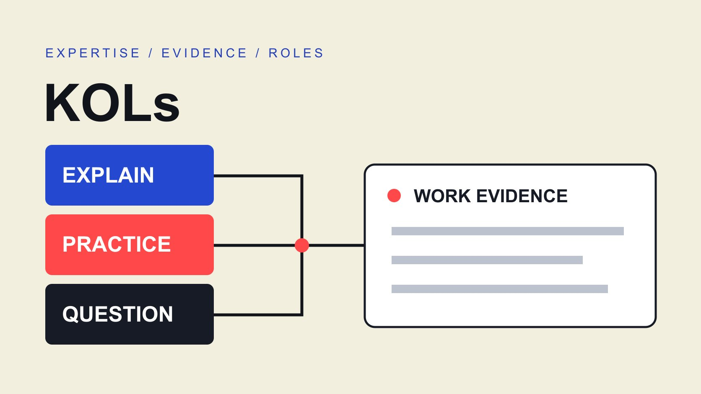

# KOLs 怎么选：为专业内容建立证据分工

状态：本地审阅稿；正式发布日期待确认。

按专业问题、工作证据和解释能力选择 KOL，建立互补的内容证据分工，而不是把头衔或粉丝数当作资格。

QuickKOL 编辑图形；不呈现真实账号指标或平台界面。

KOLs 是 key opinion leaders 的复数，通常译为关键意见领袖。品牌研究中，可以把它理解为在特定领域对相关人群的判断有影响的人，但这不是统一执照、平台认证或销售保证。本篇建议先确定需要解释的问题，再按证据选择解释者、实践者和提问者；一个人可以承担多个角色，但每项贡献仍需单独核对。

## 先定义需要影响的判断

不要从“找五位 KOL”开始。先写下谁在什么情境中，需要弄清哪一个问题。软件采购者可能想知道迁移时如何保留既有流程；消费品牌的顾客可能需要看懂清洁与维护。两种问题都可以需要专业解释，却不需要同一种人物或相同规模的受众。

[AMA 达人营销说明](https://www.ama.org/topics/influencer-marketing/)把重点放在能够影响潜在购买者的人，以及围绕他们组织品牌信息。这支持先考虑相关人群与信息任务，并不提供一个通用的 KOL 粉丝门槛。本篇的角色分工是编辑方法，不是该协会认证的分类。

把问题写成能够检查的句子，例如“看完后，读者能够列出迁移前要向供应商问的三个条件”。这里的三个是假设任务要求，不是行业标准。明确不需要承诺什么也有帮助：解释迁移风险，不等于保证每个项目节省费用。

## 把证据分给不同角色

解释者帮助读者理解概念、取舍和限制；实践者展示真实工作中的步骤与约束；提问者从目标人群角度指出容易误会的地方。这三种角色可以由一位创作者承担，也可以组合多位，不需要为了凑人数强行拆分。

[达人内容角色指南](/zh/blog/influencers-buyer-stage-roles/#answer)讨论客户阶段中的内容职责。本篇的证据分工进一步问：哪一个人能够支持哪一段解释？研究名单不只保存职业名称，还要保存相关作品、其实际贡献以及支持任务的理由。实践者有操作经验，不代表能够概括全部行业；讲解清晰，也不自动证明亲自做过本次任务。

假设一场设备培训邀请一位技术解释者和一位现场使用者。前者说明适用条件，后者展示已被允许分享的使用步骤；主持人提出新手问题。这是假设设计，不是真实客户案例。品牌仍负责核对产品事实和适用限制，不把团队中的任何一位写成对全部内容提供了独立认证。

## 为每个角色收集直接相关的作品

从公开作品中寻找相似问题，而不只收集最受欢迎的帖子。记下作品地址、日期、对象、创作者做了什么，以及它能证明哪种能力。一段清楚讲解基础概念的视频，可以支持解释角色；它不能自动证明持有专业资格或掌握最新产品。

[达人名单工作流](/zh/blog/creator-shortlist-workflow/#answer)适合保存这些字段。若任务确实要求资格或机构关系，应到适当的一方公开渠道核对，并记录核对的内容和日期。网站上的过去任职介绍不能直接变成当前头衔；名字相同也不能说明是同一个人。

初筛不需要收集私人资料。使用必要的公开商业联系；缺少决定性证据时提出一个具体问题，例如能否分享与本次任务类似的公开工作。没有可共享案例可以保留为未知，不直接判断对方没有能力。研究员需要清楚区分“看见了相关解释”“本人确认了经历”和“独立核对了某项资格”。

## 用一段试讲检查解释能力

把同一段任务说明交给候选者，请其建议解释顺序、所需输入和不愿作出的主张。初步讨论可以很短；如果要求制作可使用的定制样片，应先谈清工作范围与报酬，不把采购过程变成免费索稿。

审阅时看事实是否连贯、术语是否适合读者，以及能否把不知道的条件明确说出来。让对方指出一个可能被误解的句子，比只问“是否专业”更容易得到有效信息。不能因为讲解者愿意照读脚本，就认定内容可信。

[专家访谈 Brief](/zh/blog/influencer-expert-interview-brief/#answer) 可帮助安排提问、资料和审批。提前说明是否允许表达限制或不同意见；商业合作不应要求把一个受条件影响的结论写成无条件推荐。品牌如果尚不能提供测试环境、规格或必要文件，就先解决输入缺口，不要求创作者靠个人声誉填补。

## 分别确认报酬、关系与披露

在邀请阶段说清品牌希望购买的是访谈时间、制作、发布，还是其他具体工作。按销售结算、产品赠送与固定费用是不同安排，不能因为使用 KOL 一词就省略合作条件。对方与竞争品牌、雇主或机构的关系，也可能影响其能否接受任务。

[FTC 背书问答](https://www.ftc.gov/business-guidance/resources/ftcs-endorsement-guides-what-people-are-asking)在美国广告背景下强调真实、不误导的背书以及适当披露重要关系；专家身份本身不让商业关系消失。本篇据此提醒团队把关系核对作为工作事项，而不是替任何具体人物作法律判断。

为每项关系记录待确认问题和负责人，尊重必要范围，不索取无关私人合同。品牌还需要按本次市场与平台确认实际要求。披露安排应保留到最终素材和发布检查中，不只存在于付款邮件。编辑审核和商业确认可以由不同人员负责，但需要有人检查最终版本是否仍准确表达了双方同意的条件。

## 让审核意见对应到实际版本

给脚本和素材保存版本、日期和修改原因。把产品事实、个人体验与编辑解释分开标记；当创作者只核对了自己参与的部分，不把其名字写成整篇审核人。品牌批准排期，也不等于技术审核已完成。

以假设的软件演示为例：产品负责人核对功能条件，实践者核对自己演示的步骤，编辑检查字幕是否误解原话。若画面后来换成另一个版本，原先的确认不能自动覆盖新内容。需要补审的是受改动影响的部分，而不是机械地重新询问所有人。

安排一个收口人处理冲突：当两位贡献者对适用条件看法不同，先确认讨论的是同一版本和使用情境，再决定补证据、缩小表述或暂不发布。不要以职位高低或粉丝多少替代事实比较。让最后一位接手者能找到结论与原始材料之间的关系。

## 把使用许可与个人贡献分开

接受访谈不自动等于接受无限广告使用。确认引用、剪辑、字幕、翻译、投放渠道、地区和期限，并把不同版本的授权连接到对应素材。机构名称、第三方图表或音乐也可能涉及不同权利，不能认为出镜者能替所有材料授权。

[美国版权局版权说明](https://www.copyright.gov/what-is-copyright/)介绍美国对原创固定表达的保护以及许可、例外与限制的基本背景。这不意味着每种使用都必须取得同一种文件；具体用途仍需按适用情况处理。对需要协商的商业使用，保存清楚的同意范围，比只保存一个视频文件更有用。

[内容许可排期](/zh/blog/influencer-content-licensing-paid-media-schedule/#answer)可以连接渠道、版本与到期时间。把后续新增用途当作需要确认的改变，不从最初同意参加访谈推导零售伙伴、广告账户或其他市场均可使用。品牌也需要能说明停止使用的操作归谁负责，避免关系结束后素材仍在不明位置传播。

## 按解释成果复盘，而不只按热度

在发布前决定需要看什么。若任务是减少某类理解障碍，可以整理被回答的问题、仍存在的误会和需要补充的材料。观看与互动能描述分发，但不能单独证明读者理解了内容，更不能直接证明采购变化来自某位专家。

假设一场演示有六个预先列明的问题，成品清楚回答四个，两个因缺少输入保留待确认。记录的是该任务的覆盖情况，不是一个普遍的专家成功率。不要为了报告好看，把待确认改成已解决，或者将几位贡献者的全部粉丝相加当成独立触达人数。

下一轮决定可以是继续邀请同一人、补充一个不同角色、调整输入或停止某条内容路线。把决定与具体工作证据相连，并注明局限。QuickKOL 可帮助从 Brief 发现相关创作者并研究作品与联系路径；专家资格、贡献范围和商业条件仍须回到适当来源确认。

## KOL 证据角色分工表

| 角色 | 所需证据 | 不自动证明 |

| --- | --- | --- |

| 解释者 | 相似问题的清楚解释 | 全部领域资格 |

| 实践者 | 相关操作与实际贡献 | 所有产品均适用 |

| 提问者 | 理解读者任务与误会 | 目标受众的统计代表性 |

本表为编辑分工建议，不是平台或专业机构认证。

## 邀请前的证据检查

为本次任务保存能够支持决定的最少证据。

- [ ] 写明目标人群、问题与解释边界。

- [ ] 每个角色连接到相关作品和实际贡献。

- [ ] 把头衔、资格、观察和本人确认分开。

- [ ] 确认输入、报酬、披露与审阅责任。

- [ ] 让最终使用范围对应到素材版本。

- [ ] 按任务复盘，保留未知和下一决定。

## 研究日期与使用边界

资料核验于 2026 年 10 月 30 日。文中方法、表格和决策规则为编辑建议，标为假设的示例不是实际客户结果或行业基准。外部资料的适用地区与时期按各段说明；本稿处于独立本地审阅阶段，正式发布日期待确认。

## 来源

- [American Marketing Association：Influencer Marketing](https://www.ama.org/topics/influencer-marketing/)

- [FTC：Endorsement Guides 问答（美国）](https://www.ftc.gov/business-guidance/resources/ftcs-endorsement-guides-what-people-are-asking)

- [美国版权局：What is Copyright?](https://www.copyright.gov/what-is-copyright/)
