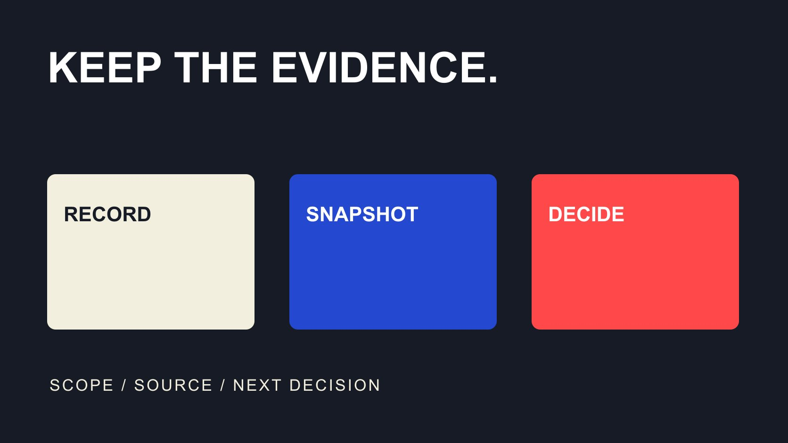

# Campaign 追踪步骤：从命名到复核的证据日志

状态：本地审阅稿；正式发布日期待确认。

用九个步骤把 Campaign 需求、链接、内容状态、数据快照与最终决定连成证据日志，让下一位同事能够复核。

QuickKOL 编辑图形；不呈现真实账号指标或平台界面。

追踪 Campaign 的可执行方法，是先定义要支持的决定与口径，建立活动、创作者和素材编号，测试实际链接与记录，再按约定窗口保存状态和数据快照，核对差异并交付结论。不要只保存一份不断被覆盖的总表。来源、时间、对象、版本和负责人一起保留，才能区分未完成、缺失、真实零值与后续修订。

## 第一步：定义追踪要支持的决定

先写本次 Campaign 要判断什么，例如是否完成准确演示、是否接到合适询问，或是否值得继续某类内容。不同问题对应不同证据，不应只因为工具能够展示某个数就把它设为目标。

[Campaign 衡量指南](/zh/blog/creator-campaign-measurement/#answer)可帮助选择目的和口径。为每个关键指标说明对象、单位、窗口、分子分母与来源，区分生产交付、分发和业务结果。观看不是订单，询问也不自动是合格机会；若任务需要后续确认，应把确认条件保留下来。

给记录安排接收人。知道谁会根据它作决定，才能选择真正需要的字段。初版可以很小，但必须允许未知，不把所有空白预设为零。团队应能解释下一次快照要检查什么、什么时候看，以及哪项证据会改变决定。

## 第二步：为活动、人员和素材建立编号

为活动、创作者、任务、素材和发布分别建立适当关联。一个人可以有多个账号，一份素材可以有多个裁切，同一活动也可能有不同市场。仅靠展示名称或文件名，后续容易把不同对象合并。

保存公开账号和必要标识，避免把私人信息写进共享链接。编号应稳定，名称可以另外更新；不要因为改了标题就失去与原始证据的关联。团队人数少，也需要说明哪一个编号对应哪个对象。

假设一位创作者交付两种画幅，只有一种用于发布。这个编辑情景需要关联一个人物、两个素材版本和一个实际发布记录，而不是笼统记作“两条内容已上线”。分开后，制作进度与分发状态才不会互相冒充。

## 第三步：统一来源命名并测试链接

为活动链接准备一致命名，并记录最终目标。[Google 来源标记说明](https://support.google.com/analytics/answer/11242870?hl=en)描述手动 UTM 如何提供来源、媒介和活动等维度；它不自动建立订单核验或佣金结算系统。先确定每个字段的含义，不让同一活动在不同人手里随意拼写。

[转化追踪指南](/zh/blog/track-influencer-conversions-ga4/#answer)可帮助连接访问与后续记录。使用获授权的实际测试，检查跳转、目标内容和必要采集，而不只看页面是否打开。若存在短链或其他中间跳转，确认最终记录是否仍保留预期条件。

保存测试日期、执行人、观察和未解决项。不要把真实客户的个人资料放进测试 URL，也不让第一次真实发布承担全部验证。链接通过测试，只说明所测路径当时可用；以后改了页面或规则，受影响部分仍需检查。

## 第四步：分别记录约定、交付与发布

[状态系统指南](/zh/blog/creator-campaign-status-system/#answer)可以帮助团队减少追问。把已讨论、已接受、制作中、待审、已交付与已发布区分，不要求每个项目使用同一套名字，但每个状态要有清楚含义。发出邀请不代表对方接受，收到文件不代表已经发布。

记录状态变化的时间、依据和负责人。实际发布应能回到相应账号、地址、版本和观察日；不能只依据排期推断。临时取消或替换时，保留原因和处理决定，不把原计划悄悄改写成从未发生变化。

对未完成项安排具体下一步。比如等品牌提供输入，与等创作者制作，是不同责任。一个统称的“进行中”会隐藏这些差别。记录不是为了制造更多审批，而是让有权处理的人看见真实依赖，知道应该补资料、改排期还是继续。

## 第五步：按对象和窗口保存快照

为每次数据观察记录账号或内容、指标、时间范围、时区、采集时间、来源和筛选条件。不要只截图一个没有上下文的数字。相同名称的指标，也可能因对象和窗口不同而不能直接比较。

[YouTube 高级分析说明](https://support.google.com/youtube/answer/9717005?hl=en)介绍按内容、日期、指标和筛选查看及导出报告，并提示界面更新。需要授权或由创作者提供的报告，应保留实际视图条件；公开可见的数据与私有分析不能混称成同一种访问。导出能力也不保证任何品牌能取得任意账号资料。

下方中英文 CSV 日志提供这些字段。每行可记录一项观察，未知保留状态，不使用同一单元格同时表示平台估计、手工观察和已确认业务结果。[数据口径指南](/zh/blog/creator-metric-definitions/#answer)可帮助统一定义，必要时给字段附一个简短说明。

## 第六步：把处理延迟与真实变化分开

[Google 数据新鲜度说明](https://support.google.com/analytics/answer/11198161?hl=en)指出，处理可能需要 24–48 小时，期间报告会变化，也说明典型可用时间并非服务保证。这个范围不是所有指标在四十八小时后永不变化的承诺，更不能把不同平台的更新节奏合并成一个统一截止点。

保存早期观察时标明阶段，后续更新另存快照与原因。不要把当天初步数与另一篇内容较成熟的累计数直接比较。若同一个窗口的数据发生修订，记录新采集时间，而不是抹掉原来那份曾用于决定的观察。

团队可以根据本次任务安排复核时点，但应说明是工作安排，不是平台硬规则。等待、数据受限、真实观察为零与采集失败分别处理。先确认哪一种情况发生，再决定是否补资料、重新取得报告或暂停解释。

## 第七步：核对差异，不强行让总数一致

先检查对象、窗口、时区、筛选和状态，再讨论某个总数为什么不同。访问、独立人、观看、订单和合格机会不是同一个单位。跨平台人数不能直接相加成独立触达，不同归因口径也不能仅因数字不一致就认定错误。

假设两个报告分别记录十次申请和八个已核验询问。这个算例不说明漏了两个人；可能两条仍待核对，或者口径不同。保存相应条件和标识，再由负责人员确认，不能为了图表好看把八改成十。

为差异留类别与下一动作，例如定义不一致、记录待处理或需要技术调查。只处理会影响决定的差异，不为追求表面完美无限追查无关小数。若暂时无法解释，结论应保留局限，并明确哪些决定还能作、哪些需要等待。

## 第八步：把证据连接到下一决定

[报告决策备忘录](/zh/blog/influencer-reporting-decision-memo-and-evidence/#answer)可帮助把结论、依据、局限和建议放在一起。说明本次完成了什么、观察到什么、什么仍不清楚，以及下一轮为什么继续、调整或停止。不要把完成追踪本身当成活动有效的证明。

区分事实与推断。例如已交付合适演示是验收事实，客户常问一个问题是观察，建议增加说明是编辑判断。它们都可以有价值，但不能被改名为已经证明销售增长。

引用日志中的具体记录与版本，让接收者能追溯到对应快照。若建议依赖一条仍待核对的数据，应先说明；若补充信息可能改变决定，也写明条件。报告不必堆满全部字段，只需要把足以支持决定的证据与限制清楚连接。

## 第九步：关闭任务但保留必要更新路径

结束时确认最终版本、未解决项、费用或许可事项的适当负责人，以及后续更正由谁处理。资料保留与访问按实际安排执行，不把整个共享盘无限开放，也不因项目结束就让必要证据失去去向。

把日志、关键快照和备忘录交给明确接收者，并说明哪些是历史观察。新窗口的数据不能悄悄覆盖旧报告；需要实质更新时保留版本和原因。若某内容下线，记录观察和影响，不根据页面消失就推断此前结果从未存在。

QuickKOL 可协助理解 Brief、研究创作者和准备联系；平台数据、订单与业务结果仍需在实际来源核对。一个 step by step way to track campaigns 的价值，在于让每一步都有对象、证据和下一动作，而不是多保存一些无法复核的总数。

## Campaign 证据日志的关键字段

| 字段组 | 包含 | 防止 |

| --- | --- | --- |

| 对象 | 活动、创作者、素材与发布编号 | 把不同对象合并 |

| 口径 | 指标、单位、窗口、时区与筛选 | 把不可比数据直接比较 |

| 证据 | 来源、采集时间、文件引用与版本 | 无法追溯修订 |

| 动作 | 状态、负责人、下一问题与决定 | 只记录数字却无人处理 |

编辑工作字段；按实际项目选用，模板不是平台数据自动连接。

## Campaign 证据日志模板

每行记录一次带对象和条件的观察；空白保持待填写，不代表零。

- [ ] 先有决定和口径，再建报表。

- [ ] 标识能连接人、素材与发布。

- [ ] 链接测试保留实际观察。

- [ ] 状态和数据快照分开。

- [ ] 差异、修订和未知有原因。

- [ ] 交接下一决定及未完成项。

[下载中文证据日志（CSV）](/downloads/campaign-evidence-log.zh.csv)

[下载英文证据日志（CSV）](/downloads/campaign-evidence-log.en.csv)

## 研究日期与使用边界

资料核验于 2026 年 10 月 30 日。文中方法、表格和决策规则为编辑建议，标为假设的示例不是实际客户结果或行业基准。外部资料的适用地区与时期按各段说明；本稿处于独立本地审阅阶段，正式发布日期待确认。

## 来源

- [Google Analytics：Traffic-source dimensions and tagging](https://support.google.com/analytics/answer/11242870?hl=en)

- [YouTube：Learn how to use Advanced mode](https://support.google.com/youtube/answer/9717005?hl=en)

- [Google Analytics：Data freshness](https://support.google.com/analytics/answer/11198161?hl=en)
