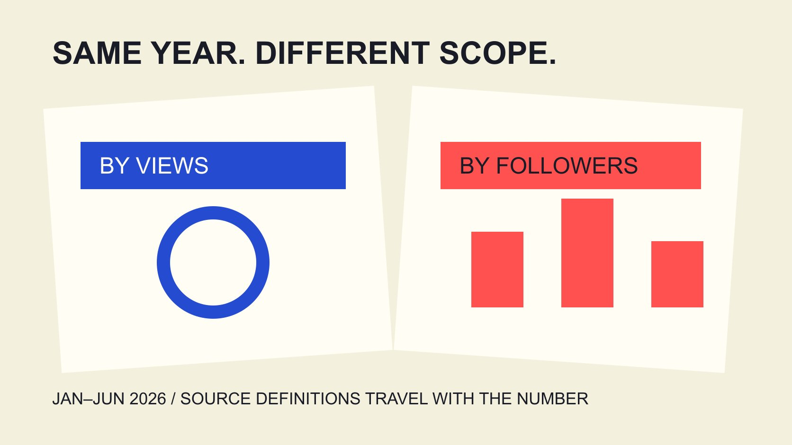

# Beauty Engagement Statistics 2026: Keep Platform Scope

Status: local review draft; confirm the publication date before release.

Before quoting 2026 beauty engagement statistics, check observation period, brand sample, platform and denominator. Use traceable numbers without turning platform differences into an ad ranking.

QuickKOL editorial graphic; not actual account metrics or a platform interface.

Beauty industry social media engagement statistics for 2026 need their sample and definition, not one percentage applied across platforms. The Dash Social 2026 Issue 2 beauty report observes January 1 through June 30, 2026, for global company accounts. It reports beauty TikTok engagement at 3.7% by views and Instagram at 0.3% by followers. Different denominators prevent a direct effectiveness comparison. These are not full-year 2026 results, creator-account benchmarks or pure paid-ad benchmarks. This guide explains how to quote the figures in a brand report, retain missing fields and handle apparent disagreement with another publication. The useful output is an accurately bounded statement rather than a universal target.

## Write report year and observation period together

The [Dash Social 2026 beauty report](https://pages.dashsocial.com/hubfs/social-media-benchmark/2026/H2/beauty-industry.pdf), Issue 2, observes the first half of 2026. H2 in a file path is an organizational clue, not independent evidence that its observations concern second-half activity.

Put the dates in the quotation sentence so readers know which seasons, launches and campaigns might fall inside the window. Publication during 2026 does not establish complete coverage of that year or performance in its remaining months.

The research date is November 3, 2026. Do not fill an absent full-year result merely because the keyword contains 2026. An explicit observed-through date makes a later update intelligible.

Retain source file, edition, page and reading date. When a publisher replaces an edition, preserve the earlier record and first determine whether its observation window changed. Only then decide what to revise in the article or internal report. That preserves the difference between a new observation and a correction to an earlier statement.

## A brand sample is not every beauty creator

The report describes global company accounts with a minimum follower threshold. Brand and individual creator accounts can differ in content purpose, publishing behavior and audience relationship. A company result should not be renamed a beauty-creator standard.

The platform-wide sample size is also not automatically the beauty subgroup size. Mark industry-specific sample size as reported or unavailable rather than copy an all-industry count into the beauty column.

Geography matters in the same way. Global is not a separate result for the Philippines, Germany or one local city. For a market-specific assignment, establish whether matching observations actually exist instead of deriving a local average from the global table.

A report can inform a budget conversation without establishing what one account should achieve. Where a comparable sample is missing, describe reference value and limits. A precise-looking threshold cannot repair the absence of relevant observations, and a narrower honest statement gives the next analyst a clearer research task.

## Quote two figures while preserving two denominators

This guide retains two published values: beauty TikTok at 3.7% by views and beauty Instagram at 0.3% by followers. They come from different platform tables in the same edition, with definitions and notes that must remain attached.

The [engagement-definition guide](/blog/engagement-rate-denominators/#answer) explains why views, reach, impressions and followers are not interchangeable. Even when both labels say engagement rate, the ratios may describe different opportunities for audience behavior.

Do not divide 3.7 by 0.3 and claim TikTok is about twelve times more effective than Instagram. That arithmetic ignores denominator, included interactions and distribution context, while measuring neither orders nor profit.

A suitable sentence says that, in this report and window, the platforms show these beauty-brand reference values under their respective definitions. They support questions rather than independently justify a budget transfer. Keeping the definition in the sentence also reduces the risk of someone extracting the percentage into a presentation where the explanatory footnote is lost.

## Separate content statistics from advertising scope

The publisher describes data including organic, boosted and promoted content while excluding paid ads. Preserve those categories as the source defines them rather than replace them with an assumed internal channel taxonomy.

The figures should therefore not become the average engagement rate for beauty Instagram ads. Nor should the source be described as entirely free of paid influence. Read a provider’s classifications under its own definitions.

The [2025 ad-statistic scope guide](/blog/beauty-instagram-ads-engagement-2025-scope/#answer) develops the same boundary problem. For an advertising budget benchmark, seek paid observations matching objective, placement, geography and window instead of relabeling an organic or mixed-content table.

When a colleague asks what an ad should achieve, first explain the statement this source supports and list fields still needed for the advertising decision. Acknowledging a mismatch is more useful than supplying an inapplicable target. It also prevents a later result being judged against an expectation that was never measured for the relevant delivery context.

## When another report differs, inspect method before choosing a number

The [Emplifi North America beauty scope](https://emplifi.io/resources/q3-2026-beauty-north-america-benchmarks/) uses different scopes across tables: North American organic profiles, worldwide fallback for engagement and impression observations, and paid metrics from advertising accounts. They are not one uniform geographic sample.

A report title therefore cannot replace each table’s method note. Disagreement with Dash Social may involve window, population, denominator, aggregation or source rather than establish that one publisher is wrong.

Turn the difference into comparison questions: whom, when, which actions, divided by what and aggregated how? Without sufficient fields, avoid forced conversion and do not select whichever value makes a proposal look best as the sole industry fact.

We have logged into no supplier system or exported client records. Reading a public report is not independent certification of every underlying observation, vendor quality or predictive ability. A comparison note should state the limits of the comparison itself rather than make the absence of matching documentation disappear behind a confident average.

## Retain the aggregation rather than only the percent sign

The [Rival IQ engagement-rate guide](https://help.rivaliq.com/en/articles/2043672-understanding-engagement-rates) gives that product’s calculation context, not a replacement for Dash Social’s method.

A median across accounts, mean of post-level ratios and total interactions divided by total denominator can produce different results. The [metric-record guide](/blog/engagement-rate-formula-metric-contract/#answer) recommends keeping aggregation in the record and marking it unavailable when not supplied.

Suppose two posts have ten interactions from one hundred views and one hundred from ten thousand views. Their mean post rate is 5.5%; the pooled rate is 110 divided by 10,100, about 1.09%. These are teaching inputs, not beauty-industry observations.

The example shows why a percentage cannot recover original totals or support arbitrary conversion between aggregation methods. Without denominators and weights, one final average cannot reconstruct another ratio.

When wording is unclear, retain the actual source label and an outstanding question instead of inventing calculation details for the publisher. Preserved uncertainty makes the next data request more specific. It is better to ask for the missing aggregation than to write a familiar method into the report merely because it would make comparison easier.

## Do not turn an annual difference directly into its cause

Before comparing 2025 and 2026, establish whether editions and definitions match. Included actions, sample entries and exits, platform counting changes and content composition can all affect a table.

A difference between two percentages does not by itself show that AI content, short video or a skincare theme caused the change. That explanation needs an appropriate design, data and more specific evidence.

Separate a trend statement into observed values, comparability limits, possible explanations and next verification. Mark a possible explanation as a research question rather than fact simply because it fits a popular market narrative.

Even one publisher’s notes for a concept can change. Preserve and check the original definitions instead of hiding inconsistency to create a smooth year-on-year chart. If necessary, present observations separately without suggesting a continuous series. This is particularly important where a report is republished by teams who may never inspect the underlying tables and could mistake a visual connection for a demonstrated statistical relationship.

## Use statistics in a decision without substituting for an objective

The [campaign-measurement guide](/blog/creator-campaign-measurement/#answer) separates outputs and business outcomes. Industry engagement references can inform discussion of content response without independently setting sales goals, profit requirements or collaboration budgets.

Begin with the business question and select an appropriate measure. To understand launch questions, examine the specific questions in comments. For paid acquisition, use matching advertising and downstream conversion records.

An unmatched industry statistic can remain background while comparable internal history supports a working hypothesis. That hypothesis is not an industry guarantee; retain window, population and conditions that could change the judgment.

This use of evidence supports discussion without requiring every market, creator type and budget to achieve one percentage the source never promised. It gives a planning team a way to explain both what informed its expectation and what evidence will be needed before treating that expectation as an observed result.

## Hand off a statistic sentence that stands on its own

A final quotation should retain source edition, observation dates, platform, population, rate definition and material exclusions. If the sentence becomes unwieldy, add an adjacent scope note rather than rely on a generic source list at the end.

Retain page link, relevant page number and unavailable fields. For example, a presentation heading that says only 2026 beauty industry average needs the brand-account population, first-half window and relevant platform definition added. If those limits do not fit, do not put the two percentages into an unqualified ranking chart. A reader should discover the comparison limit from adjacent text rather than need to contact the researcher after making an incorrect interpretation. Editing the heading is part of preserving the statistic, not an optional layer of presentation polish. Do not let the short label 2026 beauty engagement rate erase the actual brand, first-half and denominator limits.

QuickKOL can help research relevant creators’ work and content assignments. Industry statistics still require interpretation against original evidence. Establish what one number means before deciding what it suggests for your project.

## Quotable 2026 reference values

| Platform | Reported value | Required scope |

| --- | --- | --- |

| TikTok beauty | 3.7%, view-based | First-half 2026, global company accounts; not creator or paid-ad benchmark |

| Instagram beauty | 0.3%, follower-based | Same edition, different denominator; no direct platform-efficiency comparison |

Dash Social 2026 Issue 2 beauty report, printed pages 13 and 24; observed January 1–June 30, 2026. Categories and exclusions are explained in the text.

## Scope checks before quotation

An editorial quotation checklist, not an industry-target calculator.

- [ ] Separate report year and observation period.

- [ ] Do not interchange brands, creators and regions.

- [ ] Trace denominator and included interactions.

- [ ] Mark aggregation unknown when unavailable.

- [ ] Do not rename platform-wide N as industry subgroup N.

- [ ] Do not infer cause or rank efficiency without evidence.

## Research date and limitations

Sources reviewed November 3, 2026. Methods, tables and decision rules are editorial recommendations. Hypothetical examples are not actual client results or industry benchmarks. Source geography and periods are specified where relevant. This draft is in independent local review; confirm its publication date before release.

## Sources

- [Dash Social 2026 beauty report](https://pages.dashsocial.com/hubfs/social-media-benchmark/2026/H2/beauty-industry.pdf)

- [Emplifi North America beauty scope](https://emplifi.io/resources/q3-2026-beauty-north-america-benchmarks/)

- [Rival IQ engagement-rate guide](https://help.rivaliq.com/en/articles/2043672-understanding-engagement-rates)
