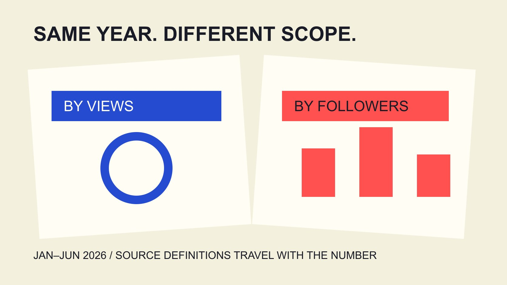

# 2026美妆互动统计：看清平台与样本

状态：本地审阅稿；正式发布日期待确认。

引用2026美妆互动统计前，先核对观察期、品牌样本、平台与分母。提供可溯源数字，不把跨平台差异写成投放优劣。

QuickKOL 编辑图形；不呈现真实账号指标或平台界面。

2026美妆行业互动率需要连同样本与定义引用，而不是寻找一个适用所有社交平台的百分比。Dash Social 2026 Issue 2美妆报告观察2026年1月1日至6月30日的全球公司账号，给出TikTok美妆按观看口径3.7%，Instagram美妆按粉丝口径0.3%。两者分母不同，不能直接比较谁更有效；这也不是全年2026、达人账号或纯付费广告基准。以下解释如何把这些数字写进品牌报告，哪些字段仍缺失，以及如何处理其他报告看似矛盾的结果。

## 把报告年份与观察期同时写出来

[Dash Social 2026美妆报告](https://pages.dashsocial.com/hubfs/social-media-benchmark/2026/H2/beauty-industry.pdf)的Issue 2观察2026年上半年。版本名称中的H2是文件组织线索，不能自行写成下半年的活动表现。

引用句直接写日期，读者才知道哪些季节、产品发布与活动可能落在窗口内。报告于2026年发布，不等于完整覆盖这一年，更不代表未来剩余月份的表现。

当前日期为2026年11月3日。没有完整全年数据时，不为了关键词里的2026而补齐不存在的全年结果。保留“截至哪个窗口”的表达，能让资料之后被正确更新。

记录原文件、版本、页码和读取日期。来源换版时保留先前记录，先判断观察窗口改变，再决定是否需要修改文章或内部报告。

## 品牌样本不是所有美妆创作者

报告描述全球公司账号及最低粉丝门槛。品牌与个人创作者的内容目的、发帖方式和受众关系可能不同，不应把品牌数值改称美妆达人标准。

文件中的平台总样本量也不能默认是美妆子样本量。品牌团队应把行业专属样本量记为已报告或未取得，而不是把整份跨行业数量填入美妆列。

地域同样重要。“全球”不是菲律宾、德国或某个本地城市的单独结果。若项目面向特定市场，先问对应数据是否实际存在，不从全球表格推导当地平均。

一份报告可以为预算讨论提供背景，但不足以证明某个账号应该达到同样水平。缺少相似样本时，说明参考价值与局限，不用看似精确的阈值代替判断。

## 引用两个数字，保留两个分母

本篇保留报告中的两个值：TikTok美妆按观看口径3.7%，Instagram美妆按粉丝口径0.3%。它们属于同一版报告中的不同平台表，不能抹去各自脚注与定义。

[互动率口径指南](/zh/blog/engagement-rate-denominators/#answer)解释为什么观看、触达、展示与粉丝不互换。即使都写engagement rate，所描述的比例也可能不是同一种观众行为机会。

不要用3.7除以0.3宣称TikTok比Instagram有效约12倍。这个运算忽略分母、互动组成与分发环境，也没有测量订单或利润。

正确写法可以是：在上述报告与窗口中，两平台按各自定义呈现这些美妆品牌参考值；它们帮助提出问题，不是跨平台预算转移的独立证据。

## 区分自然内容与广告统计边界

该出版方描述其数据包括organic、boosted与promoted内容，同时排除paid ads。按原资料保留这些类别，不将自己的渠道分类强行替换成它的统计口径。

因此不能把这两个值称作美妆Instagram广告平均互动率，也不该写成所有内容都完全没有付费影响。一个来源的分类要按它的定义读取。

[2025广告统计边界指南](/zh/blog/beauty-instagram-ads-engagement-2025-scope/#answer)讨论相似问题。寻找广告预算基准时，应另取匹配广告目标、版位、地域与窗口的付费数据，而不是把自然或混合内容表重新贴标签。

若商务同事问“广告要做到多少”，先回答手头这份来源能支持哪一种描述，再列出为广告决策仍需补充的字段。承认来源不匹配，比给出不适用的确定目标更有用。

## 另一个报告不同，先查方法而不是挑高值

[Emplifi北美美妆范围说明](https://emplifi.io/resources/q3-2026-beauty-north-america-benchmarks/)在不同表格中使用不同范围：北美自然账号、互动与展示相关的全球回退，以及广告账户的付费指标，不能把所有表视作同一个地区样本。

这说明报告标题无法替代每张表的方法说明。一个数字与Dash Social不一致，可能涉及窗口、样本、分母、汇总方式或数据来源，而不是其中一个必定错误。

把差异写成对照问题：观察谁、何时、哪种动作、除以什么、如何汇总。没有足够字段时不做强行换算，也不挑最有利于提案的值充当唯一行业事实。

本篇没有登录供应商系统或导出客户数据。公开报告的阅读，不能扩展成对所有底层记录准确性、供应商质量或预测能力的独立认证。

## 中位数、均值与加权比率不能只留百分号

[Rival IQ互动率说明](https://help.rivaliq.com/en/articles/2043672-understanding-engagement-rates)提供该产品的计算语境，不替代Dash Social的方法。

一组账号的中位数、逐帖比例均值和总互动除以总分母，可能给出不同结果。[指标记录指南](/zh/blog/engagement-rate-formula-metric-contract/#answer)建议把汇总方式写进记录，无法取得就明确标注。

假设两帖分别10次互动除以100次观看、100次互动除以10000次观看。逐帖平均为5.5%，合并为110除以10100约1.09%。这是教学输入，不是美妆行业结果。

它展示为什么不能由一个百分比倒推出原始总量，或在不同汇总法间随意换算。缺少每帖分母和权重，就无法凭最终平均值还原另一种比率。

来源的用词不明确时，记录实际标签与待问问题，不替出版方发明计算细节。保留不确定性能够让后续取数更具体，而不是制造已知方法的错觉。

## 不要从年度差异直接写出趋势原因

比较2025与2026前先核对版本与定义是否一致。互动组成、样本进入退出、平台计数变化或不同内容组合，都可能影响表格。

即使两个百分比不同，也不能单凭这一点写成AI内容、短视频或某种护肤主题导致变化。需要相应的设计、数据与更具体证据。

趋势陈述可以分层：观察到的数值、可比性限制、可能解释与下一步验证。把可能解释写成待研究，而不是因为它听起来符合市场叙事就变成事实。

有些报告对同一概念的脚注也会变化。保留原文定义并核对，不为制作一张顺滑的同比图而隐藏不一致。必要时分别呈现，不给读者虚假的连续序列。

## 让统计进入决策，但不代替目标

[活动衡量指南](/zh/blog/creator-campaign-measurement/#answer)强调产出与业务结果分层。行业互动参考可以帮助讨论内容反应，但不能单独确定品牌的销售目标、利润要求或合作预算。

先写业务问题，再确定适当指标。若目标是了解新品疑问，可审阅评论中的具体问题；若目标是付费获客，需对应广告与后续转化记录。

团队可以把不匹配的行业统计留作背景，并用自身可比历史建立工作假设。工作假设不是行业保证，应保留窗口、样本与可能改变判断的条件。

这样引用资料既支持讨论，也避免要求每个市场、每种创作者和每笔预算达到一个来源没有承诺的统一百分比。

## 交付一句可独立理解的统计描述

最终引用至少包含来源版本、观察日期、平台、对象、比例口径与重要排除项。若句子放不下，配一个紧邻的范围注释，而不是只在文末留笼统来源。

保留页面链接、对应页码和未取得的字段。例如，演示文稿原来只写“2026美妆行业平均”，应补充是品牌账号、上半年以及对应平台口径；如果放不下限定，就不要把两个比例放进一个没有注释的排名图。读者应能从紧邻文字发现无法直接比较，而不是在误解后另找研究者解释。不要让“2026美妆互动率”这个简短标签吞掉品牌、上半年和分母这些实际限定。

QuickKOL可帮助研究相关创作者作品与内容任务；行业统计仍需按原始资料解释。先让一个数字的含义可靠，再讨论它对你的项目有什么启发。

## 可引用的2026参考值

| 平台 | 报告值 | 必须保留的限定 |

| --- | --- | --- |

| TikTok美妆 | 3.7%，观看口径 | 2026上半年，全球公司账号；非达人或付费广告基准 |

| Instagram美妆 | 0.3%，粉丝口径 | 同版但不同分母；不能直接比平台效率 |

Dash Social 2026 Issue 2，美妆报告印刷页13与24；观察2026年1月1日至6月30日。统计类别与排除按正文说明。

## 引用前的范围检查

这是编辑引用清单，不是行业目标计算器。

- [ ] 报告年份与观察期分别写。

- [ ] 品牌、达人与地区不互换。

- [ ] 分母与互动组成可追溯。

- [ ] 汇总方法未知就标未知。

- [ ] 平台总样本不冒充行业子样本。

- [ ] 没有证据不写因果或效率排名。

## 研究日期与使用边界

资料核验于 2026 年 11 月 3 日。文中方法、表格和决策规则为编辑建议，标为假设的示例不是实际客户结果或行业基准。外部资料的适用地区与时期按各段说明；本稿处于独立本地审阅阶段，正式发布日期待确认。

## 来源

- [Dash Social 2026美妆报告](https://pages.dashsocial.com/hubfs/social-media-benchmark/2026/H2/beauty-industry.pdf)

- [Emplifi北美美妆范围说明](https://emplifi.io/resources/q3-2026-beauty-north-america-benchmarks/)

- [Rival IQ互动率说明](https://help.rivaliq.com/en/articles/2043672-understanding-engagement-rates)
