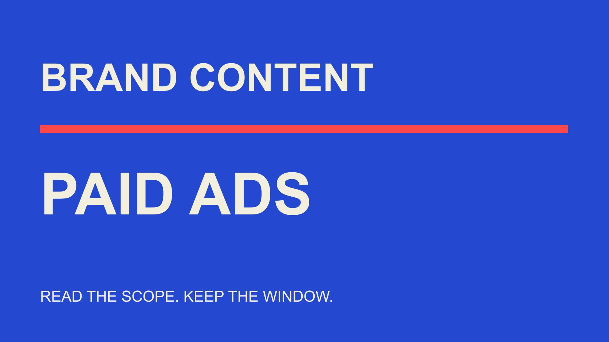

# Beauty Instagram Ads Engagement in 2025: Check Paid Scope

Status: local review draft; confirm the publication date before release.

For a 2025 beauty Instagram ad review, first establish that the source actually describes paid ads, then align actions, denominator, geography, window and comparison units.

QuickKOL editorial graphic; not actual account metrics or a platform interface.

To cite beauty brand Instagram ads engagement rate 2025, verify beauty brands, Instagram, paid advertising, actual 2025 observation and a defined engagement measure. A brand-content average does not automatically become an ad benchmark. We did not obtain a universal global average fully matching those conditions in this review. Dash Social’s Issue 2 2025 report explicitly excludes paid ads under its stated scope, so its beauty Instagram figures should not be renamed advertising performance. This guide organizes comparable historical records and identifies scope errors without inventing an ideal rate. A useful review can remain bounded when the precise external benchmark is unavailable.

## Retain all five conditions in the query

Beauty, brand, Instagram, advertising and 2025 are not optional decorations. Individual creators, another platform, organic content or another observation year may offer context without answering the same question.

Also define which actions are divided by which denominator. CTR, a like rate and a composite post-engagement field should not be exchanged because each can display a percentage.

The [Instagram metric explanation](/blog/instagram-analytics-format-decision-matrix/#answer) helps interpret formats and purposes. If a source says Instagram engagement without paid scope or formula, retain the gap rather than assume that ads in an article title resolves it.

The first citation sentence should independently state objects and period. A manager seeing only that sentence should still understand whether the material is comparable with the advertising assignment. A label that loses these conditions while moving from research notes into a presentation can change an otherwise accurate number into an inaccurate claim. Checking the label is therefore part of measurement work, not merely a final copy edit.

## Read methodology and asterisks with the 2025 figure

The [Dash Social 2025 beauty report](https://pages.dashsocial.com/hubfs/social-media-benchmark/2025/H2/beauty-industry.pdf), Issue 2, observes global company activity from January 1 through June 30, 2025. Its methodology includes organic, boosted and promoted content while excluding paid ads. Preserve the publisher’s categories instead of silently redefining those terms.

The beauty column in its Instagram industry table reports 0.2% with a follower denominator and 3.0% with a view denominator; the latter carries a customer-data-only asterisk. They have different scopes and neither is directly a 2025 beauty-ad average engagement rate.

The methodology’s 2,967 Instagram accounts are the cross-industry sample, not the beauty subgroup count. Handles with at least 1,000 followers do not represent every beauty business or advertiser.

This example shows why figures need exclusions, period and footnotes. The report can be useful when its application follows the population actually measured. Removing a methodology qualification does not make the evidence stronger; it changes the claim the number appears to support.

## Paid data still need metric and geography checks

The [Emplifi North America beauty scope](https://emplifi.io/resources/q3-2026-beauty-north-america-benchmarks/), in its Q3 2026 report, separates some organic-content data, worldwide fallback series and paid ad-account information. North America in the title does not establish the same regional sample for every table.

Paid sections present measures such as CPC, CPM and CTR. Those are relevant advertising observations without becoming 2025 Instagram engagement rates. Historical trends inside a 2026 report also do not automatically provide a complete 2025 annual average.

We use the report to illustrate scope reading, not adopt promotional claims about organic-content detection accuracy or present pooled UGC outcomes as causal beauty-ad returns.

Read object, window, geography and unit for each table. A report can legitimately contain several scopes; the citation must not move one table’s qualifications onto another. Keeping the original heading and table-specific note together helps a later reader distinguish advertising information from the organic benchmarks appearing nearby, rather than infer paid scope from the surrounding page theme.

## A historical ad export needs its own field explanation

If the brand retained 2025 advertising records, preserve original field names, source, observation window, export time, platform or placement scope and aggregation level. A current interface or definition should not automatically overwrite historical material.

The [engagement-rate metric contract](/blog/engagement-rate-formula-metric-contract/#answer) organizes actions and denominator. State whether the report uses the original field or an editorial recalculation, keeping missing, estimated and observed-zero states distinct instead of filling zeros to satisfy a formula.

Ads, ad sets and campaigns are different aggregation levels. The same content file may serve different delivery conditions; combining everything by filename does not establish the performance of a single ad.

Also distinguish advertising observations occurring during 2025 from lifetime performance, through today, of an asset published in 2025. Those records can concern the same asset while answering different time questions. Without a retained interval export, do not rename today’s lifetime total a 2025 advertising result. Preserve the available window and explain why the narrower historical claim cannot be reconstructed.

Obtain records through appropriate permissions. We have entered no advertising account or verified campaign. This is a historical-review recording method, not a claim to have measured a brand’s activity. A clear field dictionary allows another colleague to understand an older export even if its labels no longer match what the current interface displays.

## Reproducible arithmetic still needs matching definitions

Suppose two teaching ads record 200 defined actions per 10,000 impressions and 100 per 2,000: rates of 2% and 5%. Their mean rate is 3.5%, while pooled actions divided by impressions gives 300 per 12,000, or 2.5%. These are fictional inputs, not ads or industry benchmarks.

The aggregations answer different questions. Mean ad rate and overall actions per impression should not share an unexplained average label. Actions are not unique people either.

If included events differ, dividing both by impressions still does not make them comparable. For different formats or placements, retain actual fields and applicability instead of hiding differences under a common name.

When a denominator is zero, missing or inapplicable, preserve that state rather than output a precise-looking rate. Teaching arithmetic explains structure; it should not become a default success threshold copied into the brand’s next campaign. Its inputs and limited purpose should remain visible whenever the example is reused.

## External references do not replace a comparable internal review

Without an exact industry value, a brand can organize internal observations around its objective and comparable or explainable audience, window, format and delivery conditions. State uncontrolled differences rather than present historical comparison as a randomized experiment.

The [Google experiment guide](https://support.google.com/google-ads/answer/7281575?hl=en) recommends clear hypotheses, chosen measures and controlled changes for Google advertising experiments. It documents that system, not proof that Instagram organic content or every advertising comparison meets experimental conditions.

Brands can adapt the question structure: what changes, why, how it will be observed and when it will be reviewed. If several conditions change together, acknowledge that differences cannot all be assigned to creative.

This article does not recommend mechanically increasing budget to reach an external average. The assignment may need evidence of understanding, suitable inquiries or purchases, with engagement as one defined observation. A planned review should state which of those questions it addresses instead of choosing the most available percentage and treating it as the entire objective.

## Preserve the use distinction when creator content becomes an ad

Creator organic publication and brand-paid distribution may use the same asset with different audiences, impression volumes and reporting sources. Adding public interactions to advertising-system actions does not establish a deduplicated complete audience response.

The [partnership-ad permission checklist](/blog/partnership-ads-permission-checklist/#answer) helps examine entity, asset, use arrangement and platform state. Scope review does not replace actual permission or establish that a previously public post can be used for a new campaign today.

If historical records cannot separate paid and organic activity, label mixed or inseparable scope and narrow comparison. Boosted or promoted terminology also does not permit ignoring the original report’s classification and renaming its dataset.

Separate creative learning from business outcomes. More interaction with an explanatory approach can generate a next question without establishing equivalent incremental sales or product effects. This distinction remains relevant for beauty content, where audience interest in a demonstration is different from evidence that a product delivers a stated result.

## Write a qualification that survives an executive report

When citing an external figure, keep publisher, edition, observation period, objects, denominator, paid scope and footnotes together. Longer methodology can sit elsewhere, but the short note should prevent brand content being reported as an ad result.

An adaptable sentence is: this value describes brand content in the named report, whose scope excludes paid ads, and is not the benchmark for this paid campaign. Add the actual source and period; this is editorial wording, not a fixed disclaimer.

If the direct answer is that an exact 2025 ad average was not verified, retain it. Unknown is not zero or a claim that no regional research exists. It means this review’s evidence does not support a broader conclusion.

Align chart titles and notes. A headline about advertising returns cannot be repaired automatically by a later paragraph about content interactions or a source link at the end. The principal label should be no stronger than the evidence beside it.

## Hand off historical records that remain reviewable

The handoff includes original scope, field explanation, comparison reasons, hypothetical labels and gaps. The [campaign-measurement guide](/blog/creator-campaign-measurement/#answer) connects interaction observations with the actual objective instead of making a percentage a universal success rule.

When a more suitable source becomes available, update the relevant explanation with its date rather than overwrite historical facts. The team can then distinguish newly supported conclusions from continuing limited observations.

The value of the 2025 query is accurate use of past advertising and content evidence. It does not require an unverified global average. Understanding where a figure can responsibly be applied is itself a reusable professional result.

## Checks before citing a 2025 beauty-ad benchmark

| Field | Confirm | Common mismatch |

| --- | --- | --- |

| Object and channel | Beauty brands, Instagram and actual paid scope | Creators or organic brand content |

| Period | Actual window, not edition year alone | Another year or half-year called annual |

| Metric | Actions, denominator, unit and aggregation | CTR treated as all engagement |

| Source limits | Geography, exclusions and customer footnotes | A scoped figure called a global ad average |

Dash Social Issue 2 2025 excludes paid ads under its methodology; 2% and 5% are hypothetical teaching rates, not ad benchmarks.

## Prepare a historical advertising review

Establish comparability before interpreting differences.

- [ ] Retain source evidence for paid scope.

- [ ] Separate historical fields and current definitions.

- [ ] State window, placement and object.

- [ ] Distinguish mean and pooled rates.

- [ ] Avoid adding overlapping organic and ad data.

- [ ] State unknown when the exact benchmark is unverified.

## Research date and limitations

Sources reviewed November 3, 2026. Methods, tables and decision rules are editorial recommendations. Hypothetical examples are not actual client results or industry benchmarks. Source geography and periods are specified where relevant. This draft is in independent local review; confirm its publication date before release.

## Sources

- [Dash Social 2025 beauty report](https://pages.dashsocial.com/hubfs/social-media-benchmark/2025/H2/beauty-industry.pdf)

- [Emplifi North America beauty scope](https://emplifi.io/resources/q3-2026-beauty-north-america-benchmarks/)

- [Google experiment guide](https://support.google.com/google-ads/answer/7281575?hl=en)
