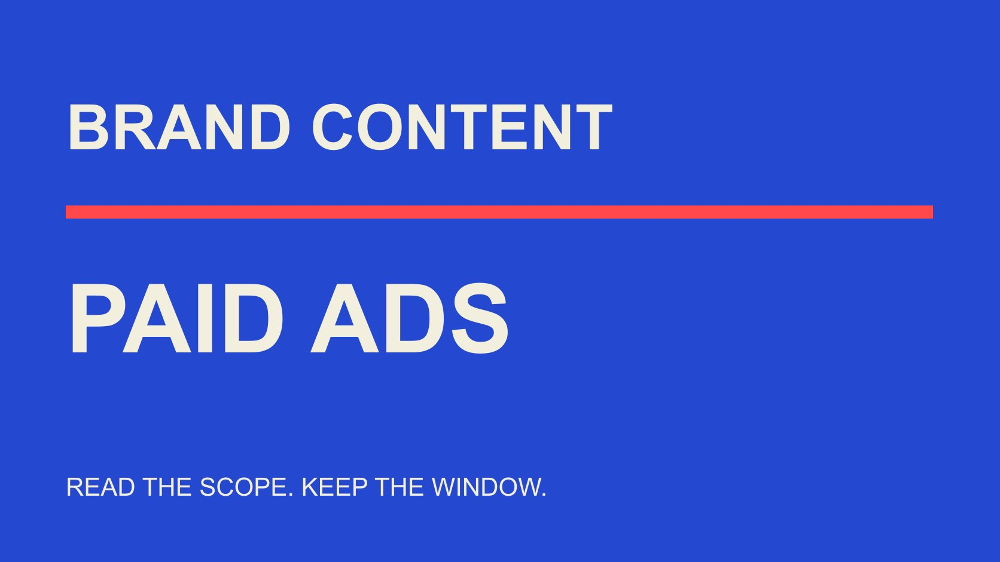

# 2025美妆Instagram广告互动率：先确认付费口径

状态：本地审阅稿；正式发布日期待确认。

回看2025美妆Instagram广告时，先确认资料真的描述付费广告，再核对动作、分母、地区、窗口和比较对象，建立自己的可比复盘。

QuickKOL 编辑图形；不呈现真实账号指标或平台界面。

引用beauty brand Instagram ads engagement rate 2025，必须先确认数据是美妆品牌、Instagram、付费广告、2025实际观察与明确互动率口径。品牌内容平均数不能自动变成广告基准。本次未取得能完整匹配这些条件的统一全球均值；Dash Social 2025第二期报告明确按其口径排除paid ads，不能将其中美妆Instagram数字改名为广告表现。本文帮助整理可比历史记录、识别范围误读，并在缺少精确基准时作有边界的复盘，不编造理想互动率。

## 把查询里的五个条件都保留

美妆、品牌、Instagram、广告和2025不是可以随意省略的修饰词。个人创作者、其他平台、自然内容或另一年观察的数据，可能有参考价值，却不直接回答同一个问题。

再说明广告互动率是哪些动作除以什么分母。一个CTR、点赞率或综合post engagement字段，都不能因为带百分号就互相替换。

[Instagram指标解释](/zh/blog/instagram-analytics-format-decision-matrix/#answer)帮助理解内容形式与用途。若来源只写Instagram engagement，没有付费范围与公式，应保留缺口，而不是根据文章标题中出现ads就认为它已满足条件。

引用的第一句话应能独立说明对象与时期。管理层只看到这一句时，仍应知道它是不是本次广告任务可比较的资料。

## 读2025报告时同时读方法与星号

[Dash Social 2025美妆报告](https://pages.dashsocial.com/hubfs/social-media-benchmark/2025/H2/beauty-industry.pdf)第二期观察2025年1月1日至6月30日的全球公司账号，方法页说明纳入organic、boosted与promoted内容，但排除paid ads。本文保留出版者原有分类，不自行将这些词重新定义。

其Instagram行业表美妆列给出粉丝分母互动率0.2%，观看分母3.0%；后者有客户数据限定星号。两者对象与口径不同，都不能直接叫2025美妆广告平均互动率。

方法页Instagram的2,967是跨行业样本数，不是美妆子样本数量。至少1,000关注者的账号范围，也不代表所有美妆企业或所有广告主。

这个例子说明数字要连同排除项、窗口和脚注引用。报告有价值，但用途必须与它实际统计的对象一致，不能通过省略一行方法说明获得更强结论。

## 付费资料也要核对指标与地区

[Emplifi北美美妆范围说明](https://emplifi.io/resources/q3-2026-beauty-north-america-benchmarks/)在2026年第三季度报告中，明确将部分自然内容数据、全球替代序列与付费广告账户资料区分。页面标题含北美，并不意味着每张表都使用同一地区样本。

付费部分呈现CPC、CPM与CTR等字段。这些是相关广告观察，但不能改写成2025 Instagram互动率；2026资料中的历史趋势，也不自动提供一个完整2025年度均值。

本篇用它示范范围阅读，不采用供应商关于自然内容检测准确性的宣传，也不把跨行业UGC结果当成美妆广告因果收益。

读每个表时分别看对象、窗口、地区和单位。整份报告可以合理包含不同范围，责任在于引用时不把一个表的限定移到另一个表上。

## 历史广告导出需要自己的字段说明

如果品牌保存了2025广告记录，先保留原始字段名称、来源、观察窗口、导出时间、平台/版位范围与汇总层级。当前界面或定义不应自动覆盖历史资料。

[互动率指标约定](/zh/blog/engagement-rate-formula-metric-contract/#answer)可以组织动作与分母。明确使用原报告字段还是编辑重新计算，缺失、估计与真实零分别记录，不因公式需要数值就强行填零。

广告、广告组与活动是不同汇总层级。内容文件相同，也可能被用于不同投放条件；不能只按素材文件名合并所有表现后称为单条广告结果。

还需区分“2025年发生的投放观察”与“2025年发布素材截至今天的累计表现”。两种记录即使使用相同素材，也不是同一个时间问题。缺少当年区间导出时，不能把今天的终生累计值改名为2025广告结果。

资料取得须有适当权限。本文没有进入广告账户或核验实际活动，提出的是历史复盘的记录方法，不声称已经替任何品牌完成测量。

## 算术可复核，定义仍须相同

假设两条教学广告分别有200次已定义动作/10,000次展示和100/2,000，对应2%与5%。两条率的平均为3.5%，合并动作除以展示为300/12,000=2.5%。这不是实际广告或行业基准。

两种汇总回答不同问题。平均每条广告率与总体每次展示的动作率不能共用不加说明的average标签；动作也不是独立人头。

如果分子包含的事件不同，即使都除以展示仍不能直接比较。对不同格式或版位，记录实际字段与适用条件，不借一个统一名称隐藏差异。

分母为零、缺失或不适用时保留状态，不输出看似精确的率。教学算例的用途是解释结构，不应被复制成品牌下次活动的默认成功门槛。

## 外部基准不能代替可比较的内部复盘

缺少精确行业值时，可以按实际目标建立品牌内部观察：相同或可解释的目标、受众、窗口、格式与投放条件。仍需说明不能控制的差异，不把内部历史比较伪装成随机实验。

[Google实验指南](https://support.google.com/google-ads/answer/7281575?hl=en)建议在Google广告实验中明确假设、选择指标并控制变更。这是该系统资料，不是Instagram自然内容或全部广告已经满足实验条件的证明。

品牌可以借鉴问题结构：准备改变什么、为什么、怎样观察、何时复核。若多个条件同时改变，结论应承认无法把变化全部归给创意。

本篇不建议为了达到外部平均率而机械加预算。广告任务可能需要理解、适当咨询或购买证据，互动率只是其中一种有定义的观察。

## 创作者内容变成广告后保留用途差异

创作者自然发布与品牌付费分发可能使用同一素材，但受众、展示量与报告来源不同。不要把公开内容互动与广告后台动作相加，假装它们构成去重后的完整受众反应。

[合作广告权限清单](/zh/blog/partnership-ads-permission-checklist/#answer)帮助核对主体、素材、使用安排与平台状态。这里的范围检查不替代实际许可，也不说明一个过去公开的帖子可以直接用于今天的新投放。

如果历史记录不能区分付费与自然部分，明确写混合或不可拆分，并缩小比较。内容曾被boosted或promoted，也不能绕过原报告的分类说明自行重新命名。

将素材学习与商业结果分开：某种解释方式得到较多互动，可以成为进一步问题；它本身不能证明广告带来同等增量销售或产品效果。

## 为管理报告写一条可独立引用的限定

引用外部值时，把机构、版本、观察期、对象、分母、付费范围与脚注放在一起。长方法可以另附，但短注释应足以防止将自然内容写成广告结果。

例如可写“此值为指定报告中的品牌内容观察，按该报告范围排除paid ads，不作为本次付费广告基准”。这是一种编辑句式，应补实际来源与时期，不是固定免责话术。

若直接回答是未核验精确2025广告均值，就如实保留。未知不等于零，也不说明所有地区都不存在相关研究；只是本次资料不能支持更广结论。

图表标题与脚注必须一致。不要标题写广告收益，正文才解释内容互动；强标题带来的误读不能由末尾一条链接自动修复。

## 交接能继续复查的历史记录

最终交付包含原始范围、字段说明、比较理由、算例标记与缺口。[活动衡量指南](/zh/blog/creator-campaign-measurement/#answer)可继续把互动观察连接到实际目标，而不是把百分比变成万能成功标准。

后续取得更适合的来源时，更新对应说明并保留时间，不覆盖历史事实。品牌团队可以因此知道哪些结论已被新资料支持、哪些仍是有限观察。

2025这个关键词的价值，是帮助读者正确引用过去的广告与内容证据。它不要求一个未经核验的全球平均数；清楚知道数字能用到哪里，本身就是可复用的专业成果。

## 2025美妆广告基准引用检查

| 字段 | 必须确认 | 常见错位 |

| --- | --- | --- |

| 对象与渠道 | 美妆品牌、Instagram及实际广告范围 | 创作者或自然品牌内容 |

| 时期 | 真实观察窗口，不只版本年 | 另一年或半年当全年 |

| 指标 | 动作、分母、单位与汇总 | CTR当全部互动率 |

| 来源限制 | 地区、排除项与客户脚注 | 把局部资料当全球广告均值 |

Dash Social 2025第二期数据按其方法排除paid ads；2%与5%为假设教学率，不是广告基准。

## 历史广告复盘准备

先确认可以比较，再解释高低。

- [ ] 付费范围有原始依据。

- [ ] 历史字段和当前定义分开。

- [ ] 观察期、版位与对象清楚。

- [ ] 平均率与合并率没有混用。

- [ ] 自然与广告资料没有重复相加。

- [ ] 缺少精确基准时明确未知。

## 研究日期与使用边界

资料核验于 2026 年 11 月 3 日。文中方法、表格和决策规则为编辑建议，标为假设的示例不是实际客户结果或行业基准。外部资料的适用地区与时期按各段说明；本稿处于独立本地审阅阶段，正式发布日期待确认。

## 来源

- [Dash Social 2025美妆报告](https://pages.dashsocial.com/hubfs/social-media-benchmark/2025/H2/beauty-industry.pdf)

- [Emplifi北美美妆范围说明](https://emplifi.io/resources/q3-2026-beauty-north-america-benchmarks/)

- [Google实验指南](https://support.google.com/google-ads/answer/7281575?hl=en)
