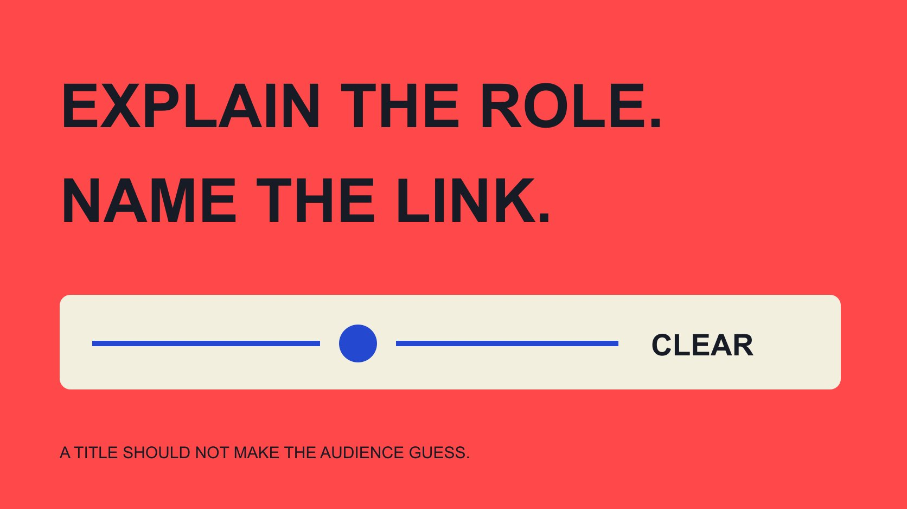

# What Is a Brand Ambassador to Your Customers?

Status: local review draft; confirm the publication date before release.

Explain the actual brand-ambassador relationship through customer-facing introductions, content and events, including what the title cannot establish.

QuickKOL editorial graphic; not actual account metrics or a platform interface.

A brand ambassador generally has a representative, promotional or community relationship with a brand, but customers should not have to infer the arrangement from the title alone. Explain what the person does in this program, their relevant relationship with the brand, and which statements concern genuine experience or brand-supplied facts. Ambassador does not automatically establish employment, professional qualifications, independent reviewing or endorsement of every product. This guide helps brands write an explanation customers can understand rather than another internal role taxonomy or a universal contract. The communication should remain accurate when someone encounters only one post or event introduction, without reading the entire program website.

## The customer’s question concerns a relationship, not only a title

When a customer asks what a brand ambassador is, they may want to know whether a presenter receives a benefit, represents the brand in answering questions and has a basis for a recommendation. Saying only that ambassadors like the brand may omit the information that matters.

The [ambassador role guide](/blog/brand-ambassador-role-program/#answer) helps an internal team establish an assignment. Public explanation translates it into ordinary language. Do not transfer internal abbreviations, contract references or a complicated hierarchy into the page and leave readers to reconstruct the relationship.

Start with three questions: what does the person do here, how are they connected to the brand and whom should the reader approach next? Different formats can answer at different lengths, but the facts should agree. A website should not describe one relationship while a video implies another.

A shorter introduction does not justify a stronger title. A community-event host can be introduced accurately without becoming a scientific authority or someone empowered to handle every transaction for the brand.

## Actual programs can use different ambassador arrangements

The [lululemon community overview](https://corporate.lululemon.com/our-business/innovation/community-engagement) describes ongoing ambassador relationships in its communities, illustrating a role beyond one post. It is one brand’s public program example, not a standard duration, benefit or admission rule for every program.

Other arrangements may concern an event, educational content or a bounded promotional assignment. Explain the current arrangement rather than borrow a familiar brand’s model to fill your own unknown terms.

An introduction might describe a presenter participating in this community event or a collaborating creator in this program, when accurate. If ambassador is the agreed name, place a specific contribution behind it rather than compress every fact into the word.

Program name and practical contribution can appear together. This preserves a consistent brand identity while helping a first-time reader understand why the participant is present. The reader should not need prior knowledge of the industry to distinguish an event contribution from a permanent representative relationship or an unrestricted promise about the brand’s products.

## Explain relevant benefits rather than invite guesses

The [FTC disclosure primer](https://www.ftc.gov/business-guidance/resources/disclosures-101-social-media-influencers) explains in a US context that valuable relationships are not limited to cash and can include free products. Review the actual content and market under applicable requirements instead of turning the guidance into a worldwide classification.

Supply collaborators with accurate relationship information they can use. Brand friend or thanks for the support should not replace an understandable account of the arrangement. Nor should the team demand disclosure of irrelevant private financial details. The purpose is understanding the relevant connection.

Where several benefits exist, do not describe only the least consequential one. The explanation should match the confirmed arrangement, with the appropriate owner reviewing scope and presentation.

For an audience, transparency does not replace evaluating the work itself. People can read, inspect its basis and form a view without first guessing whether an undisclosed commercial connection exists. This is a communication task about relevant context, not an invitation to publish a participant’s complete personal or business records.

## The ambassador label cannot replace a clear relationship explanation

The [FTC endorsement FAQ](https://www.ftc.gov/business-guidance/resources/ftcs-endorsement-guides-what-people-are-asking) notes that ambassador or partner used alone can be ambiguous, with understanding depending on expression and context. This is US staff guidance, not approval of one fixed wording set for every platform and market.

A program page, personal biography and individual post perform different jobs. An identity once stated in a biography does not establish what someone encountering this content already knows. Review the actual reading path rather than assume everyone explored every page.

Check that wording, sound, visuals and surrounding information support one another. A label somewhere does not guarantee comprehension if another prominent statement implies a different relationship.

Do not delete the actual connection in pursuit of natural tone. Ordinary language can be brief and clear, but facts should determine expression. Choosing a softer title first and forcing the arrangement to fit it risks making the introduction easier to read while less accurate. A useful review asks what an unfamiliar audience member is likely to understand, then compares that interpretation with the verified arrangement.

## Distinguish genuine experience from product facts

An ambassador may describe genuine experience while also using brand-supplied dimensions, operating conditions or service information. Those statements have different evidentiary bases. A desired brand conclusion should not become something the participant supposedly experienced firsthand.

The brand verifies its product information, while the participant speaks truthfully about experience. Claims needing specialist support go to the appropriate owner; an ambassador title replaces neither relevant qualification nor evidence.

Using a feature at one event does not establish the same outcome for every customer. Retain conditions and experiential scope so readers know which questions require formal information or support.

Where relevant experience is absent, a reliable factual explanation can be assigned instead of an invented first-person story. The contribution can remain useful without adding unsupported experience or results through its narrative form. Public introduction and content review should work together so the biography does not promise authority the actual material cannot support.

## Test the explanation with three customer situations

These are hypothetical editing exercises. A customer sees only an event poster and wants to know whether the presenter handles after-sales service. The introduction can state the assignment and official support route without giving a community participant unconfirmed service authority.

A second reader sees one product video and asks whether brand benefits are involved. Relevant context needs to be understandable in the content encounter rather than require research into an old program announcement. Check the actual market and format requirements.

A third reader finds older material after the program ended. Retain the historical period instead of implying continuing representation through an undated introduction. Where updates are needed, inspect editable locations and the arrangement.

The situations require no new score. They ask an editor to take the reader’s position: what is visible, what might be inferred and which relevant question remains unanswered? Route that question to the actual relationship owner rather than deciding for the audience whether the work deserves trust. An explanation succeeds when it removes avoidable confusion about role and context, not when it guarantees a favorable audience judgment.

## Prepare a compact fact package for public introductions

An editorial fact package can contain the name and agreed title, program, contribution, period, relevant benefit relationship, appropriate questions and official support route. Retain only information needed for this introduction, not unrelated private material.

The [program application-experience guide](/blog/ambassador-programs-member-application/#answer) concerns how participants understand entry conditions. Public introduction needs a different, shorter package. Do not copy private application answers, contact details or credential files into it.

Assign an owner and current version so hosts, editors, creators and support use consistent facts. If several teams translate the material, distinguish formal names from explanations that can be phrased naturally.

Relationship confirmation and permission to use material need separate treatment. Possession of a biography or photograph does not establish unlimited, perpetual use everywhere. Confirm the actual arrangement before publication rather than let the fact package stand in for broad authorization. A compact package is useful because it reduces conflicting explanations while respecting the boundary between public facts and information retained for operating the program.

## Update when benefits, role or program state change

Not every wording improvement changes a fact. Moving from event participation to continuing representation, or from product exchange to additional cash compensation, may affect the appropriate explanation. The responsible owner should decide which current information and content need updating.

List affected locations: introduction page, event material, assets still in use and team information. Act under actual access and technical conditions rather than promise every historical repost has been removed or rewritten across the internet.

Retain effective time, earlier version and correction reason. If a description overstated relationship or qualification, correct it rather than hide the issue through a synonym. Explaining current state is more reliable than making every document appear never to have changed.

For unconfirmed conditions, narrow the claim first. Describing the current project contribution may be more appropriate during verification than continuing a title that invites a stronger inference. The team can restore a broader accurate description once the necessary facts and permissions are established.

## Help the explanation support an appropriate next step

Customers should be able to continue learning about the product, event or service and know where a question belongs. Ambassador content can provide a useful route without requiring guarantees beyond the person’s assignment or experience.

The [collaboration workflow guide](/blog/collaborate-with-influencers-brand-workflow/#answer) connects public questions, factual review and follow-up. Recurring questions can improve brand information instead of repeatedly asking a creator to supply private explanations after publication.

To find people suited to that contribution, QuickKOL can help interpret a brief, research relevant work and prepare outreach. Genuine experience, relationships, conditions and outcomes still need separate verification. For customers, a clear role explanation is easier to use than an impressive but ambiguous title. It helps them understand the context of the contribution while leaving room to consult evidence and make their own judgment.

## Customer-facing ambassador explanation

| Customer may ask | Explain | Do not imply |

| --- | --- | --- |

| What does this person do? | Current contribution and scope | Authority over every brand matter |

| What is the relationship? | Relevant understandable connection | Title alone explains everything |

| What is the basis? | Separate experience and product facts | Everyone gets the same result |

| Where do questions go? | Appropriate contact and support route | Community role equals all service authority |

An editorial explanation framework, not universal disclosure wording or a legal-status determination.

## Before publishing the introduction

Review from the perspective of a first-time reader.

- [ ] Match the role to the actual contribution.

- [ ] Make the relevant connection understandable.

- [ ] Give experience and product facts their own basis.

- [ ] Avoid unverified credentials and guarantees.

- [ ] Name period, version and update owner.

- [ ] Give the reader an appropriate next step.

## Research date and limitations

Sources reviewed November 3, 2026. Methods, tables and decision rules are editorial recommendations. Hypothetical examples are not actual client results or industry benchmarks. Source geography and periods are specified where relevant. This draft is in independent local review; confirm its publication date before release.

## Sources

- [lululemon community overview](https://corporate.lululemon.com/our-business/innovation/community-engagement)

- [FTC disclosure primer](https://www.ftc.gov/business-guidance/resources/disclosures-101-social-media-influencers)

- [FTC endorsement FAQ](https://www.ftc.gov/business-guidance/resources/ftcs-endorsement-guides-what-people-are-asking)
