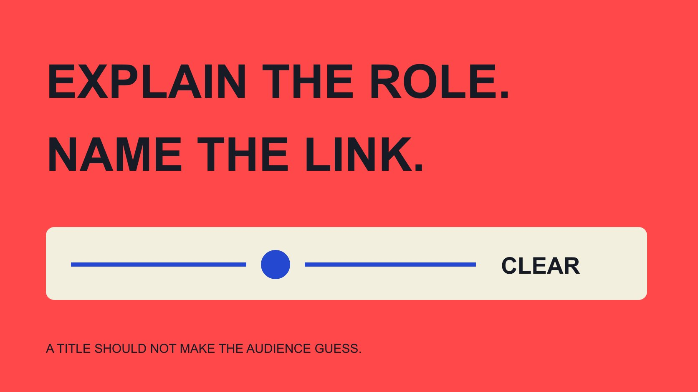

# 品牌大使是什么：向受众说清角色与关系

状态：本地审阅稿；正式发布日期待确认。

从顾客看到的介绍、内容和活动出发，说明品牌大使与品牌的实际关系，以及这个称呼不能替代的事实。

QuickKOL 编辑图形；不呈现真实账号指标或平台界面。

品牌大使通常是与品牌存在某种代表、推广或社区关系的人，但顾客不应只靠这个称呼猜具体安排。品牌应清楚说明对方在当前项目做什么、与品牌有什么相关关系，以及内容哪些来自真实经历、哪些是品牌提供的事实。大使称号不自动证明员工身份、专业资格、独立评价或对所有产品的推荐。本文帮助品牌写顾客能够理解的解释，不重新制定内部角色分类或通用合同。

## 顾客的问题是关系，不只是头衔

当顾客问“品牌大使是什么”，他们可能想知道这位讲解者是否收取回报、是否代表品牌回答问题，以及推荐是基于什么。只解释大使是“喜欢品牌的人”，可能漏掉真正影响理解的信息。

[大使角色指南](/zh/blog/brand-ambassador-role-program/#answer)有助于内部确认任务；对外说明则要将任务转成普通读者看得懂的表达。避免把内部简称、合同编号或复杂层级直接搬上页面，让读者自己拼出关系。

可从三个问题开始：此人在这里做什么，与品牌如何相关，读者下一步应该找谁。不同内容可以用不同长度回答，但三者需要事实一致，不能官网说一种关系、视频却暗示另一种关系。

不要为了缩短介绍就增加更强头衔。社区活动的主持人可以被准确介绍，不必被改写成产品科学权威或能代表品牌处理全部交易的人。

## 实际项目可以有不同的大使安排

[lululemon社区说明](https://corporate.lululemon.com/our-business/innovation/community-engagement)将大使描述为持续的社区合作角色，说明大使不一定只是一次发帖任务。这是该品牌公开项目的例子，不是所有计划的统一期限、待遇或申请标准。

其他项目可能围绕具体活动、教育内容或有限的推广任务组织。面向顾客时，应解释当前安排，而不是引用某个知名品牌的模式替自己补齐未知条件。

介绍可以说明“参与本次社区活动的讲解者”或“这个项目的合作创作者”，前提是实际如此。如果双方使用大使名称，也应让名称后面有具体贡献，不把所有信息都压在一个词里。

项目名称与实际作用可以同时出现。这样既保留品牌项目的一致性，也让第一次遇到内容的人知道为什么这位参与者出现在这里，而不必先熟悉整个行业。

## 说明回报关系，不让读者靠猜

[FTC披露入门指南](https://www.ftc.gov/business-guidance/resources/disclosures-101-social-media-influencers)在美国背景下说明，有价值的关系不限于现金，也可能包括免费产品等利益。具体内容和市场应按适用要求审阅，不能把该指南写成全球统一判定。

品牌需要为合作方提供准确、能够使用的关系信息。不要只让对方写“品牌朋友”或“感谢支持”，却不说明实际关系。也不要要求公开无关私人财务资料；重点是让读者理解相关联系。

如果一条内容包含多种回报，不能只说明最不影响读者判断的一种。实际介绍应与已确认安排一致，由适当负责人核对所需范围和方式。

对受众，透明说明不是判断作品是否有价值的替代步骤。读者仍可以阅读内容、查看依据并形成意见，而不必先猜背后是否存在一个未被说明的商业联系。

## 大使标签不能替代清楚的关系表达

[FTC背书问答](https://www.ftc.gov/business-guidance/resources/ftcs-endorsement-guides-what-people-are-asking)指出，单独使用ambassador或partner等词可能模糊，读者理解需要考虑具体表达和语境。这是美国工作人员指导中的问题，不是给所有平台和市场批准一套固定用词。

品牌介绍页、个人简介与实际帖子承担不同工作。一个人曾在简介写过身份，并不保证读者看见当前内容时已经知道关系。设计说明时从实际阅读路径检查，而不是假设大家都读过全部页面。

检查文字、声音、画面和其他信息是否相互支持。明显标题旁边若有相反暗示，不能只因某处放了一个词就宣布读者一定理解。

不要为了追求自然口吻把真实关系删掉。自然语言可以简短清楚，但应由实际事实决定表述，而不是先选一个柔和称呼，再让项目去配合这个称呼。

## 将真实体验和产品事实分别解释

大使可以描述实际经历，也可能使用品牌提供的尺寸、操作条件或服务资料。两类内容的依据不同，不能把品牌希望表达的结论改成对方亲自体验过的事实。

品牌为产品资料提供适当核对，参与者为自己的经历提供真实表达。涉及需要专业依据的说法，交给适当负责人审阅，不能用大使头衔替代相应资格或证据。

例如一次活动中实际使用某项功能，并不证明所有顾客会得到相同结果。介绍应保留使用条件和经验范围，让读者知道哪些问题仍需查看正式资料或询问客服。

若参与者没有相关经历，可以安排可靠事实讲解，而不是要求编造第一人称故事。内容贡献仍然可以有用，只要不让叙述方式增加未经支持的体验或结果。

## 用三个顾客情境检查说明是否清楚

以下为假设编辑练习。第一位顾客只看见活动海报，希望知道讲解者是否能处理售后。介绍可以说明其本次任务与正式服务入口，避免让社区角色承担未确认的客服权限。

第二位读者只看到一段产品视频，想知道讲解是否涉及品牌回报。信息需要在相关内容中容易理解，不能要求读者先去查很久以前发布的项目公告。具体要求按适用市场与格式核对。

第三位读者在项目结束后遇到旧内容。历史关系应保留适用时期，不宜通过一个没有日期的介绍暗示仍然代表品牌。若需要更新，核对可修改位置和实际安排。

三个情境都不要求建立新评分，而是让编辑换到读者的位置：他看见什么、可能推断什么、还有什么关键问题没有答案。把这些问题交给实际关系负责人核对，而不是替读者决定作品是否值得信任。

## 为公开介绍准备最小事实包

建议记录姓名与同意使用的称谓、项目名、具体贡献、期间、相关回报关系、可联系问题与正式服务入口。只保留这次介绍需要的资料，不收集无关私人信息。

[社区项目申请指南](/zh/blog/ambassador-programs-member-application/#answer)关注参与者如何理解加入条件。公开介绍使用另一份更短材料，不能把申请中的私人答案、联系方式或资格文件直接复制出来。

事实包应有负责人和当前版本，便于主持、编辑、创作者与客服使用相同信息。内容如果分给不同团队翻译，也要说明哪些是正式名称，哪些是可以自然改写的说明。

对外关系确认与素材使用许可分别处理。持有一段简介或一张照片，不自动意味着品牌可以在所有位置长期使用。发布前按实际安排确认，不让资料包变成无限授权的替代品。

## 当回报、角色或项目状态变化时更新

不是每次润色都改变事实，但从活动参与者变成持续代表、从产品置换变成另有现金回报，可能影响适当解释。负责人应确认变化是否需要反映到当前资料与内容。

列出受影响位置：介绍页、活动资料、仍在使用的素材与团队说明。按实际权限和技术条件处理，不承诺已经在全网移除或改写每个历史转发。

保留生效时间、旧版本与更正原因。若之前描述夸大了关系或资格，应更正，而不是仅换一个近义词掩盖问题。说明当前状态比让所有材料看似从未变化更可靠。

对于无法立即确认的条件，先缩小主张。暂时写明当前项目贡献，通常比继续使用一个可能引发更强推断的头衔更适合等待核对。

## 让公开说明支持合适的下一步

顾客应能继续了解产品、活动或服务，也能知道问题该交给谁。大使内容可以提供有用入口，但不能要求参与者对超出任务或经验的问题作保证。

[合作执行指南](/zh/blog/collaborate-with-influencers-brand-workflow/#answer)帮助把公众提问、事实核对与后续处理连接起来。经常重复的问题可以进入品牌资料改进，而不是每次都让创作者私下补答。

品牌若要寻找适合这种贡献的合作方，可用QuickKOL理解Brief、研究相关作品并准备联系；真实经历、关系、条件和结果仍分别核验。对顾客来说，一个清楚的角色解释比更响亮但含糊的称号更便于使用。

## 顾客看到的大使说明

| 顾客可能问 | 应说明 | 不能暗示 |

| --- | --- | --- |

| 这个人做什么 | 当前项目贡献与范围 | 能够代表品牌处理一切 |

| 与品牌什么关系 | 适当且清楚的相关联系 | 仅靠头衔已充分解释 |

| 依据是什么 | 真实经历与产品事实分开 | 所有人会得到相同结果 |

| 问题找谁 | 适当联系与服务入口 | 社区角色等于全部客服权限 |

编辑说明框架，不是通用披露用词或法律身份判定。

## 公开介绍发布前清单

用首次遇到内容的读者视角检查。

- [ ] 角色对应当前真实贡献。

- [ ] 相关关系容易理解。

- [ ] 经历与产品事实有各自依据。

- [ ] 没有增加未知资格或保证。

- [ ] 期间、版本和更新负责人明确。

- [ ] 读者知道适当下一步。

## 研究日期与使用边界

资料核验于 2026 年 11 月 3 日。文中方法、表格和决策规则为编辑建议，标为假设的示例不是实际客户结果或行业基准。外部资料的适用地区与时期按各段说明；本稿处于独立本地审阅阶段，正式发布日期待确认。

## 来源

- [lululemon社区说明](https://corporate.lululemon.com/our-business/innovation/community-engagement)

- [FTC披露入门指南](https://www.ftc.gov/business-guidance/resources/disclosures-101-social-media-influencers)

- [FTC背书问答](https://www.ftc.gov/business-guidance/resources/ftcs-endorsement-guides-what-people-are-asking)
