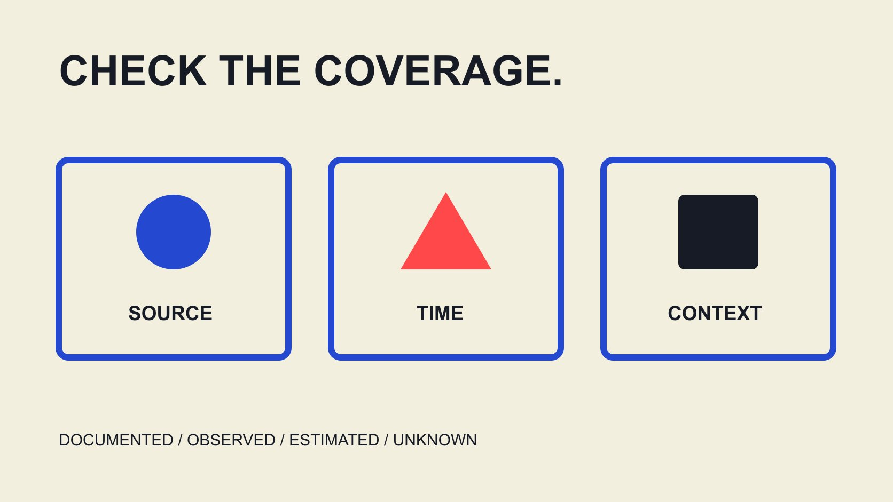

# Creator Audit Tools in 2026: Compare Evidence Coverage

Status: local review draft; confirm the publication date before release.

Compare creator-review tools in 2026 by evidence needs, refresh timing, definitions, content context and handoff, using public Modash, HypeAuditor and CreatorIQ documentation as examples.

QuickKOL editorial graphic; not actual account metrics or a platform interface.

For top creator audit tools 2026, define the review task before seeking an overall ranking. Public-data reading, audience estimates, content-context review, permission records and outcome verification need different evidence, and tools cover different parts. Using official Modash, HypeAuditor and CreatorIQ material read November 3, 2026, this guide illustrates comparisons of refresh cycles, score interpretation and review mechanisms. It includes no logged-in test or detection-accuracy validation. A tool can organize leads without letting one score replace source evidence, appropriate context and an accountable decision. Audit here describes a working review, not an independent assurance opinion or a guarantee that all relevant information is observable.

## Work backward from the decision to its evidence

Write the question first: whether work fits the assignment, data definitions align, a content passage suits this brand’s expression, or permission and delivery conditions are clear. One universal score cannot resolve all of these questions.

Separate observable records, platform- or partner-provided material, model estimates and human interpretation. Preserve sources and limits for each rather than let a tidy panel make different evidence states look equally confirmed.

The [pre-contract review-tool guide](/blog/influencer-vetting-tool-before-contract/#answer) helps define the stage. Here the comparison concerns evidence coverage, not another procurement checklist where more features automatically mean better suitability. A brand need not adopt every tool mentioned.

If the assignment only concerns organizing existing asset versions, audience-analysis capability is not a reason to expand collection. Match the choice to the actual question, access and handoff. A narrower tool can be sufficient when it preserves the needed evidence clearly; a broad suite still needs a reason for each capability the team intends to use.

## Modash example: fields need not share one update time

The [Modash refresh-cycle guide](https://help.modash.io/en/articles/5467354-profile-updates-how-often-data-refreshes) distinguishes very basic information updated at least weekly, basic information every two weeks and analysed information monthly, with individual cycles. This is the provider’s current documentation, not our observation that every profile updates on schedule.

Compare at field level: when were followers, interactions, audience estimates and content records observed and processed? An export date does not automatically mean that every input was recollected that day.

The [creator-data interpretation guide](/blog/read-creator-engagement-data/#answer) helps separate these times. If a suitable account trial is available, inspect needed fields and refresh information rather than infer one record’s complete state from a general help-page cycle.

We do not adopt database scale or always-fresh promotion as independent quality evidence, or guarantee coverage of every market or account. The verified research here concerns the published explanation of field tiers, not universal data accuracy. A useful evaluation records what the document says and identifies the particular field-level evidence still needed for the brand’s own assignment.

## HypeAuditor example: unpack the composite

The [HypeAuditor AQS guide](https://help.hypeauditor.com/en/articles/2221731-what-is-aqs-audience-quality-score-and-how-is-it-calculated), a help page dated June 21, 2022, describes AQS as a high-level composite from 1 to 100 and recommends deeper report reading. We use that definition and limitation without adopting unverified extensions such as low scores necessarily producing no sales.

A score can combine different dimensions. Inspect components, available fields, estimated states and interpretation. Do not translate it directly into an exact percentage of real people or equate it with another tool’s category.

Where an explanation is translated, retain the original language and passage. A translated summary does not establish correct handling of tone, irony or cultural context. Keep the interpretation pending when the underlying material needed for review is unavailable.

If only a total is visible, record the missing explanation instead of inventing component weights. To understand a change, return to inputs and versions rather than assume each point identifies a known behavioral cause.

A composite can organize questions without independently establishing purchased followers, deliberate deception, outcomes or complete suitability. These boundaries support fair use of information rather than deny every model output educational value. The relevant comparison asks whether the information needed to interpret this score is available, not merely whether its headline number is higher than a competing number.

## CreatorIQ example: distinguish content context and product plans

The [CreatorIQ 2026 product announcement](https://www.creatoriq.com/press/releases/applied-creator-intelligence), dated October 13, describes enhanced SafeIQ content-review context and decision trails, while distinguishing the first current Q deployment from full Q capabilities planned for early 2027. A roadmap should not be rewritten as wholly available today.

These are company product descriptions, not our validation of review speed, accuracy or complete language coverage. In particular, promotional time savings should not be presented as our test results.

For content review, ask whether users can return to the relevant passage, original expression, date and explanation, who can correct a misreading and how decisions are retained. A risk label stripped of context should not automatically become a conclusion about a person.

This comparison does not require acquiring private history to fulfill a comprehensive-review slogan. Appropriately scoped public or authorized records, task relevance and explainable handling are more useful than unverified whole-web coverage. The documentation helps prepare these questions without answering every one for a particular account, language or commercial plan.

## Build an evidence-coverage table with common fields

Record each candidate under common fields: task, input source, platform and window, definition, estimates, refresh, explanation, export and unknowns. Do not fill an unconfirmed capability with yes because it appears in a demonstration screenshot.

Separate public documentation, sales response and actual pilot findings. Each can be useful with different evidentiary strength. A button pictured on a website does not establish availability in the plan you would purchase.

For price, region and account permissions, retain only currently checkable information. Without a current quotation, publish no fixed-price ranking or assumption that one regional page defines worldwide conditions.

The table compares suitability without creating a universal moral score for people or providers. A tool can have clear documentation for one task and unknown coverage for another. The record need not force a winner in every row. That structure makes gaps explicit and gives the next conversation a concrete focus, instead of allowing unsupported cells to become facts through repeated copying.

## Use appropriate examples to inspect explanation and correction

If an actual pilot is arranged later, choose authorized, task-relevant material and state the intended checks. It can include context-sensitive expressions, missing fields and differing observation dates without constructing a negative dossier about an individual.

Inspect whether the tool shows source, interpretation limits and correction state. A model label is not a completed human finding, and an alternative human interpretation should retain its reasons rather than overwrite the underlying record.

We have not performed that pilot and claim no tool passed all such cases. Confirm the available plan, necessary access and appropriate materials before operation so testing does not expand unauthorized data access.

Record coverage, omissions and whether findings change adoption. A bounded pilot can support bounded use without becoming a claim of overall platform reliability or proof of individual authenticity. The exercise is most valuable when an unexpected result can narrow the conclusion, trigger correction or change the decision rather than be discarded to preserve an attractive product comparison.

## Do not lose evidence states during export

A polished overview may not be sufficient for handoff. Check retention of object identifiers, source times, definitions, model states, explanations and the current decision. Exporting only a final color can leave the next colleague unable to review the conclusion.

Export availability does not permit unlimited sharing. Assign access according to actual permission and work needs, rather than distribute unrelated private information because the system can download it.

When changing tools or observing again, preserve relationships between older and newer records. A changed value may reflect time, coverage or definition, not an equivalent behavioral change at the same moment.

The [collaboration-scope checklist](/blog/creator-contract-scope-checklist/#answer) develops commercial conditions further. A data-tool score cannot replace permission, actual work or a pricing response. A review can support a next question without automatically deciding every part of a partnership. Keeping that boundary visible also prevents a technically convenient export from becoming an unexplained commercial verdict in another team’s workflow.

## Avoid turning a scoped comparison into an unconditional ranking

A conclusion can say that a tool has clearer documentation for this assignment’s refresh checks, rather than that its data are permanently the most accurate. Another may suit content-context review while still needing actual material and access confirmation.

Preserve unknowns, including private plans, current quotations, particular-language performance and model errors. Without testing, do not use we tested and found as an authority device.

QuickKOL can help interpret a brief, research relevant work and prepare personalized contact. This article does not claim independent validation of every provider feature or place its own product first without comparable testing.

A responsible 2026 choice states the information-review date and conditions for checking again. When a product changes, update the relevant facts rather than change the year to conceal an older source or unverified capability. The comparison remains useful because its evidence and limits can be revisited, not because its ordering is presented as permanently settled.

## Hand off coverage rather than only a conclusion

The handoff includes required task, checked public documentation, actual pilot state, gaps, adoption scope and owner. Another colleague should know which question the tool can assist and which still needs original evidence.

Preserve the meaning of composites, estimates and content flags rather than promote them into personal facts or outcome guarantees. When key evidence is missing, narrow use or continue research instead of hiding the gap with more decimal places and colors.

A useful tool choice explains why it is used, where its use ends and when to stop for another check. That supports continuing projects and maintenance better than a top list without a method.

## Three evidence questions in public documentation

| Example | Information read | Verify next |

| --- | --- | --- |

| Modash | Different field-refresh cycles | Actual observation times for needed fields |

| HypeAuditor | High-level composite AQS definition | Components, states and interpretation |

| CreatorIQ | Review context and roadmap boundaries in 2026 release | Actual plan, coverage and decision trails |

Official material read November 3, 2026; not an exhaustive feature list, accuracy experiment or purchasing recommendation.

## Tool evidence-coverage checks

Keep public descriptions separate from actual validation.

- [ ] Define task and evidence object.

- [ ] Do not equate field time with export time.

- [ ] Do not turn a composite into a real-person percentage.

- [ ] Keep roadmap features distinct from current availability.

- [ ] Carry sources and corrections with records.

- [ ] State unknowns and adoption limits.

## Research date and limitations

Sources reviewed November 3, 2026. Methods, tables and decision rules are editorial recommendations. Hypothetical examples are not actual client results or industry benchmarks. Source geography and periods are specified where relevant. This draft is in independent local review; confirm its publication date before release.

## Sources

- [Modash refresh-cycle guide](https://help.modash.io/en/articles/5467354-profile-updates-how-often-data-refreshes)

- [HypeAuditor AQS guide](https://help.hypeauditor.com/en/articles/2221731-what-is-aqs-audience-quality-score-and-how-is-it-calculated)

- [CreatorIQ 2026 product announcement](https://www.creatoriq.com/press/releases/applied-creator-intelligence)
