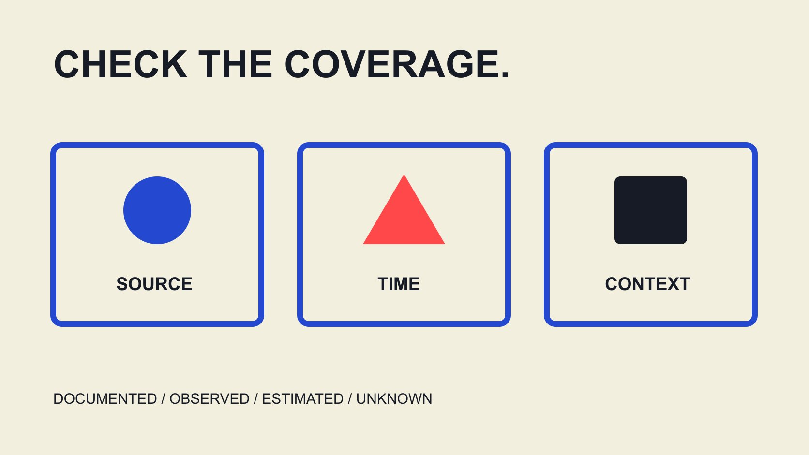

# 2026创作者审阅工具：按证据覆盖比较

状态：本地审阅稿；正式发布日期待确认。

比较2026创作者审阅工具时，先确定需要什么证据，再看更新、定义、内容语境与交接。用Modash、HypeAuditor和CreatorIQ公开资料示范核对方法。

QuickKOL 编辑图形；不呈现真实账号指标或平台界面。

寻找top creator audit tools 2026时，先定义审阅任务，而不是先找一个总排名。公开数据阅读、受众估计、内容语境审阅、许可记录与结果核验需要不同证据，工具覆盖也不同。本文依据2026年11月3日读取的Modash、HypeAuditor与CreatorIQ官方资料，示范怎样比较更新周期、分数解释与审阅机制；没有登录测试或验证检测准确率。工具可以整理线索，不能用一个分数替代原始依据、适当语境和人的决定，也不构成独立审计保证。

## 从决定倒推需要的证据

先写要回答的问题：是否理解作品任务、资料是否同口径、某段内容是否符合本次品牌表达，还是许可与交付条件是否清楚。它们不是一个万能评分可以同时解决的事。

把证据分成实际可观察记录、平台或合作方提供资料、模型估计与人工解释。每类保留来源与限制，避免一张整齐面板把不同状态都显示得像已确认事实。

[合作前核验工具指南](/zh/blog/influencer-vetting-tool-before-contract/#answer)可帮助界定阶段。本篇进一步比较证据覆盖，不复制一份功能越多就越好的采购清单，也不认定某个品牌必须采用全部工具。

如果任务只是整理已有素材版本，就不应因平台有受众分析而扩大收集范围。适当的工具选择应与实际问题、权限和交接需要相匹配。

## Modash示例：字段更新不共享一个时间

[Modash更新周期说明](https://help.modash.io/en/articles/5467354-profile-updates-how-often-data-refreshes)区分至少每周的极基础资料、每两周的基础资料和每月的分析资料，并说明资料有各自周期。这是供应商当前帮助页描述，不是本文观测到每份账号数据都按时更新。

因此比较时问到字段层面：粉丝、互动、受众估计和内容记录各自何时观察、何时处理。报表导出日不自动代表所有输入都在那天重新采集。

[创作者数据阅读指南](/zh/blog/read-creator-engagement-data/#answer)可以帮助区分这些时间。若有实际账户试用，再核对所需字段与更新信息，不从帮助页的一般周期推断某条具体记录的完整状态。

本文不采用资料规模或“始终最新”等宣传作为独立质量证明，也不保证每个市场或账号都覆盖。这里能确认的是公开文档怎样描述其字段分层，而不是全部数据准确。

## HypeAuditor示例：综合分需要拆开读

[HypeAuditor AQS说明](https://help.hypeauditor.com/en/articles/2221731-what-is-aqs-audience-quality-score-and-how-is-it-calculated)在2022年6月21日的帮助页中，将AQS描述为1至100的高层综合指标，并建议深入查看报告。本文引用这个定义与限制，不采用低分必然不带来销售等未经独立证实的延伸说法。

一个分数可能混合不同维度。比较时核对组成、可得字段、估计状态和解释，不把它直接翻译成精确的真实人数百分比，也不与另一工具的等级当作相同单位。

如果解释经过翻译，还要保留原始语言和具体片段。翻译摘要不能自动证明语气、讽刺或文化语境得到正确理解；资料缺失时，应将判断保留待复核。

如果只能看到总分，记录缺少解释；不要由编辑猜出每一项权重。需要了解评分为何改变时，回到具体输入与版本，而不是认为每一分变化都有明确行为原因。

综合指标可以辅助组织问题，但不能自行确认个人购买粉丝、故意误导、合作结果或完整适合度。保留这些边界有助公平使用资料，而不是否定所有模型输出的学习价值。

## CreatorIQ示例：区分内容语境与产品计划

[CreatorIQ 2026产品公告](https://www.creatoriq.com/press/releases/applied-creator-intelligence)于10月13日描述增强的SafeIQ内容审阅语境与决定记录，同时区分当前首个Q部署和计划于2027年初提供的完整Q能力。不能把路线图全部写成当前可用。

这些是公司发布的产品描述，不是本文验证的审阅速度、准确性或全部语言覆盖。尤其不把宣传中的节省时间写成自己的实测结果。

比较内容审阅时，问是否能回到具体片段、原始表达、日期与解释，谁能修正误读，以及如何保留决定依据。一个风险标签如果失去语境，不应自动成为个人结论。

本篇不需要取得私人历史来填满“全面审阅”口号。适当范围的公开或获授权资料、任务相关性与可解释处理，比未经核验的全网覆盖承诺更适合实际项目。

## 建立同字段的证据覆盖表

每个候选按相同字段记录：任务、输入来源、平台与窗口、字段定义、估计、更新时间、解释、导出和未知。未确认的能力不要根据演示截图填“有”。

公开文档、销售回应与实际试行结果分栏。它们都可能有用，但证据强度不同；网站出现按钮图，不表示你购买的计划中该功能一定可用。

对费用、地区与账号权限，只保留本次实际可核对信息。没有当前报价就不发布固定价格榜，也不从某一地区页面推断全球相同条件。

这种表格帮助比较适合度，不为人物或供应商制造通用道德分。它允许一个工具在某项任务资料较清楚、另一项仍未知，而不是强迫每一行都得出赢家。

## 用适当样例检验解释与修正路径

如果后续安排实际试行，先选择获授权且任务相关的材料，明确预期检查。可以包含语境容易误读的表达、缺失字段与不同观察日期，而不需要制造个人负面档案。

检验工具能否显示来源、解释限制与修正状态。模型给了一个标签，不等于人已经确认；人的不同解释也应保留依据，而不是简单覆盖原始记录。

本文没有执行该试行，因此不宣称任何工具在这些情形全部通过。操作前先确认可用计划、必要权限和适当资料，避免测试本身扩大未经授权的数据访问。

结果应写明覆盖与未覆盖，以及是否改变采用决定。一个有限试行可以支持有限采用，不必被包装成平台整体可靠性或识别个人真假的证明。

## 导出时不要丢掉证据和状态

漂亮的总览不一定足以交接。检查能否保留对象标识、来源时间、字段定义、模型状态、解释与当前决定；如果只导出最终颜色，下一位同事可能无法复核。

导出也不等于可以无限分享全部资料。按实际权限与任务需要分配访问，不因为系统可下载就把无关私人信息打包给所有人。

更换工具或重新观察时，保留旧版本与新记录的关系。数值改变可能来自时间、覆盖或定义，不一定说明某人的行为在同一时间发生相同程度变化。

[合作范围核对](/zh/blog/creator-contract-scope-checklist/#answer)可继续整理商业条件；数据工具的评分不能自行替代许可、实际工作与价格回应。审阅结果适合提出下一问题，而不是自动决定所有合作事项。

## 比较结果不变成无条件的工具排名

结论可以写“该工具对本次更新时间核对有较清楚文档”，而不是“它的数据永远最准确”。另一个工具可能更适合内容语境，但仍需实际材料与权限确认。

对未验证的事情保留未知，包含私人计划、当前报价、特定语言表现和模型误差。没有实测就不能用“我们测试后发现”作为权威包装。

QuickKOL可以帮助理解Brief、研究相关作品与准备个性化联系；本文不声称它已经独立验证这些供应商全部功能，也不将自己的产品排在未经同条件测试的第一名。

一个负责任的2026工具选择应说明资料阅读日期与未来重查条件。产品变化后更新相应事实，不通过更改年份掩盖旧来源或未验证功能。

## 交接证据覆盖，而不是只交一个结论

最终交接包括所需任务、已核对公开资料、实际试行状态、缺口、采用范围和负责人。让另一位同事知道哪种问题可以由工具帮助，哪种仍需回到原始依据。

综合分、估计与内容标记都保留原意，不升级为人物事实或结果保证。若关键证据缺失，缩小用途或继续研究，而不是用更多小数位与颜色掩盖它。

好的工具选择能说明为什么使用、用到哪里和何时停下来重新确认。这比一个没有方法的top列表更适合长期项目，也更容易在资料或产品变化时维护。

## 公开资料中的三种证据问题

| 例子 | 本次可读信息 | 继续核对 |

| --- | --- | --- |

| Modash | 不同字段更新周期 | 所需字段的实际观察时间 |

| HypeAuditor | AQS高层综合定义 | 组成、状态与解释 |

| CreatorIQ | 2026公告的审阅语境与计划边界 | 实际计划、资料覆盖与决定记录 |

2026年11月3日官方资料阅读；不是完整功能清单、准确率实验或采购推荐。

## 工具证据覆盖核对

保持公开描述与实际验证分开。

- [ ] 任务和证据对象明确。

- [ ] 字段时间没有混为导出时间。

- [ ] 综合分没有变成真实人数比例。

- [ ] 计划功能没有写成当前全量可用。

- [ ] 来源与修正能随记录交接。

- [ ] 未知与采用限制明确。

## 研究日期与使用边界

资料核验于 2026 年 11 月 3 日。文中方法、表格和决策规则为编辑建议，标为假设的示例不是实际客户结果或行业基准。外部资料的适用地区与时期按各段说明；本稿处于独立本地审阅阶段，正式发布日期待确认。

## 来源

- [Modash更新周期说明](https://help.modash.io/en/articles/5467354-profile-updates-how-often-data-refreshes)

- [HypeAuditor AQS说明](https://help.hypeauditor.com/en/articles/2221731-what-is-aqs-audience-quality-score-and-how-is-it-calculated)

- [CreatorIQ 2026产品公告](https://www.creatoriq.com/press/releases/applied-creator-intelligence)
