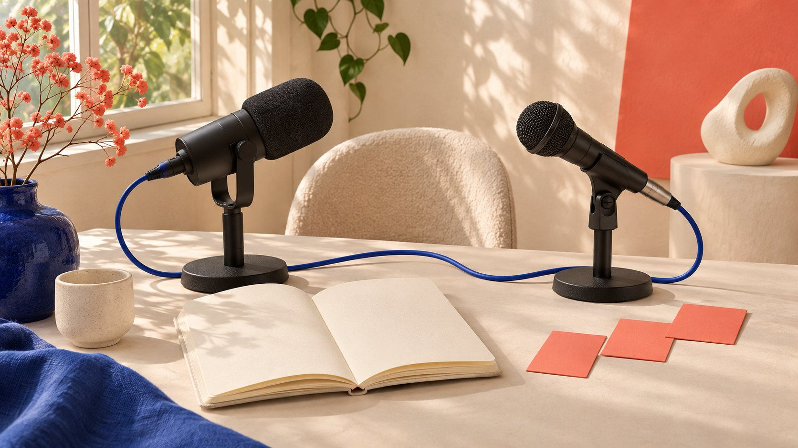

# Creator Collaboration and Fan-Base Growth: A 2025 Review

Status: local review draft; confirm the publication date before release.

Review a 2025 collaboration growth strategy through shared content value, follow pathways, subsequent experience and historical evidence. Exposure opportunity is not sustained following.

AI-generated editorial illustration, not an actual creator, client, product or event.

A review of an influencer collaboration strategy to grow a fan base in 2025 should ask what lasting value the collaboration offered, how people found the account worth following and whether subsequent content fulfilled that reason. Instagram’s August 2025 announcement introduced public post and Reel reposting with original-poster credit, describing a potential discovery opportunity rather than guaranteed new followers or retention. Evaluating that year’s strategy needs historical content, feature-availability records and matching metric windows. Today’s interface cannot fill a missing 2025 record. This guide supports retrospective interpretation and planning without promising a follower total or attributing every before-and-after change to one collaboration.

## Write the reason to follow before selecting a format

Shared content should explain why these two voices are useful together and what someone can continue to receive after following a particular account. A mutual mention can create a discovery lead without establishing sustained content value.

A brand can begin with a specific question, such as explaining a product choice or creative process together, and then assign contributions. Not every collaboration should prioritize follower growth; education, product understanding or service discussion may be more appropriate.

The [collaboration workflow guide](/blog/collaborate-with-influencers-brand-workflow/#answer) connects objectives to deliverables and owners. If growth is selected, identify the account, audience and subsequent content instead of adding two follower totals and naming the sum opportunity size.

These are editorial planning recommendations, not evidence that one format inherently works. Relevance, execution and response require specific records rather than a phrase such as crossing audiences. A clear reason to follow also makes a later review more informative: the team can inspect whether it delivered the promised continuing value instead of interpreting any visible increase as proof of a coherent strategy.

## Use 2025 records without backfilling today’s features

The [Instagram 2025 repost announcement](https://about.fb.com/news/2025/08/new-instagram-features-help-you-connect/) dated August 6, 2025 describes public-content reposting and credit to the original poster, with potential recommendation to the reposter’s followers. Retain potential rather than expand it into certain distribution.

A dated announcement establishes what was announced that year, not that every project account had the same interface on the same day, received identical recommendations or actually used the feature.

A retrospective record should include contemporaneous post links, screenshot dates, account and publishing method. A 2026 help page without historical versions supports a current explanation, not evidence of earlier settings.

If historical material is missing, state that use or availability at the time cannot be confirmed. Do not fill a complete-looking timeline with present-day operating experience disguised as past execution. A report can remain useful with a gap, provided the gap is visible and the conclusion does not depend on an event that the records fail to establish.

## Map the actual path from content to account

After seeing the content, can a viewer understand each participant’s contribution, which account to visit and why to keep watching? Retain actual credits, mentions, profile destination and follow rationale without assuming every viewer traverses every step.

A pathway helps identify communication gaps. It does not establish complete individual behavior tracking. Public pages generally cannot link a particular exposure to a particular follow, and unrelated private information should not be collected to fill that gap.

Suppose a co-created tutorial points to an ongoing series. Review whether the series exists, is easy to find and matches the promise. This is an editorial check, not a conversion guarantee.

Also distinguish the brand account’s objective from the creator account’s. Growth for one but not the other does not automatically mean failure. Return to mutually confirmed objectives and available observations. A shared project can have different intended contributions for each participant, so its evaluation should not silently replace those goals with whichever public metric is easiest to see.

## Make subsequent content fulfill the first follow’s expectation

If a collaboration creates a one-time event while subsequent account content is unrelated to the reason for following, record that experience gap as a possible issue. Do not automatically blame an algorithm when growth slows.

Assign follow-up topics, actual owners and a cadence the team can deliver. There is no mandatory publishing frequency here and no invented rule that a fixed number of consecutive days improves retention.

Participants can continue different contributions: one might explain product use while another develops the creative process. The connection should be genuine without requiring mechanically duplicated content on both accounts.

Review what was actually delivered rather than only the plan. Unpublished series, delayed posts and scope changes need visible states so the team can distinguish the hypothesis, execution and insufficient observation. This is also a practical check on whether the growth objective was supported by continuing work, instead of expecting one creator appearance to supply a permanent audience relationship without further value.

For example, if the promised follow-up has not been published, the same review point cannot establish that audiences rejected the continuing series. State its actual delivery status before describing available audience response. An execution gap and an audience response are different questions. Keeping them separate helps the next round decide whether to complete the promised work or reconsider its value proposition, rather than redraw a strategy around a reaction that was never observed.

## Separate follows, unfollows and net change

The [follower-observation guide](/blog/instagram-follower-tracker-campaign-observation/#answer) develops campaign-window records. Net change is the difference between ending and starting totals; it does not independently reveal follows, unfollows or each new follower’s source.

Suppose an account moves from 10,000 to 10,100, a net gain of 100. Only if reliable separate fields show 300 follows and 200 unfollows can those actions be described. Every number here is hypothetical, not actual account performance.

Without a source breakdown or matching attribution, do not credit all 100 to the collaboration. Other content, promotion, news or count revisions could matter; specific causes still need evidence.

Retain screenshot date, time zone, field and source. Do not fill missing data with zero or rename a supplier estimate platform-confirmed individual attribution. Keeping gross actions and net movement separate prevents a positive total from concealing a different audience pattern, while also preventing normal movement from being labeled a problem without context or supporting observations.

## Do not substitute interaction for a continuing audience

The [monthly-engagement interpretation guide](/blog/social-media-engagement-rate-monthly-explanation/#answer) separates within-group response from composition change. High engagement during a collaboration can motivate further questions without measuring sustained following or lasting brand preference.

Inspect relevant subsequent content response, visits and business records over an appropriate window, explaining what each field supports. Without person-level retention records, do not claim retention has been measured for a particular cohort of new followers.

Nor should one comment, like or unfollow become a definite statement of intent. Visible action and context can be retained, while satisfaction, dissatisfaction, purchase and abandonment need their own evidence.

Choose a review point suited to the assignment and explain the rationale. No universal number of days is prescribed; content cycles, products and available records require different arrangements. This keeps a report focused on what can be observed rather than creating a retention score simply because a growth strategy would be easier to present with one.

## Frame the next improvement as a reviewable hypothesis

The [Google experiment guide](https://support.google.com/google-ads/answer/7281575?hl=en) emphasizes objective, hypothesis and test variables in its Google Ads context. It can prompt advance question definition but does not establish a randomized Instagram collaboration experiment.

A next round might investigate whether a clearer series destination is associated with a relevant behavior improvement. If the design cannot support causal inference, call it an observational comparison and record other simultaneous content and distribution changes.

Do not change partner, topic, media budget and account positioning together, then credit every difference to one new call to action. If several changes are necessary, preserve them honestly and narrow the conclusion.

Define required evidence before execution instead of selecting metrics after results appear. An unsupported hypothesis can still produce useful learning without redefining success for the sake of a growth story. The record should say what was tested or observed, which assumptions survived review and what the team would need to know before investing in the same approach again.

## Return follower growth to the broader business question

The [AMEC evaluation framework](https://amecorg.com/amecframework/) separates communication outputs, audience changes and organizational outcomes. New follows can be one observation without automatically establishing sales, profit or stronger partnership relationships.

The [campaign-measurement guide](/blog/creator-campaign-measurement/#answer) clarifies objective levels. If the real assignment addresses presale questions or product adoption, retain matching records rather than define all success by a publicly visible follower count.

This does not mean follower counts have no value. Their usefulness depends on the question, content and evidence about subsequent behavior. Explain why the field is observed and what it cannot answer independently.

A 2025 review can therefore preserve the original objective while allowing the next round to change based on learning. It need not use an ever-larger total to prove every decision was correct. A report that distinguishes these levels gives stakeholders a clearer basis for deciding which activity deserves continuation and which question still lacks evidence.

## Hand off a strategy review with historical boundaries

Hand off historical objectives, content, feature documentation, actual execution, observation windows, metric definitions and unknowns. Keep plans, announcements, actions and outcomes separate.

A useful review of a 2025 collaboration growth strategy explains shared value, audience pathway, subsequent delivery and the strength of the supported conclusion. Missing historical records remain missing.

QuickKOL can help research relevant creators’ work and prepare the next assignment. Growth, permission, execution and business outcomes require actual evidence. Establish an explainable reason to follow before expanding the collaboration.

## Roles of different evidence in a 2025 review

| Evidence | Can support | Does not establish |

| --- | --- | --- |

| Dated feature announcement | What was publicly announced then | Every account used it successfully |

| Content and destination | Visible value and pathway | Every viewer followed the full path |

| Starting and ending totals | Net change in a specified window | Gross follows, unfollows and complete attribution |

| Subsequent content record | Whether promised work was delivered | Retention measured for a specific follower cohort |

10,000→10,100, 300 follows and 200 unfollows are hypothetical, not actual account results or an industry target.

## Collaboration growth-review checklist

Use actual historical records; no follower prediction.

- [ ] Why was the shared content worth continuing to follow?

- [ ] Is feature evidence dated to that year?

- [ ] Do actual destination and follow-up match?

- [ ] Are gross follows, unfollows and net change separate?

- [ ] Does the conclusion exceed design or records?

- [ ] Are next-round hypothesis and evidence defined in advance?

## Research date and limitations

Sources reviewed November 3, 2026. Methods, tables and decision rules are editorial recommendations. Hypothetical examples are not actual client results or industry benchmarks. Source geography and periods are specified where relevant. This draft is in independent local review; confirm its publication date before release.

## Sources

- [Instagram 2025 repost announcement](https://about.fb.com/news/2025/08/new-instagram-features-help-you-connect/)

- [Google experiment guide](https://support.google.com/google-ads/answer/7281575?hl=en)

- [AMEC evaluation framework](https://amecorg.com/amecframework/)
